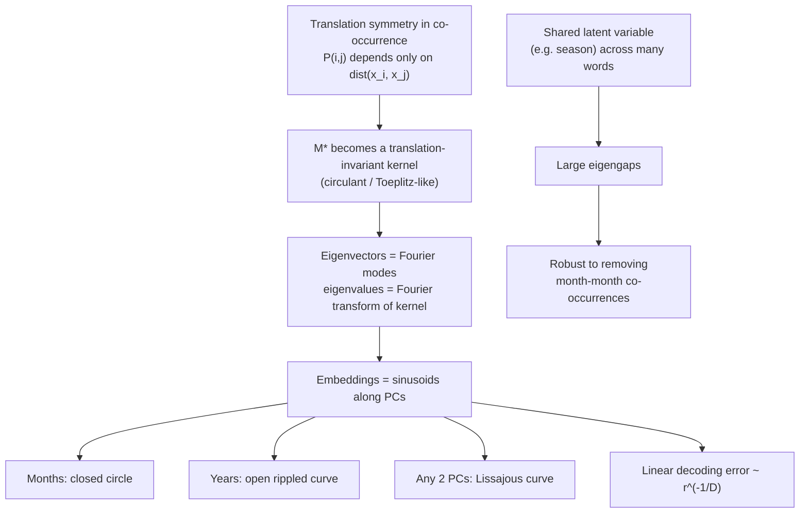

# Symmetry in language statistics shapes the geometry of model representations

> **언어 통계의 symmetry가 model representation의 geometry를 만든다**: 월(month)이 원을 그리고, 연도(year)가 휘어진 곡선을 이루고, 도시 좌표가 linear하게 decode되는 이유는 **word co-occurrence statistics의 translation symmetry** 때문이다.

| 항목 | 내용 |
|---|---|
| Authors | Dhruva Karkada (UC Berkeley, Google DeepMind 인턴 중 일부 수행), Daniel J. Korchinski (EPFL), Andres Nava (Johns Hopkins), Matthieu Wyart (EPFL, Johns Hopkins), Yasaman Bahri (Google DeepMind) |
| Venue | **ICML 2026** (43rd International Conference on Machine Learning, Seoul), PMLR 306 |
| arXiv | [2602.15029](https://arxiv.org/abs/2602.15029) (v3 기준) |
| Code | [github.com/dkarkada/symmetry-stats-repgeom](https://github.com/dkarkada/symmetry-stats-repgeom) |
| Models | Wikipedia **word embeddings** (spectral word2vec), **EmbeddingGemma** (308M), **Gemma 2 2B** |

---

## 목차

1. [TL;DR](#tldr)
2. [Background & Motivation](#1-background--motivation)
3. [Preliminaries: Embedding = Co-occurrence의 Spectral 분해](#2-preliminaries-embedding--co-occurrence의-spectral-분해)
4. [Theory: Translation Symmetry → Fourier Geometry](#3-theory-translation-symmetry--fourier-geometry)
5. [Experiments: Theory vs Word Embeddings vs LLMs](#4-experiments-theory-vs-word-embeddings-vs-llms)
6. [Collective Effects: 왜 Geometry가 Robust한가](#5-collective-effects-왜-geometry가-robust한가)
7. [Appendix Evidence 정리](#6-appendix-evidence-정리)
8. [Discussion](#7-discussion)
9. [Limitations](#8-limitations)
10. [Takeaways](#9-takeaways)

---

## TL;DR

- **관찰된 현상**: language model 내부에는 놀랍도록 규칙적인 **representation geometry**가 있다.
  - **Calendar months**는 **원(circle)** 을 이룬다.
  - **Historical years**는 물결치는(rippled) **1D curved manifold**를 이룬다.
  - **도시·주의 위경도**는 representation에서 **linearly decodable**하다.
- **핵심 주장**: 이 geometry는 **word co-occurrence statistics의 translation symmetry**에서 나온다. 두 개념(예: 3월과 5월)이 함께 등장하는 확률이 **두 개념 사이의 거리에만 의존**한다는 성질이다.
- **Theory**: 이 symmetry가 있으면 co-occurrence matrix가 **translation-invariant kernel**이 되고, 그 eigenvector는 **Fourier mode(sin, cos)** 가 된다. 그래서 embedding이 sinusoid가 되고, 결과적으로 **circle, Lissajous curve, ripple**이 생긴다.
- **Prediction 검증**: theory의 예측이 Wikipedia **word embedding**, **EmbeddingGemma**, **Gemma 2 2B**에서 모두 정성적으로 맞았다.
- **Linear decoding**: top $`r`$개 principal component로 좌표를 decode하는 error가 $`r^{-1/D}`$로 줄어든다는 bound를 증명했다(1D면 약 $`1/r`$).
- **Robustness**: **월-월 co-occurrence를 전부 0으로 지워도** 월 embedding은 여전히 원을 그린다. "ski", "beach" 같은 수많은 **seasonal word**가 공유하는 **latent variable**(계절)이 이 구조를 집단적으로(collectively) 지탱하기 때문이다.

---

## 1. Background & Motivation

### 1.1 이미 알려진 기하학적 현상들
선행 연구들은 model representation에서 다양한 구조를 관찰했다.

| 현상 | 예시 | 대표 연구 |
|---|---|---|
| **Prism / parallelogram** | king − man + woman ≈ queen | Mikolov et al. (2013), Park et al. (2024), Merullo et al. (2024) |
| **Loops / circles** | 요일, 월이 원을 이룸 | Engels et al. (2025, "Not all language model features are one-dimensionally linear"), Modell et al. (2025) |
| **Rippled 1D manifolds** | 연도, 숫자가 물결치는 곡선 | Gurnee et al. (2025) |
| **Linear space & time** | 도시 위경도, 사건 연도를 linear probe로 decode | Gurnee & Tegmark (2024) |
| **Modular arithmetic** | 원형 representation으로 modular addition 수행 | Gromov (2023) |

그러나 이 현상들을 **하나로 설명하는 organizing principle은 없었다.**

### 1.2 Hypothesis
1. Representation geometry는 **pairwise word co-occurrence statistics**를 반영한다.
2. 그 statistics에 있는 **symmetry**가 manifold 형태를 결정한다.

### 1.3 이 논문이 설명하는 것
- **Cyclic concept**(월)의 **circular representation**. 이것이 modular arithmetic을 도울 수 있다.
- **Continuous sequence**(연도)의 **rippled 1D manifold**. **Higher harmonics**가 extrinsic curvature(물결)를 만든다.
- **Spatial / temporal coordinate**의 **linear decoding**

### 1.4 Contributions
1. word2vec 계열 model에서 manifold를 실증적으로 관찰
2. 실제 co-occurrence data에 **translation symmetry**가 있다는 증거
3. Manifold geometry에 대한 **analytic prediction**
4. 더 큰 model(text embedding model, LLM)에서의 검증
5. **Decoding error scaling** theory
6. Statistics를 교란해도 geometry가 유지된다는 **robustness** 결과
7. Robustness를 설명하는 **latent variable model**

### 1.5 전체 논리 흐름



---

## 2. Preliminaries: Embedding = Co-occurrence의 Spectral 분해

### 2.1 Notation과 target matrix
- $`P_{ij}`$: word $`i`$, $`j`$의 **pairwise co-occurrence probability**
- $`P_i = \sum_j P_{ij}`$: **unigram probability**
- **Target matrix** (Eq. 1):

```math
M^\star_{(ij)} = \frac{P_{ij} - P_i P_j}{\tfrac{1}{2}\left(P_{ij} + P_i P_j\right)} \approx \log\frac{P_{ij}}{P_i P_j}
```

즉 $`M^\star`$는 **PMI**(pointwise mutual information)의 근사다. Appendix B에서 $`\Delta(x) = 2x/(2-x)`$로 두면 $`\mathrm{PMI} = x + x^3/12 + x^5/80 + \cdots`$로 전개됨을 보인다.

### 2.2 word2vec ≈ symmetric factorization
- Karkada et al. (2025)에 따르면 word2vec은 근사적으로 다음 **symmetric factorization**과 같다.

```math
\min_W \left\| W W^\top - M^\star \right\|_F^2
```

- $`M^\star = \Phi \Lambda^\star \Phi^\top`$로 eigendecomposition하면 학습된 embedding은 (Eq. 2):

```math
\mathbf{W}_{(i\mu)} = \Phi_{(i\mu)} \sqrt{\left|\Lambda^\star_{(\mu\mu)}\right|}
```

- 즉 embedding은 $`M^\star`$의 **top eigenmode**를 담는다.
- ⚠️ 이 논문의 실험은 **SGNS로 train하지 않고**, $`M^\star`$를 직접 diagonalize해서 embedding을 얻는다(**spectral** 방식).
- Context matrix를 따로 두는 **asymmetric factorization**은 $`M^\star`$ 대신 matrix absolute value $`|M^\star|`$를 복원한다(Appendix B.2).

### 2.3 PCA와 Gram matrix (Section 2.1)
특정 word subset $`\mathcal{S}`$(예: 12개 월)의 geometry를 보려면:

1. Centering matrix $`P = I - |\mathcal{S}|^{-1}\mathbf{1}\mathbf{1}^\top`$로 embedding을 center한다.
2. Compact SVD $`W_{\mathcal{S}} = \Phi \Lambda^{1/2} U^\top`$를 구하면, **PCA coordinate**는 $`\overline{W}_{\mathcal{S}} = \Phi \Lambda^{1/2}`$다.
3. PCA는 **Gram matrix를 보존**한다.
4. $`d \ge \mathrm{rank}\, M^\star`$이면:

```math
\overline{W}_{\mathcal{S}} \overline{W}_{\mathcal{S}}^\top = P\, M^\star_{\mathcal{S}}\, P^\top
```

→ **핵심 통찰**: subset의 representation geometry는 그 subset의 **centered co-occurrence submatrix**로 결정된다. 그래서 co-occurrence statistics의 구조를 알면 geometry를 예측할 수 있다.

---

## 3. Theory: Translation Symmetry → Fourier Geometry

### 3.1 Setup
- 개념들이 **latent continuum** 위에 놓여 있다고 본다. 각 word $`i`$의 좌표는 $`x_i \in \mathbb{R}^D`$다.
  - 월: 1D, **periodic boundary** (12월 다음이 1월)
  - 연도: 1D, **open boundary**
  - 미국 주: 2D(위경도), open boundary
- **Assumption 3.1 (translation symmetry)**:

```math
P_{ij} = P_i P_j \, \tilde{C}\big(\mathrm{dist}(x_i, x_j)\big)
\quad\Longrightarrow\quad
M^\star_{(ij)} = C\big(\mathrm{dist}(x_i, x_j)\big), \qquad C = f \circ \tilde{C}, \quad f(y) = \frac{2(y-1)}{y+1}
```

→ unigram frequency를 빼고 나면, 두 개념이 함께 등장하는 경향은 **둘 사이의 거리에만** 의존한다. 예: "March"와 "April"은 "March"와 "September"보다 자주 함께 나온다.

### 3.2 Proposition 1: Fourier geometry (periodic lattice)
Translation-invariant kernel은 **Fourier mode로 diagonalize**된다. Periodic lattice에서 wavevector $`k_\mu = \pi n`$, kernel $`m(x) = C(\mathrm{dist}(x, \mathbf{0}))`$의 DFT를 $`\tilde{m}`$이라 하면 eigenvalue는 $`\lambda_\mu = \tilde{m}(k_\mu)`$이고, PCA embedding은 **sinusoid**가 된다.

```math
\overline{w}_i = \sqrt{\tfrac{2}{|\mathcal{S}|}} \Big[ \sqrt{\lambda_1}\cos(k_1^\top x_i),\; \sqrt{\lambda_1}\sin(k_1^\top x_i),\; \sqrt{\lambda_2}\cos(k_2^\top x_i),\; \dots \Big]
```

- 각 principal component 방향의 **amplitude**는 $`\sqrt{\lambda_\mu}`$, 즉 **kernel의 Fourier transform**으로 정해진다.

### 3.3 Corollary 2: Months → 닫힌 원
- **Periodized exponential kernel** ($`D = 1`$): $`C(\Delta x) = \sum_{n \in \mathbb{Z}} \exp(-|\Delta x + 2n| / \sigma)`$
- Wavenumber는 **정수 배** $`k_n = \pi n`$이고, amplitude는:

```math
\lim_{|\mathcal{S}| \to \infty} a_n = \sqrt{\frac{2\sigma}{1 + \sigma^2 k_n^2}}
```

- → **Integer frequency**를 가진 **closed loop**. 첫 두 PC($`\cos`$, $`\sin`$ of $`k_1`$)가 정확히 **원**을 그린다.
- Amplitude가 $`k_n`$이 커질수록 줄어들므로, top PC일수록 **느린(slow) mode**를 담는다.

### 3.4 Proposition 3: Years → 열린 곡선
- **Open boundary**, exponential kernel $`C(\Delta x) = \exp(-|\Delta x| / \sigma)`$
- Continuum limit에서 embedding은 parity가 번갈아 나오는 $`a_n \sin_{k_n}(k_n x_i)`$ 또는 $`a_n \cos_{k_n}(k_n x_i)`$다. 여기서 $`\sin_{k_n}`$, $`\cos_{k_n}`$은 $`[-1, 1]`$에서 mean-zero, unit-normalized된 함수다.
- Wavenumber는 다음 **self-consistent quantization condition** (Eq. 8)을 만족한다($`k_n < k_{n+1}`$).

```math
k_n =
\begin{cases}
\dfrac{(n+1)\pi}{2} - \tan^{-1}(\sigma k_n), & n \text{ odd} \\[2mm]
\dfrac{n\pi}{2} + \tan^{-1}\!\left(\dfrac{k_n}{1 + \sigma(1+\sigma)k_n^2}\right), & n \text{ even}
\end{cases}
```

- Amplitude는 months와 같은 형태 $`a_n = \sqrt{2\sigma / (1 + \sigma^2 k_n^2)}`$다.
- → **Non-integer frequency**를 가진 **open curve**. 양 끝이 이어지지 않는다. 3D에서 보면 higher harmonic 때문에 **ripple**(물결)이 생긴다.

### 3.5 Beyond the lattice: US states (Section 3.1)
- 미국 주는 regular lattice 위에 있지 않다. 그래도 $`M^\star`$를 **numerical diagonalize**하면 top mode는 여전히 **천천히 변하는(slowly varying)** 함수다.
- **Latent space**: 각 주 centroid의 위도·경도, 2D open boundary
- **Distance**: 미국 본토에서 1도×1도의 가로세로 비율을 반영해 $`d_{ij} = \sqrt{(x_i - x_j)^2 + 0.78\,(y_i - y_j)^2}`$
- **Theory model**: $`M^\star_{(ij)} = 10 \exp(-d_{ij} / 20)`$. 상수는 visual inspection으로 정했다.

### 3.6 New predictions (Section 3.2)
1. **Lissajous curves**: 아무 두 PC로 projection하면 $`(x(t), y(t)) = (A \sin(at),\; B \sin(bt + \delta))`$ 꼴의 **Lissajous curve**가 된다.
2. **Slow modes first**: amplitude가 wavenumber에 대해 monotone하게 줄어들므로 top PC는 slow mode를 담는다. 2D projection에서는 원이나 열린 고리가 보이고, 3D에서는 higher harmonic이 **ripple**로 보인다.
3. **Proposition 4 (linear decoding)**: top $`r`$개 PC 위의 linear probe로 latent coordinate를 decode하면, error가 다음 bound를 만족한다($`\mathrm{Vol}_D`$는 unit $`D`$-sphere의 volume).

```math
\lim_{|\mathcal{S}| \to \infty} \varepsilon^2(r) \le \frac{6}{\pi^2} \left( \left( \frac{r}{\mathrm{Vol}_D} \right)^{1/D} - \frac{\sqrt{D}}{2} \right)^{-1},
\qquad \varepsilon^2 \sim r^{-1/D}
```

- → **1D**(연도)에서는 $`\varepsilon^2 \sim 1/r`$. Eigenvalue가 $`|k|`$에 대해 감소하기만 하면, **low-pass된 Fourier mode만으로 좌표를 decode**할 수 있다. 이것이 Gurnee & Tegmark의 "LLM이 space와 time을 linear하게 표현한다"는 관찰을 설명한다.

---

## 4. Experiments: Theory vs Word Embeddings vs LLMs

### 4.1 Setup (Appendix A)

| 항목 | 설정 |
|---|---|
| **Corpus** | English Wikipedia (2023년 11월 dump). Lowercase, 쉼표·소수점 있는 숫자 제거, 200 tokens 미만 article 제외 → **3.37M articles, 2.72B tokens** |
| **Vocabulary** | 가장 빈번한 **25,000 words** ($`V = 25{,}000`$) |
| **Co-occurrence** | Skip-gram counts, **context window 16**, distance weight $`f(d) = L + 1 - d`$ (word2vec의 randomized window를 모방) |
| **Word embeddings** | $`M^\star`$를 직접 diagonalize (spectral word2vec) |
| **Text embedding model** | **EmbeddingGemma**: 308M parameters, 768-d, unit-normalized |
| **LLM** | **Gemma 2 2B**: hidden size 2304, vocabulary 256K, layers 0–25, `blocks.{l}.hook_resid_post`의 **residual stream**, **final token** 위치 |
| **LLM prompts** | "The month of the year is x", "In the year x", "The location of the US state x" |

**Translation symmetry가 실제로 있는가?** Appendix C의 Figure 5, 6은 실제 Wikipedia co-occurrence에서 월과 연도의 $`M^\star`$ 값이 **거리에 따라서만** 변하는지 보여준다. 월에는 **periodized exponential kernel**, 연도에는 **shifted exponential kernel**을 fit했고, 저자들은 main diagonal을 제외하면 "excellent agreement"라고 보고한다.

<p align="center">
  
  
  <br>
  
  
</p>

*Figure 5 (alphaXiv가 논문에서 추출한 이미지 4장). 월 co-occurrence의 translation symmetry. 순서대로 $`M^\star`$, $`|M^\star|`$, positive part $`M^+`$, negative part $`M^-`$다. 각각 왼쪽은 12개 월의 submatrix, 오른쪽은 월 간격별 평균과 exponential kernel fit이다($`M^\star`$에서 $`\sigma = 4.2`$). "May" 행·열만 유독 어두운데, 4.2의 다의어 문제와 같은 맥락으로 보인다.*

<p align="center">
  
  
  <br>
  
  
</p>

*Figure 6 (alphaXiv가 논문에서 추출한 이미지 4장). 연도에 대한 같은 분석이고 배치도 같다. 오른쪽 패널은 연도 차이별 평균(shifted, log scale)과 exponential kernel fit이다($`M^\star`$에서 $`\sigma = 125`$). $`M^\star`$ 패널을 보면 점선(약 ±80년) 바깥에서는 fit과 잘 맞고, 안쪽에서는 실제 값이 kernel보다 낮게 눌려 있다.*

### 4.2 Figure 1: Months와 Years


*Figure 1 (alphaXiv가 논문에서 추출한 이미지). Translation symmetry에서 나오는 cyclic representation manifold. 윗줄은 theory(월: Corollary 2, 연도: Proposition 3, kernel parameter는 corpus statistics에서 추정), 가운뎃줄은 Wikipedia word embedding, 아랫줄은 Gemma 2 2B representation이다. 각각 PCA embedding과 Gram matrix를 보여준다.*

- **Months**: theory, word embedding, LLM 모두 **원**을 그린다. Gram matrix는 theory가 예측하는 **circulant** 패턴(월 간격에만 의존)을 따른다.
- **Years**: 세 경우 모두 **열린 곡선**이다.
- 세부 사항:
  - **"May" 제외**: word embedding PCA basis에서 "May"를 뺐다. "~일지도 모른다/~해도 된다"라는 다른 의미가 섞여 위치를 왜곡하기 때문이다.
  - **Digit tokenization**: Gemma의 연도 Gram matrix에는 끝자리가 같은 연도(1735, 1835, 1935) 사이에 **대각선 줄무늬**가 보인다. 숫자를 자릿수별로 tokenize하기 때문이다.
  - 월은 **centered** Gram matrix, 연도는 **uncentered** Gram matrix를 썼다.


*Figure 11 (alphaXiv가 논문에서 추출한 이미지). 연도 word embedding의 eigenmode 1–8(파란색)에 theory(빨간색)를 겹쳐 그렸다. Mode 번호가 올라갈수록 진동수가 높아지고, 낮은 mode일수록 theory와 잘 맞는다.*

### 4.3 Figure 2: Lissajous curves와 linear decoding


*Figure 2 (alphaXiv가 논문에서 추출한 이미지). Lattice translation symmetry가 만드는 Lissajous curve와 연도의 linear decoding. 왼쪽은 연도 embedding을 PC 쌍에 projection한 Lissajous curve, 오른쪽은 PC rank $`r`$에 따른 linear probe의 decoding error다.*

- **왼쪽 (Lissajous)**: 연도 embedding을 PC 쌍에 projection하면 예측대로 Lissajous curve가 나온다. 곡선에 **꺾인 곳(kink)이 WWI와 WWII 부근**에 있다. 저자들은 그 시기를 다루는 Wikipedia 문서가 유난히 많아 translation symmetry가 **약하게 깨지기** 때문이라고 해석한다.
- **오른쪽 (decoding)**:
  - 연도 **1900–2020**, rank $`r`$마다 **100 trials**, train **60개** / test **60개** 무작위 split
  - **Ridgeless regression**(정규화 없는 linear probe). 점은 평균 error, 막대는 표준편차다.
  - Error가 Proposition 4의 예측대로 약 $`1/r`$로 줄어든다.
  - $`r = n_{\text{train}} = 60`$에서 **interpolation threshold**에 걸려 test error가 튀는 **double descent** peak가 생긴다. Ridge regularization을 쓰면 이 peak가 사라진다(Figure 13).

<p align="center">
  
  
</p>

*Figure 13 (alphaXiv가 논문에서 추출한 이미지 2장). 왼쪽은 ridge regularization을 최적으로 골랐을 때의 decoding error로, double descent peak가 없다. 오른쪽은 비교용으로 다시 실은 Figure 2의 오른쪽 패널(ridgeless)이다.*

### 4.4 Figure 3: US states (2D)
- **48개 contiguous US states**의 top PCA mode를 비교했다. 열 순서는 theory, Wikipedia word embedding($`d = 1000`$), **EmbeddingGemma**, **Gemma 2 2B**(layer 6 activation), word embedding($`d = 25000`$)이다.
- 모든 model에서 top mode가 지도 위에서 **천천히 변하는(slowly varying) 2D 패턴**을 보인다. Theory가 예측하는 low-frequency mode와 닮은 모양이고, 이것이 위경도가 linearly decodable한 이유다.
- Gemma 2 2B의 **첫 번째 eigenmode는 제외**했다. 여러 token으로 쪼개지는 주 이름의 **tokenization** 효과를 반영하기 때문이다.
- 저자들은 theory와 model의 일치를 **qualitative agreement**라고 표현한다.


*Figure 3 (alphaXiv가 논문에서 추출한 이미지). 주마다 top PCA mode 값을 색으로 칠했다. 색 범위는 패널마다 다르다. Gemma 2 2B 열만 mode 2–4이고 나머지 열은 mode 1–3이다.*

<p align="center">
  
  
  <br>
  
  
</p>

*Figure 12 (alphaXiv가 논문에서 추출한 이미지 4장). US states의 Gram matrix로, 순서대로 theory, word embedding, Gemma 2 2B, EmbeddingGemma다. 주를 지역별로 묶어 대체로 동부에서 서부 순으로 늘어놓았고, 대각선 근처에 밝은 block이 생긴다. 즉 가까운 주끼리 Gram matrix 값이 크다.*

### 4.5 Calendar dates와 "Calendar Pringles"


*Figure 9 (alphaXiv가 논문에서 추출한 이미지). **365개 calendar date**(날짜를 한 단어로 tokenize) embedding을 PC 쌍에 projection한 Lissajous curve를 theory와 비교한다.*

- **Figure 8, "Calendar Pringles"**: 월 embedding을 세 번째 mode까지 3D로 그리면 **말안장(saddle) 모양**, 즉 감자칩 Pringles 같은 형태가 된다. 두 번째 harmonic이 원 위에 물결을 얹기 때문이다.

<p align="center">
  
  
  
</p>

*Figure 8, "Calendar Pringles" (alphaXiv가 논문에서 추출한 이미지 3장). 월 embedding을 PCA axis 3까지 3D로 그렸다. 왼쪽부터 theory, word embedding, Gemma 2 2B다.*

### 4.6 2D lattice (Figure 10)와 정오표
- $`4 \times 4`$, $`31 \times 31`$ grid처럼 **open boundary 2D lattice**에서 embedding geometry를 보여준다.

<p align="center">
  
  
  
  
</p>

*Figure 10 (alphaXiv가 논문에서 추출한 이미지 4장, 논문 게재본 그대로). 왼쪽 두 장은 $`4 \times 4`$ lattice, 오른쪽 두 장은 $`31 \times 31`$ lattice이고, 각각 PCA axis 1–2 projection과 3D 그림이다. 3D 그림의 "PCA axis 3" 라벨이 바로 아래 정오표의 대상이다.*

- ⚠️ 저자 저장소의 **errata**: 논문 Figure 10에서 "PCA axis 3"이라고 표시된 축은 실제로는 둘 다 **PCA axis 4**다. 수정본은 아래와 같다.

<p align="center">
  
</p>

*저자 저장소의 Figure 10 수정본 (`errata/fig10-corrected.png`).*

---

## 5. Collective Effects: 왜 Geometry가 Robust한가

### 5.1 Ablation: 월-월 co-occurrence를 전부 지우면?
Section 2.3에 따르면 full dimension($`d = V`$)에서 Gram matrix는 co-occurrence submatrix와 같다. 그렇다면 **월끼리의 co-occurrence를 모두 0으로 지우면** 원이 사라져야 할 것 같다.

- **설정**: Wikipedia, $`V = 2.5 \times 10^4`$, $`d = 10^3 \ll V`$. 월-월 co-occurrence를 모두 0으로 만들고($`M^\star_{\mathcal{S}} = 0`$), "May"는 PCA에서 제외했다.
- **결과**: **원형 월 embedding이 그대로 복원된다.**


*Figure 4 (alphaXiv가 논문에서 추출한 이미지). **왼쪽**: 월-월 co-occurrence를 지운 뒤에도 full vocabulary embedding에서 월이 원을 그린다. **오른쪽**: 12개 월에 계절성이 강한 helper word 10개를 더한 submatrix로 재구성한 결과다. 월-월 entry는 여전히 0이고, "May"도 포함했으며, centered Gram matrix를 썼다.*

### 5.2 Mechanism: seasonal word가 공유하는 latent variable
- 많은 단어가 **특정 계절과 함께 등장**한다. 예: "ski"는 12월, "beach"는 8월과 자주 나온다.
- 이런 **seasonal word**들은 **계절이라는 latent variable**을 공유한다. 이것이 전체 PMI matrix에서 **큰 eigenvalue**를 만든다.
- 월 representation은 월끼리의 직접적인 co-occurrence가 아니라, **수천 개 단어와의 관계 전체**에 의해 결정된다. 그래서 일부 entry를 바꿔도 거의 흔들리지 않는다.

### 5.3 Shared continuous latent variable model (Section 4.1)
- 각 word $`i`$에 **seasonal center** $`t_i`$가 있고, 시점 $`t`$에서 word가 등장할 확률을 다음과 같이 둔다.

```math
P(i \mid t) = P(i)\,\big(1 + g(t - t_i)\big)
```

- 시간 $`t`$에 대해 marginalize하면:

```math
P(i, j) = P(i)\,P(j)\,\Big[1 + \tilde{K}(t_i - t_j)\Big], \qquad \tilde{K}(\Delta) = \frac{1}{T}\int g(u)\,g(u + \Delta)\,du
```

- 따라서 $`\mathrm{PMI} = \log\big(1 + \tilde{K}(t_i - t_j)\big)`$이고, 이는 $`t_i - t_j`$에만 의존하는 **circulant matrix**다. 즉 **translation symmetry가 단어 전체 수준에서 자연스럽게 생긴다.**

### 5.4 왜 robust한가 (Section 4.1.1)
- Circulant kernel은 **Fourier mode로 diagonalize**된다.
- **Eigengap이 단어 수 $`N`$에 비례해 커진다.**
- **Weyl inequality**나 **Davis–Kahan theorem**에 따르면, eigengap이 크면 고정된 개수의 entry를 바꿔도(예: 월-월 144개) **top eigenvector는 거의 변하지 않는다.**
- → Geometry는 소수의 특정 co-occurrence가 아니라 **집단적(collective) 효과**에서 나온다.

### 5.5 Helper words 실험 (Appendix C.1)
- **Seasonality 점수**: word와 월의 affinity를 complex phase $`e^{i 2\pi m / 12}`$로 가중한 $`A = Q_{\text{words}}\, Q_{\text{months}}^\dagger`$의 **phase**로 각 단어의 "계절 위치"를 매긴다.
- **Top-100 seasonal words**만으로도 **월 순서가 올바르게 재구성**된다(Figure 16).
- **Control**: 계절성이 없는 숫자 단어 "one"~"seventeen"으로는 월 순서가 **재구성되지 않는다**(Figure 15).
- **Procrustes reconstruction error**는 helper word 수 $`H`$에 대해 약 $`1/\sqrt{H}`$로 줄어든다. **Seasonal helper가 random helper보다 훨씬 좋다**(Figure 17).


*Figure 15 (alphaXiv가 논문에서 추출한 이미지). Control 실험. 숫자 단어("one"~"seventeen")와 월 사이의 PMI에는 계절에 따른 변화가 없고, 이 단어들로는 월의 계절 구조가 재구성되지 않는다.*


*Figure 16 (alphaXiv가 논문에서 추출한 이미지). Top-100 seasonal word는 월에 따라 PMI가 뚜렷하게 변하고(단어는 seasonality 점수 순으로 정렬), 이 단어들로는 월 순서가 올바르게 재구성된다.*

<p align="center">
  
</p>

*Figure 17 (alphaXiv가 논문에서 추출한 이미지). Helper word 수 $`H`$에 따른 Procrustes error. Seasonal word(초록)는 점선($`1/\sqrt{H}`$)을 따라 줄고, random word(빨강)는 훨씬 느리게 준다.*

### 5.6 Joint model: seasonality + binary attributes (Appendix D)
- 계절성(continuous)과 **binary semantic attribute**(예: 성별 같은 이진 속성)를 **Kronecker structure**로 결합한 model이다.
- **Theorem 5**: spectrum이 **seasonal subspace**와 **attribute subspace**로 분리된다. Eigenvalue는 다음 네 경우로 나뉜다.

| 조건 | Eigenvalue |
|---|---|
| $`k = 0`$, attribute 없음 | $`2^d \mu_k + A N 2^d`$ |
| $`k \ne 0`$, attribute 없음 | $`2^d \mu_k`$ |
| $`k = 0`$, attribute 하나 $`r`$ | $`N 2^d \beta_r`$ |
| 그 외 | 0 |

- → 다른 semantic 구조가 섞여 있어도 **seasonal mode에 projection하면 원형 geometry가 여전히 나타난다.**

---

## 6. Appendix Evidence 정리

| Figure | 내용 |
|---|---|
| **5** | 월 co-occurrence의 translation symmetry. $`M^\star`$, 절댓값, positive part, negative part 각각에 periodized exponential kernel fit |
| **6** | 연도에 대한 같은 분석. Shifted exponential kernel fit |
| **7** | $`M^\star`$와 PMI의 eigenvalue 분포. Unimodal bulk와 가파른 edge, positive·negative part의 rank가 비슷함 |
| **8** | **"Calendar Pringles"**: 세 번째 mode까지 그린 3D 월 embedding의 saddle 모양 |
| **9** | 365개 calendar date의 Lissajous curve |
| **10** | 2D open-boundary lattice ($`4 \times 4`$, $`31 \times 31`$) embedding. 축 라벨 정오표 있음 |
| **11** | 연도 embedding의 eigenmode와 theory 비교 |
| **12** | Model별 US states의 centered Gram matrix |
| **13** | Ridge regularization을 쓴 decoding. Double descent peak가 사라짐 |
| **14** | 문맥이 "May"의 중의성을 해소함. Gemma layer가 깊어질수록 원형 geometry가 개선됨 |
| **15** | 숫자 단어("one"~"seventeen")로는 월 순서 재구성 실패 (control) |
| **16** | Top-100 seasonal word로 올바른 월 순서 재구성 |
| **17** | Helper word 수 $`H`$에 따른 Procrustes error. 약 $`1/\sqrt{H}`$ scaling, seasonal > random |

### 6.1 본문에 넣지 않은 그림

나머지 Appendix 그림은 본문 해당 절에 넣었다. Figure 7과 14만 여기에 둔다.

<p align="center">
  
  
</p>

*Figure 7 (alphaXiv가 논문에서 추출한 이미지 2장). 왼쪽은 $`M^\star`$, 오른쪽은 PMI의 eigenvalue 분포(empirical spectral distribution)다. 각 이미지 안에서 왼쪽은 $`\log_{10}|\lambda|`$, 오른쪽은 $`\lambda`$ 기준이다.*


*Figure 14 (alphaXiv가 논문에서 추출한 이미지). 윗줄은 문맥 없이 단어만 넣은 prompt, 아랫줄은 "The month of the year is x" prompt이고, 열은 Gemma 2 2B의 block 0–4 residual stream(PC1 vs PC2)이다. 문맥이 없으면 "May"가 원 밖으로 튀어 있고, 문맥을 주면 block이 깊어지면서 원 쪽으로 붙는다.*

---

## 7. Discussion

### 7.1 하나의 원리로 여러 현상 설명
Low-order statistics(pairwise co-occurrence)의 **symmetry** 하나로 다음을 함께 설명한다.
- **Circular time** (월, 요일, 날짜)
- **Curved historical manifold** (연도)
- **Geographic sheet** (위경도)

그리고 이 mechanism은 **collective**하고 **robust**하다.

### 7.2 다른 manifold로의 확장
- **Color**(색상환 hue), **temperature**, **age** 같은 연속 속성의 manifold에도 같은 원리가 적용될 수 있다고 제안한다(Modell et al. 2025, Bhalla et al. 2026).

### 7.3 Modular arithmetic과의 연결
- 원형 representation은 "November에서 다섯 달 뒤는?" 같은 **modular addition**에 유용하다(Gromov 2023).
- Engels et al.(2025), Feucht et al.(2026)은 model이 실제로 이런 **Fourier structure**를 계산에 활용함을 보였다.

### 7.4 Neuroscience: grid cells 유추
- 뇌의 **grid cell** 발화 패턴은 몇 개 **Fourier mode의 간섭**으로 해석할 수 있다(Hafting et al. 2005, Dordek et al. 2016, Stachenfeld et al. 2017).
- 저자들은 궤적에서 **next-position prediction**을 학습하면 비슷한 representation이 생길 수 있다고 추측한다. 이는 **입증된 결과가 아니라 제안**이다.

---

## 8. Limitations

- **Static word embedding 기반 theory**: theory는 word embedding model에서 유도했다. LLM은 많은 prediction과 맞지만 **context에 따라 representation을 바꿀 수 있다.** 예를 들어 "May"의 중의성은 문맥으로 해소되고, 그 왜곡은 layer가 깊어질수록 줄어든다(Figure 14).
- **Continuous attribute만 다룸**:
  - **Binary attribute**와 parallelogram analogy는 Korchinski et al.(2025)이 다뤘다.
  - **Hierarchical attribute**의 geometry(Park et al. 2025b)는 이 논문이 설명하지 못한다.
- **정량적 일치 부족**: theory와 model의 비교는 대부분 **qualitative**다. Mode amplitude의 **절대 크기는 정확히 예측하지 못한다**고 저자들이 Appendix에서 밝힌다. US states theory의 상수(10, 20, 0.78)는 visual inspection으로 정했다.
- **Figure 10 축 라벨 오류**: 저자가 저장소 errata에서 정정했다.

---

## 9. Takeaways

1. **Geometry는 statistics의 그림자다**: representation geometry를 이해하려면 model 내부만 볼 것이 아니라, **training data의 co-occurrence 구조**와 그 **symmetry**를 봐야 한다.
2. **Fourier가 기본 언어다**: translation symmetry가 있으면 eigenvector는 Fourier mode가 된다. 그래서 circle, Lissajous curve, ripple은 "신기한 우연"이 아니라 **수학적 필연**이다.
3. **Linear probe가 잘 되는 이유**: 위치·시간 정보는 slow Fourier mode에 담기고, 그 몇 개만으로 좌표를 decode할 수 있다(error $`\sim r^{-1/D}`$). "LLM이 세계 지도를 갖고 있다"는 관찰을 data statistics로 설명한 셈이다.
4. **Robustness는 collective하다**: 월 representation은 월끼리의 관계가 아니라 **수천 개 seasonal word와의 관계**에서 나온다. 특정 data를 지우거나 바꿔도 geometry가 쉽게 무너지지 않는다. Data editing이나 unlearning으로 representation을 바꾸려 할 때 중요한 시사점이다.
5. **Word embedding에서 LLM까지 이어지는 원리**: 단순한 spectral word2vec에서 유도한 예측이 EmbeddingGemma와 Gemma 2 2B에서도 맞는다. Model 규모와 architecture가 달라도 **data의 symmetry가 geometry를 지배**한다는 증거다.

---

## References & Links

- Paper: https://arxiv.org/abs/2602.15029
- alphaXiv: https://www.alphaxiv.org/abs/2602.15029
- Code: https://github.com/dkarkada/symmetry-stats-repgeom
- Corpus: [wikimedia/wikipedia (Hugging Face)](https://huggingface.co/datasets/wikimedia/wikipedia)
- Model: [google/gemma-2-2b](https://huggingface.co/google/gemma-2-2b)

<sub>작성 메모: arXiv 논문(v3, ICML 2026) 본문과 Appendix를 기준으로 정리했다. 그림은 전부 외부 링크라 이 파일 하나만 있으면 보인다. Figure 1–17은 alphaXiv가 논문(v3)에서 추출해 올린 이미지 33장(`x1.png`~`x33.png`)이고, 어느 번호가 어느 Figure인지는 arXiv HTML판의 그림 순서와 이미지를 직접 대조해 확인했다. Figure 10 수정본만 저자 저장소의 정오표 이미지(commit `738ce8a` 고정)다. alphaXiv가 주소를 바꾸면 그림이 깨질 수 있다. 수식은 GitHub 전용 문법(```` ```math ```` 블록과 `` $`...`$ ``)으로 썼고, GitHub가 막는 `\operatorname`은 `\mathrm`으로 바꿨다. 캡션은 원문을 번역하지 않고 요약해서 다시 썼다.</sub>
