# 뉴런 그대로도 해석된다 — Goodfire 「Neurons as an Interpretable Basis」 쉽게 풀어 쓴 정리

> **원문** [Neurons as an Interpretable Basis](https://www.goodfire.com/research/neurons-as-an-interpretable-basis) · Goodfire Research · 2026-11-10
> **저자** Curt Tigges, Matthew Kowal, Thomas McGrath, Owen Lewis, Nick Cammarata
> **분석 대상 모델** Qwen3.6-35B-A3B (MoE)
>

---

## 목차

- [TL;DR](#tldr)
- [1. 왜 다시 뉴런인가](#1-왜-다시-뉴런인가)
- [2. 배경: 이 모델의 뉴런은 어떻게 생겼나](#2-배경-이-모델의-뉴런은-어떻게-생겼나)
- [3. 질문 1: 뉴런이 정말 일을 하나](#3-질문-1-뉴런이-정말-일을-하나)
- [4. 질문 2: 뉴런이 하는 일을 한마디로 말할 수 있나](#4-질문-2-뉴런이-하는-일을-한마디로-말할-수-있나)
- [5. 질문 3: 그 설명이 실제로 맞나](#5-질문-3-그-설명이-실제로-맞나)
- [6. 뉴런 예시](#6-뉴런-예시)
- [7. 뇌과학과의 연결](#7-뇌과학과의-연결)
- [8. 결론과 남은 질문](#8-결론과-남은-질문)
- [부록. transcoder로 본 뉴런](#부록-transcoder로-본-뉴런)
- [이 정리본에 없는 것](#이-정리본에-없는-것)
- [출처](#출처)

---

## TL;DR

- **배경** — 예전에는 "뉴런 하나가 개념 하나를 맡는다"고 기대했다. 그런데 실제로는 뉴런 하나가 서로 상관없어 보이는 여러 것에 반응했다(이런 뉴런을 polysemantic하다고 한다). 그래서 연구자들은 뉴런을 직접 보는 걸 포기하고, SAE 같은 별도 도구로 모델을 "번역"해서 보는 쪽으로 넘어갔다.
- **이 글의 주장** — 뉴런을 그냥 봐도 생각보다 잘 읽힌다. Qwen3.6-35B-A3B의 MLP 뉴런 약 526만 개를 직접 뜯어보고 세 가지를 보여 준다.
  1. **일하는 뉴런은 소수다** — 토큰마다 약하게 켜진 뉴런 **92.2%를 꺼도**, 다음 단어 예측 오차(loss)는 **2.9%** 정도만 늘어난다. 길게 생각하는 능력은 망가지지만, 아주 짧은 추가 학습(약 1억 토큰)으로 돌아온다.
  2. **뉴런 하나가 하는 일은 대개 한 가지다** — 뉴런의 **47%는 하는 일이 한 가지**뿐이다. **69%는 여러 일을 하더라도 한 가지가 영향력의 90% 이상**을 차지한다.
  3. **뉴런이 하는 일을 말로 설명할 수 있고, 그 설명이 실제로 맞는다** — 설명만 읽고 "이 글에서 이 뉴런이 켜질까?"를 맞히면 약 **95%** 맞는다(찍으면 50%). 설명만 보고 뉴런 값을 흉내 내서 넣어도 모델이 꽤 잘 돌아간다(가능한 최대치의 **73%**). 그리고 **뉴런의 94%는**, 설명만 보고 지은 문장으로 100억 토큰 데이터의 최고 기록보다 더 세게 켤 수 있었다.
- **공통 패턴** — 뉴런이 세게 켜질수록 모델이 그 값에 더 기대고, 설명도 더 잘 맞는다.
- **보는 눈을 바꾼다** — "이 뉴런은 무슨 **개념**이지?"가 아니라 "이 뉴런은 무슨 **계산**을 하지?"를 먼저 묻는다.

### 먼저 알아 둘 말

이 문서는 연구자들이 실제로 쓰는 영어 용어를 그대로 쓴다. 억지로 한국어로 옮기면 오히려 헷갈려서다. 뜻은 아래와 같다.

| 말 | 뜻 |
|---|---|
| activation | 뉴런이 어떤 토큰에서 얼마나 세게 켜졌는지 나타내는 숫자. 원문의 "firing"도 같은 얘기라서, 이 문서에서는 그냥 "켜진다"고 쓴다 |
| expert, routing | 이 모델은 작은 MLP(expert)를 여러 개 두고, 토큰마다 몇 개만 골라 쓴다. 고르는 걸 routing이라고 한다 |
| ablation | 뉴런을 "꺼 보는" 실험. 값을 0이나 평균값으로 바꿔 놓고 모델이 얼마나 달라지는지 본다 |
| loss, KL | loss는 다음 단어를 얼마나 틀리게 예측했는지, KL은 원래 예측과 얼마나 달라졌는지다. 둘 다 클수록 모델이 망가진 것이다 |
| 영향력 (causal effect) | 그 뉴런을 껐을 때 모델 출력이 얼마나 바뀌는지 |
| pole | 뉴런 값은 +로도 −로도 나온다. +쪽과 −쪽이 서로 다른 일을 하는 경우가 많아서 따로 센다. 그 한쪽이 pole이다 |
| mode | 뉴런(정확히는 pole 하나)이 하는 "일의 종류" |
| input 뉴런, reader 뉴런 | 이 뉴런을 켜 주는 앞쪽 층 뉴런이 input이고, 이 뉴런의 출력을 받아 쓰는 뒤쪽 층 뉴런이 reader다 |
| p97/3 | 가장 세게 켜진 구간. +쪽 상위 3%와 −쪽 하위 3% |

---

## 1. 왜 다시 뉴런인가

**지금까지의 흐름**

1. **처음 기대** — 뉴런 하나하나에 "이건 고양이 뉴런" 같은 이름표를 붙일 수 있을 거라고 봤고, 실제로 그런 뉴런이 꽤 발견됐다.
2. **문제 발견 (polysemantic)** — 그런데 뉴런 하나가 서로 상관없어 보이는 여러 것에 켜지는 경우가 흔했다. 이름표를 하나로 붙일 수가 없다.
3. **그 이유에 대한 가설 (superposition)** — 모델이 알아야 할 개념은 뉴런 수보다 훨씬 많다. 그래서 개념 하나를 여러 뉴런에 조금씩 나눠 겹쳐서 담는다. 그러니 뉴런 하나만 보면 여러 개념이 섞여 보인다.
4. **그래서 나온 해결책 (SAE)** — 뉴런을 직접 보지 말자. 대신 작은 신경망을 따로 학습시켜서, 섞인 신호를 개념 하나씩으로 풀어내자. 이게 SAE(sparse autoencoder)이고, 요즘 주류다.
5. **이 글의 입장** — SAE를 쓰려면 분석을 시작하기도 전에 모델을 다른 형태로 바꿔 놓아야 한다. 저자들은 이 점을 문제로 본다. 번역본 말고 원문을 직접 읽어 보자는 것이다. 뉴런을 직접 보는 연구는 그동안에도 계속 있었고, 이 글은 그 흐름을 잇는다.

*원문은 단계마다 참고 논문을 달아 둔다. 예: superposition은 Elhage et al. (2022), SAE는 Bricken et al. (2023)과 Cunningham et al. (2023). 짝이 되는 글 「Neural Networks Are Already Clean」(2026-10-15)도 있다.*

**저자들이 한 일** — "뉴런이 정말 못 써먹을 단위라면, 아래 셋 중 적어도 하나는 사실이어야 한다"고 먼저 정해 놓는다. 그리고 하나씩 확인해서 셋 다 아니라는 걸 보인다.

| 뉴런이 못 써먹을 단위라면… | 확인한 방법 | 결과 |
|---|---|---|
| ① 뉴런 하나하나는 딱히 하는 일이 없을 것이다. (진짜 단위는 뉴런 여러 개의 묶음이나 방향일 것이다) | 약하게 켜진 뉴런을 꺼 본다 | 세게 켜진 소수만 남겨도 모델이 거의 그대로 돌아간다. 뉴런마다 하는 일이 뚜렷하다는 뜻이다 (§3) |
| ② 뉴런이 가장 세게 켜지는 경우들조차 제각각이라, 한마디로 설명할 수 없을 것이다 | 뉴런이 하는 일의 종류(mode)를 센다 | 대부분 한 가지이거나, 한 가지가 압도적이다 (§4) |
| ③ 설명을 써 봤자, 뉴런이 언제 얼마나 세게 켜질지 맞히지 못할 것이다 | 설명만 가지고 여러 시험을 본다 | 잘 맞힌다 (§5) |

세 결과에 공통된 패턴이 있다. **뉴런이 세게 켜질수록 모델이 그 값에 더 기대고, 설명도 더 잘 맞는다.** 그래서 이 글은 가장 세게 켜진 구간(p97/3)을 집중적으로 본다.

**보는 눈을 바꾼다: "무슨 뜻이냐"보다 "무슨 계산을 하냐"**

- 뉴런이 "뜻이 하나(monosemantic)"인지 "뜻이 여럿(polysemantic)"인지는, 사실 보는 사람이 무엇을 "하나"로 치느냐에 달렸다.
- 원문의 예: "차고 세일에 내놓을 물건"이라는 묶음에는 낡은 게임큐브와 안 쓰는 카약이 같이 들어간다. 둘은 하나도 안 닮았지만, "팔아 치울 물건"이라는 목적을 알면 한 묶음이다. (원문은 인지과학 연구인 Murphy & Medin, 1985를 근거로 든다. 뉴런 반응을 묶는 일이 단어 묶기 퍼즐 NYT Connections와 비슷하다는 다른 연구도 소개한다.)
- 마찬가지로, 뉴런이 켜진 글들이 서로 안 닮아 보여도 뉴런이 하는 계산을 알고 나면 공통점이 보일 수 있다.
- 그래서 저자들은 **계산**을 먼저 본다. "어떤 뉴런들이 이 뉴런을 켜는가", "이 뉴런의 출력을 어떤 뉴런들이 받아 쓰는가"를 따라간다. "어떤 글에서 켜지는가"는 그다음이다.
- 예: 치과 수술 글과 바다 생태 글에서 둘 다 켜지는 뉴런이 있다. 글만 보면 뒤죽박죽이다. 그런데 연결을 따라가 보면 "치과 쪽 input → 치과 쪽 reader"와 "바다 쪽 input → 바다 쪽 reader"라는 두 갈래가 따로 있다(§4.1의 L18_E219_N55).

---

## 2. 배경: 이 모델의 뉴런은 어떻게 생겼나

### 2.1 뉴런 하나의 구조 (SwiGLU)

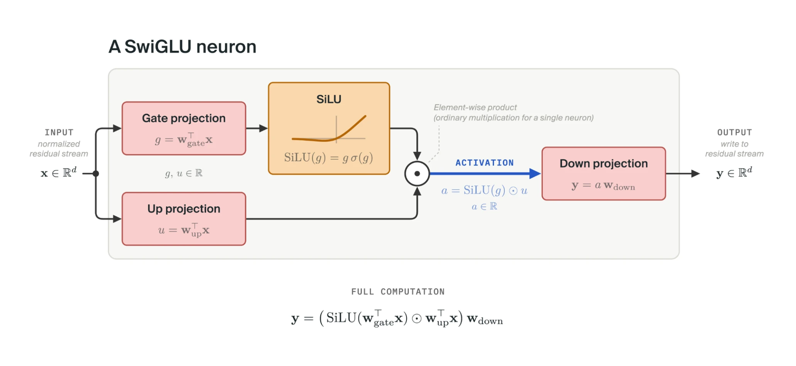

**▲ 원문 Figure 1** — SwiGLU 뉴런 하나의 구조. 입력 x가 gate 쪽과 up 쪽으로 갈라진다. SiLU(g)와 u를 곱한 값이 뉴런 값이고, 이 값이 down 쪽 가중치를 거쳐 residual stream에 더해진다.

요즘 LLM의 MLP는 대부분 이런 구조(SwiGLU)다. 뉴런 하나는 이렇게 계산한다.

1. 같은 입력으로 숫자 두 개를 만든다. **gate** 값 g와 **up** 값 u다.
2. g에 SiLU라는 함수를 씌운 뒤 u와 곱한다. 이게 뉴런 값이다.
3. gate는 "지금 내가 나설 때인가"를 정하는 문이다. g가 크면 문이 열려서 값이 크게 나오고, g가 음수면 문이 닫혀서 값이 0 근처로 줄어든다.
4. up은 "나선다면 +쪽인가 −쪽인가, 얼마나 세게"를 정한다.

```text
g = W_gate · x                      # gate 값
u = W_up   · x                      # up 값
a = SiLU(g) · u                     # 뉴런 값
activation = a · w_router           # router 가중치를 곱한 값. 이 문서의 activation은 이것이다
write = activation · W_down[:, n]   # residual stream에 실제로 더해지는 벡터 (write)
```

residual stream은 모델이 층을 지나며 계속 고쳐 쓰는 "작업용 벡터"다. 뉴런은 여기서 읽고, 계산한 결과를 여기에 더한다.

**분석한 모델 (Qwen3.6-35B-A3B)**

| 항목 | 값 |
|---|---|
| 층 수 | 40 |
| 층마다 expert 수 | 256개 (expert 하나에 뉴런 512개) |
| 토큰 하나가 쓰는 expert | router가 고른 8개 + 항상 쓰는 공유 expert 1개 |
| 토큰 하나가 한 층에서 쓰는 뉴런 수 | 8 × 512 = 4,096개 (공유 expert 제외) |
| 전체 뉴런 수 | 약 526만 개 |

### 2.2 뉴런은 +쪽과 −쪽이 따로 논다 (pole)

up 값 u는 +도 −도 될 수 있다. 그래서 뉴런 값도 +로 나올 때가 있고 −로 나올 때가 있다. 그런데 **+로 켜질 때 하는 일과 −로 켜질 때 하는 일이 전혀 상관없는 경우가 많다.** 그래서 이 연구는 뉴런을 통째로 세지 않고 +쪽과 −쪽을 따로 센다. 이 한쪽을 **pole**이라고 부른다. 뒤에 나오는 "pole 5,468개" 같은 숫자가 이 단위다.

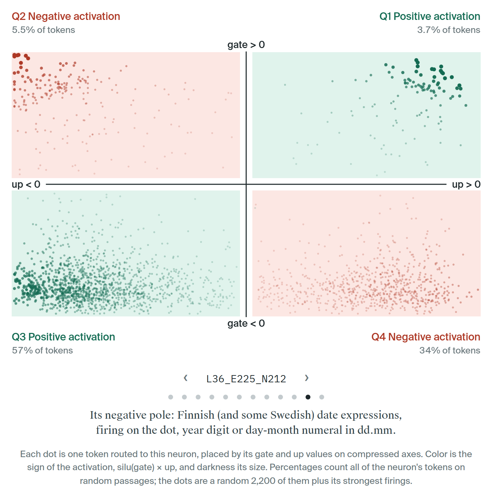

**▲ 원문 Figure 2** — gate와 up의 부호로 나눈 네 칸(Q1–Q4)에, 뉴런 하나(L36_E225_N212)가 실제로 처리한 토큰들을 점으로 찍은 그림. 점 하나가 토큰 하나다. 색은 값이 +인지 −인지, 진하기는 값의 크기다. 원문에서는 화살표로 다른 뉴런도 넘겨 볼 수 있다.

gate와 up이 각각 +냐 −냐에 따라 네 가지 경우가 있다.

| 경우 | gate | up | 뉴런 값 | 특징 |
|---|---|---|---|---|
| Q1 | + (문 열림) | + | 큰 + | 세게 켜진 +값은 대부분 여기서 나온다 |
| Q2 | + (문 열림) | − | 큰 − | 세게 켜진 −값은 대부분 여기서 나온다 |
| Q3 | − (문 닫힘) | − | 작은 + | 음수 × 음수라서 +가 된다. 원문은 "double-negative"라고 부른다 |
| Q4 | − (문 닫힘) | + | 작은 − | 약하다 |

- 문이 닫혀도(g < 0) 값이 정확히 0이 되지는 않는다. SiLU가 작은 음수(최소 약 −0.28)를 내보내기 때문이다. Q3·Q4는 그렇게 "새어 나온 작은 값"이다.
- 뉴런이 속한 expert가 이번 토큰에 뽑히지 않았으면 뉴런 값은 정확히 0이다. 뽑혔으면 거의 항상 0이 아니다.
- **p97/3**이라는 표기는 "+쪽 상위 3%와 −쪽 하위 3%", 곧 가장 세게 켜진 양 끝을 뜻한다.

### 2.3 용어 정리

| 용어 | 뜻 |
|---|---|
| activation | 뉴런 값에 router 가중치를 곱한 숫자. 뉴런이 얼마나 세게 켜졌는지를 나타낸다 |
| write | 뉴런이 residual stream에 더하는 벡터 |
| pole | 뉴런의 +쪽 또는 −쪽. 둘이 하는 일이 보통 다르다 |
| 켜진다 (firing) | 어떤 토큰에서 activation이 0이 아닌 것. 그 expert가 뽑혀야 가능하다 |
| input 뉴런 | 이 뉴런을 켜 주는 앞쪽 층 뉴런 |
| reader 뉴런 | 이 뉴런의 출력을 받아 쓰는 뒤쪽 층 뉴런 |
| 서브회로 (subcircuit) | "어떤 input들이 켰고 → 이 뉴런 → 어떤 reader들이 받았나"를 한 세트로 묶은 것 |
| mode | 뜻이 같은 서브회로들을 묶은 것. 뉴런이 하는 "일의 종류" 하나에 해당한다 |
| multi-mode 뉴런 | mode가 2개 이상인 뉴런 |

---

## 3. 질문 1: 뉴런이 정말 일을 하나

> **한 줄 요약** — 약하게 켜진 뉴런을 거의 다 꺼도 모델은 멀쩡하다. 실제 일은 가끔 아주 세게 켜지는 소수의 뉴런이 한다.

### 3.1 실험 방법

토큰마다 뉴런 일부만 그대로 두고 나머지는 **꺼 버린다**. 그리고 모델 성능이 얼마나 떨어지는지 본다.

- 여기서 "끈다"는 건 값을 0으로 만드는 게 아니다. 그 뉴런의 **평소 평균값으로 바꿔 놓는** 것이다(mean ablation). 평소에 하던 만큼은 남기고, 이번 토큰에서 특별히 한 일만 지우려는 것이다.
- 공유 expert는 어느 실험에서도 건드리지 않았다.

어떤 뉴런을 남길지는 여러 방식으로 해 봤다.

| 방식 | 무엇을 남기나 |
|---|---|
| 중간 구간 끄기 (P25–75, P10–90, P5–95) | 값이 중간쯤인 뉴런을 끄고, 아주 크거나 아주 작은 양 끝만 남긴다 |
| expert별 Top-K (Top-64, Top-32) | expert마다 가장 세게 켜진 K개만 남긴다 |
| 층 전체 Top-320 | 한 층의 4,096개 중 가장 세게 켜진 320개만 남긴다(router 가중치까지 곱해서 순위를 매긴다). **92.2%가 꺼진다** |
| 비교용 ①: 무작위-64 | expert마다 아무거나 64개만 남긴다 |
| 비교용 ②: 하위-448 | 거꾸로 **가장 센 64개를 끄고** 약한 448개만 남긴다 |

### 3.2 결과

| 방식 | 끈 비율 | loss 증가 (원래 1.886) | KL |
|---|---|---|---|
| 층 전체 Top-320 | 92.2% | **+0.054** | 0.140 |
| expert별 Top-64 | 87.5% | +0.066 | 0.152 |
| expert별 Top-32 | 93.8% | +0.146 | 0.263 |
| 중간 구간 P25–75 끄기 | 49.7% | +0.010 | 0.033 |
| 중간 구간 P10–90 끄기 | 78.6% | +0.040 | 0.088 |
| 중간 구간 P5–95 끄기 | 88.8% | +0.091 | 0.162 |
| 비교용: 무작위-64 | 87.5% | +2.328 | 2.511 |
| 비교용: 하위-448 | 12.5% | **+2.701** | 2.885 |

*웹 텍스트 840만 토큰으로 잰 값이다. 원문 표에서 일부 열만 가져왔다.*

<details>
<summary>📋 원문 Table 1 캡처 보기 — 방식별 KL·loss·벤치마크 전체 표</summary>
<br>
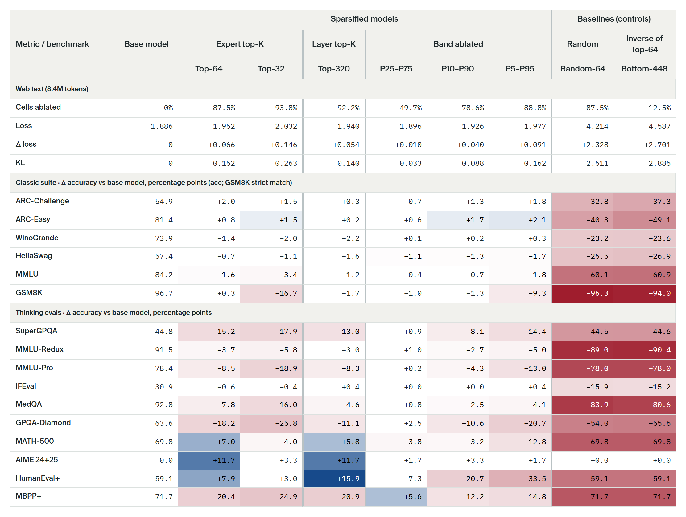
</details>

**이 표가 말하는 것**

- **세게 켜진 것만 남기면**, 90% 넘게 꺼도 loss가 거의 안 변한다(1.886 → 1.940, 약 2.9% 증가).
- **같은 양을 꺼도 아무거나 끄면** 모델이 망가진다(무작위-64).
- **12.5%만 꺼도 그게 가장 센 것들이면** 모델이 망가진다(하위-448).
- 그러니까 얼마나 끄느냐보다 **무엇을 끄느냐**가 중요하다. 실제 일은 세게 켜진 소수가 한다.

벤치마크로 보면 이렇다(Top-320 기준).

- 지식 문제나 간단한 문제(ARC, MMLU, GSM8K 등)는 거의 그대로다.
- 길게 생각해야 하는 문제는 많이 떨어진다. SuperGPQA −13.0%p, GPQA-Diamond −11.1%p, MBPP+ −20.9%p.
- 오히려 오른 것도 있다. HumanEval+ +15.9%p, AIME 24+25 +11.7%p.

### 3.3 길게 생각하는 능력이 망가진 이유, 그리고 고치기

- **증상** — 뉴런을 끈 모델은 정답까지는 잘 간다. 그런데 거기서 멈추지 못하고 "맞나? 다시 확인해 보자"를 끝없이 반복한다. 마지막에 든 답 후보가 대개 정답이었다.
- **고친 방법** — Top-320 방식으로 뉴런을 끈 상태를 유지한 채, 짧게 추가 학습(fine-tuning)을 했다.
  1. **따라 하기 학습 (SFT, distillation)**: 뉴런을 끄지 않은 원래 모델의 출력을 따라 하도록 학습한다. 9,100만 토큰, 1,000스텝. SuperGPQA에서 떨어진 점수의 약 72%를 되찾은 뒤 더는 오르지 않았다.
  2. **강화학습 (RL)**: 지식 문제 1,024개를 4번씩 풀게 하는 걸 10라운드 반복했다. 약 900만 토큰. (학습률 1e-6, KL 페널티 0.1)
  - 합쳐서 약 **1억 토큰**이다. 원래 모델을 만들 때 쓴 약 34조 토큰과 비교하면 거의 없는 수준이다.
  - RL에서 모델이 받은 건 "잘했다/못했다" 점수뿐이고, 그 정보량은 약 34KB다. 정답을 가르쳐 준 게 아니다.
- **결과** — SuperGPQA **45.4**. 원래 모델(44.8)보다 높다. 답이 너무 길어져 잘리는 경우도 원래 모델보다 줄었다.
- **저자들의 해석** — 새 지식을 넣은 게 아니다. **짧게 말하고, 답을 정했으면 거기서 끝내는 버릇**을 들인 것이다. 필요한 정보는 추가 학습 전에도 이미 모델 출력 안에 있었다.
- 참고로 하위-448(센 것을 끈 모델)은 같은 방식으로 학습시켜도 살아나지 않았다.

<details>
<summary>📋 원문 Table 8 캡처 보기 — 추가 학습 전후의 벤치마크 점수</summary>
<br>
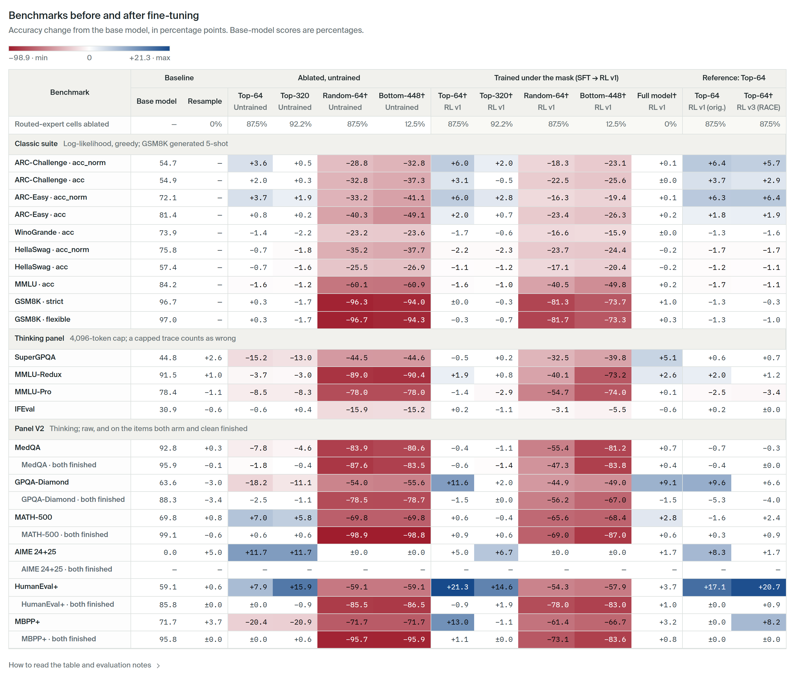
</details>

### 3.4 수수께끼: 약한데 없으면 안 되는 Q3

Q3는 §2.2에서 본 "문이 닫혔는데 새어 나온 작은 +값"이다.

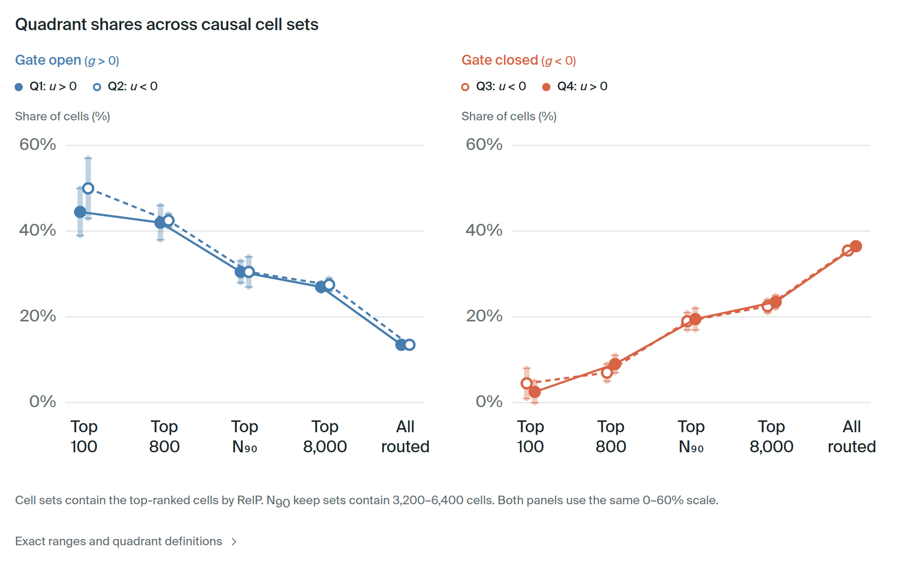

**▲ 원문 Figure 3** — 영향력이 큰 순서로 뉴런 값을 골랐을 때 Q1–Q4가 각각 얼마나 차지하는지. 왼쪽이 문이 열린 Q1·Q2, 오른쪽이 문이 닫힌 Q3·Q4다. 수염(가는 선)은 원문에 나온 범위, 점과 선은 그 가운데 값이다. 영향력이 큰 것만 고를수록 Q3·Q4가 크게 줄어든다.

| 어떤 값들을 봤나 (영향력 큰 순) | Q1 | Q2 | Q3 | Q4 |
|---|---|---|---|---|
| 가장 영향력 큰 100개 | 39–50% | 43–57% | 1–8% | 0–5% |
| 800개 | 38–46% | 41–44% | 5–9% | 7–11% |
| N₉₀ (3,200–6,400개) | 28–33% | 27–34% | 17–21% | 17–22% |
| 8,000개 | 26–28% | 26–29% | 21–24% | 22–25% |
| 전부 | 13–14% | 13–14% | 35–36% | 36–37% |

*범위는 원문에 나온 최솟값–최댓값이다(신뢰구간이 아니다).*

- 전체를 놓고 보면 Q3와 Q4가 각각 **3분의 1쯤**을 차지한다. 숫자로는 다수다.
- 그런데 모델 출력에 영향이 큰 것만 추리면 거의 다 Q1·Q2다. Q3·Q4는 별 영향이 없어 보인다.
- **그런데도 Q3를 전부 끄면 모델이 길게 생각하지 못한다.** 수학 문제(GSM8K) 24개에서 풀이 길이가 평균 약 1,550토큰에서 176토큰으로 줄었다. §3.3에서 본 문제가 Q3와 관련 있다는 단서다.

그래서 저자들은 뒤쪽 층(24–39)의 Q3 값을 다른 것으로 바꿔 끼워 보며, Q3의 무엇이 중요한지 찾아봤다.

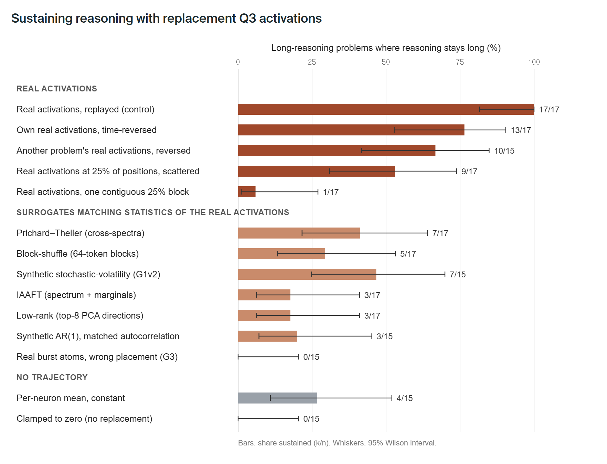

**▲ 원문 Figure 4** — 뒤쪽 층(24–39)의 Q3 값을 다른 값으로 바꿔 끼웠을 때, 여전히 길게 풀이를 이어 간 문제의 비율. 위쪽 묶음은 진짜 Q3 값을 변형한 것, 가운데는 통계적 특징만 흉내 낸 가짜 값, 아래는 값의 흐름이 아예 없는 경우다. 수염(가는 선)은 95% Wilson 구간이다.

| Q3 자리에 넣은 것 | 길게 풀이를 이어 간 문제 |
|---|---|
| 진짜 Q3 값, 토큰 순서만 뒤집음 | 13/17 |
| 진짜 Q3 값, 다른 문제에서 가져옴 | 10/15 |
| 진짜 Q3 값의 1/4만, 원래 자리에 드문드문 | 9/17 |
| 진짜 Q3 값의 1/4만, 한곳에 몰아서 | 1/17 |
| 통계적 특징만 흉내 낸 가짜 값 | 4/15 |

*"길게 이어 갔다"의 기준은 원래 길이의 40% 이상이면서 600토큰 이상이다. 원래 1,000토큰 넘게 풀던 문제(15–17개)만 셌다. 가짜 값은 스펙트럼, 값의 분포, 저랭크 구조, 자기상관 같은 통계적 특징을 진짜와 맞춘 것이다.*

- 진짜 Q3 값이기만 하면 **순서를 뒤집어도, 다른 문제에서 가져와도** 대체로 괜찮았다.
- 통계적 특징만 비슷하게 만든 **가짜 값은 잘 안 통했다.**
- 진짜 값이라도 한곳에 몰아 넣으면 안 통했다. 처음부터 끝까지 깔려 있어야 한다.
- **저자들의 해석** — Q3는 "이 토큰에는 이 값"처럼 하나하나 정확히 맞아야 하는 정보가 아니다. 풀이 내내 깔려 있는 전체적인 성질이 중요한 것으로 보인다. 정확히 어떻게 작동하는지는 아직 모르고, 다음 연구로 남겼다.

### 3.5 정리

- 토큰 하나를 처리하는 데 실제로 필요한 뉴런은 아주 적다. 그 뉴런들은 거의 다 **가장 세게 켜진 구간**(p97/3)에 있다.
- 그래서 이 뒤로는 세게 켜진 경우만 집중해서 본다. 약하게 켜진 값이 쓸모없다는 뜻은 아니다(Q3가 그 예다). 그쪽은 다음 연구로 남겼다.
- (부록) 다른 방법으로도 확인했다. **RelP**라는 기법으로 "이 답을 내는 데 어떤 뉴런이 얼마나 기여했나"를 그래프(attribution graph)로 그린 뒤, 꼭 필요한 뉴런만 남겼다. 켜진 뉴런의 **0.2–0.8%**(몇천 개)만으로, 정답이 2등 답을 앞서는 정도(logit margin)의 90%가 유지됐다. 같은 수의 뉴런을 아무거나 고르면 최대 0.02밖에 안 됐고, 1등 답을 되살린 적도 없다. 남은 뉴런은 대부분 상위 1%(p99) 이상으로 세게 켜진 것이었다.
- (부록) 토큰 하나가 아니라 **글을 길게 생성하는 동안에도** 같은 분석을 했다. 다섯 종류(사실 이어 쓰기, 이야기, 코드, 추론 과정, 외운 구절)에서 프롬프트 10개를 골라, 생성한 토큰 약 1,000개마다 그래프를 그렸다. 결과는 아래 Figure 14에 있다.

<details>
<summary>📋 원문 Table 9 캡처 보기 — RelP로 고른 뉴런 값들이 얼마나 세게 켜진 구간에 있는지</summary>
<br>
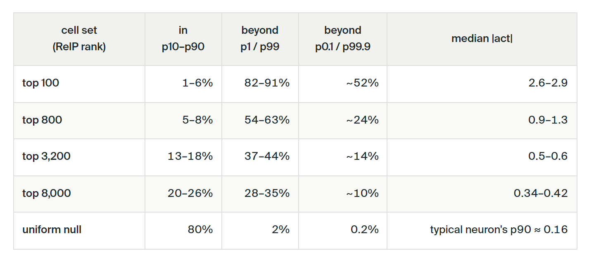
</details>

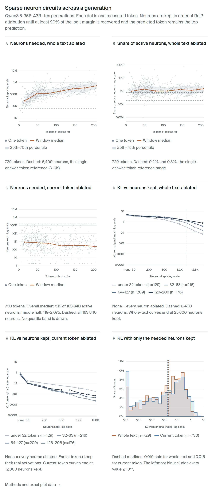

**▲ 원문 Figure 14** — 글을 생성하는 동안 필요한 뉴런 수(생성 10건, 점 하나가 생성한 토큰 하나). **A**: 지금 토큰과 앞 토큰들에서 모두 뉴런을 끌 때, logit margin 90%를 유지하려면 뉴런이 몇 개 필요한가 — 글이 길어질수록 늘어난다. **B**: 그 수가 지금까지 켜진 뉴런의 몇 %인가 — 약 1%로 거의 일정하다. **C**: 지금 토큰에서만 끌 때 필요한 뉴런 수 — 중앙값이 약 520개이고, 글이 길어져도 늘지 않는다. **D·E**: 남긴 뉴런 수에 따라 다음 토큰 예측이 얼마나 달라지는지(KL). **F**: 꼭 필요한 뉴런만 남겼을 때의 KL 분포. ※ 원문은 두 패널씩 넘겨 보는 방식이라, 캡처할 때 여섯 패널을 한 장에 펼쳤다.

---

## 4. 질문 2: 뉴런이 하는 일을 한마디로 말할 수 있나

> **한 줄 요약** — 뉴런 하나가 하는 일은 대개 한 가지다. 여러 일을 하는 뉴런도 "누가 켰고 누가 받아 쓰는지"를 보면 일이 깔끔하게 나뉜다.

### 4.1 뉴런의 출력은 하나인데, 받아 쓰는 쪽이 다르다

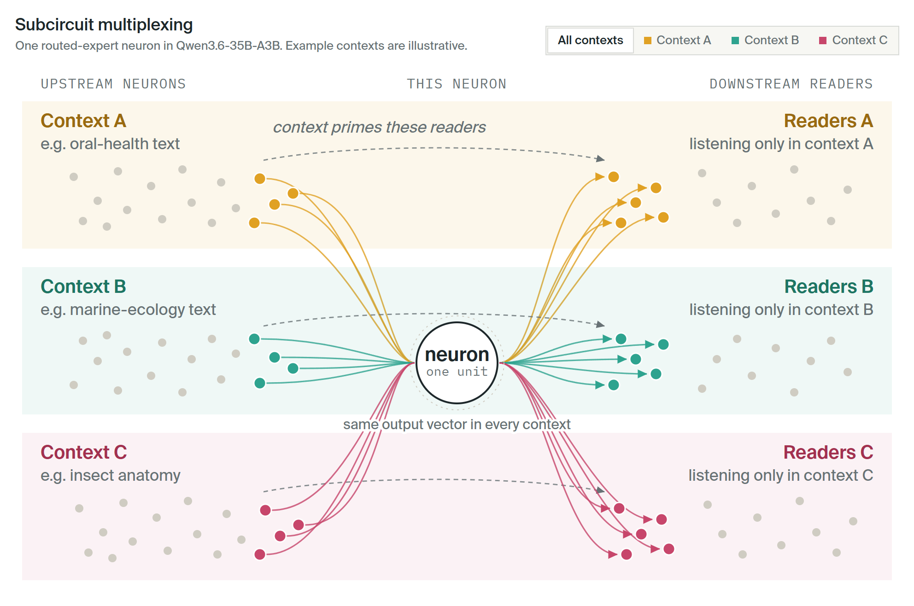

**▲ 원문 Figure 5** — 개념도. 뉴런이 내보내는 벡터는 어떤 상황에서든 같은 방향이다. 다만 상황마다 서로 다른 reader 뉴런들이 미리 준비되어 있어서, 같은 뉴런이 다른 용도로 쓰인다(상황 A·B·C는 설명용 예시). 원문은 이것을 subcircuit multiplexing이라고 부른다.

핵심 아이디어는 이렇다.

- 뉴런이 residual stream에 내보내는 **신호는 언제나 같은 방향**이다. 뉴런은 "지금은 치과 얘기야", "지금은 바다 얘기야"를 구분해서 내보내지 못한다.
- 달라지는 건 **그 신호를 누가 받아 쓰느냐**다. 지금 글이 어떤 상황이냐에 따라, 앞쪽 층 뉴런들이 특정 reader들의 gate(문)를 미리 열어 둔다. 문이 열린 reader만 신호에 반응한다.
- 사무실 스피커의 "삐-" 소리와 비슷하다. 소리는 한 가지뿐이다. 아침에 소방 훈련 공지를 들은 날에는 대피 신호로 듣고, 평소 정오에는 점심 종으로 듣는다. 소리는 같고, 듣는 쪽의 준비가 다르다.
- 원문은 이것을 multiplexing(선 하나로 여러 신호를 나눠 보내는 기술)에 빗댄다. gate와 up을 곱하는 SwiGLU 구조라서 가능한 일이다.

**실제 예: 뉴런 L18_E219_N55 (치과 수술 ↔ 바다)**

- 이 뉴런은 치과 수술 글에서도 켜지고 바다 글에서도 켜진다. 둘은 상관이 없다. 그런데 뉴런이 내보내는 방향은 하나뿐이다.
- 바다 글에서는 바다와 관련된 앞쪽 뉴런 8개 중 7개가 켜져 있다. 원문은 이렇게 미리 문을 열어 주는 뉴런을 **primer**라고 부른다. 예를 들어 'Marine'이라는 단어에 반응하는 L1_E76_N311이 −6.47, 해양생물·연구소에 반응하는 L7_E96_N356이 −11.40이다. 같은 글에서 치과 쪽 primer 18개(앞쪽 층 13개, 뒤쪽 층 5개)는 **하나도** 켜지지 않는다.
- 그 결과 장소·해안·자연을 다루는 reader L20_E236_N283이 켜진다(+1.22). 이 reader의 gate로는 +2.23, up으로는 +0.61이 들어왔다.
- 치과 글에서는 반대다. 치과 쪽 primer가 켜지고, reader들은 똑같은 신호를 "치과 얘기구나"의 근거로 쓴다.
- 정리하면 reader 뉴런 쪽에서 **up으로는 이 뉴런의 신호가 들어오고, gate로는 primer의 신호가 들어온다.** primer가 문을 열어 줘야 신호가 통과한다.

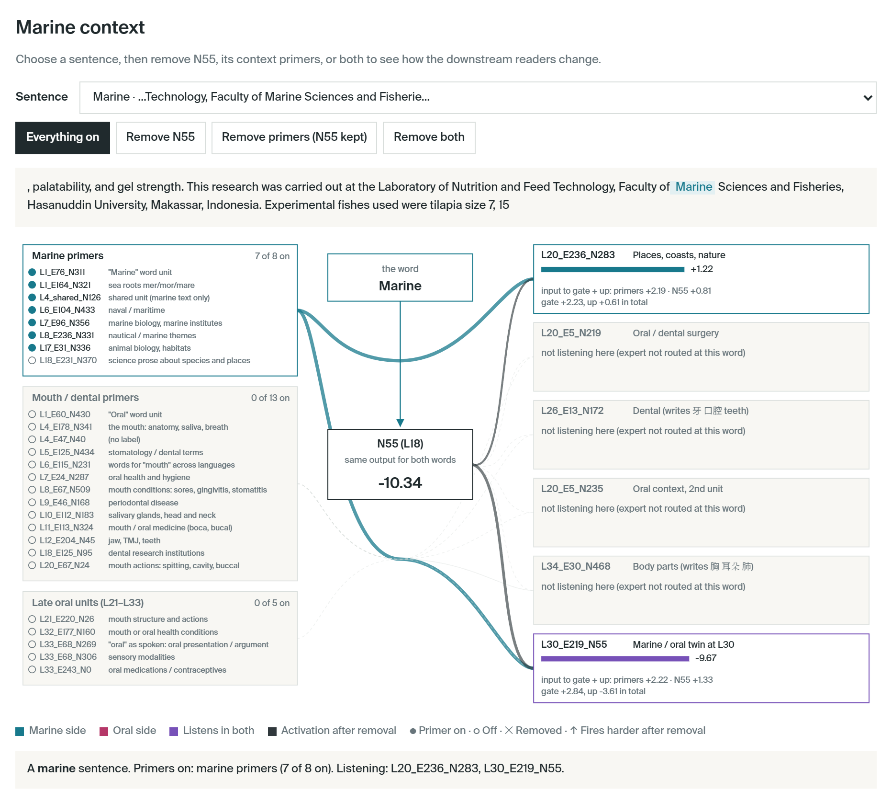

**▲ 원문 Figure 11** — 뉴런 L18_E219_N55의 실제 연결 그림(캡처는 바다 문장을 고른 기본 화면). 앞쪽의 바다 primer가 켜지면 뒤쪽의 장소·해안·자연 reader가 이 뉴런의 출력을 받아 쓰고, 치과 쪽 reader는 반응하지 않는다. 원문에서는 문장을 바꾸거나 뉴런·primer를 꺼 보면서 치과 쪽과 비교할 수 있다.

### 4.2 뉴런이 하는 일을 찾아내는 방법 (서브회로)

기본 생각은 간단하다. 뉴런이 켜진 사례를 잔뜩 모은다. 사례마다 "누가 켰나(input)"와 "누가 받아 썼나(reader)"를 기록한다. 그 기록이 비슷한 사례끼리 묶는다. 이렇게 묶인 한 무리가 **서브회로**이고, 뉴런이 하는 "일 하나"에 해당한다.

1. **사례 모으기** — 모델에 100억 토큰을 넣는다. 뉴런마다 켜진 세기를 14구간으로 나누고 구간마다 1,000개씩, 모두 14,000개 사례를 모은다. 골고루 뽑은 대표 뉴런 2,734개는 세게 켜진 사례(p95/5 이상)를 30,000개 더 모은다.
2. **누가 켰는지 계산** — 이 뉴런의 gate 값과 up 값이 앞쪽 뉴런 각각 때문에 얼마씩 올라갔는지 나눠서 계산한다. (RMSNorm이라는 정규화 층의 스케일을 실제 값으로 고정해 두면, 어림값이 아니라 정확한 값으로 나뉜다.) 기여가 큰 것만 남긴다.
3. **누가 받아 썼는지 계산** — 이 뉴런의 출력이 뒤쪽 층 뉴런 각각의 값을 얼마나 바꾸는지 어림해서 구한다(1차 근사).
4. **사례마다 "지문" 만들기** — 앞쪽 뉴런을 네 무리로 나눈다. gate를 올린 쪽(driver)과 내린 쪽(suppressor), up을 올린 쪽과 내린 쪽이다. 무리마다 영향이 큰 400개를 쓴다. 거의 모든 사례에 나오는 뉴런은 구별에 도움이 안 되니 비중을 낮춘다(TF-IDF. 검색에서 "the"처럼 어디에나 나오는 단어를 덜 쳐 주는 것과 같다).
5. **비슷한 사례끼리 묶기** — 지문이 가장 비슷한 사례 15개씩을 선으로 이어 그래프를 만들고, Leiden이라는 알고리즘으로 무리를 찾는다. 데이터의 75%로 묶고 25%는 검증용으로 따로 둔다.
6. **같은 무리 합치기** — 두 무리의 주요 input 50개와 주요 reader 50개가 **둘 다** 30% 이상 겹치면 하나로 합친다. 둘 다 겹쳐야 하니까 엉뚱하게 합쳐지는 일을 막을 수 있다.
7. **설명 쓰기** — Claude Opus 5.5가 서브회로마다 설명을 세 가지로 쓴다. 연결이 어떻게 되어 있나, 글에서 어떤 뜻인가, 어떤 토큰에서 켜지나.

이렇게 하면 pole 하나에 서브회로가 **중앙값 19개** 나온다(적으면 1개, 많으면 51개).

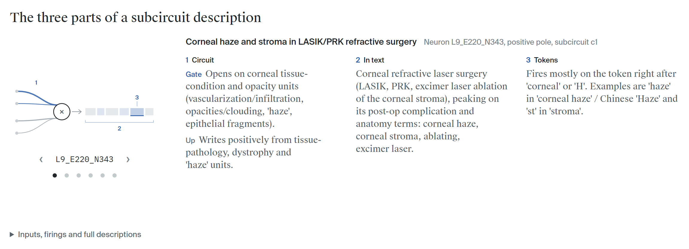

**▲ 원문 Figure 6** — 서브회로 설명의 예(뉴런 L9_E220_N343. 라식/PRK 수술 얘기에서 각막 혼탁·각막 실질 같은 말에 켜진다). 설명은 연결, 글의 뜻, 토큰 패턴의 세 부분으로 되어 있다.

### 4.3 한 뉴런의 서브회로끼리는 거의 안 겹친다

같은 뉴런에 속한 서브회로 두 개를 골라, 주요 input 50개와 주요 reader 50개가 얼마나 겹치는지 봤다.

| 겹치는 비율 | input | reader |
|---|---|---|
| 모든 쌍의 평균 | 5.2% | 6.5% |
| 보통의 쌍 (중앙값) | 2% | 2% |
| 가장 비슷한 쌍 (중앙값) | 14% | 17% |

→ 거의 안 겹친다. 서브회로들은 서로 **꽤 다른 경로**다.

<details>
<summary>📋 원문 Table 2 캡처 보기 — 같은 뉴런의 서브회로끼리 input·reader가 겹치는 비율</summary>
<br>
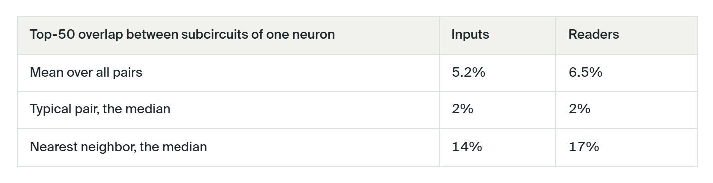
</details>

### 4.4 뜻이 같은 서브회로끼리 묶으면 mode

서브회로 19개가 전부 다른 일은 아니다. 연결은 조금 달라도 뜻이 같은 것이 많다. 그런 것끼리 묶은 것이 **mode**다. "뉴런이 하는 일이 몇 가지냐"는 mode 수로 센다.

- 묶는 일은 Claude Opus 5.5가 두 단계로 한다.
- "실질적인" mode 수는 inverse Simpson index로 계산한다. 거의 안 나오는 mode는 덜 쳐 주는 계산법이다.
- **이 묶기가 믿을 만한가** — 같은 작업을 세 번 해 보면 "mode가 하나냐 여럿이냐" 판정이 96% 일치한다(조정 Rand 지수 중앙값 0.95). 데이터를 반으로 나눠 따로 묶어도 서브회로의 68%가 다시 나온다(무작위로 섞으면 1%).
- 같은 mode 안의 서브회로끼리는 다른 mode의 서브회로보다 input·reader가 더 많이 겹친다.

<details>
<summary>📋 원문 Table 12 캡처 보기 — 같은 mode 안 / 다른 mode 사이 서브회로가 겹치는 비율 (input 9.8% 대 2.0%, reader 9.9% 대 3.1%)</summary>
<br>
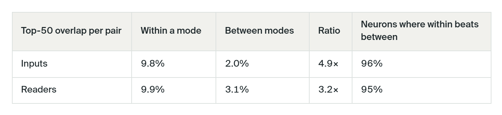
</details>

<details>
<summary>📋 원문 Table 13 캡처 보기 — reader만 보고 어느 mode인지 맞히는 정확도 (켜진 세기 구간별)</summary>
<br>
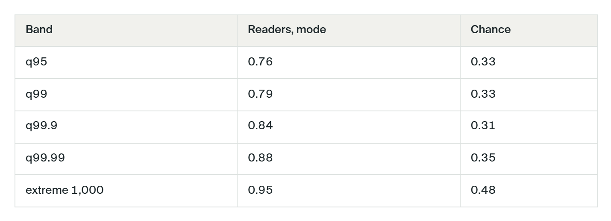
</details>

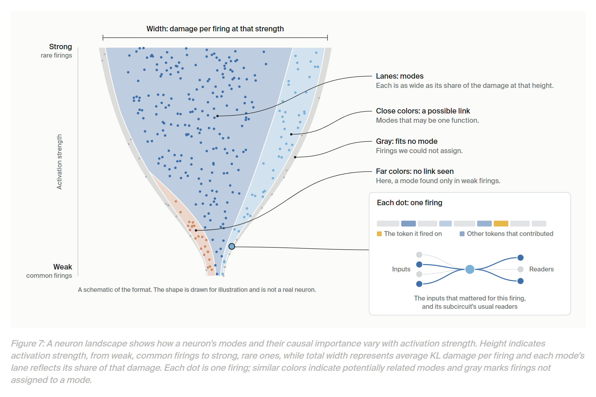

**▲ 원문 Figure 7** — 'neuron landscape' 그림 읽는 법. 위아래는 켜진 세기다(아래는 약하고 흔한 경우, 위는 세고 드문 경우). 전체 폭은 뉴런을 껐을 때 출력이 달라지는 정도(KL)의 사례당 평균이고, mode별 띠의 폭은 그중 그 mode가 차지하는 몫이다. 점 하나가 뉴런이 켜진 사례 하나다. 비슷한 색은 서로 관련 있을 수 있는 mode, 회색은 어느 mode에도 속하지 않은 사례다.

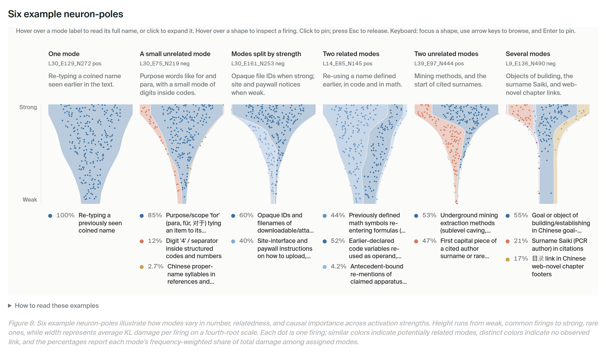

**▲ 원문 Figure 8** — pole 여섯 개의 landscape 예시. mode가 몇 개인지, mode끼리 얼마나 관련 있는지, 어느 mode의 영향이 큰지가 켜진 세기에 따라 어떻게 달라지는지 보여 준다. 폭은 사례당 평균 KL(네제곱근 척도)이고, 퍼센트는 각 mode가 전체 영향에서 차지하는 몫이다(얼마나 자주 나오는지를 반영한 값).

**숫자로 본 결과 (pole 5,468개)**

| 항목 | 값 |
|---|---|
| mode 수의 중앙값 / 평균 | 1 / 2.82 |
| mode가 1개인 pole | 2,556개 (약 47%) |
| mode가 2 / 3 / 4 / 5개인 pole | 788 / 517 / 343 / 247개 |
| mode 하나가 영향의 90% 이상을 차지하는 pole | **69%** |
| mode가 여럿인 pole(2,673개) 중, 그래도 한 mode가 90% 이상인 것 | 46% |
| mode가 여럿인 pole에서, 가장 큰 mode 말고 나머지가 차지하는 영향 (중앙값) | 14% |
| 가장 자주 나오는 mode가 차지하는 비율 (중앙값) | 73% (두 번째 mode는 16%) |
| mode마다 영향이 얼마나 고르지 않은지 (중앙값) | 0.72 (사례를 무작위로 섞으면 0.52) |
| mode마다 영향 차이가 뚜렷한 pole | 37% (mode가 2개 이상인 2,665개 중 978개) |

*여기서 "영향"은 뉴런을 껐을 때 출력이 달라지는 정도(KL)다.*

쉽게 말해 절반 가까이는 하는 일이 하나뿐이다. 나머지도 대부분 "주로 하는 일 하나 + 가끔 하는 자잘한 일" 구조다.

> 💡 mode가 몇 개인지는 설명을 얼마나 잘게 나누느냐에 따라 달라진다. 저자들도 이 점을 밝혀 둔다.

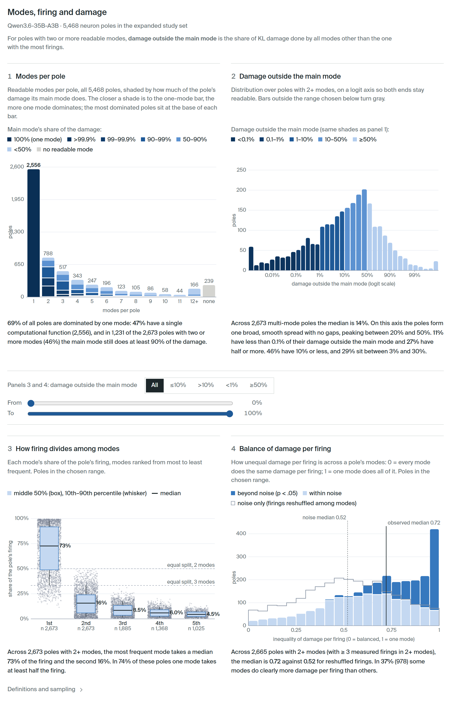

**▲ 원문 Figure 9** — pole 5,468개의 통계. **패널 1**: pole마다 mode가 몇 개인지. **패널 2**: 가장 큰 mode 말고 나머지가 차지하는 영향(KL)의 비율. **패널 3**: mode별로 얼마나 자주 나오는지 — 대개 한 mode가 대부분을 차지하고, 세 번째 이후 mode는 드물다. **패널 4**: mode마다 영향이 얼마나 고르지 않은지 — 고르지 않은 쪽으로 크게 쏠려 있다. 자잘한 mode는 다음 토큰에 거의 영향을 주지 않는 경우가 많다는 뜻이다.

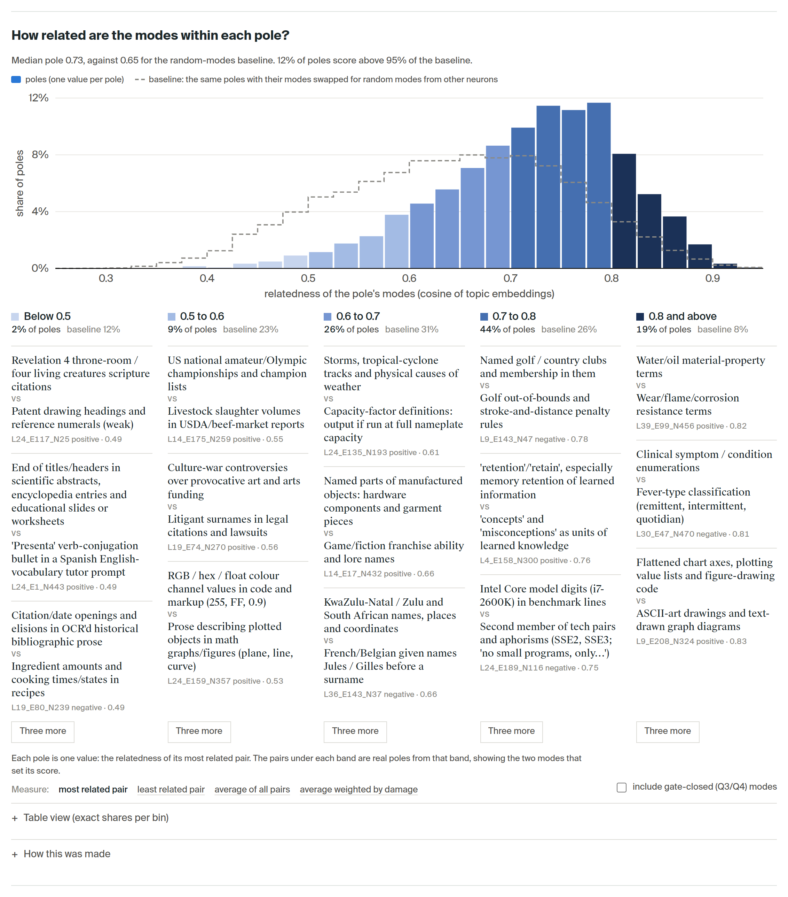

**▲ 원문 Figure 10** — 한 pole 안의 mode 설명들이 서로 얼마나 비슷한지를 임베딩 모델로 계산한 분포. 봉우리가 하나인 넓은 분포다. 아래쪽 목록은 비슷한 정도별 실제 mode 쌍의 예시다.

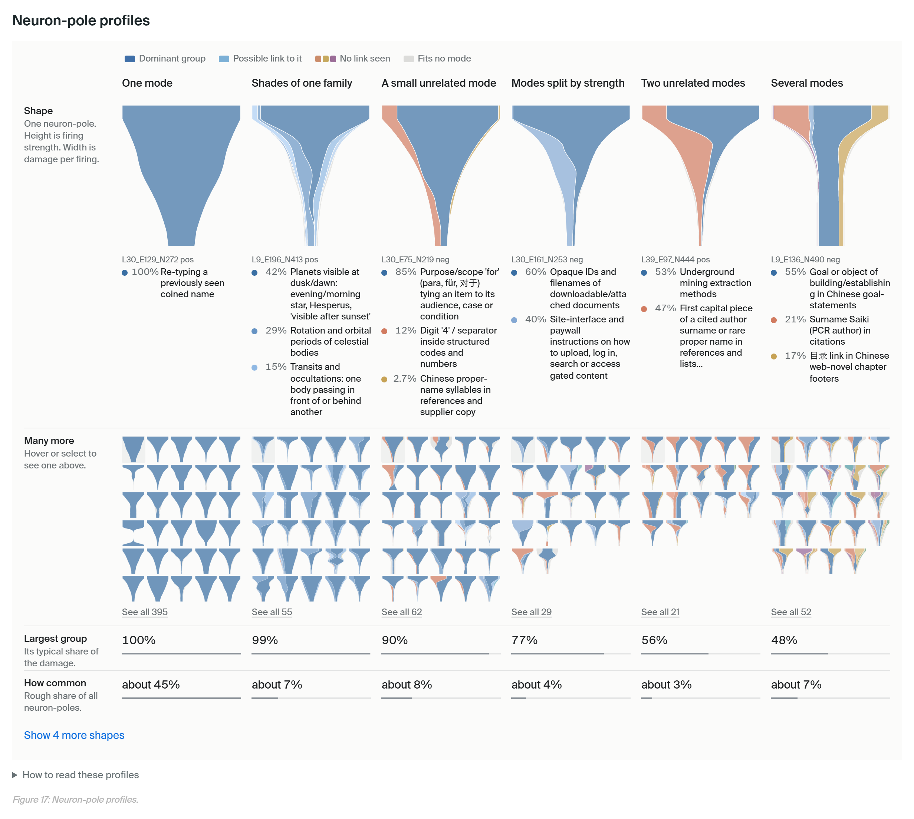

**▲ 원문 Figure 17** — (원문 부록) pole의 landscape를 모양별로 모은 것 — mode가 하나인 것, 한 계열의 비슷한 mode가 여럿인 것, 상관없는 작은 mode 하나가 섞인 것, 켜진 세기에 따라 mode가 갈리는 것, 상관없는 mode가 둘인 것, mode가 여럿인 것.

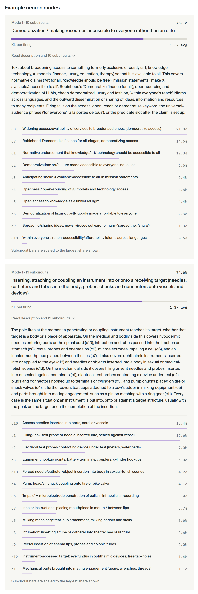

**▲ 원문 Figure 18** — (원문 부록) 서로 다른 두 뉴런의 mode 예시 — '누구나 쓸 수 있게 넓히기(민주화·접근성 확대)'와 '기구를 대상에 끼워 넣기'. mode 하나가 서로 관련된 서브회로 여러 개(이름이 c로 시작한다)로 이루어져 있다. 오른쪽 퍼센트는 뉴런이 켜진 사례 중 그 서브회로가 차지하는 비율이다. ※ 원문은 탭으로 나뉘어 있어, 두 탭을 모두 펼쳐 한 장으로 캡처했다.

### 4.5 뉴런이 특별한가: 아무 방향과 비교

"뉴런 말고 아무 방향이나 잡아도 비슷하게 나오는 거 아닌가?"라는 의문이 들 수 있다. 그래서 뉴런 대신 무작위로 고른 방향들과 비교했다. 한 층에서 k개만 남기고 나머지를 지웠을 때, 그 층이 하던 일이 얼마나 유지되는지 본다(1이면 전부 유지).

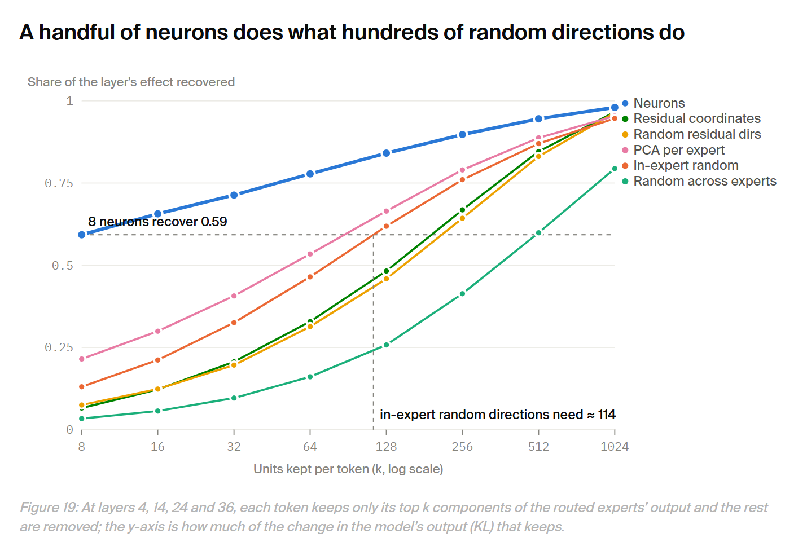

**▲ 원문 Figure 19** — 4·14·24·36층에서, 토큰마다 expert 출력의 성분 중 가장 중요한 k개만 남겼을 때 모델 출력 변화(KL)가 얼마나 유지되는지. 뉴런 8개면 0.59가 유지된다. expert 안에서 무작위로 고른 방향으로 같은 수준이 되려면 약 114개가 필요하다.

| 남긴 개수 k | 뉴런 | expert별 PCA 방향 | expert 안 무작위 방향 | residual stream 무작위 방향 | residual stream 좌표축 | expert 전체에 걸친 무작위 방향 |
|---|---|---|---|---|---|---|
| 8 | **0.59** | 0.21 | 0.13 | 0.08 | 0.07 | 0.03 |
| 64 | **0.78** | 0.53 | 0.46 | 0.31 | 0.33 | 0.16 |
| 1,024 | **0.98** | 0.95 | 0.95 | 0.96 | 0.97 | 0.79 |

*그 층이 하던 일이 유지된 비율이다. 4개 층 평균.*

- **뉴런 8개만 남겨도 0.59**가 유지된다. 무작위 방향 8개는 0.13이다. 뉴런 8개가 무작위 방향 약 114개 몫을 한다.
- 원문 본문은 여러 종류의 무작위 방향과 비교한 결과를 "뉴런 8개가 무작위 방향 128–256개 몫"이라고 요약한다.
- PCA(데이터가 가장 많이 퍼진 방향을 찾는 방법)로 고른 방향도 8개로는 0.21에 그친다.
- 1,024개쯤 남기면 무엇으로 해도 비슷해진다. 뉴런의 장점은 **적은 개수로 많은 걸 설명한다**는 것이다.

그 밖에도 뉴런은 무작위 방향과 다르다.

- **뉴런은 특정 reader와 딱 연결되어 있다.** 무작위 방향은 여러 reader를 넓고 흐릿하게 건드린다. 가중치만 보고 "강한 연결"(|cos| > 0.3)을 세면, 38→39층에서 뒤쪽 뉴런의 27%가 특정 앞쪽 뉴런과 강하게 연결되어 있다. 무작위 방향은 0.13%다. 앞쪽 층에서는 뉴런도 낮고(3→4층에서 0.24%), 뒤쪽 층으로 갈수록 커진다.
- **뉴런은 세게 켜질수록 뜻이 좁아진다.** 무작위 방향은 약하든 세든 뒤죽박죽이다. 뉴런이 가장 세게 켜진 0.01% 사례에서는, 그 구간을 대표하는 서브회로 하나가 차지하는 몫의 중앙값이 0.93이다. 가장 세게 켜질 때는 거의 한 가지 일만 한다는 뜻이다.

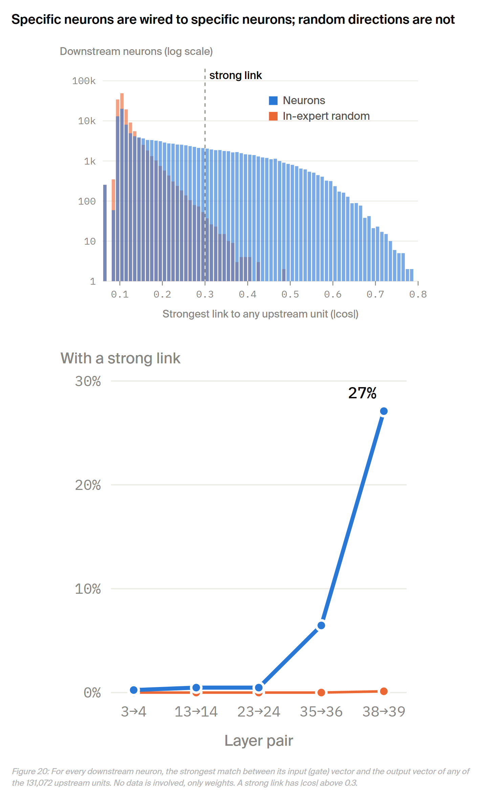

**▲ 원문 Figure 20** — 뒤쪽 뉴런마다, 그 뉴런의 입력(gate) 벡터와 가장 잘 맞는 앞쪽 유닛을 131,072개 중에서 찾은 것. 데이터 없이 가중치만으로 계산했다. |cos|가 0.3을 넘으면 강한 연결로 친다. 뉴런은 특정 뉴런과 강하게 연결되어 있지만 무작위 방향은 그렇지 않다.

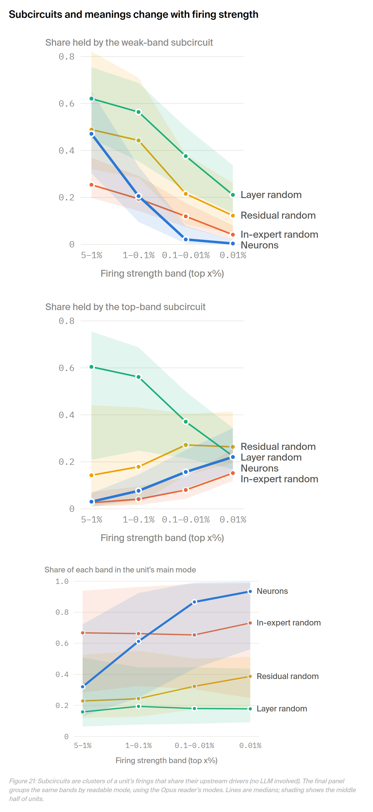

**▲ 원문 Figure 21** — 켜진 세기에 따라 서브회로와 뜻이 어떻게 달라지는지. 여기서 서브회로는 "켜 준 앞쪽 뉴런이 같은 사례들"을 묶은 것이다(LLM을 쓰지 않았다). 마지막 패널은 같은 구간을, 읽을 수 있는 mode 기준으로 묶은 것이다. 선은 중앙값, 색칠된 부분은 가운데 절반이다.

### 4.6 정리

뉴런이 하는 일은 몇 가지 안 된다. 뉴런이 내보내는 방향은 고정되어 있고, **그때 어떤 reader가 준비되어 있느냐**에 따라 다르게 쓰인다. 저자들은 이것을 해석 연구에 아주 좋은 소식으로 본다. 다만 이런 "돌려쓰기"가 모델 전체에서 얼마나 흔한지는 아직 재지 않았다고 밝힌다.

---

## 5. 질문 3: 그 설명이 실제로 맞나

> **한 줄 요약** — AI 에이전트가 쓴 설명만 가지고, 뉴런이 언제 켜질지 맞히고, 뉴런 값을 흉내 내고, 뉴런을 최대로 켜는 문장까지 지어낼 수 있다.

### 5.1 설명은 누가 어떻게 쓰나

- AI 에이전트가 쓴다. 최신 모델(Claude Fable 5.0/5.1, Claude Opus 5.5, GPT-6 Sol)에게 뉴런 하나당 글 **200개**를 준다. 가장 세게 켜진 글부터 중간쯤(p75) 켜진 글까지 골고루다.
- 에이전트는 "이 뉴런은 이럴 때 켜지는 것 같다"는 가설을 세우고, 실험해 보고, 설명을 고치기를 여러 번 반복한다.
- 설명이 맞는지는 에이전트가 **본 적 없는 글**로 채점한다.
- 원문은 이 시스템을 'Neuron Scientist'라고 부른다.

### 5.2 시험 1: 켜질지 맞히기 (detection)

AI 채점자에게 뉴런 설명과 짧은 글 두 개를 주고, 뉴런이 켜지는 쪽을 고르게 한다. 찍으면 0.5다. pole 500개로 시험했다.

| 정확도 | p97–99 | p99–99.9 | p99.9–99.99 | p99.99+ | 가장 센 1,000개 | 전체 |
|---|---|---|---|---|---|---|
| 아무 글과 구별하기 | 0.906 | 0.932 | 0.952 | 0.972 | 0.970 | 0.946 |
| 같은 expert가 처리한 글과 구별하기 | 0.812 | 0.852 | 0.901 | 0.942 | 0.939 | 0.885 |
| 평균 | 0.858 | 0.892 | 0.927 | 0.955 | 0.953 | 0.914 |

*왼쪽에서 오른쪽으로 갈수록 뉴런이 더 세게 켜진 사례다.*

<details>
<summary>📋 원문 Table 4 캡처 보기 — detection: 두 글 중 뉴런이 켜진 쪽을 맞힌 비율</summary>
<br>
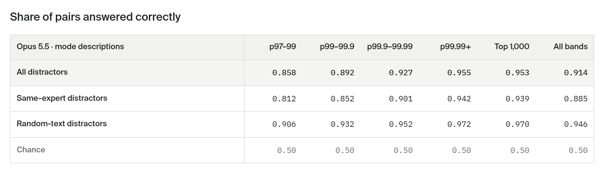
</details>

<details>
<summary>📋 원문 Table 3 캡처 보기 — 시험 1·2·3의 결과를 켜진 세기 구간별로 모은 전체 표</summary>
<br>
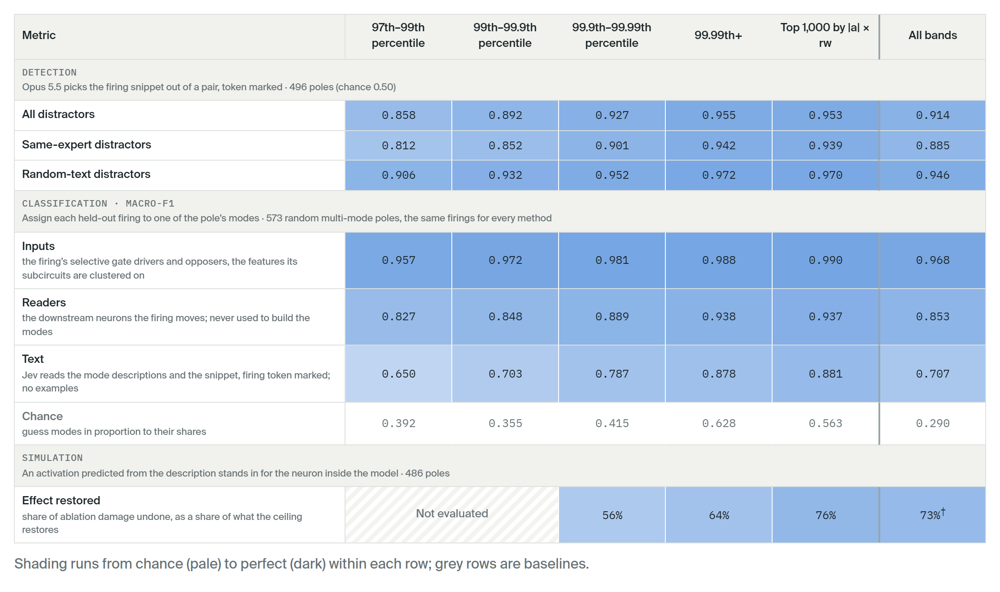
</details>

- 전체로 보면, 아무 글과 구별할 때는 **94.6%**, 같은 expert가 처리한 글과 구별할 때는 **88.5%** 맞힌다(원문 요약에서는 약 95%, 89%라고 쓴다).
- 같은 expert가 처리한 글은 주제가 비슷해서 더 헷갈리는 문제다. 그래도 89% 가까이 맞힌다.
- 뉴런이 세게 켜진 사례일수록 더 잘 맞힌다. 가장 센 구간(p99.99+)에서는 각각 97.2%, 94.2%다.
- **앞 내용이 중요하다** — 사례의 약 15%는 그 부분만 잘라서 다시 모델에 넣으면 뉴런이 켜지지 않는다. 앞에 나온 내용이 있어야 켜진다는 뜻이다. 앞쪽 250토큰을 같이 주면 점수(AUROC, 같은 expert 글과 구별할 때)가 0.927에서 0.978로 오른다.

### 5.3 시험 2: 어느 mode인지 맞히기

mode가 여럿인 pole 573개에서 "이번에 켜진 건 어느 mode인가"를 맞히게 했다(점수는 macro-F1이고 1이 만점이다).

| 무엇을 보고 맞혔나 | 점수 |
|---|---|
| 누가 켰는지 (input) | **0.968** |
| 누가 받아 썼는지 (reader) | 0.853 |
| 글만 보고 | 0.707 |
| 찍었을 때 | 0.290 |

- **글보다 연결을 보는 쪽이 훨씬 잘 맞힌다.** "뜻보다 계산을 먼저 보자"는 저자들 주장의 근거다.
- 뉴런이 얼마나 세게 켜지는지도 마찬가지다. 글의 특징으로는 그 차이의 약 14%만 설명되고, gate로 들어온 입력으로는 59%가 설명된다.
- router가 낮은 순위로 뽑은 expert일수록 글만으로는 맞히기 어렵다. 글 기준 점수는 1순위 expert에서 0.856이고 8위 밖에서 0.652다. input 기준은 0.986에서 0.971로 거의 그대로다.

<details>
<summary>📋 원문 Table 5 캡처 보기 — mode 맞히기 점수 (input / reader / 글 / 찍었을 때)</summary>
<br>
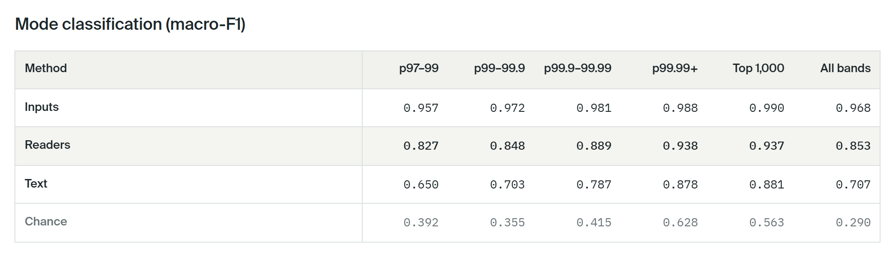
</details>

<details>
<summary>📋 원문 Table 6 캡처 보기 — expert의 router 순위별 mode 맞히기 점수</summary>
<br>
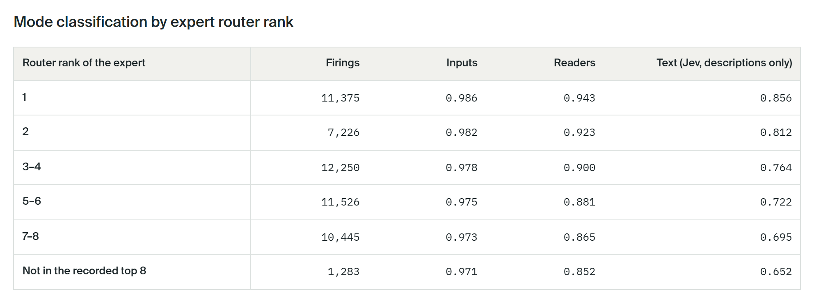
</details>

### 5.4 시험 3: 뉴런 값 흉내 내기 (simulation)

설명만 보고 뉴런 값을 예측해서, 진짜 값 대신 모델에 끼워 넣는다. 그래도 모델이 잘 돌아가면 설명이 정확한 것이다.

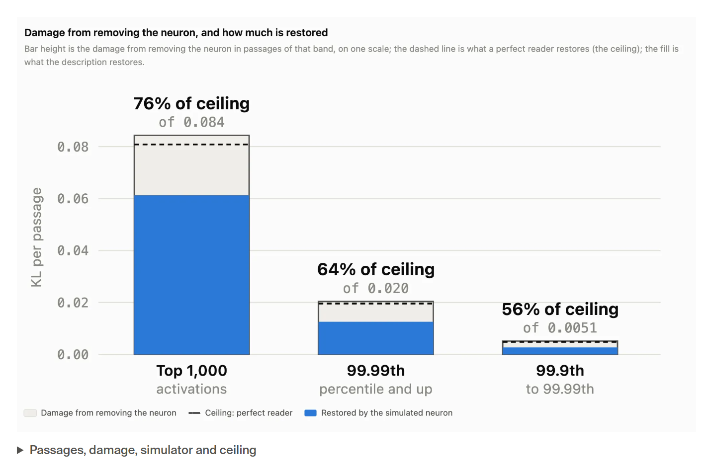

**▲ 원문 Figure 12** — 막대 높이는 뉴런을 껐을 때 모델이 망가지는 정도, 파란 부분은 흉내 낸 값을 넣어서 되살린 몫이다. 점선은 완벽하게 흉내 냈을 때 되살릴 수 있는 최대치다. 최대치 대비 되살린 비율은 가장 센 1,000개에서 76%, p99.99+에서 64%, p99.9–99.99에서 56%다.

- **방법**
  1. Claude Sonnet 5.5가 설명을 정해진 형식(JSON)으로 정리한다. AI 채점자(Jev라는 모델)가 그 설명과 58토큰짜리 글 조각을 본다(뉴런이 켜진 토큰의 앞 45개, 뒤 12개).
  2. 토큰마다 "뉴런이 얼마나 세게 켜질까"를 0–9단계로 예측한다(단계별 확률로 답한다).
  3. 확률로 평균 낸 단계를 반올림하고, 뉴런마다 준비한 표로 그 단계를 실제 값으로 바꾼다.
  4. 그 값을 진짜 값 대신 모델에 넣는다.
- **점수 매기는 법** — 뉴런을 0으로 껐을 때 출력이 망가지는 정도(KL)를 기준으로, 흉내 낸 값을 넣으면 얼마나 덜 망가지는지 본다. 점수 = 1 − (흉내 냈을 때 KL ÷ 껐을 때 KL). 1이면 원래 모델과 똑같고, 0이면 끈 것과 같고, 음수면 끈 것보다 못한 것이다.
- **최대치** — 값을 10단계로 뭉개기 때문에, 매번 정답에 가장 가까운 단계를 골라도 100%는 안 나온다. 그렇게 완벽하게 골랐을 때의 점수가 **96%** 정도다. 원문은 이 가상의 기준을 perfect reader라고 부른다(reader 뉴런과는 다른 말이다).
- **결과** — 흉내 낸 값은 **최대치의 73%**(정확히는 72.7%)를 되살렸다. 구간별로는 p99.9–99.99에서 56%, p99.99+에서 64%, 가장 센 1,000개에서 76%다. 채점자를 따로 학습시키지 않고 얻은 결과다. pole 486개, 글 조각 29,090개로 시험했다.

### 5.5 시험 4: 뉴런을 최대로 켜는 문장 짓기 (input synthesis)

거꾸로, 설명만 보고 "이 뉴런을 최대한 세게 켤 문장"을 지어내게 한다.

- 지휘하는 에이전트(주로 Claude Opus 5.5)가 **설명만 보고** 어떤 문장을 써야 할지 규칙을 정한다. 글 쓰는 에이전트들이 그 규칙대로 문장을 쓴다. 둘 다 뉴런이 실제로 켜진 글은 보지 못한다.
- 쓴 문장을 모델에 넣어 뉴런이 얼마나 켜지는지 재고, 그 결과를 지휘 에이전트에게 알려 준다. 이걸 여러 번 반복하고, 마지막에 한 번 더 다듬는다.
- **결과** — pole **128개 중 120개**(94%)에서, 100억 토큰 데이터 전체의 최고 기록보다 더 세게 켜는 데 성공했다. 128개는 +쪽 64개와 −쪽 64개다. 120개 중 22개는 마지막에 다듬는 단계에서 넘겼다.
  - 최종 기록은 원래 최고 기록의 1.06배(중앙값), 평균 1.08배다. 가장 낮은 것이 0.46배, 가장 높은 것이 1.55배다.
  - 가장 높았던 예는 디스크·inode 명령이 든 셸 스크립트(1.55배)와 리젠시 시대풍 소설 문단(1.46배)이다. 영어가 아닌 문장도 여럿 있었다.

이 시험이 중요한 이유가 있다. 이미 본 글을 그럴듯하게 요약하는 건 쉽다. 하지만 100억 토큰 어디에도 없던 더 센 입력을 새로 만들어 내려면, 설명이 뉴런이 켜지는 조건을 제대로 짚고 있어야 한다.

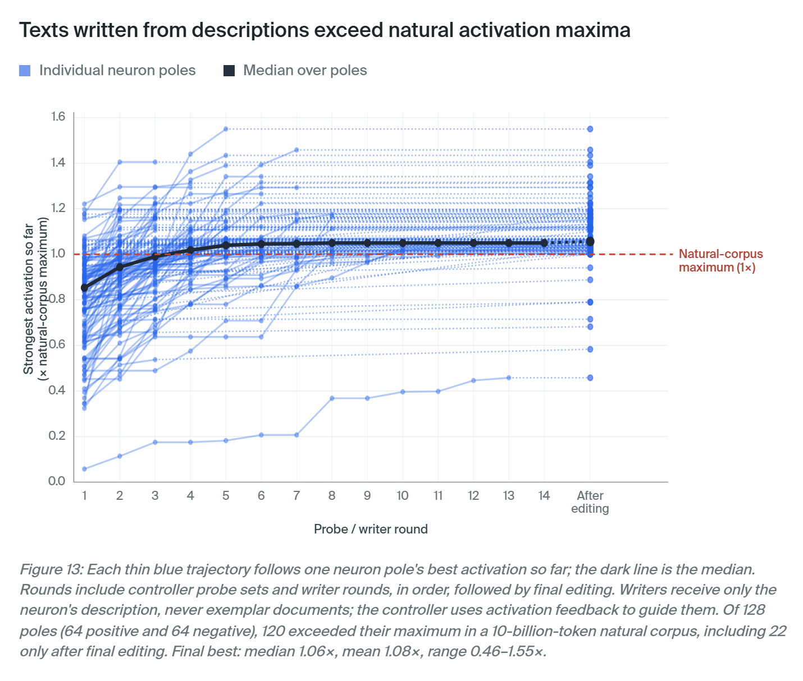

**▲ 원문 Figure 13** — 설명만 보고 쓴 문장으로 뉴런을 얼마나 세게 켰는지의 변화. 가는 파란 선 하나가 pole 하나의 "지금까지 최고 기록"이다. 굵은 검은 선은 중앙값, 빨간 점선은 원래 데이터의 최고 기록(1×)이다. 128개 중 120개가 이 선을 넘었다.

<details>
<summary>📋 원문 Table 7 캡처 보기 — 설명만 보고 쓴 문장 예시 8개와, 원래 최고 기록의 몇 배인지</summary>
<br>
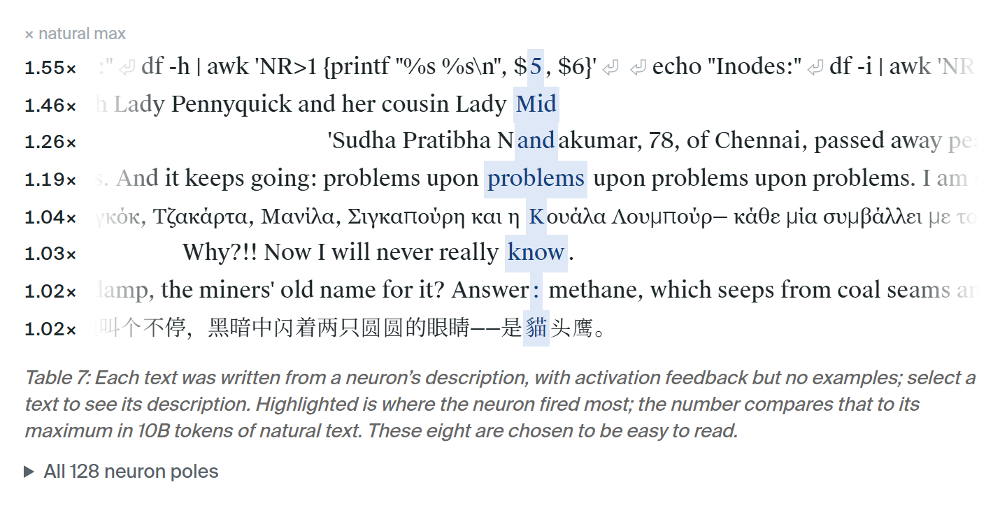
</details>

---

## 6. 뉴런 예시

### 6.1 계약서의 "at the option of" 뉴런 — L4_E177_N37 (−쪽)

- **언제 문이 열리나 (gate)**: 계약서 말투의 "at the ___ of" 꼴이 있고 거기에 'option'이라는 단어가 올 때. gate를 가장 크게 올리는 input은 비용·의무와 관련된 뉴런 L3_E132_N174다.
- **어느 쪽으로 내보내나 (up)**: 법률 용어에 반응하는 뉴런들과 'option'이라는 글자에 반응하는 뉴런들이 "계약상 선택권" 쪽으로 밀어 준다.
- **누가 받아 쓰나 (reader)**: 선택권이나 단독 재량 권한을 다루는 reader는 더 켜지게 하고, 일반적인 법적 의무·가능성을 다루는 쪽은 누른다.
- **어디서 켜지나**: "at the" 바로 뒤의 " option"에서 가장 세게 켜진다.

### 6.2 건배사의 "to" 뉴런 — L24_E246_N254 (+쪽)

- **언제 문이 열리나 (gate)**: 건배하는 동사 바로 뒤의 "to"에서. 건배·cheers를 알아채는 뉴런과, 목적을 나타내는 전치사에 반응하는 뉴런이 함께 연다.
- **어느 쪽으로 내보내나 (up)**: 감사, "Long Live", 결혼 축복, 격식 있는 호칭에 반응하는 뉴런들이 "이제 건배 받을 사람 이름이 나올 차례" 쪽으로 민다.
- **누가 받아 쓰나 (reader)**: 다 같이 외치는 환호나 오래가길 비는 말을 예상하는 reader는 더 켜지게 하고, 그냥 "잔을 들다" 같은 동사 쪽은 누른다.
- **어디서 켜지나**: "raise our glasses"나 "a toast" 뒤의 " to" / " and". 러시아어 생일 축시에서도 약하게 켜진다.

두 예시 모두 "이 단어에서 켜진다"가 아니라 "이런 조건이 겹치면 켜지고, 그 결과 다음에 이런 게 준비된다"로 설명된다.

### 6.3 그 밖의 뉴런

| 뉴런 ID | 언제 켜지나 |
|---|---|
| L9_E220_N343 | 라식/PRK 수술 얘기에서 각막 혼탁·각막 실질 같은 말 |
| L14_E2_N83 | 'nested case-control'이라는 연구 방식의 "case" |
| L30_E129_N272 | 앞에서 선언한 코드 이름(Java 등)을 다시 칠 때 |
| L36_E193_N223 | 결혼식·춤 장면에서 "dance floor"가 나올 것 같을 때 |
| L9_E98_N330 | "Wait" 같은, 스스로 멈칫하며 의심하는 순간 |
| L16_E9_N229 | 막힌 뒤에 조심스럽게 새 방법을 시도할 때 |
| L4_E190_N436 | 날짜가 다음 달이나 다음 해로 넘어가는 지점 |
| L14_E2_N240 | 연구 결과를 "추정", "~일 수 있다"처럼 조심스럽게 말할 때 |
| L24_E230_N452 | 어떤 곳을 예전 국경 기준으로 말할 때 |
| L36_E110_N224 | 문서 다른 곳에 "release"라는 단어가 나왔을 때 |
| L24_E121_N186 | 누군가의 상태를 나이와 견줄 때 |
| L13_E133_N30 | 사람들이 혼자서도 생활할 수 있게 돕는 기술·지원 얘기 |

> 원문과 함께 자료도 공개됐다. 대표 뉴런 **2,734개**의 연결 그림, 켜진 사례, 에이전트가 쓴 설명 페이지다. 이와 별도로 뉴런을 훑어볼 수 있는 사이트와, 약 1,000만 개 pole 전체에 간단히 붙인 이름표도 있다(원문 페이지 위쪽에 neuron atlas 링크가 있다).

### 6.4 예외처럼 보이는 뉴런 파헤치기: 콜로라도 뉴런과 토네이도 (부록)

다른 모델(Qwen3-32B)의 뉴런 L55/N11703 얘기다. 콜로라도에 반응하는 뉴런인데, 엉뚱하게 토네이도 얘기에서도 가끔 작동한다. 겉보기에 뒤죽박죽인 뉴런을 끝까지 파 본 사례다.

- 이 뉴런의 영향력은 거의 전부(약 **98.8%**) 콜로라도, 다른 산악 지역, 그 밖의 장소 얘기에서 나온다. 콜로라도 얘기는 뉴런이 켜진 토큰의 1.4%뿐인데 영향력의 56%를 차지한다.
- 토네이도와 관련된 질문에서 이 뉴런을 누르면, 답에 '콜로라도'가 나올 확률이 30%에서 1%로 떨어지고 '캘리포니아'는 0.7%에서 4.7%로 오른다.
- 1억 토큰을 훑어서 이 뉴런이 세게 켜진 경우(보통 콜로라도에서 켜지는 세기의 30% 이상) 3,812건을 봤더니, 98.5%가 콜로라도나 다른 장소 얘기였다.
- "장소" 계산과 "토네이도" 계산이 겹치는 부분은 약 2%뿐이다. 연결을 따라가면 7층·11층의 토네이도 뉴런이 14층의 콜로라도 뉴런으로 이어진다. 같은 연결이 37–38층 근처에서 한 번 더 나온다(이 모델은 32–55층이 8–31층을 베낀 것 같은 구조다).
- 토네이도와 콜로라도가 왜 연결됐는지는 끝내 밝히지 못했다. 저자들은 학습 데이터와 중간 체크포인트가 공개된 모델로 다시 연구하겠다고 했다.

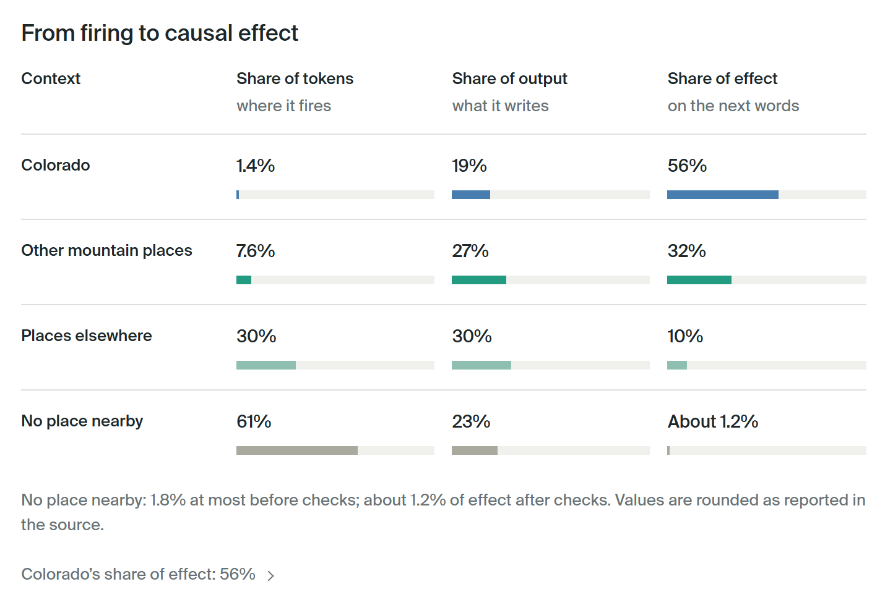

**▲ 원문 Figure 22** — 콜로라도 뉴런이 켜지는 상황별로 세 가지 비율을 나란히 놓은 그림. 켜진 토큰 중 몇 %인지, 출력 중 몇 %인지, 다음 단어에 준 영향 중 몇 %인지다. 콜로라도는 켜진 토큰의 1.4%뿐이지만 영향의 56%를 차지한다.

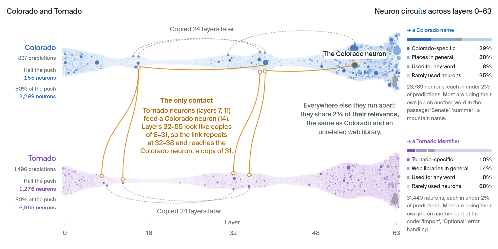

**▲ 원문 Figure 23** — 콜로라도–토네이도 지도. 0–63층에 걸친 두 뉴런의 연결과, 둘이 만나는 단 하나의 지점을 그렸다.

---

## 7. 뇌과학과의 연결

- 뇌 연구에도 같은 논쟁이 있다. "뉴런 하나가 특정 자극에 반응한다"로 설명할 것인가(single-neuron selectivity), "여러 뉴런이 함께 정보를 담는다"로 설명할 것인가(population coding, mixed selectivity).
- 저자들은 둘이 같이 성립할 수 있다고 본다. 그리고 "여러 뉴런이 함께 담는다"는 말이 superposition과 같은 뜻은 아니며, 어느 쪽도 "뉴런 하나하나는 해석할 수 없다"는 결론으로 이어지지 않는다고 말한다.
- 원문은 Hubel & Wiesel (1962), Barlow (1972), Quiroga et al. (2005) 같은 뇌과학 연구를 근거로 든다.

---

## 8. 결론과 남은 질문

**결론**

- 뉴런 대부분은 **하는 일이 한 가지에서 몇 가지**로 설명된다.
- 모델 출력에 미치는 영향은 대부분 **드물지만 세게 켜진 경우**에서 나온다. 약하게 켜진 것을 꺼도 모델은 상당 부분 그대로 돌아간다.
- 뉴런의 약 92%를 꺼도, 짧은 추가 학습으로 벤치마크 점수가 돌아온다.
- 어떤 기능 하나만 놓고 보면, **층마다 뉴런 몇 개**만으로 그 MLP 층 전체의 효과가 다시 나온다.
- 에이전트가 쓴 설명만으로, 가장 세게 켜진 구간에서 가능한 최대치의 약 73%까지 뉴런 값을 흉내 낸다.

**그래서 뭐가 달라지나**

- 뉴런은 생각보다 해석하기 쉽다. 뒤죽박죽인 뉴런은 예상보다 드물다. 여러 일을 하는 뉴런도 **누가 켜고 누가 받아 쓰는지**를 보면 일을 구분할 수 있다.
- 에이전트로 조사를 많이 할수록 설명이 계속 좋아진다. 이해한 뉴런이 늘면 다른 뉴런을 이해할 단서도 늘어나기 때문에, 갈수록 더 빨라질 수 있다고 본다.
- SAE 같은 도구를 거치지 않고 모델이 **원래 가진 단위**(뉴런)로 해석하자는 연재('native interpretability')의 첫 글이다.

**아직 모르는 것**

- 뉴런은 학습 중에 어떻게 자기 일을 갖게 되나? 서로 상관없는 mode는 왜 생기나?
- 약하게 켜진 값과 Q3는 정확히 무슨 일을 하나?
- 다른 모델에서도 같은 결과가 나오나?
- 앞으로 할 일: 뉴런 하나보다 큰 단위로 넓히기, 학습 중에 연결이 생기는 과정 보기, attention과 뉴런이 서로 어떻게 엮이는지 보기

원문 부록 「Open Questions & Future Work」는 따로 일곱 가지를 꼽는다.

| 주제 | 내용 |
|---|---|
| 외운 글 떠올리기 (memorization) | 모델이 외운 글을 떠올리는 방식에 대한 가설이다. 글 속 단서들이 attention에 쌓여서, 외운 다음 토큰 쪽 연결을 밀어 준다고 본다. 자세한 건 다음 글에서 다룬다고 했다 |
| 뉴런 조합 (composition) | 뉴런마다 자주 같이 켜지는 짝이 있고, 그 조합이 "두 뜻이 겹치는 부분"을 나타낸다. 그렇다면 여러 뉴런에 넓게 퍼진 feature가 없어도 부드럽게 이어지는 표현이 가능할 수 있다 |
| 학습 중 변화 | 엉뚱하거나 동떨어진 mode는 학습 중에 어떻게 생기나. 수학·코딩 mode는 추가 학습(post-training)에서 생긴 건가 |
| 감지기 만들기 | residual stream에 probe를 다는 방식 말고, 뉴런이나 뉴런 연결을 바탕으로 더 좋은 감지기와 모니터를 만들 수 있나 |
| 약하게 켜진 값 | 대체로 영향이 작다. 다만 꺼도 출력은 안 바뀌는데, 해당 내용이 나올 확률을 조금 올려 주는 중간 구간이 있다 |
| attention이 끼는 경우 | 어떤 뉴런은 주된 reader(가끔은 input)가 attention 층이라는 걸 알고 나서야 해석됐다 |
| n-gram 알아채기 | 어떤 경우에는 뉴런 몇 개의 뜻이 겹치는 것만으로 두 단어 조합(bigram)이나 n-gram을 알아챌 수 있다. 저자들은 이것을 "뉴런 하나 = 뜻 하나"(monosemantic) 관점에 대한 반론으로 본다 |

## 부록. transcoder로 본 뉴런

원문 부록 「Transcoder Evidence for Sparsity」의 내용이다. 본문에서 다루지 않아서 그림과 함께 요점만 적는다.

- **transcoder**는 SAE의 친척이다. MLP가 하는 계산을, 드물게 켜지는 feature들로 바꿔서 흉내 내는 도구다.
- 원문이 인용한 앞선 연구(Shabalin & Piotrowski, 2026)에 따르면 transcoder의 feature는 대체로 뉴런을 그대로 베낀 것이다. 뉴런에서 알 수 있는 것 이상을 거의 알려 주지 않는다.
- 저자들은 한 걸음 더 나가서, 뉴런과 딱 맞지 않는 나머지 feature가 무엇인지 뜯어봤다(OMP라는 분해 기법을 썼다). 대개 **자주 같이 켜지는 뉴런 2–64개를 합친 것**이었다. 원문은 이런 묶음을 coalition이라고 부른다.
- 이렇게 합쳐진 feature의 뜻은 구성 뉴런들의 뜻을 **합치거나 겹친 것**이었다. 뉴런과 상관없는 새로운 뜻이 아니었다. 그 밖에 앞 층 뉴런을 되풀이하는 feature와, 특정 문구 틀에만 맞춰진 feature도 있었다.
- 숫자 예(19층, 1× 크기 사전, feature 131,072개): feature의 50.9%는 뉴런 복사, 16.0%는 뉴런 + 읽는 쪽 조건, 14.3%는 coalition이다. 그 층 뉴런의 38.9%는 자기를 복사한 feature가 있다. coalition 하나에 들어가는 뉴런 수는 사전에 따라 중앙값 8–34개다.
- 저자들의 결론: 여러 뉴런에 넓게 퍼진 feature가 있을 가능성을 완전히 배제하지는 못한다. 하지만 이 결과는 "뉴런 하나하나가 의미 있는 계산 단위이고, 전용 뉴런이 없는 개념은 뉴런 몇 개의 조합으로 표현된다"는 그림과 잘 맞는다.

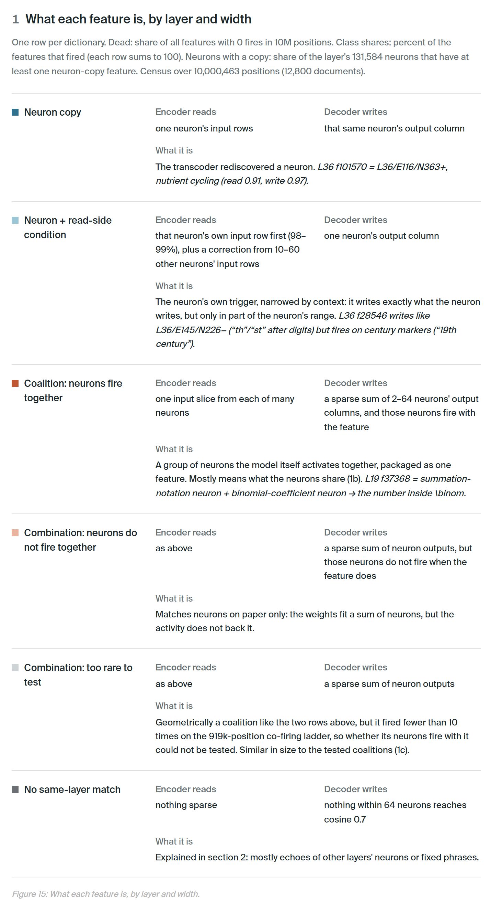

**▲ 원문 Figure 15** — transcoder feature의 종류. 뉴런 복사 / 뉴런 + 읽는 쪽 조건 / 같이 켜지는 뉴런 묶음(coalition) / 같이 켜지지 않는 뉴런들의 조합 / 너무 드물어서 확인하지 못한 조합 / 같은 층에 짝이 없는 것.

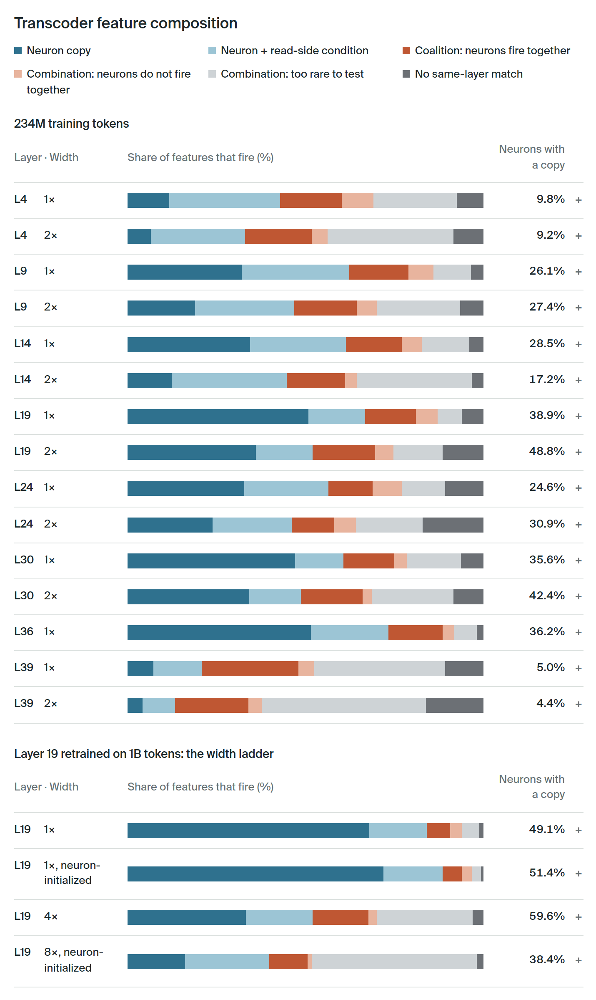

**▲ 원문 Table 10** — 층과 사전 크기별로 위 여섯 종류가 각각 몇 %인지, 그리고 자기를 복사한 feature가 있는 뉴런의 비율.

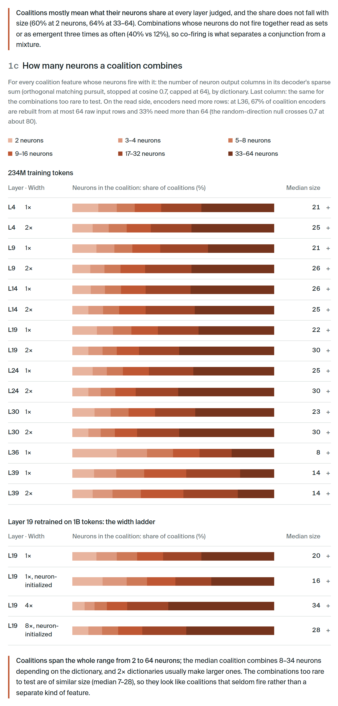

**▲ 원문 Figure 16** — coalition 하나에 뉴런이 몇 개 들어가는지의 분포(2개부터 33–64개까지). 층과 사전 크기별.

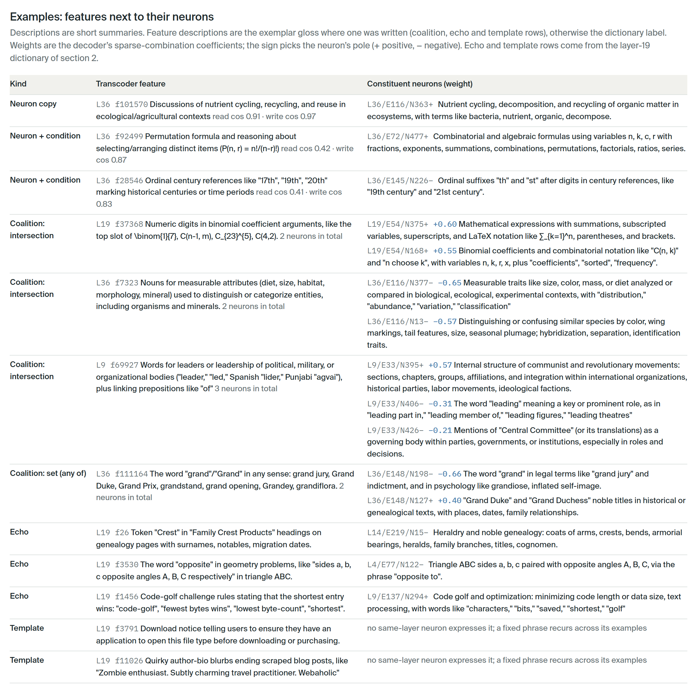

**▲ 원문 Table 11** — 뜻이 합쳐지는 예. transcoder feature의 설명과, 그 feature를 이루는 뉴런들의 설명을 나란히 놓았다.

---

## 이 정리본에 없는 것

원문은 본문 뒤에 긴 부록이 붙어 있어서 이 문서보다 훨씬 길다. 이 문서에는 큰 줄기와 번호 붙은 그림·표가 다 들어 있다. 다만 아래는 빼거나 한두 줄로 줄였다.

- **평가 방법 부록의 자세한 내용** — 데이터를 어떻게 나누고 무엇을 뺐는지, 설명 형식을 바꿔 가며 한 detection 실험, reader를 보고 mode를 맞히는 실험의 여러 변형, 시험용 글 조각을 뽑는 방식
- **긴 목록과 직접 눌러 보는 자료** — Table 7에 딸린 pole 128개 전체 목록, 부록의 pole landscape 모음(약 990개), 그림마다 붙은 "About this figure" 설명
- **벤치마크 표의 자세한 조건** — 조건별 정의, 오차 구간 계산 방식, 실행 환경에 대한 주석
- **그 밖** — 참고문헌, 감사의 글, 저자별 역할, 각주

## 출처

- Goodfire Research, *Neurons as an Interpretable Basis* (2026-11-10): https://www.goodfire.com/research/neurons-as-an-interpretable-basis
  - 원문 페이지에서 PDF, 마크다운 버전, 인용(BibTeX), 뉴런 아틀라스 링크를 제공한다.
  - 이 문서의 그림은 모두 위 원문 페이지를 화면 캡처한 것이다(2026-11-11). 맨 위 제목 옆의 장식용 애니메이션은 번호 붙은 그림이 아니라서 뺐다.
