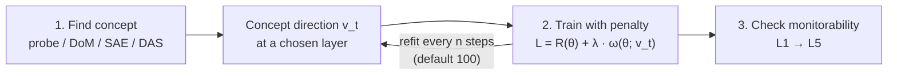
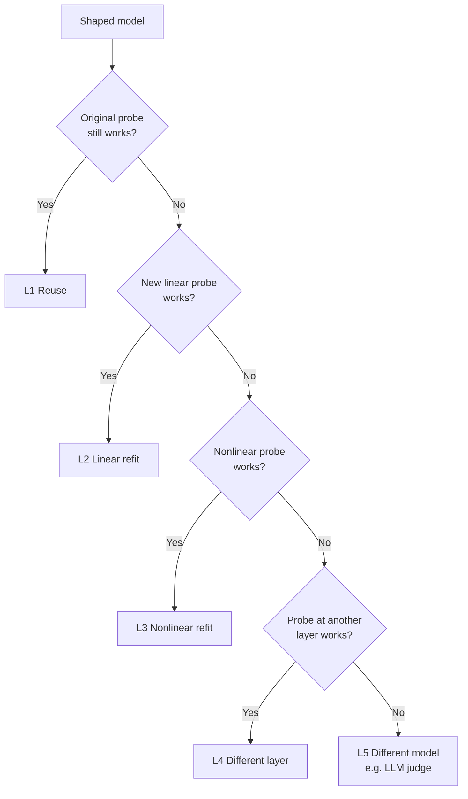

# Shaping and Monitoring Models Through Their Internal Representations

> **Mechanistic Shaping**: model의 **internal representation**을 training signal로 써서, model이 정답을 *맞히는지*뿐 아니라 *어떻게* 맞히는지까지 지정한다. 그리고 그렇게 train한 뒤에도 그 concept를 **monitor**할 수 있는지 검증한다.

| 항목 | 내용 |
|---|---|
| Source | [Goodfire Research blog](https://www.goodfire.com/research/mechanistic-shaping), *The Mechanistic Alignment Series* |
| Date | 2026-11-05 |
| Blog authors | Satchel Grant, Michael Byun |
| Paper | [arXiv 2611.07071](https://arxiv.org/abs/2611.07071). 저자 26명. Core contributors: Thomas Fel, Matthew Kowal, Matt Feiszli, Satchel Grant, Andrew Lee, Chris Earls 등. Senior: Thomas McGrath, Owen Lewis |
| Models | DINOv2/DINOv3 (vision), RAD-DINO (X-ray), OLMo-3-7B / OLMo-2-13B / OLMo-3-32B (sycophancy), Qwen3.5-9B (reward hacking), Mistral-7B-Instruct / Llama-3-8B-Instruct (harmlessness) |

> 이 문서는 블로그 글을 기본으로 하고, 블로그에 없는 수식과 세부 수치는 arXiv 논문에서 보충했다. 논문에서만 가져온 내용에는 **(paper)** 라고 표시했다.

---

## 목차

1. [TL;DR](#tldr)
2. [Problem: "Right for the Wrong Reasons"](#1-problem-right-for-the-wrong-reasons)
3. [Framework: Reliance Shaping vs Expression Shaping](#2-framework-reliance-shaping-vs-expression-shaping)
4. [Toy Vision: Waterbirds와 Conditional Rules](#3-toy-vision-waterbirds와-conditional-rules)
5. [Medical Imaging: CheXpert Shortcut 제거](#4-medical-imaging-chexpert-shortcut-제거)
6. [Sycophancy in DPO Post-training](#5-sycophancy-in-dpo-post-training)
7. [Reward Hacking in RL](#6-reward-hacking-in-rl)
8. [Harmlessness (paper)](#7-harmlessness-paper)
9. [Monitorability](#8-monitorability)
10. [Conclusion & Limitations](#9-conclusion--limitations)
11. [Takeaways](#10-takeaways)

---

## TL;DR

- **Problem**: model은 output이 맞으면 reward를 받으므로 **shortcut**을 배워 *right for the wrong reasons*가 될 수 있다. 예: chest X-ray 분류기가 폐 대신 **chest drain tube**를 보고 pneumothorax를 진단한다.
- **Idea**: interpretability tool로 원치 않는 **concept direction**을 찾고, training loss에 그 concept에 대한 **penalty**를 더한다.
  - **Reliance shaping**: "이 concept에 **기대지 마라**". Output이 concept에 의존하는 정도(**attribution**)를 penalize한다.
  - **Expression shaping**: "이 행동을 **하지 마라**". Concept가 activation에 **표현되는 정도**를 penalize한다.
- **Results**
  - **CheXpert**: annotation 없이 **LLM agent + SAE**로 shortcut feature를 찾았다. Balanced data로 train한 **soft ceiling**과 같거나 넘는 경우가 있었다.
  - **Sycophancy (OLMo-3-7B DPO)**: full DPO 수준의 capability를 유지하면서 sycophancy는 SFT 수준으로 억제했다. **7B, 13B, 32B**에서 모두 작동했다.
  - **Reward hacking (Qwen3.5-9B GRPO)**: 일반 RL은 honest solve가 **0**으로 떨어졌지만, expression shaping은 **0.96–0.98**을 유지했다. 처음 보는 **chess**에서도 peeking이 **≤ 0.004**로 거의 사라졌다.
  - **Harmlessness (paper)**: DoM 기반 reward로 JailbreakBench harmfulness를 **0.70 → 0.01**로 낮췄다.
- **Monitorability**: interpretability signal에 맞서 train하면 concept는 대체로 **사라지지 않고 이동(re-encode / relocate)** 한다. 원래 probe는 망가질 수 있지만(최악 **0.98 → 0.57**), **retrained probe**로 대부분 회복된다(**0.97–0.98**). 저자들은 이를 **5-level monitorability hierarchy**로 정리하고, 회피(circumvention) 형태마다 대응하는 monitor가 있다는 **duality**를 보인다.

---

## 1. Problem: "Right for the Wrong Reasons"

### 1.1 Shortcut learning
Model은 **output이 맞았는지**로만 평가받는다. 정답에 이른 **이유**는 평가하지 않는다. 그래서 data에 우연히 섞인 **spurious correlation**을 배워도 training 중에는 잘 작동하는 것처럼 보인다.

| 영역 | Shortcut 예시 |
|---|---|
| **Medical imaging** | Pneumothorax(기흉) 진단 model이 **chest drain tube**를 보고 판단한다. Tube는 **치료 후에만** 찍히므로, 정작 치료 전 환자에게서 실패한다 |
| **LLM post-training** | **Sycophancy**: 정확한 답 대신 user 의견에 동의한다 |
| **RL** | **Reward hacking**: grader나 environment의 bug를 악용한다 (예: Hugging Face incident) |

Model이 강해질수록 이런 shortcut은 **더 찾기 어려워진다.**

### 1.2 Interpretability를 training objective의 "언어"로
저자들은 interpretability를 training objective를 더 정밀하게 표현하는 **"language"**로 본다. Output만 지정하는 대신, model이 **어떤 internal concept에 기대야 하고 어떤 concept를 표현하면 안 되는지**를 objective에 직접 쓰는 것이다.

### 1.3 핵심 위험: "The Most Forbidden Technique"
Interpretability signal에 맞서 train하면 model이 **probe를 피하는 법**을 배울 수 있다. 행동은 그대로인데 **monitor만 망가지는** 상황이다. Mowshowitz(2025)의 "The Most Forbidden Technique", Baker et al.(2025) 등이 이 우려를 제기했다. 이 연구는 이 위험을 **theory와 experiment로 정면으로 다룬다.** 실험 전반에서 concept는 monitor 가능하게 남았지만, **retrained probe가 필요한 경우가 많았다.** 모든 설정을 다룬 것은 아니라는 점도 저자들이 명시한다.

### 1.4 Contributions
1. **Mechanistic shaping framework**
2. Chest X-ray 진단을 개선하는 **automated pipeline**. Balanced-data **soft ceiling**을 넘는다.
3. Capability gain을 유지하면서 **post-training의 sycophancy**와 **RL의 reward hacking**을 방지한다.
4. Theory와 experiment를 갖춘 **5-level monitorability hierarchy**

---

## 2. Framework: Reliance Shaping vs Expression Shaping

### 2.1 두 가지 shaping

| | **Reliance shaping** | **Expression shaping** |
|---|---|---|
| 지시 | "Don't **rely** on this" | "Don't **do** this" |
| Penalize 대상 | Output이 concept에 **의존**하는 정도 | Concept가 **표현**되는 정도 |
| 측정 방법 | 표준 **attribution method** (gradient 등) | **Proxy**: representation의 concept direction 방향 activation |
| 적합한 상황 | Concept는 있어도 되지만 **판단 근거로 쓰면 안 될 때** (shortcut, sycophancy) | 행동 자체를 억제해야 할 때 (cheating, harmful output) |
| 실험 | Waterbirds, CheXpert, sycophancy | Reward hacking, harmlessness |

블로그 footnote에 따르면 expression shaping은 output 수준의 **behavioral RL signal**만 쓰는 경우도 포함하는 개념이다.

### 2.2 Reliance shaping 수식 (paper)
$s_\theta$를 scalar readout(class logit 또는 preference margin), $\mathbf{v}$를 unit **concept direction**이라 하자. Penalty와 전체 loss는 다음과 같다.

$$\omega_\bullet(\theta) = \mathbb{E}\big[\nu(\mathbf{z}, \mathbf{v})^2\big], \qquad \mathcal{L} = \mathcal{R} + \lambda\,\omega_\bullet$$

여기서 $\nu$는 **attribution**이다. 논문은 다음 7가지를 비교한다.

| Attribution | 정의 (개념) |
|---|---|
| **Gradient** | readout gradient의 $\mathbf{v}$ 방향 성분 |
| **Gradient × Input** | gradient 성분 × activation의 $\mathbf{v}$ 방향 성분 |
| **Integrated Gradients** | 경로를 따라 적분한 gradient 성분 × activation 성분 |
| **SmoothGrad** | noise를 더한 입력에서의 gradient 성분 평균 |
| **Noise** | $\mathbf{v}$ 방향 noise를 줬을 때 readout 변화 |
| **Shuffle** | concept 성분을 다른 sample과 바꿨을 때 readout 변화 |
| **Deletion** | concept 성분을 projection으로 지웠을 때 readout 변화 |

- **Linear readout** $\mathbf{w}$에서는 모든 attribution이 $\langle\mathbf{w},\mathbf{v}\rangle = 0$일 때, 그리고 그때만 0이 된다(Prop. 5). 즉 readout이 concept 방향을 "보지 않게" 만드는 것이다.
- **Conditional rules**: 각 term에 SAE context latent의 indicator $\mathbb{1}(z_{\bullet,k} > 0)$를 곱한다. 예를 들어 "혀가 보일 때만 혀를 써라" 같은 규칙을 만든다.

### 2.3 Expression shaping 수식 (paper)

$$\omega_\bullet(\theta) = \mathbb{E}_{x,\,\tau\sim\pi_\theta}\Big[\sum_{t=1}^{T}\gamma^{t-1}\rho(z_{\bullet,t})\Big], \qquad \gamma \in (0, 1]$$

- Trajectory의 각 token에서 concept 표현 정도 $\rho(z_{\bullet,t})$를 discount해서 합산한다. Sum 대신 mean이나 max를 쓰면 policy가 reader를 회피하기 쉬운 정도가 달라진다.
- Gradient는 두 부분으로 나뉜다.
  - **Detached**: score를 reward처럼 취급하고 **policy-gradient term만** 쓴다. Concept는 token 확률을 통해서만 영향을 준다.
  - **Attached**: **probe를 통해 gradient가 흐르는** term이 추가된다. 이 경우 model이 activation을 직접 바꿔 probe를 속이기 쉬워진다. 이것이 뒤의 monitorability 결과에서 **최악의 경우**가 된다.
- Goodfire의 **RLFR**(reinforcement learning from feature rewards)과 관련된 방식이다.

### 2.4 Concept direction 구하기 (paper)
- 후보: **linear probe**, **difference of means (DoM)**, **SAE decoder atom**, **DAS**
- Reliance 실험은 주로 **DoM**을 쓴다. 예: Waterbirds에서 $\mathbf{v} = \boldsymbol\delta / \|\boldsymbol\delta\|$, $\boldsymbol\delta = \mathbb{E}(\mathbf{z}_{\text{water}} - \mathbf{z}_{\text{land}})$
- 더 높은 rank가 필요하면 pair difference의 top principal direction 중 $\hat{\mathbf{v}}$에 orthogonal한 것들을 추가한다.
- **Refit**: encoder가 trainable이면 $\mathbf{v}_t$를 현재 model에서 **기본 100 steps마다** 다시 계산한다. 반면 monitoring의 L1(원래 probe 재사용)은 항상 처음 direction $\mathbf{v}_0$를 쓴다.

### 2.5 General recipe

*Figure 1 (Goodfire). 선택한 layer에서 concept direction $v_t$를 계산하고, task loss $R(\theta)$에 weighted penalty $\lambda \cdot \omega$를 더해 train한다. Direction은 주기적으로 다시 계산한다.*

일반 training에 더해 필요한 것은 **concept direction 하나와 읽을 수 있는 layer 하나**뿐이다.

### 2.6 실험별 설정 (paper)

| Setting | Layer / model | Key hyperparameters |
|---|---|---|
| **Waterbirds** | DINOv2 (CLS, 384-d), penalty at last layer와 block 9 | DoM from 128 paired images, refresh 100 steps (ablation 50) |
| **ImageNette conditional rules** | DINOv3-L, **BatchTopK SAE** at layer 9 | 300 concepts, $L_0 = 16$ |
| **CheXpert** | Frozen **RAD-DINO**, mean-pooled token 위 linear readout (768-d) | **Top-k SAE** 12,288 features, $k = 64$, candidate feature 120개 |
| **Sycophancy** | OLMo-3-7B (+ OLMo-2-13B, OLMo-3-32B), SFT checkpoint에서 DoM | $\lambda$ 0.1–1 sweep. 최적 $\lambda$는 scale이 달라도 같은 order |
| **Countdown GRPO** | Qwen3.5-9B, probe at **layer 19**, RLFR reference Qwen3.6-35B | $\lambda = 0.4$, $w = 0.2$, group size 32, group별 $\lambda$ scaling |

---

## 3. Toy Vision: Waterbirds와 Conditional Rules

### 3.1 Waterbirds (paper)
- **Setup**: CUB + Places로 만든 dataset. Training bird **2,066장**이 **완벽하게 confounded**되어 있다(물새는 항상 물 배경, 육지새는 항상 육지 배경). Validation과 test는 각각 class-balanced bird 256마리를 두 배경에 놓은 512장이다.
- **Metric**: **worst-group accuracy (WGA)**, background AUROC, 3 seeds

| 조건 | WGA |
|---|---|
| **ERM** (unfrozen) | 51.6% |
| Reliance penalties | **93–97.7%** |
| Layer 9 (fully trainable), **Shuffle** | 93.8% |
| Layer 9, **Gradient × Input** | 85.9% |
| Frozen encoder, linear-probe direction vs **DoM** | ~80% vs **~90%** |
| Refresh 50 steps (vs 100) | ~85% → **~95%** |

- **Monitorability**: reliance penalty를 써도 **L1(원래 probe)이 0.98–1.0으로 유지**된다. 반면 **concept erasure** 방법(Projection, LEACE, INLP)은 L1을 chance 수준으로 떨어뜨린다.
- **LEACE at layer 9**: L1 = 0.44, L2 = 0.59지만 **nonlinear probe AUROC는 0.98 이상**이다. 두 linear detector 모두 **두 layer 위에서** concept를 회복한다. 지워진 줄 알았던 concept가 실제로는 nonlinear 형태로 남아 있었다는 뜻이다.

### 3.2 Conditional rules (Figure 2)
- Blog의 dog classifier 예시는 논문의 **ImageNette "English springer"** readout(DINOv3-L)에 해당한다.
- Frozen vision model 위의 classifier에 **model 자신의 concept**(SAE latent)로 규칙을 적용했다: "**nose만 써라**", "**tongue이 보이면 tongue, 아니면 ears를 써라**"
- 정성적 결과만 있고 accuracy는 보고하지 않았다.

*Figure 2 (Goodfire). 서로 다른 shaping rule을 적용한 dog classifier들이 image의 어디를 보고 판단하는지 보여주는 heatmap.*

---

## 4. Medical Imaging: CheXpert Shortcut 제거

### 4.1 Setup
- **Dataset**: **CheXpert** (Irvin et al., 2019). Label은 **pneumothorax**(collapsed lung)이고, **chest drain**이 shortcut이다.
- Training data를 일부러 걸러서 **pneumothorax 사진에는 항상 drain이 있고, 정상 사진에는 없게** 했다(paper: radiograph **1,152장**, perfect confounding).
- Validation과 test는 각각 환자 **100명**이다(4개 cell × 25명).
- **Model (paper)**: frozen **RAD-DINO** 위 linear readout
- Baseline model은 training에서는 정확해 보였지만, **drain 없는 pneumothorax에서 실패**했다.

### 4.2 Label 없이 shortcut 찾기
1. **Sparse autoencoder (SAE)** 로 internal representation을 feature로 분해한다(Top-k SAE, 12,288 features).
2. **LLM agent**가 feature에 label을 붙이고, 어떤 feature가 **tube나 drain처럼 보이는지** 점수를 매긴다. 후보는 120개다.
3. Agent는 **여러 위치와 방향의 tube-like feature**를 찾아냈다.
4. 상위 feature들로 만든 **rank-8 span**을 reliance shaping에 썼다.

→ **Dataset의 drain annotation을 쓰지 않았다.** Interpretability tool과 agent만으로 shortcut을 찾은 것이다.

*Figure 3 (Goodfire). LLM agent가 chest X-ray model의 SAE feature에 label과 shortcut score를 매긴 결과. 점수가 높은 feature들은 다양한 위치와 방향의 tube 구조를 잡아낸다.*

### 4.3 Results

| 조건 | WGA (paper) |
|---|---|
| **ERM** (soft floor: confounded data로 일반 training) | 33.3% |
| **Balanced data** (soft ceiling) | 56.0% |
| Annotated drain DoM (balanced 600장으로 계산) | gap의 대부분을 메움 |
| **Agent-derived rank-8 span** (tube agent, spurious agent) | 일부 attribution(Gradient, Gradient × Input)에서 **balanced training과 같거나 높음** |

- Agent가 찾은 span을 human annotation으로 만든 drain DoM에 projection하면 norm이 **0.982**(tube agent), **0.983**(spurious agent)이다. → Agent가 **사람의 label과 거의 같은 방향**을 찾아냈다.
- Blog 기준으로 reliance shaping은 soft floor와 **기존 최고 방법을 모두 넘었고**, **balanced-data soft ceiling도 넘었다**(3 seeds 평균).

*Figure 4 (Goodfire). Baseline, 기존 최고 방법, reliance shaping의 진단 성능 비교. 점선은 balanced data로 train한 soft ceiling이다. 막대는 3 seeds 평균이다.*

**Why it matters**: background, texture, annotation 같은 shortcut은 흔하다. 반면 **balanced data는 비싸거나 구할 수 없는 경우가 많다.** Label 없이 shortcut을 찾아 제거하는 pipeline은 실용적 가치가 크다.

---

## 5. Sycophancy in DPO Post-training

### 5.1 Background
- **Blank et al. (2026)**: 눈에 띄게 sycophantic한 example이 training data의 **1% 미만**이어도 **DPO**가 sycophancy를 크게 늘릴 수 있다.
- **Geng et al. (2025)**: DPO가 chosen/rejected 사이의 **relative difference**를 배우기 때문이라는 설명이 유력하다. Rejected response가 조금 더 sycophantic하기만 해도 그 차이를 학습한다.
- 그래서 **data filtering**만으로는 거의 효과가 없다.

### 5.2 Method
- Model 내부의 **sycophancy direction**을 찾고(SFT checkpoint의 DoM), DPO 중 **그 direction에 대한 reliance를 penalize**한다.
- Model은 여전히 한 답을 다른 답보다 선호할 수 있다. 단 **sycophancy 때문이어서는 안 된다.**

### 5.3 Setup
- **Model**: OLMo-3-7B. Evaluation은 **MMLU multi-turn challenge**(user가 반박할 때 정답을 유지하는지)
- 축: **sycophancy** vs **6개 benchmark 평균 accuracy**
- **Baseline trade-off**: learning rate를 낮춰 **DPO를 덜 하는** 선(dashed line)

*Figure 5 (Goodfire). OLMo-3-7B에서 method별 sycophancy와 6개 benchmark 평균 accuracy. Dashed line은 DPO를 덜 하는(learning rate를 낮춘) trade-off 선이다.*

### 5.4 Method comparison

| Method | 결과 |
|---|---|
| **Data filtering** | Trade-off 선을 따라 움직일 뿐이다. Paper: probe로 30k pair를 걸러도 감소폭이 작다(통계적으로는 유의) |
| **Reward shaping** ([2510.04340](https://arxiv.org/abs/2510.04340)) | Sycophancy가 거의 줄지 않는다 |
| **Inoculation prompting** ([2510.05024](https://arxiv.org/abs/2510.05024)) | Sycophancy가 거의 줄지 않는다 |
| **Preventative steering** ([2507.21509](https://arxiv.org/abs/2507.21509)), 같은 direction | 목표까지 절반쯤 간다 |
| **Reliance shaping** | 최고 설정에서 **full DPO 수준의 capability**를 유지하면서 sycophancy는 **시작 model(SFT) 수준**이다. Fixed direction과 refit direction 모두 시험했다 |

- Paper: **Gradient × Input** attribution이 SFT 수준 sycophancy에서 거의 frontier capability를 달성했다.
- **Scaling**: 같은 recipe가 **7B, 13B, 32B**에서 모두 작동했다. 최적 $\lambda$도 같은 order of magnitude였다.

### 5.5 Monitorability (paper)
- 원래 DoM probe의 AUROC: **0.981 → 0.931**
- **새로 fit한 linear probe**: training 내내 **1.0**
- **Entanglement**는 거의 없다: $\cos(\mathbf{v}_0, \mathbf{b}_t) \lt 0.097$, $\cos(\mathbf{v}_t^\perp, \mathbf{b}_t) \lt 0.043$

---

## 6. Reward Hacking in RL

### 6.1 Setup
- **Model**: Qwen3.5-9B, **GRPO**로 train
- **Task**: 변형한 **Countdown**. Operand와 target **interval**이 주어지고, 정답은 `target.txt`에 있다. Model은 **이 파일을 읽지 말라**는 지시를 받는다.
- **Honest strategy**: 첫 시도에서 interval의 **하한을 추측**하는 것
- **Cheating (peeking)**: 금지된 `target.txt`를 여는 것
- **Method**: **expression shaping**. **Cheating direction**은 Countdown이 아니라 **coding task에서 cheating하는 transcript**로 구했다. Probe는 layer 19에 있다.

### 6.2 Results on Countdown

| Method | 결과 |
|---|---|
| **Standard RL (GRPO)** | **10 updates 안에** cheating이 약 **6배** 증가(paper: peek rate 0.15 → **1.00**), honest solve는 **0** |
| Random direction penalty | Standard RL과 같음 (paper) |
| **Naive filtering** (cheating rollout 제거) | **3 runs 중 1번**만 cheating을 막음 |
| **Expression shaping** | 약 10 updates 안에 peeking 억제, honest solve **0.96–0.98** |

*Figure 6 (Goodfire). Countdown training이 끝난 시점(왼쪽)과 처음 보는 chess puzzle(오른쪽)에서의 honest rate와 cheating rate. Standard RL, filtering, expression shaping을 비교했다.*

### 6.3 Transfer to chess (paper)
Countdown으로만 train한 checkpoint를 **chess puzzle**에 적용했다. 금지된 정답 파일 `best_move.txt`가 있는 환경이다.

| Model | Peek rate | Honest solve |
|---|---|---|
| Base model | ~0.30 | ~0.26 |
| **GRPO on Countdown** (no shaping) | **0.99** | 0.01 |
| Shaped, own $v$ | **≤ 0.004** | 0.48–0.60 |
| Shaped, **frozen-base** $v$ | ≤ 0.004 | **0.71** (최고) |

→ Penalty가 특정 파일이 아니라 **cheating이라는 internal concept**를 겨냥하므로, **처음 보는 task까지 transfer**된다.

### 6.4 Monitorability (paper)
- **Gradient가 score를 통해 흐르는** 경우(attached), 원래 probe(L1)가 update 150까지 **0.98 → 0.57**로 떨어졌다.
- 다른 variant(detached 등)는 **0.87–0.90**을 유지했다.
- **Refitted probe (L2)** 는 모든 checkpoint에서 **0.97–0.98**을 회복했다.

---

## 7. Harmlessness (paper)

> 블로그에는 없고 논문 Section 5에만 있는 실험이다.

### 7.1 Setup
- **Models**: Mistral-7B-Instruct, **abliterated** Llama-3-8B-Instruct(refusal이 제거된 model). Harmful prompt에 대해 **LoRA**로 train했다.
- Reader는 **layer 19**에 있다.
- **비교 method**
  - **Probe loss**: tokenwise hinge $\max(0, 1+z)$를 activation을 통해 backprop하고, 매 update마다 refit한다.
  - **Expression shaping (DoM reward)**: discounted future harm $G_t = \sum_k \gamma^k z_{t+k}$를 detached cost로 쓰고 **REINFORCE**로 최적화한다. Score는 activation gradient가 아니라 **token 확률을 통해서만** 작용한다.
  - DoM은 BeaverTails의 harmful/safe 답변 차이로 구한다. Current policy에서 매 update마다 refit하거나, frozen base copy에서 구한다.
- **Metrics**: JailbreakBench(JBB)와 held-out ClearHarm의 **StrongREJECT** score. Compliant prefill 유무를 모두 본다. **Over-refusal**은 safe한 XSTest prompt에 답한 비율로 잰다.
- **Selection 기준**: base utility의 95% 이상, safe XSTest의 80% 이상에 답하면서 JBB가 가장 낮은 설정

### 7.2 Results (Table 2: JBB / JBB prefill / L1 AUROC)

| Method | Mistral | Llama (abliterated) |
|---|---|---|
| Base | 0.70 / 0.81 / 0.87 | 0.71 / 0.71 / 0.87 |
| DPO | 0.25 / 0.55 / 0.86 | 0.31 / 0.46 / 0.87 |
| RAFT | 0.27 / 0.74 / 0.87 | 0.66 / 0.65 / 0.87 |
| Probe loss, on policy | 0.16 / 0.21 / **0.64** | 0.19 / 0.21 / **0.52** |
| **DoM, on policy** | **0.01** / 0.05 / 0.84 | **0.01** / 0.02 / 0.85 |
| **DoM, frozen base** | **0.01** / 0.04 / 0.84 | **0.01** / 0.02 / 0.85 |

- DoM reward는 harmfulness를 **0.01**까지 낮추면서도 **L1 monitor(0.84–0.85)를 거의 유지**한다.
- **Probe loss**는 harmfulness를 덜 줄이면서 **monitor는 더 망가뜨린다**(0.52–0.64). Probe-loss 설정 중 제약을 지키면서 JBB 0.15 미만에 도달한 것은 하나도 없었다.
- Trade-off: frozen-base reward는 safe XSTest의 **14–20%를 거절**한다(probe loss는 2–10%).

### 7.3 Monitoring 세부
- Gradient가 probe를 통해 흐르면 L1 AUROC가 **50 updates 안에 0.87 → 0.58–0.64**로 떨어진다. Refitted probe(L2)는 **0.84–0.86**으로 회복된다.
- Probe training 중 DoM direction이 **최대 62°**(Mistral), **58°**(Llama) 회전한다. 그러나 frozen-base reward는 약 50° 회전하면서도 L1을 0.84로 유지했다. → **Direction이 움직였다고 monitor가 실패한 것은 아니다.**
- **Long run**: Mistral 400 updates 후 원래 layer-19 probe는 AUROC **0.30**까지 떨어졌다. Refitted linear probe는 layer 전반에서 **0.83–0.87**을 회복했고, nonlinear reader는 0.02–0.04만 더했다.
- Side effect: 오래 train하면 harmfulness score는 낮지만 **설교조(moralizing)이거나 거절을 반복하는** 답변이 나올 수 있다.

---

## 8. Monitorability

### 8.1 Core concern
Probe에 맞서 train하면, 실제 concept는 그대로인 채 **representation만 재배치되어 probe를 피할** 수 있다. 결론부터 말하면, probe가 **망가질 수는 있지만 그 저하는 대체로 예측 가능하고, retrained probe로 신호를 회복할 수 있다.**

### 8.2 Theory (toy model, paper Section 6)
가장 강한 경우인 **concept direction을 projection으로 제거하는** 설정을 분석했다.

1. **Regrowth (Prop. 1)**: projection으로 지우면 gradient가 제거된 subspace의 **orthogonal complement**에 놓인다. 옛 encoding은 얼어붙고, **새 encoding이 즉시 다른 방향으로 자라난다.** Task가 여전히 그 concept의 존재를 reward하기 때문이다.
   - **Deep residual network (Prop. 2)**: intervention 아래의 모든 block이 같은 rebuild signal을 받는다.
2. **Entanglement**: 다시 자란 encoding은 head가 이미 읽고 있는 **원하는 concept 방향과 얽힐** 수 있다. 블로그에 따르면 일부 vision 실험에서 cosine similarity가 **약 0.45**까지 올라갔다. 이 상태에서 refit하면 core 정보까지 함께 지워진다. 보고된 run에서는 K = 20, 50, 100 steps마다 refit했을 때 erasure 후 accuracy가 chance 근처로 떨어졌다.
3. **Nonlinear product code**: direction을 **자주 refit**하면 linear regrowth와 nonlinear encoding 사이의 **race**가 생긴다. Nonlinear code가 이길 수 있지만, 그 concept는 **이후 layer에서 다시 linear하게** 읽힐 수 있다.
   - Residual toy model, **K ≥ 20**: linear probe가 concept를 읽는다(R² 0.90–0.93). 새로 erasure하면 accuracy가 ~0.50으로 떨어진다(concept 없이 가능한 0.652보다 낮음).
   - **K ≤ 10**: linear R² ≤ 0.014인데 **nonlinear share가 0.04 → ~0.29**로 커진다. Erasure 후에도 accuracy는 0.80(최대 0.806)을 유지하고, **MLP probe는 R² = 0.99**로 concept를 읽는다.
   - 이 code는 ReLU로 만든 **second-order product** $m(a,b) = ab / \max(|a|, |b|)$다. **Lemma 1**: linear reader에 대한 기댓값이 0이라 **linear readout에는 보이지 않지만 nonlinear reader는 쓸 수 있다.**

### 8.3 네 가지 outcome (Figure 7)
**(a) No change**: 원래 probe가 그대로 작동한다. (별도 이미지 없음)

  
  
  

*Figure 7 (Goodfire). **(b) Linear re-encoding**: concept가 새 linear direction으로 옮겨가고, 새 linear probe가 찾아낸다. **(c) Nonlinear re-encoding**: nonlinear probe나 이후 layer에서만 찾을 수 있다. **(d) Erasure**: 그 layer에서는 concept가 사라진다. 이후 layer에서 다시 만들어질 수는 있다. 원문의 [3D animation](https://www.goodfire.com/research/mechanistic-shaping/7-shaping_outcomes_grid.mp4)은 GitHub에서 재생되지 않으니 링크로 확인할 수 있다.*

Figure 8은 반복 제거가 concept를 **second-order product code**로 밀어내는 toy model 애니메이션이다. → [영상 링크](https://www.goodfire.com/research/mechanistic-shaping/8-product_code_toy_model.mp4)

*Figure 9 (Goodfire). Vision model의 중간 layer에서 concept의 linear 형태를 반복해서 제거하면, 그 layer에는 nonlinear 형태만 남는다(L3). 두 layer 뒤에서는 concept가 다시 linear하게 읽힌다(L4).*

### 8.4 Five-level Monitorability Hierarchy
Retrained probe를 **얼마나 바꿔야 하는지**에 따라 정렬한 위계다.

| Level | Name | 필요한 조치 | 대응 outcome |
|---|---|---|---|
| **L1** | **Reuse** | 원래 probe가 그대로 작동 | (a) |
| **L2** | **Linear refit** | Concept가 다시 자랐지만 linear decodable → 새 linear probe | (b) |
| **L3** | **Nonlinear refit** | 더 이상 linear decodable하지 않음 → nonlinear probe | (c) |
| **L4** | **Different layer** | Concept가 relocate됨 → 다른 layer에서 probe | (c) 또는 (d) |
| **L5** | **Different model** | Shaped model을 black box로 보고 별도 model(예: **LLM judge**)로 input/output 감시 | (c) 또는 (d) |

- **Concept erasure**(d)는 relocation이면 L4에 해당하고, **정보가 완전히 삭제**된 경우는 위계 밖이다.
- L5는 shaped model **안에서** concept를 읽을 수 있다는 것을 보장하지 않는다 (paper).

**Probe 회복 순서 (practical recommendation)**

### 8.5 Monitoring Duality (paper)
**Circumvention과 monitoring은 dual**이다. 회피 형태마다 그것을 읽는 monitor level이 짝지어진다.

| Circumvention form | Matching monitor |
|---|---|
| **Re-encoding** (새 linear direction) | **L2** refitted linear probe |
| **Product code** (같은 위치의 nonlinear code) | **L3** 같은 site의 nonlinear probe |
| **Decoded code** (다음 nonlinear layer 이후) | **L4** 다음 nonlinear layer 뒤의 probe |

→ Circumvention은 **예측 가능하다.** Task가 여전히 concept를 reward하는 상태에서 한 영역만 막으면 자연스럽게 생기는 결과이고, 형태마다 **signature**를 남긴다.

### 8.6 Empirical summary

| 실험 | 원래 probe (L1) | Retrained probe | Level |
|---|---|---|---|
| **Sycophancy** | AUROC 0.98 → **0.93** | Linear probe **1.00** 유지 | L1/L2 |
| **Reward hacking** | Balanced acc 0.98 → **0.57** (최악: gradient가 probe를 통과), 다른 variant 0.87–0.90 | Linear **0.97–0.98** | L2 |
| **Harmlessness** (paper) | AUROC 0.87 → 0.58–0.64 (probe gradient) | Linear **0.84–0.86** | L2 |
| **Vision** (Fig. 9) | 중간 layer에서 linear 형태 소실 | 같은 layer는 nonlinear만, **2 layers 뒤 linear 회복** | L3 → L4 |

- Mechanistic shaping은 대체로 concept를 **제거하지 않고 옮겼다.** **모든 실험에서** concept는 monitor 가능하게 남았다.
- Theory의 예측대로 **reliance penalty 바로 앞 layer들이 가장 많이 변했다.**
- **예측 못 한 결과**: 마지막 layer에 건 일부 reliance penalty가 그 layer의 concept를 **부분적으로 erase**했다. 그래도 앞쪽 layer에서는 회복할 수 있었다.

### 8.7 Practical recommendations
- Probe를 **주기적으로 점검**해서 실패를 감지하라.
- 회복 순서: **retrain → nonlinear → different layer** (위 flowchart)
- **Erasure가 의심될 때의 모호성**: 정말 지워진 것인지, probe가 약한 것인지 구분하기 어렵다. 다만 model이 concept를 **사용하려면 스스로 읽을 수 있어야** 하므로, probe는 **model의 나머지 부분만큼만 강력하면 충분하다**(Pimentel et al., 2022).
- **Time matters (paper)**: circumvention 형태마다 발달 속도가 다르다. Nonlinear circumvention은 더 느리고, 긴 run에서는 frozen scorer 설정도 저하될 수 있다. → **Training duration도 evaluation 변수로 봐야 한다.**
- **Indirect pressure (paper)**: 관찰된 hack에 대응해 reward나 hyperparameter를 조정하는 간접 압력, 그리고 outcome-only RL도 legibility를 갉아먹을 수 있다.

---

## 9. Conclusion & Limitations

### 9.1 Conclusion
- Mechanistic shaping은 **vision, medical imaging, DPO post-training, reward hacking**에 걸쳐 **small-to-medium scale**에서 효과가 있었다. 여러 설정에서 **behavioral objective만으로는 효과가 없었다.**
- Interpretability signal에 맞서 train하는 일은 **"기본적으로 균일하지도, 무해하지도 않다"**. Concept는 re-encode되거나 이동할 수 있다.
- 그러나 circumvention은 **예측 가능하고**, 맞는 level의 monitor로 읽을 수 있다.
- 저자들은 이를 model을 내부에서부터 **"intentionally designing"** 하는 방향으로 가는 한 걸음으로 본다.

### 9.2 Limitations
- 실험은 **small-to-medium scale**에 한정된다. **Frontier scale**에서도 monitorability 결과가 유지될지는 열린 질문이다.
- 모든 **neural code**를 정확히 이해하지 못한다. Deep network에 대한 **analytic solution**은 없다.
- 여러 실험이 **seed 1–3개** 결과이고, toy model은 단순화되어 있다. Waterbirds는 일부러 **perfectly confounded**하게 만든 설정이다.
- 제시한 circumvention 형태가 **전부는 아니다.** Higher-order interaction이나 layer·token position에 걸친 **distributed encoding**에는 다른 monitor가 필요할 수 있다.
- Monitorability에 관한 모든 질문에 답하지 못하며, **degradation risk가 제거된 것은 아니다.**

---

## 10. Takeaways

1. **"What" → "How"**: output만이 아니라 **어떤 internal concept를 써서 푸는지**까지 training objective에 넣을 수 있다. 필요한 것은 concept direction 하나와 layer 하나뿐이라 기존 training pipeline에 쉽게 붙는다.
2. **Reliance와 Expression의 구분이 실용적**: shortcut처럼 concept를 판단 근거로만 쓰지 말아야 하면 reliance, cheating처럼 행동 자체를 막아야 하면 expression을 쓴다.
3. **Data를 고칠 수 없을 때의 대안**: CheXpert(balanced data가 비쌈), sycophancy(문제 data가 1% 미만이라 filtering이 안 통함), reward hacking(filtering이 3번 중 1번만 성공)처럼 **data 수정이 막힌 곳에서 효과**를 냈다.
4. **Concept 수준 penalty는 generalize한다**: coding transcript로 만든 cheating direction이 Countdown과 **처음 보는 chess**까지 막았다.
5. **"Forbidden technique"는 조건부로 안전하다**: monitor는 망가질 수 있지만 대개 **retrain으로 회복**된다. 특히 **gradient가 probe를 통과하는(attached) 설정이 가장 위험**하다. Probe를 통해 gradient를 흘리지 않는 **detached reward**가 monitor를 더 잘 보존한다.
6. **실무 체크리스트**: (a) probe를 주기적으로 retrain해서 점검한다, (b) linear → nonlinear → 다른 layer 순으로 확인한다, (c) training 길이를 평가 변수로 둔다, (d) 간접적인 reward 조정 압력을 경계한다.

---

## References & Links

- Blog: https://www.goodfire.com/research/mechanistic-shaping
- Paper: https://arxiv.org/abs/2611.07071
- Interpretability as training signal: [Ross et al. 2017](https://arxiv.org/abs/1703.03717), [Elazar & Goldberg 2018](https://arxiv.org/abs/1808.06640), [Ravfogel et al. 2020 (INLP)](https://arxiv.org/abs/2004.07667), [Fel et al. 2022](https://arxiv.org/abs/2211.04533), [Chen et al. 2025](https://arxiv.org/abs/2507.21509), [Casademunt et al. 2025](https://arxiv.org/abs/2507.16795), [Prasad et al. 2026](https://arxiv.org/abs/2602.10067), [Bergen et al. 2026](https://arxiv.org/abs/2606.12360)
- Monitor degradation: [Mowshowitz 2025, "The Most Forbidden Technique"](https://thezvi.substack.com/p/the-most-forbidden-technique), [Gupta & Jenner 2025](https://arxiv.org/abs/2506.14261), [Baker et al. 2025](https://arxiv.org/abs/2503.11926), [Bailey et al. 2026](https://arxiv.org/abs/2412.09565), [Taufeeque et al. 2026](https://arxiv.org/abs/2602.15515)
- Attribution: [Fel et al. 2023](https://arxiv.org/abs/2306.07304) · Probe capacity: [Pimentel et al. 2022](https://arxiv.org/abs/2211.06420)
- CheXpert: [Irvin et al. 2019](https://arxiv.org/abs/1901.07031) · Chest drain shortcut: [Jiménez-Sánchez et al. 2023](https://arxiv.org/abs/2211.04279)
- Sycophancy: [Blank et al. 2026](https://arxiv.org/abs/2608.31079), [Geng et al. 2025](https://arxiv.org/abs/2507.06187)
- Baselines: [Reward shaping](https://arxiv.org/abs/2510.04340), [Inoculation prompting](https://arxiv.org/abs/2510.05024), [Preventative steering](https://arxiv.org/abs/2507.21509)
- RL: [Countdown task](https://arxiv.org/abs/2504.14379), [Hugging Face incident (OpenAI)](https://openai.com/index/hugging-face-incident-and-the-road-ahead/), [RLFR (Goodfire)](https://www.goodfire.com/research/rlfr)
- [Intentional design (Goodfire)](https://www.goodfire.com/blog/intentional-design)

작성 메모: Goodfire 블로그를 기본으로, 수식·실험 설정·세부 수치와 harmlessness 실험은 arXiv 논문(2611.07071)에서 보충했다. 그림 11개는 goodfire.com의 원본 이미지에 직접 링크했다. Framework와 monitorability flow는 GitHub에서 별도 이미지 없이 렌더링되는 Mermaid 다이어그램으로도 넣었다. Figure 7, 8 애니메이션은 GitHub에서 재생되지 않아 링크로 달았다. 캡션은 원문을 번역하지 않고 요약해서 다시 썼다.
