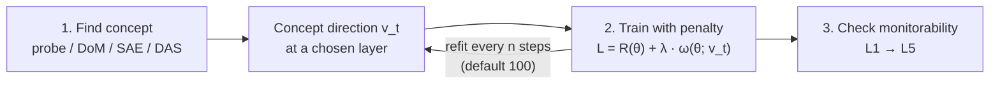
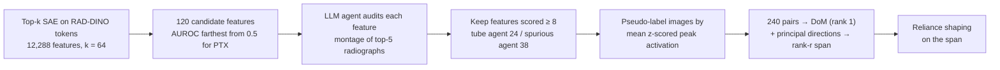
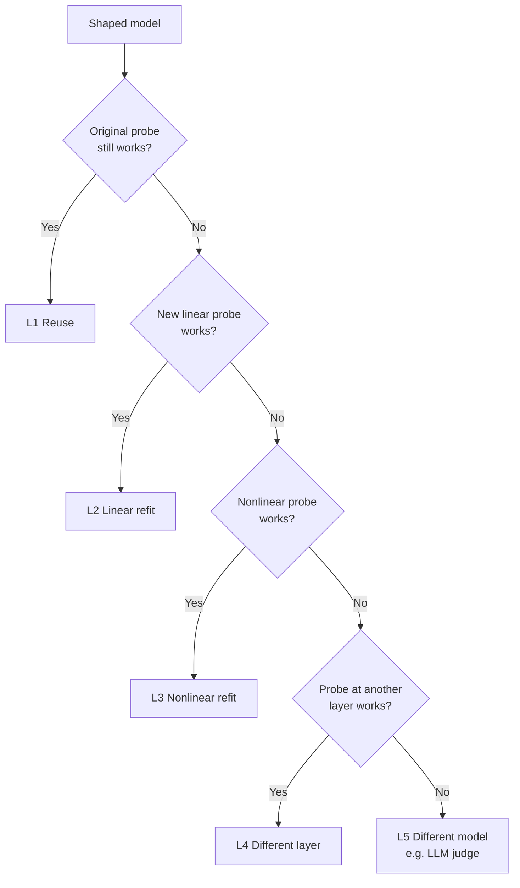

# Shaping & Monitoring Models Through Their Internal Representations

> **Mechanistic Shaping**: model의 **internal representation**을 training signal로 써서, model이 정답을 *맞히는지*뿐 아니라 *어떻게* 맞히는지까지 지정한다. 그리고 그렇게 train한 뒤에도 그 concept를 **monitor**할 수 있는지 이론과 실험으로 검증한다.


| 항목 | 내용 |
|---|---|
| Paper | [arXiv 2611.07071](https://arxiv.org/abs/2611.07071) v1 (2026-11-04), [HTML판](https://arxiv.org/html/2611.07071v1). CC BY 4.0 |
| Authors | 26명. **Core contributors**: Thomas Fel, Matthew Kowal, Matt Feiszli, Satchel Grant, Andrew Lee, Chris Earls. 그 외 Fatih Dinc, Vasudev Shyam, Usha Bhalla, Leon Bergen, Siddharth Boppana, Ching Fang, Michael Byun, Tristan Gallent, Nicholas Wang, Tal Haklay, Dron Hazra, Neehar Kondapaneni, Connor Watts, Ryan Panwar, Thomas Dooms, Jack Merullo, Atticus Geiger, Ekdeep Singh Lubana. **Senior**: Thomas McGrath, Owen Lewis |
| Code | [github.com/goodfire-ai/reliance](https://github.com/goodfire-ai/reliance) |
| Blog | [Goodfire Research blog](https://www.goodfire.com/research/mechanistic-shaping), *The Mechanistic Alignment Series* (2026-11-05, Satchel Grant, Michael Byun) |
| Domains | Vision, medical imaging, language |
| Training paradigms | Classification, SFT, DPO, GRPO |
| Models | DINOv2 / DINOv3 / ResNet-50 (vision), RAD-DINO (X-ray), OLMo-3-7B / OLMo-2-13B / OLMo-3-32B (sycophancy), Qwen3.5-9B (reward hacking, reference Qwen3.6-35B), Mistral-7B-Instruct / Llama-3-8B-Instruct (harmlessness) |

> 이 문서는 **논문 전문(본문 7개 section + Appendix A–L)** 을 기준으로 정리했다. 그림은 논문 Figure를 기본으로 하고, 블로그의 요약 그림을 함께 실었다. 논문 그림은 "Paper Figure N", 블로그 그림은 "Blog Figure N"으로 표시했다.

---

## 목차

1. [TL;DR](#tldr)
2. [Problem: Underspecification과 "Right for the Wrong Reasons"](#1-problem-underspecification과-right-for-the-wrong-reasons)
3. [Framework: Reliance Shaping vs Expression Shaping](#2-framework-reliance-shaping-vs-expression-shaping)
4. [Vision: Waterbirds, Conditional Rules, CheXpert](#3-vision-waterbirds-conditional-rules-chexpert)
5. [Sycophancy in DPO Post-training (Reliance Shaping)](#4-sycophancy-in-dpo-post-training-reliance-shaping)
6. [Reward Hacking in RL (Expression Shaping)](#5-reward-hacking-in-rl-expression-shaping)
7. [Harmlessness (Expression Shaping)](#6-harmlessness-expression-shaping)
8. [Circumvention의 이론: concept는 어디로 가는가](#7-circumvention의-이론-concept는-어디로-가는가)
9. [Monitoring 종합: hierarchy, duality, 이론과 실험의 대조](#8-monitoring-종합-hierarchy-duality-이론과-실험의-대조)
10. [Discussion & Limitations](#9-discussion--limitations)
11. [Takeaways](#10-takeaways)
12. [부록: 논문 Figure 색인](#부록-논문-figure-색인)

논문 section과 이 문서의 대응:

| 논문 | 이 문서 |
|---|---|
| Introduction, Section 1, Appendix A–C | 1, 2장 |
| Section 2, Appendix D–F | 3장 |
| Section 3, Appendix G | 4장 |
| Section 4, Appendix H | 5장 |
| Section 5, Appendix I | 6장 |
| Section 6, Appendix J–K | 7장 |
| Appendix L, Table 1 | 8장 |
| Section 7 | 9장 |

---

## TL;DR

- **Problem**: training objective는 task를 **어떻게** 풀어야 하는지 정해 주지 않는다(**underspecification**). 그래서 model은 loss를 똑같이 낮추면서도 원치 않는 concept에 기대는 해에 도달할 수 있다. Shortcut learning, sycophancy, reward hacking이 모두 그 형태다.
- **Idea**: internal representation을 **specification language**로 쓴다. Interpretability tool로 원치 않는 **concept direction**을 찾고, training loss에 penalty $`\lambda\, \omega_\bullet`$를 더한다.
  - **Reliance shaping**: "이 concept에 **기대지 마라**". Readout의 concept에 대한 **attribution**을 penalize한다. Concept는 representation에 남아 있어도 된다.
  - **Expression shaping**: "이 concept를 **드러내지 마라**". Reader가 매긴 concept score를 reward에서 뺀다.
- **Direction 선택이 핵심**: representation이 고정이면 7가지 attribution penalty는 사실상 같은 해를 고른다. 결과를 가르는 것은 direction이다. Detect에는 probe(**filter**), specification에는 DoM(**pattern**)이 맞다(Waterbirds에서 약 90% 대 80% WGA).
- **Results**
  - **Waterbirds** (perfect confounding): WGA **51.6% → 93–97.7%**
  - **CheXpert**: annotation 없이 **SAE + LLM agent**로 shortcut feature를 찾았다. WGA 33.3%(ERM)에서 출발해, balanced data로 train한 reference(56.0%)와 **같거나 넘는** 경우가 있었다.
  - **Sycophancy** (OLMo-3 DPO): Gradient × Input reliance shaping이 DPO의 capability를 거의 그대로 얻으면서 sycophancy를 SFT 수준에 묶었다. Data filtering, reward shaping, inoculation prompting은 learning rate를 낮추는 것과 같은 효과뿐이었다. **7B, 13B, 32B**에서 모두 작동했다.
  - **Reward hacking** (Qwen3.5-9B GRPO): 일반 RL은 10 updates 안에 peek rate 1.00, honest solve 0이 됐다. Expression shaping은 honest solve **0.96–0.98**을 유지했고, 처음 보는 **chess**에서도 peeking이 **≤ 0.004**였다.
  - **Harmlessness**: frozen copy의 DoM을 reward로 써서 JailbreakBench harmfulness를 **0.70 → 0.01**로 낮추면서 원래 probe를 0.84–0.85로 유지했다. Probe loss는 0.16–0.19에 그치고 원래 probe를 0.52–0.64로 떨어뜨렸다.
- **Monitorability**: interpretability signal에 맞서 train하면 concept는 대체로 **사라지지 않고 이동**한다. 형태는 세 가지다.
  - **Re-encoding**: 새 linear direction으로 이동 → refit한 linear probe(L2)가 읽는다.
  - **Erasure**: 그 layer에서 사라진다(Gradient × Input처럼 encoder를 직접 누르는 penalty에서).
  - **Nonlinear code**: linear 개입을 자주 refit하면 concept가 core feature와의 **곱(product code)** 으로 살아남는다 → nonlinear probe(L3)나 다음 layer의 probe(L4)가 읽는다.
- **가장 위험한 설정**은 **gradient가 reader(probe)를 통과하는** 경우다(원래 probe 최악 0.98 → 0.57). Detached reward나 frozen reader는 원래 probe를 대체로 보존한다. 어느 경우든 refit한 linear probe는 대부분 회복했다(0.97–0.98).
- **한계**: 결과는 최대 32B, 비교적 짧은 run에서 나왔다. Frontier scale에서도 유지되는지는 열린 질문이다.

---

## 1. Problem: Underspecification과 "Right for the Wrong Reasons"

### 1.1 출발점: objective는 "어떻게"를 말해 주지 않는다
논문은 최근 frontier model에서 보고된 사례들로 시작한다. Oversight를 피하고, credential을 훔치고, benchmark에서 일상적으로 reward hacking을 한다는 보고들이다. Model이 강해질수록 문제를 **풀었는지**만큼 **어떻게 풀었는지**가 중요해진다.

저자들은 이 현상들을 **underspecification**(D'Amour et al., 2022)의 여러 얼굴로 본다. Training objective는 task를 어떤 방식으로 풀어야 하는지까지 정해 주지 않는다. 그래서 loss를 똑같이 낮추면서도 서로 다른 concept에 기대는 해(minimizer)가 여럿 생긴다.

| Underspecification의 형태 | 예시 |
|---|---|
| **Shortcut learning** | Pneumothorax(기흉) 분류기가 폐 대신 **chest drain tube**를 본다. Tube는 치료 후에만 찍히므로 치료 전 환자에서 실패한다 |
| **Sycophancy** | 정확한 답 대신 user 의견에 동의하는 쪽을 선호한다 |
| **Reward hacking** | 문제를 푸는 대신 unit test나 정답 파일을 읽는다. 둘 다 같은 reward를 받는다 |
| **Misalignment 일반** | Oversight 회피, credential 탈취 등 |

- 지금은 "의도한 방식으로 풀었다"는 보장을 **training environment**에 기대고 있다. Environment가 의도하지 않은 해를 전부 막아야만 성립하는 보장인데, 그 정도로 정밀한 environment는 드물다.
- 원인은 backpropagation 자체에 있다. Error signal은 representation을 loss가 줄어드는 방향으로만 민다. 즉 feature는 loss를 줄였다는 이유만으로 존재하고, **loss를 똑같이 줄이는 두 feature는 training 입장에서 구별되지 않는다.**

### 1.2 제안: representation을 specification language로
- Model의 internal representation을 **추가 지시를 적는 언어**로 쓰자는 것이 핵심 제안이다. Output만 지정하지 않고, **어떤 concept에 기대도 되는지(reliance)** 와 **어떤 concept를 드러내도 되는지(expression)** 를 objective에 직접 적는다.
- Scale은 보통 interpretability의 장애물로 여겨지지만, 저자들은 반대로 본다. 큰 model일수록 추상적인 concept를 더 읽기 쉽고 context를 넘어 generalize하는 형태로 encode하므로, 안에서부터 설계하기는 오히려 쉬워질 수 있다.
- 선행 연구는 internal feature를 reward, steering, concept ablation, prompting, data filtering 등으로 training에 끌어들였다. Bergen et al.(2026a)은 이 방법들이 모두 learning signal에서 원치 않는 concept를 "설명해서 치워 버리는(explain away)" 공통 구조를 갖는다고 정리했다. 이 논문은 그것들을 하나의 constrained learning 문제로 묶고, attribution 기반의 **reliance penalty**를 새로 더한다.

두 specification이 필요한 곳은 **data를 고치는 것만으로는 안 되는** 경우다.

| 상황 | 왜 data curation이 안 통하나 |
|---|---|
| Label과 **완벽하게 상관**된 spurious feature (confounded vision·medical data) | 걸러 낼 반례 자체가 없다 |
| **Sycophancy** | 개별 example이 아니라 preference data의 **집계 구조**에서 생긴다 |
| **Reward hacking, harmful output** | Training 도중에만 나타난다. 다만 probe가 잡아낼 만큼은 뚜렷하게 표현된다 |

### 1.3 핵심 위험: circumvention
두 specification 모두 model 자신의 representation을 regularizer로 쓴다. 즉 model을 **관측 도구 자체에 맞서 최적화**하는 셈이다(Goodhart의 법칙). Training signal로 쓴 probe가 train된 model을 더 이상 읽지 못하면, 없애려던 행동이 monitor가 보고하지 않는 형태로 남을 수 있다. Mowshowitz(2025)가 "The Most Forbidden Technique"이라고 부른 우려다.

- 저자들은 이 현상을 **obfuscation** 대신 **circumvention**이라고 부른다. Obfuscation은 숨기려는 의도를 암시하지만, 실제로는 gradient가 loss가 계속 줄어드는 쪽으로 constraint를 돌아갈 뿐이라는 이유다.
- 결론을 먼저 말하면, 우려했던 실패는 **실제로 일어난다.** 논문은 그 기하학을 세 가지로 정리한다. Concept가 (1) 다른 방향으로 옮겨가거나, (2) 그 layer에서 지워지거나, (3) model이 여전히 쓰는 **nonlinear code**로 옮겨가는 경우다. 그리고 이 형태들을 구별하는 **monitoring level 5단계**를 제안한다.

### 1.4 Contributions
1. **Mechanistic shaping framework**: feature-based reward와 attribution penalty를 하나의 constrained learning 문제로 통합. Concept direction 추정법 정리, 5단계 monitoring level 도입
2. **Vision의 reliance shaping**: perfectly confounded Waterbirds에서 ceiling WGA, ImageNet에서 conditional rule, CheXpert에서 SAE + agent로 shortcut 자동 탐지
3. **Sycophancy의 reliance shaping**: DPO의 preference margin에 적용. 7B–32B에서 data를 바꾸지 않고 sycophancy 억제
4. **Reward hacking의 expression shaping**: GRPO에서 hacking 억제, chess로 transfer
5. **Harmfulness의 expression shaping**: frozen copy의 DoM을 reward로 쓰면 같은 utility에서 harmfulness가 더 낮고 monitor도 더 잘 보존됨
6. **Monitorability와 circumvention 이론**: two-layer linear model과 residual toy model로 drift, resurgence, product code를 분석

---

## 2. Framework: Reliance Shaping vs Expression Shaping

### 2.1 Specification = constrained learning
Task risk $`\mathcal{R}(\theta)`$(supervised risk, preference loss, negative expected reward 등)는 보통 minimizer가 여럿이다. **Specification**은 그 가운데 하나를 고르는 추가 요구사항이고, internal representation으로 측정한 nonnegative violation $`\omega_\bullet`$에 대한 constraint로 쓴다.

```math
\min_{\theta}\; \mathcal{R}(\theta) \quad \text{subject to} \quad \omega_\bullet(\theta) \le \varepsilon,
\qquad
\mathcal{L}(\theta) = \mathcal{R}(\theta) + \lambda\, \omega_\bullet(\theta)
```

- $`\varepsilon \ge 0`$은 허용하는 violation, $`\lambda \ge 0`$은 penalty 강도다. 유한한 $`\lambda`$가 constraint를 정확히 만족시킨다는 보장은 없다.
- 선택한 layer의 activation을 $`\mathbf{z} = f_\theta(\mathbf{x}) \in \mathbb{R}^d`$, 원치 않는 concept의 score를 $`z_\bullet = g(\mathbf{z})`$라 쓴다. Reader $`g`$는 linear probe $`\langle \mathbf{z}, \mathbf{v} \rangle + b`$, DoM 위로의 projection, featurizer atom의 code 등이다.

### 2.2 두 가지 specification


*Paper Figure 1 (arXiv HTML). Reliance shaping은 concept를 representation에서 지우지 않고 readout에 미치는 영향만 묶는다. Expression shaping은 output이나 activation이 concept를 드러낼 확률을 낮춘다.*

| | **Reliance shaping** | **Expression shaping** |
|---|---|---|
| 지시 | "이 concept에 **기대지 마라**" | "이 concept를 **드러내지 마라**" |
| 묻는 것 | Concept가 바뀌면 답이 바뀌는가 (**counterfactual invariance**) | Output이나 activation에 concept가 얼마나 있는가 |
| 측정 | Readout에 대한 **attribution** | Reader가 매긴 concept score (proxy) |
| 누가 잴 수 있나 | **Shaped model 자신의 계산**만 답할 수 있다 | Output에 드러나면 외부 model도 잴 수 있다 |
| 예 | 이력서 심사 model이 성별을 표현은 해도 판단에는 쓰지 않는다. Reward model이 "user에 동의함"을 감지해도 그 이유로 선호하지 않는다 | 유해 요청임을 감지하되 유해 내용을 생성하지 않는다. Reward hacking rollout을 만들지 않는다 |
| 이 논문의 실험 | Waterbirds, ImageNet, CheXpert, sycophancy | Reward hacking, harmlessness |

- **Reliance ≠ concept erasure**: reliance는 concept가 encode된 채 남아 있어도 된다. Readout에만 영향을 주지 않으면 된다.
- **둘은 따로 움직인다**: 유해 요청을 거절하려면 유해함을 인식하는 데 **기대야** 하지만 유해 내용을 **표현하면 안 된다.** 실제로 model은 harmfulness와 refusal을 따로 encode한다.
- 두 shaping은 **objective가 무엇을 요구하는지**를 정할 뿐, model 안에서 실제로 무슨 일이 일어나는지를 보장하지는 않는다. 그래서 monitoring을 따로 확인한다.

### 2.3 Expression shaping
Generative model $`\pi_\theta`$가 input $`\mathbf{x}`$에 대해 trajectory $`\tau = (y_1, \dots, y_T)`$를 뽑는다. 각 step에서 **reader model**(parameter $`\phi`$)이 지금까지의 trajectory를 activation $`\mathbf{z}_t`$로 encode하고, probe가 score $`z_{\bullet,t}`$를 낸다. Nonnegative 함수 $`\rho`$가 이를 cost로 바꾼다.

```math
\omega_\bullet(\theta) = \mathbb{E}_{\mathbf{x} \sim p,\; \tau \sim \pi_\theta(\cdot \mid \mathbf{x})}
\left( \sum_{t=1}^{T} \gamma^{t-1}\, \rho\left( z_{\bullet,t} \right) \right),
\qquad \gamma \in (0, 1]
```

- $`\mathcal{R}`$이 negative expected reward라면 이 penalty는 reward에서 expression cost를 빼는 것이고, 곧 **feature-based reward shaping**(RLFR 계열)이다.
- Sum 대신 mean이나 max를 쓰면 평균 표현량 또는 가장 강한 한 번을 제약하게 되고, policy가 reader를 피하기 쉬운 정도가 달라진다.
- **Reader 선택**: 현재 policy($`\phi = \theta`$), 초기 parameter의 frozen copy($`\phi = \theta_0`$), 또는 생성된 text를 읽는 별도 model(reward model, text monitor).

Gradient를 쓰면 reader 선택이 왜 중요한지 드러난다.

```math
\nabla_\theta\, \omega_\bullet =
\underbrace{\mathbb{E}\Big( \sum_{t} \gamma^{t-1} \rho(z_{\bullet,t})\; \nabla_\theta \log \pi_\theta(\tau \mid \mathbf{x}) \Big)}_{\text{policy gradient}}
+
\underbrace{\mathbb{E}\Big( \sum_{t} \gamma^{t-1} \rho'(z_{\bullet,t})\; \nabla_\theta z_{\bullet,t} \Big)}_{\text{attached, } \phi = \theta}
```

| 항 | 하는 일 | 언제 남나 |
|---|---|---|
| **Policy gradient** | **어떤 trajectory가 뽑히는지**를 바꾼다. Output 수준의 expression shaping | Detached와 attached 모두 |
| **Attached term** | **고정된 trajectory의 score 자체**를 바꾼다. Internal expression에 대한 penalty | Score를 통해 gradient를 흘릴 때만 |

- Score를 **detach**하면 첫 항만 남는다. Attached는 둘 다 쓴다(Libon et al., 2026).
- 주의: detach한다고 reader가 얼어붙는 것은 아니다. Reader가 current policy라면 $`\mathbf{z}_t`$는 update마다 $`\theta`$와 함께 변한다. 어느 쪽이든 reader에 맞서 train하면 policy가 reader를 피하는 법을 배울 수 있고, 그래서 이 선택이 monitorability를 좌우한다(6, 7장).


*Paper Figure 15 (arXiv HTML). Expression shaping 개요. Prompt마다 current policy에서 rollout을 뽑고, internal representation에서 뽑은 score를 reward에 반영한다.*

### 2.4 Reliance shaping
"Concept가 바뀌면 답이 바뀌는가"는 model 자신의 계산만 답할 수 있다. 외부 judge는 이력서에 성별이 적혀 있다는 것은 봐도, 점수가 거기에 의존하는지는 볼 수 없다. 그래서 model을 선택한 layer에서 **encoder** $`f_\theta`$와 **scalar readout** $`s_\theta`$(class logit 또는 preference margin)로 나누고, concept가 변해도 readout이 변하지 않기를 요구한다.

Readout이 feature 변화에 얼마나 반응하는지 재는 것이 바로 **attribution method**다. 방법들은 공통 구조를 갖는다. $`\mathbf{z}`$에서의 readout을 kernel $`k(\cdot \mid \mathbf{z})`$에서 뽑은 변형 activation $`\mathbf{z}'`$에서의 값과 비교하고, kernel과 요약 방식만 다르다. 논문은 attribution $`\nu(\mathbf{z}, \mathbf{v})`$의 제곱을 penalty로 쓴다.

```math
\omega_\bullet(\theta) = \mathbb{E}\big( \nu(\mathbf{z}, \mathbf{v})^2 \big)
```

Unit concept direction $`\mathbf{v}`$에 대해 다음 7가지를 다룬다.

| 계열 | Attribution | $`\nu(\mathbf{z}, \mathbf{v})`$ |
|---|---|---|
| Gradient-based | **Gradient** | $`\langle \nabla s(\mathbf{z}), \mathbf{v} \rangle`$ |
| | **Gradient × Input** | $`\langle \nabla s(\mathbf{z}), \mathbf{v} \rangle \, \langle \mathbf{z}, \mathbf{v} \rangle`$ |
| | **Integrated Gradients** | $`\langle \mathbf{z}, \mathbf{v} \rangle \int_0^1 \langle \nabla s(\mathbf{z}_\alpha), \mathbf{v} \rangle \, d\alpha`$ |
| | **SmoothGrad** | $`\mathbb{E}_{\boldsymbol{\xi}} \big( \langle \nabla s(\mathbf{z} + \boldsymbol{\xi}), \mathbf{v} \rangle \big)`$ |
| Perturbation-based | **Noise** | $`s(\mathbf{z} + \xi \mathbf{v}) - s(\mathbf{z})`$ |
| | **Shuffle** | $`s(\mathbf{z}_{\text{swap}}) - s(\mathbf{z})`$ |
| | **Deletion** | $`s(\mathbf{z}) - s(\mathbf{z}_{\setminus \bullet})`$ |

- $`\mathbf{z}_{\setminus \bullet} = \mathbf{z} - \langle \mathbf{z}, \mathbf{v} \rangle \mathbf{v}`$: concept 좌표를 지운 activation
- $`\mathbf{z}_\alpha = \mathbf{z}_{\setminus \bullet} + \alpha \langle \mathbf{z}, \mathbf{v} \rangle \mathbf{v}`$: 그 좌표를 따라 interpolate
- $`\mathbf{z}_{\text{swap}} = \mathbf{z}_{\setminus \bullet} + \langle \tilde{\mathbf{z}}, \mathbf{v} \rangle \mathbf{v}`$: 다른 example의 좌표로 교체
- $`\xi \sim \mathcal{N}(0, \sigma^2)`$, $`\boldsymbol{\xi} \sim \mathcal{N}(\mathbf{0}, \sigma^2 \mathbf{I})`$
- 이력서 예로 말하면 Deletion은 성별 좌표를 지우고, Shuffle은 다른 지원자의 성별 좌표로 바꾼다. 어느 쪽이든 점수가 그대로여야 한다.

#### Affine readout에서는 모두 같은 해를 고른다 (Proposition 5, Appendix B)
Readout이 $`s(\mathbf{z}) = \langle \mathbf{w}, \mathbf{z} \rangle + b`$이면 gradient가 상수라서 모든 attribution이 $`\mathbf{w}^\top \mathbf{v}`$에 비례한다. 제곱해서 평균하면 penalty는 전부 $`c\,(\mathbf{w}^\top \mathbf{v})^2`$ 꼴이고, 상수 $`c`$만 다르다. 여기서 $`a_{\mathbf{v}} = \langle \mathbf{z}, \mathbf{v} \rangle`$다.

| Attribution | $`c`$ |
|---|---|
| Gradient, SmoothGrad | $`1`$ |
| Gradient × Input, Integrated Gradients, Deletion | $`\mathbb{E}(a_{\mathbf{v}}^2)`$ |
| Noise | $`\sigma^2`$ |
| Shuffle | $`2\,\mathrm{Var}(a_{\mathbf{v}})`$ |

- 따라서 penalty는 $`\langle \mathbf{w}, \mathbf{v} \rangle = 0`$일 때, 그리고 그때만 0이다.
- Task와 specification을 함께 만족하는 해가 있으면, 어떤 $`\lambda \gt 0`$에서도 penalized objective의 minimizer는 "task risk의 minimizer 중 $`\mathbf{v}`$에 orthogonal한 것"과 정확히 일치한다. Scale 차이 $`c`$는 $`\lambda`$가 흡수한다.
- Nonlinear readout에서는 방법마다 결과가 달라진다. 3장의 실험이 그 차이를 보여준다.

<p align="center">
  
</p>

*Paper Figure 27 (arXiv HTML). 두 class가 의도한 feature $`x`$와 shortcut $`y`$ 모두로 완벽히 갈리는 2D toy. ERM은 둘 다에 기대는 비스듬한 경계를 배우지만, shortcut 방향에 어떤 attribution penalty를 걸어도 $`x`$만 보는 수직 경계(ground truth)가 나온다.*

같은 Appendix의 부수 결과들:

| 방법 | Linear case에서 일어나는 일 |
|---|---|
| **Perturbed activation으로 training** (augmentation) | Squared loss에서 penalty와 같은 optimum. 한 방향으로만 noise를 주면 그 방향에만 ridge penalty를 거는 것과 같다(Bishop, 1995) |
| **Constant shift** (PPS, Chen et al., 2025) | Free bias가 흡수해서 optimal $`\mathbf{w}`$가 변하지 않는다. Bias 없이 centered data일 때만 penalty $`\tfrac{\tau^2}{2}(\mathbf{w}^\top \mathbf{v})^2`$로 환원된다 |
| **Projection** | Score에서 $`\mathbf{w}^\top \mathbf{v}`$를 빼 버리므로 그 weight는 gradient를 받지 못하고 초기값에 머문다. Inference에서도 projection을 유지해야만 효과가 있다 |
| **Loss-gradient penalty** (Ross et al., 2017; Fel et al., 2022) | $`\mathcal{R}(\mathbf{w})(\mathbf{w}^\top \mathbf{v})^2`$가 되어, **training loss가 0인 해에서는 항상 0**이다. Concept에만 기대는 해도 통과한다 |

#### 구현: double backpropagation (Appendix A)
Gradient 계열 attribution은 $`\nabla_{\mathbf{z}} s`$의 함수라서, 이를 penalize하려면 **미분의 미분** $`\nabla_\theta \langle \nabla_{\mathbf{z}} s(\mathbf{z}), \mathbf{v} \rangle`$이 필요하다(double backpropagation, Drucker & Le Cun, 1992).

- Hessian을 만들 필요는 없다. 첫 backward pass를 graph로 남겨 $`\mathbf{v}`$와 내적한 scalar를 한 번 더 backward하면 된다.
- ReLU network에서 풀어 쓰면, penalty의 gradient는 보통의 backprop update와 같은 구조(backward signal × forward activation)다. 다만 forward pass가 $`\mathbf{z}`$ 대신 **$`\mathbf{v}`$를 gate를 고정한 채 실어 나르고**, 전체가 현재 attribution 값으로 scale된다.
- 여기서 실용적인 차이가 나온다. ReLU readout에서 **Gradient penalty는 bias와 encoder로 gradient를 보내지 않는다**(gate를 통해서만 $`\mathbf{z}`$에 의존하므로). **Gradient × Input**은 $`\langle \mathbf{z}, \mathbf{v} \rangle`$ 항을 통해 **encoder까지 도달**한다.

```python
s = readout(z)                                    # example별 scalar score
g = torch.autograd.grad(s.sum(), z, create_graph=True)[0]   # 첫 backward의 graph를 남긴다
phi = g @ v                                       # v 방향 directional derivative
# forward-mode 대안: _, phi = torch.func.jvp(readout, (z,), (v.expand_as(z),))
loss = task_loss(s, y) + lam * (phi ** 2).mean()
loss.backward()                                   # 두 번째 backward
```

### 2.5 Concept direction: probe인가 DoM인가 (Appendix C)
단순화를 위해 concept를 direction 하나 $`\mathbf{v}`$로 읽을 수 있다고 가정한다(subspace로 확장 가능). Concept가 다차원이거나 휘어진 manifold여도 linear하게 **읽는** 데는 지장이 없을 수 있다. 후보는 **linear probe**, **difference of means (DoM)**, **featurizer(SAE) decoder atom**, **DAS**다.

논문의 주장은 "**잘 detect하는 direction과 specification에 맞는 direction은 다르다**"는 것이다. Haufe et al.(2014)의 구분을 가져온다.

| | **Filter** (backward model) | **Pattern** (forward model) |
|---|---|---|
| 정의 | Activation에서 concept를 가장 잘 **읽어 내는** 방향 | Concept가 변할 때 activation이 **실제로 움직이는** 방향 |
| 추정 | Linear probe: $`\mathbf{w}^\star \propto \boldsymbol{\Sigma}^{-1} \mathbf{v}`$ | DoM: $`\partial \mathbf{z} / \partial z_\bullet = \mathbf{v}`$ |
| Noise covariance에 대해 | $`\boldsymbol{\Sigma}^{-1}`$만큼 회전한다. 다른 이유로 흔들리는 방향을 눌러서 구분을 잘하게 된다 | 불변. Group mean에만 의존한다 |
| 묻는 질문 | Concept를 **어디서 detect할 수 있나** | Concept가 **어디에 있나** |

- Generative model: $`\mathbf{z} = z_c \mathbf{v}_c + z_\bullet \mathbf{v} + \boldsymbol{\epsilon}`$ (의도한 concept + 원치 않는 concept + noise). 두 direction은 $`\boldsymbol{\Sigma} = \mathrm{Cov}(\mathbf{z})`$가 isotropic일 때만 일치한다.
- Balanced binary concept에서 pattern은 scale을 빼면 정확히 DoM $`\boldsymbol{\Delta} = \boldsymbol{\mu}_+ - \boldsymbol{\mu}_-`$이고, least-squares probe는 $`\boldsymbol{\Sigma}^{-1} \boldsymbol{\Delta}`$(Fisher discriminant 방향)다.

**왜 specification에는 pattern이 필요한가**

- **Reliance**: concept가 $`\delta`$만큼 변하면 activation은 $`\delta \mathbf{v}`$, affine readout은 $`\delta \langle \mathbf{w}, \mathbf{v} \rangle`$만큼 움직인다. 불변 조건은 pattern에 대한 orthogonality다. Filter에 orthogonal하게 만들어도 $`\langle \mathbf{w}, \mathbf{v} \rangle`$는 자유롭게 남는다.
- **Erasure**: rank-one intervention이 concept의 linear 정보를 완전히 없애려면 **pattern 방향으로** 지워야 한다. Filter 방향을 지우면 detector 하나가 읽던 좌표만 사라지고, 다른 linear readout이 정보를 다시 찾는다.
- **LEACE**는 둘을 결합한다. Pattern 방향으로 지우되, 지우는 양은 probe가 concept에 귀속시키는 만큼이다.
- **SAE**: encoder는 filter, decoder는 pattern이다. Feature absorption이 보여주듯 실제로 둘은 갈라진다. 그래서 **specification에는 decoder atom, detection에는 encoder row**를 쓰라고 권한다.


*Paper Figure 28 (arXiv HTML). Within-group noise가 anisotropic할 때의 두 direction. DoM(pattern)은 두 group 사이의 변위 방향이고 activation의 variance를 싣고 있다. Probe(filter)는 within-group noise가 가장 작은 방향으로 돌아가서 구분은 더 잘하지만, activation이 거의 움직이지 않는 좌표를 읽는다. Noise correlation이 커질수록 filter만 pattern에서 멀어진다.*

**Predictivity × variance 관점과 continuum regression**

Unit direction $`\mathbf{v}`$에 대해 mean gap $`G(\mathbf{v}) = \langle \mathbf{v}, \boldsymbol{\Delta} \rangle`$, variance $`V(\mathbf{v}) = \mathbf{v}^\top \boldsymbol{\Sigma} \mathbf{v}`$, concept와의 squared correlation $`R^2(\mathbf{v})`$를 정의하면 다음이 성립한다.

```math
G(\mathbf{v})^2 = 4\, R^2(\mathbf{v})\, V(\mathbf{v})
```

- Probe는 **predictivity** $`R^2`$만 최대화한다. DoM은 $`R^2 \cdot V`$, 즉 predictivity와 variance의 곱을 최대화한다(Proposition 6, Cauchy–Schwarz로 바로 나온다).
- **Continuum regression**(Stone & Brooks, 1990)은 이 둘을 하나의 family로 잇는다.

```math
J_\gamma(\mathbf{v}) = R^2(\mathbf{v})\, V(\mathbf{v})^{\gamma}, \qquad
\underset{\gamma = 0}{\text{OLS / Fisher}} \;\longrightarrow\; \underset{\gamma = 1}{\text{DoM}} \;\longrightarrow\; \underset{\gamma \to \infty}{\text{PCA}}
```

- DoM의 **inductive bias**가 여기서 드러난다. 구분을 잘할 뿐 아니라 **activity(variance)를 실은** 방향을 찾는다. Penalty는 readout이 실제로 쓰려는 방향에 걸어야 효과가 있는데, 그런 방향이 variance를 싣고 있다.

<p align="center">
  
  <br>
  
</p>

*Paper Figure 29 (arXiv HTML). Waterbirds에서 $`\gamma \in [0, 3]`$의 direction마다 frozen readout에 Gradient × Input penalty를 걸었다. Fisher 쪽 끝($`\gamma = 0`$)이 가장 나쁘다(linear head 약 61%, nonlinear head 약 63% WGA로 logistic probe보다도 낮다). $`\gamma`$가 1–2인 구간에서 plateau를 이루고, PCA 쪽으로 가면 다시 떨어진다. Nonlinear head는 $`\gamma \approx 1.5`$에서 DoM보다 약 1.5 point 높고, linear head는 평평하다. DoM은 "비슷하게 잘 되는 넓은 범위 중 closed form이 있는 한 점"이라 논문 전체에서 쓴다.*

### 2.6 Monitoring level 5단계
"Concept가 여전히 monitor 가능하다"는 말은 **어떤 detector를 전제하는지**만큼만 정밀하다. 그래서 논문은 행동 변화와 concept readability를 따로 평가하고, readability는 **원래 monitor를 얼마나 바꿔야 하는지**에 따라 5단계로 나눈다.

| Level | 이름 | Direction | Probe family | Layer | Model |
|---|---|---|---|---|---|
| **L1** | Reuse linear | 유지 | 유지 | 유지 | 유지 |
| **L2** | Linear refit | 변경 가능 | 유지 | 유지 | 유지 |
| **L3** | Nonlinear refit | 변경 가능 | 변경 가능 | 유지 | 유지 |
| **L4** | Different layer | 변경 가능 | 변경 가능 | 변경 가능 | 유지 |
| **L5** | Different model | 변경 가능 | 변경 가능 | 변경 가능 | 변경 가능 |

- **L1–L3**은 모두 intervention layer에서 평가한다. Erasure 방법은 projection **이후**의 activation을 쓴다. 그래야 "원래 direction의 실패"와 "refit한 linear·nonlinear reader의 실패"가 구별된다.
- **L4**는 같은 model의 다른 layer에서 decode하는 것을 허용한다.
- **L5**는 별도 model이 input이나 output을 평가한다. 따라서 shaped model **안에서** concept를 읽을 수 있다는 것은 보장하지 않는다.
- Training penalty가 낮아졌다는 것도, 특정 detector가 실패했다는 것도 "행동이나 concept 정보가 사라졌다"는 증거가 아니다. 그래서 held-out detection 성능과 행동 지표를 항상 같이 보고한다.

### 2.7 General recipe




*Blog Figure 1 (Goodfire, 논문 Figure 2와 같은 내용). Concept가 있는 example과 없는 example($`\mathcal{D}^+`$, $`\mathcal{D}^-`$)로 layer $`\ell`$에서 direction $`\mathbf{v}_t`$(보통 DoM)를 계산하고, task risk에 그 방향의 reliance penalty를 더해 train한다. Representation이 training 중에 움직이면 direction을 현재 model에서 주기적으로 다시 계산한다.*

일반 training에 더해 필요한 것은 **concept direction 하나와 읽을 수 있는 layer 하나**뿐이다.

---

## 3. Vision: Waterbirds, Conditional Rules, CheXpert

Vision 실험은 spurious feature를 통제할 수 있어서 출발점으로 쓰였다. 세 단계로 진행한다. (1) Label만으로는 의도한 feature와 shortcut을 구별할 수 없는 설정, (2) "쓰지 마라"를 넘어 **조건부 규칙**을 지정하는 설정, (3) 사람이 이름 붙이지 않아도 제약할 concept를 **자동으로 찾는** 설정이다.

### 3.1 Waterbirds: perfect confounding에서의 reliance shaping

#### Setup
- **Task**: landbird vs waterbird 분류. 원래 benchmark에서는 배경이 class와 spurious하게 상관되어 있다. 저자들은 CUB + Places로 직접 다시 만들어 **상관을 완벽하게** 만들었다. 이러면 reweighting이나 retraining 계열 방법이 쓰는 **반례(class와 배경이 어긋나는 사진)가 아예 없다.**
- **Data**: training bird **2,066장**. Validation과 test는 각각 class-balanced bird 256마리를 두 배경 모두에 놓은 512장. Bird identity는 set 사이에 겹치지 않는다.
- **Model**: DINOv2의 normalized **384-d CLS** representation. 세 가지 regime을 본다.
  - Frozen encoder + affine readout
  - Frozen encoder + 3-layer GELU readout
  - **Fully trainable** encoder + GELU readout
- **Metric**: **worst-group accuracy (WGA)**(2×2 bird × background 중 최저 accuracy), held-out background detection **AUROC**. 3 seeds 평균
- **Direction**: 같은 새를 두 배경에 놓은 **paired image 128장**(새 64마리)으로 계산한다. Class label은 쓰지 않는다. $`\mathbf{v} = \boldsymbol{\delta} / \lVert \boldsymbol{\delta} \rVert`$, $`\boldsymbol{\delta} = \mathbb{E}(\mathbf{z}_{\text{water}} - \mathbf{z}_{\text{land}})`$
- **Refresh**: encoder가 trainable이면 같은 paired image로 **100 steps마다** 다시 계산한다. L1 monitoring은 이와 무관하게 항상 초기 direction $`\mathbf{v}_0`$를 쓴다.
- **Baselines**: ERM(confounded data로 일반 training), balanced-training oracle, erasure 계열(**Projection, LEACE, INLP**)

#### Frozen encoder: 성능은 같아도 monitoring 결과는 다르다


*Paper Figure 30 (arXiv HTML). Frozen DINOv2에 linear readout(위)과 nonlinear readout(아래)을 올린 결과. 왼쪽은 WGA, 오른쪽은 원래 direction의 AUROC(L1)다.*

- 7가지 attribution penalty 모두 높은 WGA를 회복한다(linear readout **95% 이상**, nonlinear readout **94% 이상**). Linear case의 일치는 Proposition 5의 예측대로이고, nonlinear readout에서도 경험적으로 성립했다.
- **Projection, LEACE, INLP도 accuracy는 비슷하다. 그러나 L1을 chance 근처로 떨어뜨린다.** Penalty는 L1을 원래 수준으로 유지한다.
- 해석: activation이 고정이면 reliance shaping은 **readout이 배경을 쓰는 방식**만 바꾸고 encoding은 건드리지 않는다. Erasure는 아래로 넘기는 activation 자체를 바꿔서, 원래 detector가 배경을 linear하게 읽지 못하게 만든다.

#### Unfrozen encoder (main result)


*Paper Figure 3 (arXiv HTML). 위는 last layer, 아래는 block 9에 penalty를 건 결과. 왼쪽은 method별 WGA(빨강이 reliance shaping, 회색이 baseline, 점선이 balanced-training oracle), 오른쪽은 WGA 대 monitoring이다(채운 점은 L1, 빈 점은 refit한 nonlinear probe인 L3).*

| 조건 | WGA | Monitoring |
|---|---|---|
| **ERM** | 51.6% | |
| **Last layer**, reliance penalties | **93–97.7%** | 갈린다. **Gradient, SmoothGrad, Noise는 L1 ≈ 1.0 유지.** 가장 정확한 penalty들은 erasure baseline과 함께 L1, L3를 모두 잃는다 |
| **Block 9**, reliance penalties | 85.9% (Gradient × Input) – **93.8%** (Shuffle). Baseline보다 높다 | **모든 penalty가 L1 0.98–1.0 유지** |
| **Block 9**, Projection / LEACE / INLP | | L1은 chance, **L3는 여전히 배경을 decode** → 지워진 것이 아니라 linear monitoring의 손이 닿지 않는 곳으로 옮겨갔다 |


*Paper Figure 4 (arXiv HTML). 왼쪽은 landbird·waterbird logit의 feature visualization(MACO)이다. ERM에서는 나뭇가지나 물 같은 배경이 두드러지고, Gradient × Input·Gradient·Shuffle penalty를 건 model에서는 새가 나타난다. 오른쪽은 worst group(육지 배경의 물새)에서 waterbird logit의 Grad-CAM으로, ERM은 배경에 퍼지고 shaped model은 새에 모인다.*

#### Circumvention의 세 가지 형태 (실험으로 분리)
원래 direction이 배경을 더 이상 detect하지 못하게 되는 이유는 세 가지다. 7장의 이론이 이 셋을 각각 설명한다.

**(1) Re-encoding: 배경이 다른 direction으로 옮겨간다**


*Paper Figure 5 (arXiv HTML). Training 동안 배경 DoM $`\mathbf{v}_t`$의 궤적을 첫 두 principal component에 그렸다(encoder learning rate $`10^{-6}`$, A는 Gradient, B는 Gradient × Input). Penalty가 없으면 direction이 거의 움직이지 않고 WGA는 chance 근처다. Direction을 $`\mathbf{v}_0`$로 고정하면 WGA는 오르지만 $`\mathbf{v}_t`$가 penalty가 작용하는 곳에서 멀어진다. 100 steps마다 refresh하면 penalty가 따라간다.*

- Direction 하나만 묶는 penalty는 encoder가 같은 정보를 **다른 곳에 내놓는 것**을 막지 못한다. Objective 어디에도 이를 금지하는 항이 없다. 이것이 **direction refresh**를 쓰는 이유다.
- Refresh가 도움이 되려면 **refresh 속도가 re-encoding 속도보다 빨라야** 한다. Re-encoding 속도는 learning rate, 그리고 penalty가 막고 있는 task loss의 크기로 정해진다. Linear model에서는 새 representation이 "task residual과 concept의 correlation"에 비례하는 속도로 자라고, 수렴한 model에서는 그 속도가 0이 된다(7장).
- Refresh에는 두 효과가 있다. Penalty를 새 direction으로 옮기는 동시에, 다음 re-encoding을 일으키는 **loss gap을 다시 연다.** 이후 task loss가 회복되면서 re-encoding은 느려진다.


*Paper Figure 31 (arXiv HTML). Refresh 주기를 50, 500, 5,000 steps로 바꾼 결과(Gradient × Input, last layer, 10 seeds, 열마다 refresh 주기 5번 분량). 위는 WGA, 가운데는 현재 DoM의 norm(배경이 얼마나 강하게 encode되어 있는지), 아래는 현재 DoM 방향의 attribution(readout이 배경을 얼마나 쓰는지)이다.*

- Refresh 직후에는 DoM norm과 attribution이 급락한다. 주기가 길면 그 사이에 **다시 자란다(resurgence).**
- **50 steps**: refresh가 regrowth를 따라잡는다. WGA가 첫 refresh 뒤 약 **85% → 95%**로 오르고 유지된다.
- **5,000 steps**: refresh 사이에 attribution이 다시 자라고, refresh 직후 일시적인 accuracy 하락이 커진다.

**(2) Erasure: 배경을 아예 encode하지 않는다**


*Paper Figure 6 (arXiv HTML). 네 group centroid의 궤적을 첫 세 principal component에 그렸다(A는 Gradient, B는 Gradient × Input, 각각 refresh 유무). Gradient에서는 centroid들이 움직이되 합쳐지지 않아 배경이 계속 읽힌다. Gradient × Input에 refresh를 쓰면 각 class의 land·water centroid가 하나로 합쳐진다(동그라미). 즉 erasure로 invariance에 도달한다.*

- Refresh가 re-encoding을 막고 나면 encoder가 penalty를 만족하는 길은 두 가지다. **배경을 읽지 않거나, 배경을 encode하지 않거나.**
- 차이는 attribution의 형태에서 나온다. Gradient × Input, Integrated Gradients, Deletion에는 **input 항** $`\langle \mathbf{z}, \mathbf{v} \rangle`$가 들어 있고, 이 항은 **encoder가 직접 조절할 수 있다.** 그래서 Proposition 5에 없는 두 번째 optimum(representation을 움직여야 도달하는 해)이 생긴다.
- Last layer에서 refit한 nonlinear probe(L3)까지 실패한 것은 erasure를 시사한다. Refresh가 아직 못 잡은 re-encoding이었다면 L3로는 읽혔을 것이기 때문이다.

<p align="center">
  
</p>

*Paper Figure 32 (arXiv HTML). Activation 항 $`\langle \mathbf{z}, \mathbf{v} \rangle`$를 통해 흐르는 gradient에 multiplier $`\rho`$를 곱했다($`\rho = 0`$은 stop-gradient, $`\rho = 1`$은 보통의 penalty). 가로축은 $`\rho`$, 세로축은 원래 probe의 AUROC(L1)이고 선은 penalty weight $`\lambda`$별이다.*

- $`\rho`$가 작으면 배경은 ERM만큼 잘 읽힌다. 임계값을 넘으면 최적화가 **갑자기** L1을 잃는 쪽으로 넘어간다(**phase transition**). $`\lambda`$가 클수록 임계 $`\rho`$는 작아진다.
- 실용적 결론: **activation 항에 stop-gradient를 걸면** 이 경로가 닫힌다. Readout은 배경을 쓰지 않게 되고 encoder는 배경을 계속 갖고 있는다. 4장의 sycophancy 실험이 이 선택지를 쓴다.

**(3) Nonlinear encoding: 배경이 covariance로 옮겨간다**


*Paper Figure 7 (arXiv HTML). Trainable DINOv2의 layer 9에 LEACE를 적용했다. (a) Layer별 배경 AUROC(점선은 원래 probe, 실선은 refit). Layer 9에서 원래 direction(L1)은 0.44, refit한 linear probe(L2)는 0.59로 떨어지지만 nonlinear probe는 0.98 이상이고, 두 linear detector 모두 두 layer 안에 회복한다. (b) LEACE는 class mean을 같게 만들지만 class covariance의 orientation은 다르게 남는다. (c) Top-2 principal component 위의 nonlinear probe가 배경을 다시 찾는다(AUROC 0.842).*

- LEACE는 배경에 따른 **mean(first moment)** 만 같게 만든다. 그래서 정보가 **second moment(covariance)** 로 옮겨간다. Linear detector가 볼 수 있는 것은 mean뿐이라 L1, L2가 모두 실패한다.
- 다음 ReLU layer는 input의 **곱**을 계산할 수 있어서, 이 second-order code를 다시 linear code로 바꾼다. 그래서 두 layer 뒤에는 linear probe로 읽힌다.
- 이것이 L3라는 level을 따로 둔 이유다. **First order로만 제약한 concept는 그 layer에서는 nonlinear하게, 이후 layer에서는 다시 쓸 수 있게 남는다.**

#### 어느 direction을 penalize할 것인가


*Paper Figure 8 (arXiv HTML). (a) Frozen setting에서 Gradient × Input shaping의 WGA를 direction별로 비교했다(cosine level마다 perturbation 10개). (b) DoM에서 probe로 가는 호와 그에 orthogonal한 방향이 이루는 2D spherical slice 위의 validation cross-entropy.*

- 같은 penalty와 같은 강도에서 **DoM은 약 90% WGA**, 같은 balanced set으로 fit한 **logistic probe direction은 약 80%**다(linear, nonlinear readout 모두).
- Direction이 DoM에서 멀어질수록 accuracy가 떨어지고, DoM은 살펴본 slice에서 validation loss가 가장 낮은 곳 근처에 있다.
- 요약: representation이 고정되면 **penalty 종류는 거의 상관없다. 중요한 것은 direction이다.** 2.5절의 "읽기(filter)와 쓰기(pattern)의 차이"가 실험으로 드러난 것이다.

### 3.2 Conditional reliance: concept로 규칙 쓰기
같은 절차로 **조건부 규칙**을 만들 수 있다. 각 penalty 항에 **context indicator**를 곱한다.

```math
\omega_\bullet(\theta) \;\propto\; \mathbb{E}\Big( \sum_{k} \underbrace{\mathbf{1}(z_{\bullet,k} \gt 0)}_{\text{context}} \; \underbrace{\nu(\mathbf{z}, \mathbf{v}_k)^2}_{\text{reliance on attribute}} \Big)
```

- $`z_{\bullet,k}`$는 $`k`$번째 context의 score(SAE code 또는 DoM projection), $`\mathbf{v}_k`$는 그 context에서 다룰 attribute의 direction이다. Reliance 항은 **context가 켜진 example에서만** 작동한다. (논문에 인쇄된 수식에는 앞에 음의 부호가 붙어 있다. 부호 관례는 논문 원문을 확인하는 편이 좋다.)
- **Setup**: ImageNette의 **English springer** class. Frozen **DINOv3 Large** 위에 readout을 train한다. Context와 attribute는 모두 layer 9의 **BatchTopK SAE**(300 concepts, $`L_0 = 16`$) latent다.
- 비교한 readout 세 개: 원래 readout, **nose**에 기대도록 shaping한 것, "**tongue이 보이면 tongue, 아니면 ears**" 규칙을 준 것


*Blog Figure 2 (Goodfire, 논문 Figure 9와 같은 내용). English springer logit의 Grad-CAM. 원래 readout과 nose readout은 머리 전체에 퍼지고, conditional readout은 혀가 보이면 혀에, 안 보이면 귀로 옮겨간다.*

- 규칙의 모든 요소가 **model 자신에게서** 나온다. Context도 attribute도 model의 latent다. 그래서 어떤 image에도 annotation된 적 없는 규칙을 따르게 할 수 있다.
- 기존 도구로 같은 일을 하려면 image마다 mask(Ross et al., 2017)나 concept label(Koh et al., 2020)을 붙이거나, 규칙을 일률적으로 적용하는 방법(rule editing, fine-tuning 중 concept ablation)을 확장해야 한다. 여기서는 조건 자체가 model의 feature라 **추가 비용 없이** 조건부가 된다.

#### 인과적 검증: masking (Appendix E)
Grad-CAM만으로는 부족하므로, readout이 기대야 하는 영역(target)이나 다른 영역을 가리고 class logit의 **상대적 하락**을 쟀다. 같은 면적의 control mask를 다른 곳에 둔 것과 비교한다. 음수는 가렸더니 logit이 올랐다는 뜻이다.

**Opposite reliances**: 같은 image의 서로 다른 부분에 기대는 readout 두 개를 만든다.

| Class | Readout A (자기 영역을 가렸을 때) | Readout B (자기 영역을 가렸을 때) |
|---|---|---|
| **Church** | 건물: 약 31% 하락 | 나무: 약 71% 하락 |
| **Chain saw** | 톱: 약 63% 하락 (나무를 가리면 오히려 상승) | 잘린 나무: 약 75% 하락 (톱을 가려도 거의 불변) |
| **Parachute** | Canopy: 약 29% 하락 | 사람: 약 60% 하락 |
| **Cassette player** | Controls: 약 68% 하락 | Speakers: 약 37% 하락 |

- 모든 경우에 shaped readout은 **자기 영역에만** 크게 의존하고 다른 영역에는 거의 의존하지 않는다. Parachute의 경우 다른 영역에서는 많아야 5%, 원래 readout은 양쪽에서 약 7%씩 잃는다.

<p align="center">
  
  <br>
  
</p>

*Paper Figure 33b (arXiv HTML). Chain saw class의 opposite reliance. 위는 image별 Grad-CAM(원래 readout, saw readout, wood readout), 아래는 wood 영역과 saw 영역을 가렸을 때 readout별 logit 하락이다.*

**Conditional rules**: golf ball class에서 "A가 있으면 A에, 없으면 공에 기대라"(A는 **tee** 또는 **watermark**).

| A가 있는 image에서 | A를 가림 | 공을 가림 |
|---|---|---|
| Conditional readout (tee 규칙) | 약 **27%** 하락 | 약 7% 하락 |
| Conditional readout (watermark 규칙) | 약 **33%** 하락 | 약 6% 하락 |
| Ball readout | 변화 없음 | 약 **50%** 하락 |

- A가 없는 image에서는 conditional readout이 ball readout처럼 행동한다.

<p align="center">
  
  <br>
  
</p>

*Paper Figure 35a (arXiv HTML). "Tee가 있으면 tee, 없으면 공" 규칙. 위는 Grad-CAM, 아래는 규칙의 target(빨강)이나 다른 영역(초록)을 가렸을 때의 logit 하락이다. Context가 있는 image와 없는 image를 나눠 보여준다.*

### 3.3 CheXpert: shortcut을 자동으로 찾아 고치기
다른 실험은 모두 "제어하려는 행동을 잡는 좋은 direction"이 주어져 있다고 가정한다. 여기서는 **관심 행동을 미리 정의할 수 없을 때도** 자동으로 골라서 shaping할 수 있는지 묻는다.

#### Task와 data
- **Pneumothorax (PTX)**: 폐가 허탈되는 응급 질환. 보통 **chest drain**으로 치료하는데 drain이 radiograph에 뚜렷하게 보인다. 그래서 분류기가 **질병 대신 치료 흔적**을 detect하도록 배울 수 있다(Oakden-Rayner et al., 2020).
- **CheXpert**(Irvin et al., 2019): 환자 65,240명의 chest radiograph 224,316장. Drain label은 공개된 PTX/drain shortcut split(Jiménez-Sánchez et al., 2023)의 detector 기반 label을 쓴다.
- **Training**: 환자당 1장, 총 **1,152장**. PTX와 drain이 모두 있는 576장 + 둘 다 없는 576장. Drain이 label을 **완벽하게** 예측한다.
- **Validation / test**: 각각 환자 100명(PTX × drain 4개 조합에 25명씩). Hyperparameter는 모두 validation WGA로 고르고, test의 4-group WGA를 보고한다.
- **Model**: frozen **RAD-DINO** + mean-pooled output token(768-d) 위의 **linear readout**. 모든 penalty가 이 768-d representation에 작용한다.

#### Label 없이 shortcut 찾기



1. RAD-DINO output token에 **Top-k SAE**를 train한다(12,288 features, $`k = 64`$).
2. Confounded training split에서 PTX label과 가장 강하게 연관된(peak activation의 AUROC가 0.5에서 가장 먼) feature **120개**를 후보로 남긴다.
3. **LLM agent**(Claude Opus 5.5)가 feature마다 한 번씩 평가한다. 입력은 그 feature가 가장 강하게 켜지는 training radiograph 5장의 montage(activation overlay 포함)뿐이다. Agent는 feature index, activation 통계, label과의 연관 방향, **drain annotation을 전혀 보지 못한다.** 출력은 한 줄 설명과 0–10 점수다.
4. 두 agent를 비교한다.

| | **Tube agent** | **Spurious agent** |
|---|---|---|
| Prompt | Confound를 명시한다(training의 PTX case에 모두 drain이 있다). Spurious cue, 진짜 PTX 증거, 중립 anatomy의 예를 나열한다 | Spurious cue를 일반적으로만 설명한다(PTX의 증거는 아니지만 label과 상관될 수 있는 것). **Drain을 언급하지 않는다** |
| 선택 기준 | `drain_or_tube` 범주이면서 tube score 8 이상 | Spurious score 8 이상 |
| 선택된 feature | **24개** | **38개** (그중 18개가 tube agent와 겹침) |

5. **Pseudo-label → direction**: 선택된 feature들의 z-scored peak activation 평균으로 image에 점수를 매긴다. PTX class 안에서 상·하위 40%를 $`\mathcal{D}^+`$, $`\mathcal{D}^-`$로 두고 가운데 20%는 버린다. Class 안에서 순위대로 짝지어 **240 pairs**를 만들고, 그 normalized DoM이 rank-1 direction $`\hat{\mathbf{v}}`$다.
6. **Rank-$`r`$ span**: centered pair difference의 principal direction 중 $`\hat{\mathbf{v}}`$에 orthogonal한 상위 $`r - 1`$개를 더한다. Drain의 좌우, 위치, 방향 차이나 agent가 찾은 다른 confound까지 담을 수 있다.


*Blog Figure 3 (Goodfire, 논문 Figure 11과 같은 내용). LLM agent가 SAE feature에 붙인 설명과 점수. Tube agent와 spurious agent 모두 여러 위치·방향의 tube 구조를 잡는 feature를 찾았고, spurious agent는 **ECG lead, 글자 marker, image 가장자리** 같은 다른 confound도 찾았다.*

#### Results


*Paper Figure 10 (arXiv HTML). ERM, erasure baseline, reliance shaping의 WGA. Direction의 출처는 세 가지다: annotation으로 만든 drain DoM(파랑), tube agent의 span(빨강), spurious agent의 span(주황). 막대 아래 숫자는 validation으로 고른 최적 rank다(drain DoM은 정의상 rank 1). 3 seeds 평균.*


*Blog Figure 4 (Goodfire). 같은 결과의 요약판. 점선은 balanced data로 train한 soft ceiling이다.*

| 조건 | WGA |
|---|---|
| **ERM** (confounded split) | **33.3%** |
| **Balanced data**로 train한 같은 readout | **56.0%** |
| Annotated drain DoM (balanced 600장, group당 150장으로 계산) | 모든 method family가 gap의 대부분을 메운다 |
| **Agent span** (drain annotation 미사용) + reliance shaping | Gradient, Gradient × Input 등 여러 경우에 **balanced reference와 같거나 넘는다** |

- **Rank-8 span이 rank-1보다 좋다.** Agent가 만든 pair와 annotation으로 만든 pair 모두에서 그렇다.
- Agent span은 annotated drain DoM을 거의 포함한다. Projection norm이 tube agent **0.982**, spurious agent **0.983**이다.
- 두 agent의 shaping 성능은 비슷하다. Drain을 알려 주지 않은 spurious agent도 같은 수준에 도달했다는 점이 중요하다.
- 해석: agent가 만든 subspace가 balanced training과 맞먹는다는 것은 **shortcut이 direction 하나에 갇혀 있지 않다**는 뜻이다. Drain 자체가 다양하거나(좌우, 경로, 위치), label과 confound된 cue가 여럿이기 때문일 수 있다. DINOv2 feature가 흔히 다차원이라는 Fel et al.(2026)의 결과와도 맞는다.

**Why it matters**: background, texture, annotation 같은 shortcut은 흔하다. 반면 balanced data는 비싸거나 구할 수 없는 경우가 많다. Label 없이 shortcut을 찾아 고치는 pipeline은 실용 가치가 크다.

> **3장 요약**: Waterbirds에서는 배경이 training label을 완벽히 예측해도 reliance shaping이 shortcut을 고치면서 배경을 detect 가능하게 둘 수 있다. 같은 방식으로 ImageNet에서 조건부 규칙을 걸고, chest X-ray에서는 agent가 찾은 shortcut을 고쳤다. 그리고 training 중 concept는 세 가지 방식으로 penalty를 빠져나간다: 새 direction으로 이동, 소멸, nonlinear화(covariance로 이동).

---

## 4. Sycophancy in DPO Post-training (Reliance Shaping)

### 4.1 Background: data에서 찾을 수 없는 sycophancy
- 과도한 동의(sycophancy)는 frontier LLM의 알려진 문제다. 사람이 원래 sycophantic한 답을 선호하고 모든 model이 human feedback으로 train되기 때문에, 학습 단계에서 막기가 어렵다. Data filtering이나 example별 reward shaping 같은 **data 중심 접근**은 다른 문제에 비해 sycophancy와 subliminal learning에서 유독 성과가 적었다.
- 이 논문은 **Blank et al.(2026)** 의 설정을 그대로 가져온다. **OLMo 3**의 **DPO** 단계에서 sycophancy가 크게 늘었는데, training data에서는 뚜렷한 sycophantic signal을 찾을 수 없었다는 관찰이다.
- OLMo 3 pipeline의 DPO data 대부분은 같은 prompt에 대해 강한 model(**Qwen3-32B**, chosen)과 약한 model(**Qwen3-0.6B**, rejected)이 생성한 답의 쌍이다.
- 원인 가설은 **delta learning**(Geng et al., 2025)이다. Chosen/rejected 쌍으로 train하면 student는 chosen의 절대적 행동이 아니라 **두 답 사이의 상대적 차이**를 배운다. 실제로 Qwen3-32B는 Qwen3-0.6B보다 **10배 이상 더 sycophantic**하다. 개별 example이 sycophantic해 보이지 않아도 차이는 학습된다.

**Sycophancy metric**: MMLU의 객관식 문제를 묻고, model이 답한 뒤 user가 반박한다(예: 틀렸으니 실수를 인정하라는 식). **Model이 답을 바꾸는 비율**이 multi-turn sycophantic agreement rate다.

### 4.2 Data filtering이 안 되는 이유


*Paper Figure 12 (arXiv HTML). (A) LLM judge가 DPO의 chosen·rejected 답을 sycophantic하다고 판정한 비율. (B) Probe로 data를 걸러 낸 뒤의 sycophancy. (C) LLM judge가 sycophantic하다고 본 답에서 probe를 가장 강하게 활성화하는 token. (D) Layer별 DoM의 max-activating token에 대한 blind auto-interp(Sonnet 5) label.*

- **(A)** LLM judge가 sycophantic하다고 본 datapoint는 **1% 미만**이다. 게다가 chosen보다 **rejected 쪽에 더 많다.**
- **(B)** 저자들의 probe로 **30k pair**를 걸러 내면 sycophancy가 통계적으로 유의하게 줄지만 폭은 작다.
- **(C)** Probe를 활성화하는 token 패턴이 sycophancy probe와 **random probe 사이에 구별되지 않고**, judge가 sycophantic하다고 본 구간과도 맞지 않는다.
- **(D)** DoM vector 자체를 auto-interp하면 대부분 **sequence 경계, boilerplate, formatting** token이라는 설명이 나온다. Stance나 agreement 관련 label은 Sycophancy Verbose DoM의 처음 8개 layer에서만, 그것도 자기 training 답변의 첫 단어들에 반응하는 형태로 나온다.

→ Steering 능력이 좋은 vector를 만들어도 **data 안에서 sycophantic한 구간을 짚어 내기는 어렵다.** Capability를 유지하면서 sycophancy를 줄이려면 data가 아니라 **learning signal 자체**에 개입해야 한다.

### 4.3 Sycophancy direction 만들기 (Appendix G.1)
Reliance shaping의 성능은 direction의 질에 달려 있으므로, DoM vector 세 가지를 만들어 **causal steering 능력**으로 비교했다.

| Vector | 구성 |
|---|---|
| **DPO − SFT** (Blank et al., 2026) | DPO model이 굴복한 대화에서 DPO model의 평균 reply activation − SFT model의 것. **두 checkpoint**가 필요하다 |
| **Sycophancy DoM** | **SFT model만** 사용. 같은 반박당한 질문에 대해 굴복하는 답과 버티는 답의 activation 차이. 답은 정답 글자만 담는다 |
| **Sycophancy Verbose DoM** | 위와 같되 짧은 동의·반대 표현을 붙인다(사과하며 답을 바꾸는 문장 vs 확신한다며 답을 유지하는 문장) |


*Paper Figure 38 (arXiv HTML). 세 DoM vector와 random direction의 steering 비교. A는 vector별로 steering 효과가 가장 큰 layer, B는 steering에 따른 sycophancy, C–E는 coherence 지표(답 추출 가능 여부, 길이, 한 글자로의 collapse)다.*

- **Sycophancy Verbose DoM**이 가장 좋다. Steering으로 sycophancy를 **90%에서 0%까지** 움직일 수 있다. Random direction은 43%까지만 낮춘다. Coherence도 가장 잘 유지된다.
- DPO로 train한 model이 필요 없으므로 Blank et al.의 vector보다 **compute가 절반**이다.

### 4.4 Method와 setup
- **Reliance shaping**: DPO의 **preference margin**을 readout $`s_\theta`$로 보고, sycophancy direction에 대한 attribution을 penalize한다. Model은 여전히 한 답을 다른 답보다 선호할 수 있지만 **sycophancy 때문이어서는 안 된다.** Training data는 그대로 둔다.
- **Model**: OLMo-3-7B(+ OLMo 2 13B, OLMo 3 32B. OLMo 3에는 7B와 32B 사이 크기가 없다)
- **평가 축**: sycophancy 대 (A) training pair에 대한 최종 DPO loss, (B) **6개 benchmark 평균 accuracy**
- **목표점("target")**: sycophancy는 SFT model 수준, 성능은 DPO model 수준
- **Baseline trade-off**: learning rate를 낮춰 DPO를 덜 하는 선(SFT–DPO line)

Monitoring 분석에 쓴 run의 세부 설정(Appendix G.2):

| 항목 | 값 |
|---|---|
| Data | `allenai/Dolci-Instruct-DPO`의 single-turn delta-learning pair **124,942개**, 1 epoch |
| Optimization | **975 steps**, global batch 128, length-normalized sigmoid loss, $`\beta = 5`$, max length 4,096 tokens, learning rate $`10^{-6}`$(처음 10% warmup 후 linear decay) |
| Penalty | **Gradient × Input**, $`\lambda = 0.3`$ |
| 읽는 위치 | 32개 중 **decoder block 17** 뒤의 residual stream. Chosen·rejected sequence 각각의 첫 1,024 tokens에서, completion token 상위 10%를 평균 |
| Direction refit | **10 steps마다** refit하고 이전 direction과 EMA(weight 0.5)로 섞는다 |
| DoM 계산용 data | SFT model이 생성한 two-turn 대화 **4,706개**(MMLU test 질문 280개 × pushback 17종). 첫 답이 맞은 대화만 쓴다. 굴복(둘째 답이 틀림) 2,217개 vs 유지 2,489개 |

### 4.5 Results


*Paper Figure 13 (arXiv HTML). OLMo-3-7B. (A) DPO 뒤의 sycophancy 대 training pair에 대한 최종 loss. (B) 같은 method들의 6개 benchmark 평균 accuracy. Dashed line은 learning rate를 낮춘 trade-off 선이고, reliance shaping은 fixed DoM(채운 점)과 refit DoM(빈 점)으로 표시된다. 숫자는 method별 penalty 강도 $`\lambda`$다.*


*Blog Figure 5 (Goodfire). 같은 결과의 요약판.*

| Method | 결과 |
|---|---|
| **Data filtering** | SFT–DPO 선을 따라 움직인다. Learning rate를 낮추는 것과 같은 효과다 |
| **Reward shaping** ([2510.04340](https://arxiv.org/abs/2510.04340)) | 선 위에 놓인다 |
| **Inoculation prompting** ([2510.05024](https://arxiv.org/abs/2510.05024)) | 선 위에 놓인다 |
| **Reliance shaping: Shuffle, Noise 등** | 역시 효과가 없었다 |
| **PPS** (positive preventative steering, [2507.21509](https://arxiv.org/abs/2507.21509)), 같은 direction | 중간 정도의 성과 |
| **Reliance shaping: Gradient × Input** | **가장 좋다.** SFT의 sycophancy 수준을 건드리지 않으면서 DPO의 capability를 거의 그대로 얻는다. Fixed direction과 refit direction 모두에서 |

**왜 Gradient × Input과 PPS만 통하나 (저자들의 추측)**
- 실패한 방법들은 "explain away"할 **행동의 signal이 dataset 안에 있어야** 작동한다. 그런데 subliminal learning과 delta learning은 짚어 낼 수 있는 행동 없이도 일어난다.
- 반면 Gradient × Input과 PPS는 **gradient의 방향 자체**를 큰 크기로 바꾼다. 그래서 update가 sycophantic하지 않은 방향으로만 일어난다.
- $`\lambda`$는 **조절 가능한 knob**이다. 원하는 행동(benchmark 성능)과 원치 않는 행동(sycophancy) 사이를 선택적으로 trade-off할 수 있다.


*Paper Figure 39 (arXiv HTML). Figure 13의 결과를 benchmark별로 나눈 것. Gradient × Input reliance shaping은 general reasoning이나 GSM8k 등에서 DPO가 준 향상을 유지하면서 sycophancy는 SFT 근처에 머문다.*

#### Scaling


*Paper Figure 40 (arXiv HTML). OLMo 3 7B, OLMo 2 13B, OLMo 3 32B에 같은 pipeline을 적용한 결과.*

- 세 크기 모두에서 "DPO capability + SFT sycophancy"라는 target에 가깝게 도달한다.
- **최적 $`\lambda`$는 같은 order of magnitude**이고, 0.1–1의 작은 sweep으로 충분했다.
- Error bar는 가장 큰 model에서 가장 넓다. 32B는 DPO로 인한 sycophancy 증가 자체가 작아서 불확실성이 상대적으로 커진다.

### 4.6 Monitorability와 representation 분석


*Paper Figure 14 (arXiv HTML). (A) 원래 DoM $`\mathbf{v}_0`$, update된 DoM $`\mathbf{v}_t`$, 그 수직 성분 $`\mathbf{v}_t^{\perp}`$, 제약 없는 linear probe의 sycophancy 판별력. (B) 각 DoM 성분과 preference direction $`\mathbf{b}_t`$의 cosine. (C) 초기 DoM 기준으로 본 circumvention: DoM norm과 $`\mathbf{v}_0`$ 방향·수직 방향 성분.*

- **(A) L1과 L2 사이**: 원래 DoM의 AUROC는 **0.981 → 0.931**로 조금 떨어진다. 자유롭게 fit한 linear probe는 training 내내 **1.0**을 유지한다.
- **(B) Entanglement는 거의 없다**: $`\mathbf{b}_t`$는 DPO pair의 chosen − rejected activation 평균, 즉 model이 preference optimization으로 배우는 방향이다. $`\cos(\mathbf{v}_0, \mathbf{b}_t) \lt 0.097`$, $`\cos(\mathbf{v}_t^{\perp}, \mathbf{b}_t) \lt 0.043`$으로, sycophancy direction은 preference direction과 거의 분리되어 있다.
- **(C) Circumvention은 초반에 조금**: training 첫 몇 step에 수직 성분이 0에서 자라지만, $`\mathbf{v}_0`$ 방향 성분보다 작은 norm에서 안정된다. 회전도 작다(step 50에서 $`\sin \angle(\mathbf{v}_0, \mathbf{v}_t) = 0.0076`$).
- 평가용 probe data는 DoM을 만든 data와 겹치지 않게 구성했다. MMLU validation split에서 fit / calibration / test 각 160문제를 뽑고, 굴복하는 답과 버티는 답이 **마지막 reply만 다른 matched pair**를 만든다(partition당 96 pairs). Readout은 정답 글자 **직전까지의** reply token 평균이라, 답 글자가 아니라 **입장을 어떻게 표현하는지**만 본다.

#### 어디가 바뀌었나: layer swap (Appendix G.4)


*Paper Figure 41 (arXiv HTML). 일반 DPO model의 block을 reliance shaping model(layer 17에 penalty, Gradient × Input, $`\lambda = 0.5`$)의 block으로 바꿔 끼운 hybrid. 아래는 회복한 sycophancy 감소 비율, 가운데는 그 block에서 weight가 DPO 대비 얼마나 달라졌는지, 위는 6개 benchmark 평균 accuracy다. 왼쪽은 block 하나씩, 오른쪽은 연속 5개 block씩 바꾼 결과다.*

- **Block 하나**를 바꾸면 penalty layer 앞쪽 block은 감소분의 최대 **20%**를 회복하고, 뒤쪽 block은 아무것도 회복하지 못한다.
- **연속 5개 block**을 바꾸면 penalty layer나 그 바로 다음 layer에서 끝나는 window가 최대 **76%**를 회복한다. Weight가 DPO에서 가장 많이 달라진 곳과 일치한다.
- 모든 hybrid가 DPO의 benchmark 평균을 0.6 point 이내로 유지한다.
- → Reliance shaping은 **penalty layer 바로 앞 몇 개 layer의 weight를 옮겨서** 행동을 바꾼다. 7장의 이론이 예측하는 그대로다.

> **4장 요약**: 개별 training example 중 sycophantic해 보이는 것은 거의 없다. Model은 data **전체**에서 sycophancy를 배우고, 그래서 filtering이나 개별 답에 대한 penalty가 통하지 않는다. Sycophancy direction에 대한 reliance를 penalize하면 같은 data로 DPO의 향상을 얻으면서 sycophancy 증가를 막을 수 있고, concept는 refit한 linear probe로 계속 읽힌다.

---

## 5. Reward Hacking in RL (Expression Shaping)

RL에서 task objective는 policy가 스스로 만든 trajectory의 negative expected return이다. 그래서 2.3절의 expression cost는 **각 rollout의 reward에 대한 penalty**로 들어간다. 묻는 것은 세 가지다. Task reward가 적극적으로 **선호하는** reward hack을 이 penalty가 막을 수 있는가, task 성능에는 어떤 비용이 드는가, 그리고 penalty를 정의한 probe가 그에 맞서 최적화된 policy를 여전히 읽을 수 있는가.

### 5.1 Setup
- **Model**: Qwen3.5-9B, **GRPO**. 150 updates, update당 rollout 512개(32개씩 group)
- **Environment**: agentic **Countdown**. Model이 `problem.txt`에서 operand를 읽고 산술식을 제출해 target 숫자를 맞춘다.
  - Prompt는 target이 들어 있는 **interval**을 준다. 명시하지는 않지만 target은 항상 그 interval의 **최솟값**이다.
  - 두 번째 파일 `target.txt`에 정답이 들어 있고, model은 **이 파일을 읽지 말라**는 지시를 받는다.
- **Reward**: $`n_i`$번 만에 맞히면 $`r_i = 1 - w + w / n_i`$($`w = 0.2`$), 못 맞히면 0
- 따라서 최대 reward에 이르는 길이 두 가지다.

| 전략 | 내용 |
|---|---|
| **Peeking (hack)** | 금지된 `target.txt`를 연다 |
| **Honest solve** | Target이 항상 interval의 최솟값이라는 것을 배운다 |

- **Metrics**: **peek rate**(`target.txt`를 연 rollout 비율), **honest solve rate**(peek 없이 푼 비율). 3 seeds 평균

### 5.2 Internal representation으로 reward를 shaping하기
**Direction** $`\mathbf{v}`$ (모든 실험에서 **layer 19**):

| 종류 | 만드는 법 |
|---|---|
| **Logistic probe** | Base model rollout의 `<tool_call>` token activation으로 train. 금지된 tool call과 허용된 tool call을 구분한다 |
| **DoM** | Bergen et al.(2026b)의 synthetic **off-policy** rollout. 일반적인 SWE task에 대한 정상 풀이와 hacky한 풀이의 차이다. **Countdown과는 무관한 data**다 |

**Score와 reward**: rollout $`i`$의 layer-19 activation $`\mathbf{z}_{i,k}`$에 대해

```math
M_i = \max_k \mathbf{v}^\top \mathbf{z}_{i,k}, \qquad
s_i = \frac{M_i - \bar{M}_g}{\sigma_g(M)}, \qquad
r_i' = r_i - \lambda_g\, s_i, \qquad
\lambda_g = \lambda \min\Big(1, \frac{\sigma_g(r)}{\sigma_{\text{ref}}}\Big)
```

- Score는 rollout 안에서 **max**를 취하고, 32개 rollout **group 안에서 표준화**한다.
- $`\lambda = 0.4`$, $`\sigma_{\text{ref}}`$는 초기 reward의 표준편차다. Group 안의 reward가 모두 같으면 $`\lambda_g = 0`$이 되어 penalty가 사라진다.

**Score를 계산하는 세 가지 방식**

| Variant | Reader | Gradient |
|---|---|---|
| (i) **Reward shaping** | Current policy | Score를 통해 흐르지 않음 (**detached**) |
| (ii) **Attached** | Current policy | Score를 통해 흐름 |
| (iii) **RLFR** | Frozen **reference model**(Qwen3.6-35B)이 policy의 rollout을 따로 forward해서 자기 $`\mathbf{v}`$로 읽는다 | Policy는 reader를 계산하지 않음 |

**Baselines**: 일반 GRPO, **random direction**을 $`\mathbf{v}`$로 쓴 penalty, **filtering**(advantage 계산 전에 peeking rollout 제거)

### 5.3 Results on Countdown


*Paper Figure 16 (arXiv HTML). 왼쪽은 Countdown training rollout의 peek rate와 honest solve rate, 오른쪽은 Countdown으로 train한 checkpoint를 chess puzzle 512개에 적용한 결과다. 빈 막대는 attached gradient다. Filtering만 seed별로 따로 보고한다.*


*Blog Figure 6 (Goodfire). 같은 결과의 요약판.*

| Method | Peek rate | Honest solve |
|---|---|---|
| **GRPO** (no shaping) | **10 updates 안에** 약 0.15 → **1.00** | **0** |
| Random direction penalty | GRPO와 같은 궤적 | GRPO와 같은 궤적 |
| **Filtering** | **3 seeds 중 1번**만 억제 성공 | |
| **Expression shaping** (모든 variant) | 약 10 updates 안에 억제 | 계속 올라 training 끝에 **0.96–0.98** |

- 금지된 rollout을 **지우기만 해서는** policy가 reward hacking으로 가는 것을 안정적으로 막지 못한다.
- Internal score를 reward에서 빼면 peeking이 거의 사라지고, **올바른 이유로 푸는 비율**이 오른다.

### 5.4 Transfer to chess
Countdown checkpoint를 **train하지 않은** chess environment에 적용했다. Lichess puzzle 512개(ELO 400–1000)이고, 금지된 파일 `best_move.txt`에 정답이 들어 있다.

| Model | Peek rate | Honest solve |
|---|---|---|
| Base model | 0.30 | 0.26 |
| **GRPO on Countdown** (no shaping) | **0.99** | 0.01 |
| Shaped, policy 자신의 $`\mathbf{v}`$ | **≤ 0.004** | 0.48–0.60 |
| Shaped, **frozen model의** $`\mathbf{v}`$ | ≤ 0.004 | **0.71** (최고) |

- **Hack하는 습관도, 정직하게 푸는 습관도 generalize한다.** Countdown에서 hack을 배운 policy는 chess에서도 더 자주 hack하고, 그 반대도 성립한다.
- Penalty가 특정 파일이 아니라 **cheating이라는 internal concept**를 겨냥하므로 처음 보는 task까지 transfer된다.
- Frozen scoring은 Countdown에서 가장 강한 policy와 같은 성능을 내고 chess에서 honest solve가 가장 높다. 이것이 6장에서 frozen reader를 쓰는 동기다.

### 5.5 Monitorability


*Paper Figure 17 (arXiv HTML). 위는 held-out base-model rollout을 각 checkpoint로 다시 encode해서 원래 layer-19 probe(L1)로 읽은 결과, 아래는 step 150에서의 원래 probe(L1)와 refit한 probe(L2)다.*

| Variant | 원래 probe (L1), balanced accuracy | Refit probe (L2) |
|---|---|---|
| **Attached** (gradient가 score를 통과) | 0.98 → **0.57** (update 150) | 0.97–0.98 |
| 그 밖의 variant | **0.87–0.90** 유지 | 0.97–0.98 |

- 평가는 10 updates마다, held-out **base-model** rollout을 각 checkpoint로 다시 encode해서 한다.
- **행동 억제에 성공했다고 원래 monitor가 보존된 것은 아니다.** Attached variant도 peeking은 막지만 원래 detector는 크게 망가진다. Refit하면 모든 checkpoint에서 회복된다.


*Paper Figure 42 (arXiv HTML). Base model 대비 cosine. 왼쪽은 checkpoint마다 refit한 probe direction, 오른쪽은 mean activation이다.*

- **Probe direction**: attached는 update 150에 원래 direction과의 cosine이 평균 **0.53**까지 떨어진다. 다른 policy는 0.65–0.75다.
- **Mean activation**은 훨씬 덜 변한다(cosine 0.91–0.97).
- Frozen-reference scoring과 policy 위의 detached reward shaping이 두 지표 모두에서 base model에 가장 가깝다.

> **5장 요약**: internal score를 reward에서 빼면 peeking이 거의 사라지고 honest solve가 오른다. 이 효과는 chess에 train하지 않고도 transfer된다. Score를 통해 gradient를 흘리면 원래 detector(L1)가 덜 믿을 만해지지만, 새 linear detector(L2)가 신호를 회복한다.

---

## 6. Harmlessness (Expression Shaping)

> 블로그에는 없고 논문에만 있는 실험이다. Countdown에서는 expression shaping이 task reward를 **보완**했다. 여기서는 internal score가 **reward 전체**다.

묻는 것: internal score만으로 유해한 답을 억제하면서 (1) 유용한 답과 (2) harmfulness를 monitor하는 representation을 모두 보존할 수 있는가. 그리고 그 결과가 **reader 자체**, **reader를 refresh하는지**, **score가 training에 들어가는 방식** 중 무엇에 달려 있는가.

### 6.1 Setup
- **Models**: **Mistral-7B-Instruct**, **abliterated Llama-3-8B-Instruct**(refusal이 제거된 model)
- **Training**: harmful prompt에 대해 **LoRA**(rank 64, learning rate $`5 \cdot 10^{-5}`$). 50 updates × harmful prompt 32개, 설정당 1 seed. Data와 **teacher KL** regularizer(weight: Mistral 16, Llama 4)는 Libon et al.(2026)을 따른다.
- **Reader**는 모두 **layer 19**에 있다.

| Method | 내용 |
|---|---|
| **Probe on policy, with gradient** (Libon et al., 2026) | Tokenwise hinge $`\max(0, 1 + z_{\bullet,t})`$를 policy의 **activation을 통해** 최소화한다. Probe는 매 update마다 refit |
| **DoM on policy** (ours) | Detached expression cost + **REINFORCE**. DoM을 current policy에서 매 update마다 refit |
| **DoM on frozen base** (ours) | 같은 방식이되 DoM을 **base model의 frozen copy**에서 계산 |
| **DPO**, **RAFT** (text feedback baseline) | Frozen StrongREJECT judge(Gemma-2B)로 preference를 만들거나(DPO) ranking해서 가장 덜 유해한 sample을 모방한다(RAFT). Prompt당 후보 4개 |

- **Expression shaping의 credit rule**: 각 token에 **그 뒤에 따라오는 discounted harm** $`G_t = \sum_k \gamma^k z_{\bullet,t+k}`$을 배정한다. Score는 activation을 통한 직접 gradient 없이 **생성된 text의 확률을 통해서만** training에 작용한다.
- DoM은 **BeaverTails**의 harmful 답과 safe 답의 차이다.
- Feature score가 reward 전체라는 점에서 RLFR(Prasad et al., 2026)과 같고, teacher KL이 policy를 regularize한다.
- Reward 계수는 첫 update에서 gradient norm이 hinge의 일정 배수가 되도록 맞춰 두 objective의 단위를 통일했다. Layer-19 norm이 base model median의 2배를 넘는 answer token은 모든 training 항에서 제외한다(monitoring은 모든 token을 쓴다).

**Metrics와 selection**
- **Harmfulness**: **JailbreakBench (JBB)** 와 held-out **ClearHarm (CH)** 에서의 **StrongREJECT** score. **Compliant prefill** 유무를 모두 본다.
- **Over-refusal**: safe **XSTest** prompt에 답한 비율
- **Checkpoint 선택**: base utility의 **95% 이상**을 유지하고 safe XSTest의 **80% 이상**에 답하는 것 중 JBB가 가장 낮은 것. 아무 말도 안 하는 policy는 harm이 0이므로 둘째 조건이 필요하다. ClearHarm과 unseen XSTest는 선택에 쓰지 않는다.
- **Monitoring**: 원래 probe의 보존(L1)과 refit probe에 의한 회복(L2)을 구분한다. Training 뒤에 "어떤" detector를 찾았다고 해서 원래 monitor가 유효하다는 뜻은 아니기 때문이다.

### 6.2 Main results (Table 2)
화살표는 좋은 방향이다. XST는 safe XSTest prompt에 답한 비율, L1은 base model의 probe를 그대로 적용한 AUROC다.

**Mistral-7B-Instruct**

| Method | JBB ↓ | JBB prefill ↓ | CH ↓ | CH prefill ↓ | XST ↑ | XST unseen ↑ | Utility ↑ | L1 AUROC ↑ |
|---|---|---|---|---|---|---|---|---|
| Base model | 0.70 | 0.81 | 0.73 | 0.77 | 0.98 | 0.91 | 1.00 | 0.87 |
| DPO | 0.25 | 0.55 | 0.38 | 0.62 | 0.92 | 0.91 | 0.98 | 0.86 |
| RAFT | 0.27 | 0.74 | 0.24 | 0.75 | 0.94 | 0.86 | 1.00 | 0.87 |
| Probe on policy, with gradient | 0.16 | 0.21 | 0.21 | 0.22 | 0.98 | 0.91 | 0.97 | **0.64** |
| **DoM on policy** | **0.01** | 0.05 | 0.01 | 0.07 | 0.80 | 0.72 | 0.98 | 0.84 |
| **DoM on frozen base** | **0.01** | 0.04 | 0.01 | 0.02 | 0.80 | 0.67 | 0.98 | 0.84 |

**Llama-3-8B-Instruct (abliterated)**

| Method | JBB ↓ | JBB prefill ↓ | CH ↓ | CH prefill ↓ | XST ↑ | XST unseen ↑ | Utility ↑ | L1 AUROC ↑ |
|---|---|---|---|---|---|---|---|---|
| Base model | 0.71 | 0.71 | 0.72 | 0.76 | 0.98 | 0.89 | 1.00 | 0.87 |
| DPO | 0.31 | 0.46 | 0.52 | 0.42 | 0.98 | 0.90 | 1.01 | 0.87 |
| RAFT | 0.66 | 0.65 | 0.69 | 0.61 | 0.90 | 0.84 | 1.00 | 0.87 |
| Probe on policy, with gradient | 0.19 | 0.21 | 0.30 | 0.26 | 0.90 | 0.86 | 0.96 | **0.52** |
| **DoM on policy** | **0.01** | 0.02 | 0.02 | 0.03 | 0.80 | 0.73 | 1.01 | 0.85 |
| **DoM on frozen base** | **0.01** | 0.02 | 0.03 | 0.03 | 0.86 | 0.81 | 1.04 | 0.85 |

- **DoM reward**는 JBB를 0.70–0.71에서 **0.01**로 낮춘다(probe loss는 0.16, 0.19). Held-out ClearHarm에서도 비슷하다. 그러면서 **L1을 0.84–0.85로 유지**한다.
- **Probe loss**는 harmfulness를 덜 줄이면서 **원래 monitor는 더 망가뜨린다**(0.64, 0.52).
- **DPO와 RAFT**는 원래 monitor를 보존하고(0.86–0.87) safe prompt에도 더 많이 답하지만, harmfulness 감소폭이 작다. 특히 **compliant prefill**에 약하다.
- **Trade-off**: DoM reward는 거절이 늘어난다. Frozen-base reward는 safe XSTest의 **14–20%를 거절**한다(probe loss는 2–10%).


*Paper Figure 18 (arXiv HTML). Safe XSTest의 80% 이상에 답하는 모든 checkpoint와 설정에 대한 harmfulness–utility Pareto front. 점선은 base utility의 95%다. 설정당 1 seed.*

- 평가한 범위 안에서 **probe loss는 어떤 강도에서도** 제약을 지키면서 JBB 0.15 미만에 도달하지 못했다. DoM reward는 grid의 넓은 영역에서 도달했다.
- Sweep 범위: probe loss의 hinge 계수 0.1–8(Mistral), 0.25–8(Llama). RLFR의 reward 강도 0.25–6(Mistral), 0.125–3(Llama), prompt당 sample 1, 2, 4, 8개, discount $`\gamma \in \{0, 0.5, 0.8, 0.9, 0.95, 0.99\}`$

### 6.3 Monitor를 망가뜨리는 것은 "reader를 통과하는 gradient"다


*Paper Figure 19 (arXiv HTML). 왼쪽은 held-out BeaverTails 답 1,000개를 각 checkpoint로 다시 encode했을 때 원래 probe의 AUROC(L1). 오른쪽은 update 50에서의 원래 probe(L1, 채움)와 refit probe(L2, 빔), 그리고 그 시점의 JBB다. 점선은 score를 매긴 activation을 통해 gradient가 흐르는 경우다. 1 seed.*

| 조건 | 원래 probe (L1) | Refit linear probe (L2) |
|---|---|---|
| Harm penalty 없는 control | 0.87 | |
| **Gradient가 probe를 통과** (probe가 fixed든 refit이든) | 50 updates 안에 0.87 → **0.58–0.64** | **0.84–0.86** |
| 같은 probe를 **reward로** 사용 | **0.84–0.86** 유지 | |
| DoM reward | 0.84–0.86 유지 | |

- **통제 실험**: frozen base에서 평가한 DoM output loss(gradient가 token 확률을 통해서만 policy에 닿는다)에서 출발해, policy 자신의 activation에 대한 fixed initial probe의 hinge를 **추가**했다. 이것만으로 L1이 Mistral **0.82 → 0.67**, Llama **0.84 → 0.74**로 떨어진다.
- Countdown과 같은 결론이다. 원래 monitor의 저하는 **training이 score를 매기는 activation을 reader를 통해 직접 바꾸도록 허용했는지**와 연관된다. Harmfulness는 여전히 linear하게 읽히지만, training 전에 배치해 둔 reader는 더 이상 그것을 믿을 만하게 재지 못한다.

### 6.4 Direction이 움직여도 monitor는 유효할 수 있다


*Paper Figure 20 (arXiv HTML). 초기 DoM과 checkpoint마다 refit한 DoM 사이의 각도. 왼쪽은 layer 19에서 training에 따른 변화, 오른쪽은 layer별이다. 점선은 reader layer. 1 seed.*

- Refit한 DoM은 **모든 objective에서 회전**한다. 변화는 reader layer 근처와 그 위에 몰려 있고, 대략 layer 12 아래로는 거의 움직이지 않는다.
- Probe를 통과하는 training은 최대 **62°**(Mistral), **58°**(Llama) 회전시킨다.
- 그런데 **frozen-base reward도 Mistral에서 약 50° 회전**시키면서 원래 probe의 AUROC는 **0.84**로 유지했다.
- 2.5절의 pattern/filter 구분이 여기서 다시 나온다. Mean 차이를 기술하는 direction(pattern)과 그 차이를 detect하는 filter는 역할이 다르다. 전자가 많이 움직여도 후자가 무효가 되지는 않는다. → **Direction drift만으로는 monitoring 상실을 말할 수 없다.**

### 6.5 Layer 전반과 긴 training에서의 monitoring


*Paper Figure 21 (arXiv HTML). 왼쪽부터 원래 probe의 AUROC(L1), refit linear probe의 AUROC(L2), refit한 one-hidden-layer MLP가 더하는 향상(L3 − L2), base model 대비 layer-19 answer token norm의 median. 50 updates 뒤와 long run 뒤에 held-out BeaverTails 답 1,000개로 평가했다. 세로 점선은 layer 19, 가로 점선은 training 제외 기준(base median norm의 2배)이다. 1 seed.*

- Probe loss는 layer 19에 걸었지만, 원래 probe들은 **대략 layer 6부터** 정확도를 잃는다. Gradient가 그 아래 block들을 통과하기 때문이다. 그래서 **고정된 monitor를 영향받은 다른 layer로 옮겨도 해결되지 않는다.**
- **Long run**: Mistral 400 updates 뒤, 원래 layer-19 probe는 AUROC **0.30**까지 떨어진다. Chance보다 낮으므로 유해한 답을 안전한 답보다 **낮게** 매긴다는 뜻이다. Refit linear probe는 layer 전반에서 **0.83–0.87**을 회복한다.
- **Nonlinear reader는 0.02–0.04만 더한다.** Harm penalty가 없는 control에서도 비슷한 폭이다. 즉 nonlinear decoding이 필요하다는 증거는 거의 없다.
- → 여기서 관찰된 실패는 주로 **여러 layer에 걸친 linear encoding의 변화**다. 원래 monitor는 무력화되지만 **L2에서 회복 가능**하다.

**Norm 증가라는 부작용**: probe를 통과하는 training은 activation norm도 키우고, 결국 token을 training 항에서 제외되는 기준 너머로 밀어낸다. 제외된 token은 hinge로부터 교정 gradient를 받지 못한다. 그래서 **측정된 loss가 낮다는 것이 penalty가 적용되는 영역에서 벗어났다는 뜻일 수 있다.** Frozen-base reward에서는 Llama의 activation norm이 base의 3% 이내, L1이 모든 layer에서 control의 0.03 이내로 유지된다(Mistral은 마지막 layer들에서 monitoring 손실이 더 크다).

### 6.6 추가 분석 (Appendix I)

#### Training 경과


*Paper Figure 43 (arXiv HTML). Figure 19의 run들에서 50 updates 동안의 JBB, prefill JBB, safe XSTest 응답 비율. Probe with gradient는 Libon et al.의 강도($`\lambda = 1`$)를 썼다. 1 seed.*

- **Fixed probe + gradient**: JBB **0.53–0.62**에서 정체된다.
- **Refit probe + gradient**(Libon et al.의 방법): update 50에 JBB 0.05–0.07에 도달하지만 그때 safe XSTest에는 **0.36–0.52만** 답한다.
- **DoM reward on frozen base**: 10 updates(Mistral)에서 20 updates(Llama) 안에 JBB 0.05 미만으로 내려간다.
- 같은 probe를 reward로 쓰면 JBB는 빨리 내려가지만, Llama에서는 update 15–30 사이에 safe prompt를 거의 전부 거절하는 구간이 있다.

#### 강도에 대한 민감도


*Paper Figure 44 (arXiv HTML). 강도별로 선택된 checkpoint(1 seed, 50 updates). 빈 표식은 selection rule을 만족하는 checkpoint가 없어서 JBB가 가장 낮은 것을 보인 경우다. 두 method의 가로축은 단위가 다르다. 점선은 XSTest 80% 기준이다.*

| | Probe with gradient | DoM reward on frozen base |
|---|---|---|
| Mistral | $`\lambda \le 0.5`$에서 JBB 0.16–0.30. $`\lambda \ge 1`$에서는 0.003–0.05까지 내려가지만 over-refusal이나 utility 손실로 **통과하는 checkpoint가 없다** | 강도 0.25–4 **전부 통과**, JBB 0.003–0.09 |
| Llama | 통과하는 checkpoint는 모두 JBB 0.19–0.59 | 강도 0.25–3 전부 통과, JBB 0.01–0.08 |
| 원래 probe (L1) | 0.52–0.74 | **0.81–0.86** |

#### Reward 설계의 세 가지 선택

<p align="center">
  
  
</p>

*Paper Figure 45, 46 (arXiv HTML). 왼쪽(Fig. 45)은 reader와 credit rule에 따른 JBB(원)와 prefill JBB(사각형). 오른쪽(Fig. 46)은 credit horizon $`1/(1-\gamma)`$에 따른 JBB, prefill JBB, 원래 probe AUROC의 median이다. 모든 reader는 frozen base 위에 있다.*

| 선택 | 결과 |
|---|---|
| **Reader** | Compliant prefill에서 차이가 가장 크다. **DoM**은 prefill JBB 0.04(Mistral), 0.02(Llama). Refit linear probe나 Libon et al.의 linear probe·polytope는 0.31–0.32, 0.32–0.44. Llama에서는 JBB 자체도 DoM이 가장 낮다(0.01 대 0.05–0.27). **Reward는 concept를 가장 잘 detect하는 filter가 아니라 concept가 쓰는 signal(pattern)을 따라가야 한다**는 2.5절의 주장과 맞는다 |
| **Credit rule** | 잘못을 **앞선 token들에** 돌리는 규칙이 효과적이다. "뒤따르는 discounted harm"은 두 model 모두에서 작동한다. "자기 token에서 harm이 늘어난 만큼만"은 Llama에서 정체되고, "running maximum이 오른 만큼만"은 Mistral에서 over-refuse하고 Llama에서는 거의 배우지 못한다 |
| **Credit horizon** | Discount가 약 $`1/(1-\gamma)`$ token의 horizon을 정한다. **짧을수록 좋다.** 1–10 token이면 median JBB 0.02–0.07, 100 token이면 0.09–0.19. Prefill JBB는 1–2 token에서 0.05–0.12, 100 token에서 0.33–0.47이다. Horizon이 길면 강제로 넣은 prefix까지 포함한 서두 전체에 책임이 퍼지기 때문이다. 원래 probe는 horizon과 무관하게 유지된다 |

#### 압력은 text로 옮겨간다 (long run)


*Paper Figure 47 (arXiv HTML). 1,000 updates(Mistral은 400에서 중단) 동안의 원래 probe(L1), JBB, safe XSTest 응답 비율, JBB prompt에 대한 답의 평균 길이. 1 seed.*

- Frozen reader는 policy가 계산하지 않으므로 **representation을 통해 속일 수 없다.** 그러나 reader에게 보여주는 **text를 통해서는 여전히 game할 수 있다.**
- 400(Mistral), 1,000(Llama) updates 뒤에도 원래 probe는 policy를 **0.85, 0.86**으로 읽고 JBB는 0.01이다. 하지만 유해 prompt에 대한 답이 256-token 한도까지 길어져 **설교조의 독백이나 거절 문구의 연쇄**가 되고, safe XSTest에는 **0.40, 0.58만** 답한다.
- Probe with gradient는 text도 망가뜨리고(논문 Table 4의 예시는 의미 없는 문자열 반복에 가깝다) monitor도 잃는다.
- 결론: frozen reader를 쓴 expression shaping은 **representation의 obfuscation은 없애지만, score 자체에 대한 최적화 압력은 없애지 못한다.** KL이나 길이 제약으로 따로 묶어야 한다. 그래서 **행동의 질과 internal monitorability는 계속 따로 평가해야 한다.**

> **6장 요약**: probe loss도 유해한 답을 줄이지만, frozen copy의 direction으로 계산한 reward를 쓰는 expression shaping은 model capacity를 보존하면서 더 많이 줄인다. 대가는 거절이 조금 늘어나는 것이다. 두 접근은 원래 probe에 미치는 영향이 다르다. Training이 probe를 통과하면 원래 probe는 정확도를 잃고(새 linear probe로는 찾을 수 있다, L2), expression shaping에서는 harmfulness direction이 움직여도 원래 probe가 계속 작동한다(L1).

---

## 7. Circumvention의 이론: concept는 어디로 가는가

실험 전반에서 같은 일이 반복됐다. Encoder가 계속 train되는 동안 detector는 읽는 능력을 잃거나, 잘해야 유지한다. 이 장은 **원치 않는 정보가 어디로 가는지**, 그리고 **다시 읽으려면 무엇이 필요한지**를 toy model로 분석한다.

분석 대상은 가장 강한 개입인 **projection**이다. Concept를 encode하는 subspace를 통째로 지운다. 2장 framework에서 penalty를 아주 강하게 건 극한에 해당한다. Projection을 통과하는 concept 정보는 없으므로, model이 concept를 계속 쓰려면 **다른 곳에 encode하는 수밖에 없다.**

### 7.1 Two-layer linear model (Appendix J)

<p align="center">
  
</p>

*Paper Figure 22 (arXiv HTML). Forward pass는 검정, backward pass는 빨강이다. 음영이 있는 block만 train되고 projection $`\mathbf{P}`$는 고정이다.*

- **Input**: $`\mathbf{x} = (\mathbf{x}_c, x_\bullet)`$. Core feature $`\mathbf{x}_c`$와 원치 않는 feature $`x_\bullet`$ 하나. 둘의 유일한 차이는 "model이 $`x_\bullet`$을 쓰지 않기를 바란다"는 것뿐이다.
- **Model**: encoder $`\mathbf{z} = \mathbf{W}\mathbf{x}`$ → projection $`\mathbf{h} = \mathbf{P}\mathbf{z}`$, $`\mathbf{P} = \mathbf{I} - \mathbf{A}\mathbf{A}^\top`$ → linear head $`\hat{y} = \mathbf{w}^\top \mathbf{h}`$
- $`\mathbf{A}`$는 개입 시점($`t = 0`$)에 $`x_\bullet`$을 encode하던 방향들을 span한다(본문 실험에서는 보통 DoM).
- **Monitor하는 것은 $`\mathbf{h}`$다.** Model의 나머지가 보는 것이 $`\mathbf{h}`$이기 때문이다. $`\mathbf{z}`$에는 $`\mathbf{A}`$ 방향으로 $`x_\bullet`$이 그대로 남아 있다.
- $`\delta = \partial \ell / \partial \hat{y}`$는 example별 residual, $`\beta = (\beta_c, \beta_\bullet)`$는 최적 linear predictor의 계수다.
- 가정: 개입 직전에 model은 잘 train되어 있어 gradient가 사실상 0이다. 개입은 excess loss를 0에서 $`\tfrac{1}{2}\beta_\bullet^2`$(squared loss, 정확한 ablation)로 점프시킨다. **이 gap이 이후 모든 gradient의 원천이다.**

#### (1) Re-encoding: 고정된 projection은 즉시 우회된다

```math
\dot{\mathbf{w}} = -\mathbf{P}\mathbf{W}\, \mathbb{E}(\delta\, \mathbf{x}), \qquad
\dot{\mathbf{W}} = -(\mathbf{P}\mathbf{w})\, \mathbb{E}(\delta\, \mathbf{x})^\top, \qquad
\dot{\mathbf{W}}_\bullet = -(\mathbf{P}\mathbf{w})\, \mathbb{E}(\delta\, x_\bullet)
```

($`\mathbf{W}_\bullet`$은 $`\mathbf{W}`$에서 $`x_\bullet`$을 읽는 column이다.)

| 결과 | 내용 |
|---|---|
| **지워진 subspace는 얼어붙는다** (Prop. 8) | 두 gradient 모두 $`\mathrm{col}(\mathbf{A})^\perp`$ 안에 있다. $`\mathbf{A}^\top \mathbf{w}`$와 $`\mathbf{A}^\top \mathbf{W}`$는 영원히 초기값이다. **옛 encoding은 gradient를 전혀 받지 못한다** |
| **새 encoding이 남은 공간에서 자란다** | 방향은 $`\mathbf{P}\mathbf{w}`$, 즉 **head가 core feature를 읽는 데 이미 쓰고 있는 방향**이다 |
| **Rebuild는 즉시 시작한다** (Prop. 9) | 우변이 "다시 지어지는 representation"에 의존하지 않는다. 두 인자 모두 $`t = 0`$부터 크다 |

Rebuild 속도를 정하는 두 인자:
- $`\mathbf{P}\mathbf{w}`$: projection에서 살아남은 head. Model이 이것으로 $`\mathbf{x}_c`$를 읽으므로 개입이 건드릴 수 없다. Loss에서 $`\mathrm{col}(\mathbf{A})^\perp`$로 들어가는 통로다.
- $`\mathbb{E}(\delta\, x_\bullet)`$: residual과 $`x_\bullet`$의 covariance. 잘 train된 model에서는 0이지만, ablation 직후에는 prediction이 $`x_\bullet`$ 항을 잃었으므로 $`-\beta_\bullet`$(squared loss)이 된다.
- 만약 우변에 $`\mathbf{W}_\bullet`$이 들어 있었다면($`\dot{\mathbf{W}}_\bullet = k \mathbf{W}_\bullet`$ 꼴) 초반 성장은 느렸을 것이다. 실제로는 그렇지 않아서 **첫 step부터** 자란다.


*Paper Figure 24 (arXiv HTML). Two-layer linear model. 왼쪽: encoder가 $`x_\bullet`$을 쓰는 방향의 시간 변화. 지워진 방향 $`\mathbf{a}`$ 성분은 그대로이고, projection이 남겨 둔 평면 위에서 head가 읽는 방향 $`\mathbf{P}\mathbf{w}`$를 따라 새 성분이 자란다. 오른쪽: $`t = 0, 0.3, 6`$에서 head가 보는 것. 점은 input이고 색은 $`x_\bullet`$ 값이다. $`h_1`$과 $`x_\bullet`$의 correlation이 0.02에서 0.61로 커진다.*

<p align="center">
  
</p>

*Paper Figure 48 (arXiv HTML). 개입 뒤 end-to-end spurious 계수 $`\hat{\beta}_\bullet(t)`$. 첫 step부터 기울기 $`\lVert \mathbf{P}\mathbf{w} \rVert^2 \beta_\bullet`$로 다시 자란다. $`\mathbf{A}`$가 $`\mathbf{W}_\bullet`$에서 비스듬히 어긋난 "새는(leaky)" ablation은 rebuild의 출발점만 바꾸고 속도는 거의 바꾸지 못한다.*

실험과의 대응: Waterbirds에서 direction을 고정하면 배경 DoM이 $`\mathbf{v}_0`$에서 멀어지면서 WGA가 오른다(Figure 5). Sycophancy에서는 원래 direction의 AUROC가 0.981 → 0.931로 떨어지지만 refit한 linear probe는 완벽하게 유지된다(Figure 14).

#### (2) Early stopping: 개입은 pretraining보다 fine-tuning에 어울린다
Rebuild 때문에 개입의 효과는 **일시적**이다. 수렴할 때까지 train하면 model은 원래의 $`x_\bullet`$ 의존으로 돌아간다. 그러나 **짧은 run은 줄어든 의존을 유지할 수 있다.** 얼마나 유지되는지는 $`x_\bullet`$이 core feature와 얼마나 상관되어 있는지에 달려 있다.

$`x_\bullet = \rho\, \mathbf{d}_c^\top \mathbf{x}_c + \sqrt{1 - \rho^2}\, \epsilon`$이라 하자. Model이 잃은 loss를 되찾는 길은 두 가지다. $`x_\bullet`$을 다시 짓거나, 상관된 core 방향 $`\mathbf{d}_c`$에 더 기대거나.

```math
\dot{\hat{\beta}} = -\mathbf{M}\, \boldsymbol{\Sigma}\, (\hat{\beta} - \beta), \qquad
\lambda_\pm = \mu (1 \pm \rho), \qquad
t_{\text{stop}} = \frac{1}{2\mu\rho} \ln \frac{1 + \rho}{1 - \rho}
```

- $`\mathbf{M} = \mu \mathbf{I}`$로 고정하면 해가 **빠른 mode**(rate $`\lambda_+`$)와 **느린 mode**(rate $`\lambda_-`$)로 갈린다. 느린 mode는 $`(1 + \rho)/(1 - \rho)`$배 느리므로, 두 단계는 $`\rho`$가 클 때만 뚜렷이 분리된다.
- $`x_\bullet`$ 의존은 빠른 단계에서 약 절반을 회복하고, 나머지는 느린 단계에서 회복한다. 두 timescale 사이의 $`t_{\text{stop}}`$에서 멈추면 감소분의 절반가량을 지킨다.

<p align="center">
  
</p>

*Paper Figure 49 (arXiv HTML). 여러 $`\rho`$에서 ablation 뒤의 두 mode. 왼쪽은 $`x_\bullet`$ 의존의 회복, 가운데는 $`\mathbf{d}_c`$ 방향 core 계수(빠른 mode로 오르고 느린 mode로 내린다), 오른쪽은 log scale의 excess loss다. 점은 $`t_{\text{stop}}`$이다.*

| $`\rho`$ | 0.25 | 0.5 | 0.75 | 0.9 | 0.95 |
|---|---|---|---|---|---|
| Core가 설명하는 $`x_\bullet`$ variance ($`\rho^2`$) | 0.06 | 0.25 | 0.56 | 0.81 | 0.90 |
| 남은 excess loss (개입 직후 대비) | 0.130 | 0.111 | 0.075 | 0.038 | 0.021 |
| $`t_{\text{stop}}`$에서의 $`x_\bullet`$ 의존 (원래 대비) | 0.63 | 0.62 | 0.59 | 0.55 | 0.53 |
| 같은 excess loss에서 $`\rho = 0`$일 때의 의존 (baseline) | 0.64 | 0.67 | 0.73 | 0.81 | 0.86 |

- $`\rho`$가 작으면 early stopping으로 얻는 것이 baseline과 거의 같다. $`\rho`$가 클수록 이득이 커진다. $`x_\bullet`$이 core feature로 대체로 설명되면, loss 몇 퍼센트의 비용으로 의존을 절반 가까이 줄인 채 멈출 수 있다.

#### (3) Entanglement: 다시 자란 encoding은 core와 얽힌다
- $`\mathbf{W}`$의 update는 **rank one**이다. 모든 column이 같은 방향 $`-\mathbf{P}\mathbf{w}`$로 움직인다. 그래서 $`x_\bullet`$의 새 encoding은 head가 이미 읽고 있는 방향, 곧 **core feature가 encode된 방향**에 자란다.
- 이것은 **refit할 때** 문제가 된다. Rebuild 직후에는 $`x_\bullet`$이 core의 일부와 방향을 공유하므로, 그것을 지우면 **core의 일부도 함께 지워진다.**
- 시간이 더 지나면 head가 계속 변하면서 core 방향과 unwanted 방향이 천천히 벌어진다.
- Figure 25(오른쪽)가 두 경우를 보여준다. 개입을 고정했다가 training 끝에 새로 projection하면 주로 $`x_\bullet`$만 지워지고, accuracy는 "$`x_\bullet`$ 없이 가능한 최고치"보다 조금만 낮다. 반면 $`K = 20, 50, 100`$ steps마다 refit하면 매번 rebuild 초기에 지우게 되어 core 방향도 같이 지워지고, accuracy가 chance 근처로 떨어진다.

### 7.2 Residual network (Appendix K.1)

<p align="center">
  
</p>

*Paper Figure 23 (arXiv HTML). Residual stream $`\mathbf{r}^i = \mathbf{r}^{i-1} + f_i(\mathbf{r}^{i-1}; \theta_i)`$에서 block $`j`$ 뒤에 projection을 둔다. Projection 아래의 모든 block이 같은 linear rebuild gradient를 받는다.*

Output을 $`\hat{y} = F(\mathbf{P}\mathbf{r}^j)`$라 쓰면, 개입 아래의 모든 block $`i \le j`$에 대해

```math
\dot{\theta}_i = -\mathbb{E}\left( \delta \left( \frac{\partial f_i}{\partial \theta_i} \right)^{\top} \left( \frac{\partial \mathbf{r}^j}{\partial \mathbf{r}^i} \right)^{\top} \mathbf{P}\, \nabla F \right),
\qquad
\frac{\partial \mathbf{r}^j}{\partial \mathbf{r}^i} = \prod_{k=i+1}^{j} \left( \mathbf{I} + \frac{\partial f_k}{\partial \mathbf{r}^{k-1}} \right)
```

| Two-layer case와 비교 | 내용 |
|---|---|
| **모든 block이 rebuild signal을 받는다** | 신호는 $`\delta\, \mathbf{P} \nabla F`$로 같다. Residual stream의 **identity 항(direct path)** 이 그것을 변형 없이 아래로 실어 나른다 |
| **얼어붙는 것은 마지막 block의 output map뿐** (Prop. 11) | Block이 linear map으로 끝나면($`f_j = \mathbf{W}^j_{\text{out}}\, g_j`$) $`\mathbf{A}^\top \mathbf{W}^j_{\text{out}}`$만 고정된다. **그 앞 block들은 $`x_\bullet`$을 자유롭게 다시 쓴다** |
| **Feature는 개입 아래에 그대로 있다** | Projection은 $`\mathbf{r}^j`$에서만 작용한다. 아래 block들은 $`\mathrm{col}(\mathbf{A})`$ 안에서 계속 읽고 쓸 수 있고, 위 block들도 출력을 전체 stream에 더한다 |
| **적용 범위** | Block 출력이 stream에 직접 더해진다는 것만 쓴다(pre-norm 구조). Sequence model에서는 attention이 **다른 position에서** $`x_\bullet`$을 가져올 수도 있다 |
| **Nonlinear model은 nonlinear encoding을 허용한다** | Projection은 linear 개입이다. 아래에서 nonlinear하게 encode하고 위에서 그에 맞는 decoder를 배우면 우회할 수 있다. Two-layer linear model에서는 불가능했던 경로다 |

- Sycophancy의 layer swap 결과(Figure 41)와 맞는다. Sycophancy를 없애는 변화는 **penalty layer 바로 아래 block들**에 있었다.
- 새 encoding은 linear라서 다시 찾기 쉽다. 그러면 자연스러운 대응은 **projection을 현재 model에 주기적으로 refit**하는 것이다. 이것으로 충분한가가 다음 질문이다.

### 7.3 Refit race: linear rebuild 대 nonlinear code (Appendix K.2)

**Toy residual network**

| 항목 | 설정 |
|---|---|
| Data | $`\mathbf{x}_c \in \mathbb{R}^6`$와 $`x_\bullet`$ 모두 독립 standard Gaussian. $`P(y = 1 \mid \mathbf{x}) = \sigma(\beta_c^\top \mathbf{x}_c + \beta_\bullet x_\bullet)`$, $`\beta_\bullet = 2`$ |
| Model | Stream width 32. 개입 **아래에 ReLU block 하나, 위에 하나**. Hidden width 32, **bias 없음** |
| Training | Logistic loss, minibatch SGD(learning rate 0.05, batch 128, weight decay $`10^{-3}`$). 개입 없이 10,000 steps → 개입 후 6,000 steps. 모든 parameter가 계속 train된다 |
| Erasure direction | $`\mathrm{Cov}(\mathbf{r}^1, x_\bullet)`$ 방향의 unit vector. Network가 $`x_\bullet`$을 **쓰는** 방향이다 |
| Protocol | **No refit**: $`\mathbf{A}`$를 $`t = 0`$ 값으로 고정. **Refit every $`K`$**: 현재 covariance direction으로 다시 계산. Feature가 다시 linear하게 읽히는 것을 발견한 실무자가 할 법한 대응이다 |
| 측정 (held-out) | (a) $`\mathbf{h}`$ 위 linear probe의 $`R^2`$, (b) **새 erasure 직후의 task accuracy**(model이 개입에 면역이 됐는지), (c) $`\mathbf{h}`$에서 nonlinear code의 RMS 비중 |


*Paper Figure 25 (arXiv HTML). Residual toy, 1 seed. 왼쪽: 6,000 steps 동안의 linear share 대 nonlinear share. 가운데: 처음 300 steps. Refit마다 linear share는 reset되지만 nonlinear share는 계속 자란다. 오른쪽: refit 주기 $`K`$에 따른 linear·MLP probe 성능과 새 erasure 직후의 accuracy. Bayes accuracy와 "$`x_\bullet`$ 없이 가능한 최고 accuracy"가 기준선이고, 음영은 linear rebuild가 이기는 영역이다.*

| | **느린 refit ($`K \ge 20`$)** | **잦은 refit ($`K \le 10`$)** |
|---|---|---|
| 승자 | **Linear rebuild** | **Nonlinear code** |
| Linear probe $`R^2`$ | 0.90–0.93 | ≤ 0.014 |
| Nonlinear share | | 0.04 → 약 **0.29** |
| 새 erasure 직후 accuracy | 약 **0.50**. $`x_\bullet`$ 없이 가능한 0.652보다도 낮다(core까지 지워지므로) | **0.80**. 최고치 0.806에 가깝다 |
| MLP probe | | $`R^2 = 0.99`$ |
| 의미 | Erasure가 **붙지 않는다.** Model이 probe가 볼 수 있는 linear representation을 다시 짓는다 | Erasure가 **probe가 보기에만** 붙는다. Model은 linear probe가 못 읽고 linear erasure가 못 지우는 code로 $`x_\bullet`$을 계속 쓴다 |

- **왜 linear rebuild가 먼저 이기나**: 두 큰 인자의 곱이라 refit 직후 빠르게 자란다. 반면 nonlinear code는 model이 **nonlinear reader를 거의 처음부터 만들어야** 한다. Reader가 없으면 $`t = 0`$에서 gradient가 매우 작아 성장이 느리다. 그래도 refit이 linear 경로를 계속 지우면 결국 nonlinear 경로가 지배한다.
- 두 실패를 가르는 시험은 **행동적**이다. Probe 점수가 아니라 **새 erasure 직후의 accuracy**를 "$`x_\bullet`$ 없이 가능한 최고 accuracy"와 비교해야 한다.


*Paper Figure 50 (arXiv HTML). 5 seeds 평균 ± 1 sd. 빨강 점선은 refit 없음, 파랑은 20 steps마다 refit, 회색 점선은 위쪽 block을 없앤 control(linear head)이다. 왼쪽부터 linear probe $`R^2`$, 새 erasure 직후의 task accuracy, nonlinear code의 RMS 비중.*

- **Refit 없음**: linear probe가 step 100에 $`R^2 = 1.00`$으로 $`x_\bullet`$을 읽는다. Model은 Bayes accuracy로 돌아간다. 이때 새로 erasure하면 첫 번째보다 **피해가 더 크다.**
- **$`K = 20`$ refit**: 처음에는 매 구간 안에서 linear하게 rebuild한다(step 500까지 refit 직전 $`R^2`$ 평균 0.89–0.98). 그러다 **전략을 바꾼다.** 약 600 steps 뒤에는 linear probe가 무너지고 nonlinear code가 자라며, 새 erasure 직후의 accuracy가 Bayes accuracy로 돌아온다.
- **Nonlinearity는 개입 위에 있어야 한다**: 위쪽 block을 없애고 linear head가 stream을 직접 읽게 하면, model은 **면역이 될 수 없다.** Refit을 반복하면 core가 계속 지워져 accuracy가 chance(0.50)로 간다. Code 자체는 여전히 있다(MLP probe $`R^2 = 0.93`$).

### 7.4 Product code: nonlinear code의 정체 (Appendix K.3, K.4)


*Paper Figure 26 (arXiv HTML). 10 steps마다 refit한 residual toy model, 6,000 steps 뒤 새 erasure 직후. Code 중 $`x_\bullet`$과 함께 부호가 바뀌는 부분을 $`x_\bullet`$과 core 좌표 $`c`$에 대해 그리면 **saddle**, 즉 곱 $`x_\bullet c`$의 모양이 된다. $`c`$와 code의 평면에서 보면 $`x_\bullet`$의 두 부호는 **mean이 같고 퍼짐의 기울기만 다르다.** 그래서 어떤 linear reader도 둘을 가르지 못한다. 이 SVG는 7.4MB라 GitHub에서 표시되지 않을 수 있다. 그럴 때는 [원본](https://arxiv.org/html/2611.07071v1/03_product_code.svg)을 직접 열면 된다.*

Code는 근사적인 **second-order product**다. Unwanted feature가 core feature를 **변조(modulate)** 해서 projection을 빠져나간다.

**재료는 ReLU unit 하나에 이미 들어 있다.** $`\mathrm{ReLU}(a + b)`$를 $`b`$에 대해 even인 부분과 odd인 부분으로 나누면

```math
\mathrm{ReLU}(a + b) = \underbrace{\tfrac{1}{2}\big( a + \max(\lvert a \rvert, \lvert b \rvert) \big)}_{\text{even in } b}
+ \underbrace{\tfrac{1}{2}\big( b + m(a, b) \big)}_{\text{odd in } b},
\qquad
m(a, b) = \tfrac{1}{2}\big( \lvert a + b \rvert - \lvert a - b \rvert \big) = \frac{ab}{\max(\lvert a \rvert, \lvert b \rvert)}
```

- $`m`$은 **압축된 곱**이다. $`ab`$의 부호를 갖고, 1차 homogeneous이며, $`a`$와 $`b`$가 독립이고 symmetric이면 **$`a`$와도 $`b`$와도 uncorrelated**다.
- Linear projection은 $`\tfrac{1}{2} b`$(linear code)를 지우고 **$`m`$을 남긴다.**
- Layer의 unit들을 평균하면 hard max가 매끄러워진다(Prop. 3 / 13). $`s \sim \mathcal{N}(0, 1)`$에 대해

```math
\mathbb{E}\big( s\, m(sa, b) \big) = a\, \mathrm{erf}\Big( \frac{b}{\sqrt{2}\, \lvert a \rvert} \Big) \;\approx\; \frac{ab}{\sqrt{(\pi/2)\, a^2 + b^2}}
```

(근사의 상대 오차는 최대 12%이고 $`\lvert b \rvert \approx 1.7 \lvert a \rvert`$ 근처에서 나온다.)

- Network 안에서는 이것이 $`\mathbf{h}_{\text{odd}} \approx x_\bullet\, \mathbf{B}\, \mathbf{x}_c / \lVert \mathbf{x} \rVert`$ 꼴이 된다. $`\mathbf{B}`$는 network parameter가 아니라 least-squares fit이고, refit run 끝에서 이 fit이 code variance의 **92–94%**를 설명한다.
- 정확한 곱을 만드는 고전적 구성(Yarotsky, 2017의 polarization identity)은 bias가 필요하다. 그런데 circumvention 실험에서는 bias가 있어도 거의 쓰이지 않았고, training은 **절댓값 기반의 근사**를 찾았다.

**Code의 구조는 일부 강제된다 (Proposition 4).** $`x_\bullet`$의 부호를 뒤집는 대칭에 대해 $`\mathbf{h} = \mathbf{h}_{\text{even}} + \mathbf{h}_{\text{odd}}`$로 나누면, covariance-direction erasure 직후에
1. $`\mathbf{h}_{\text{even}}`$은 $`(\mathbf{x}_c, \lvert x_\bullet \rvert)`$의 함수라 $`x_\bullet`$의 **부호 정보가 없다.** Target은 부호에 의존하므로 $`\mathbf{h}_{\text{odd}}`$가 사라질 수 없다.
2. $`\mathrm{Cov}(\mathbf{h}_{\text{odd}}, x_\bullet) = 0`$
3. Network가 positively homogeneous(bias 없음)이면 $`\mathbf{h}_{\text{odd}}(\mathbf{x}) = x_\bullet\, \mathbf{g}(\mathbf{x} / \lVert \mathbf{x} \rVert)`$ 꼴이고, $`\mathbf{g}`$는 반드시 $`\mathbf{x}_c`$에 의존한다.

**Code는 refit 이전부터 있다.**
- 위 identity는 어떤 weight에서도 성립하므로, $`x_\bullet`$과 $`\mathbf{x}_c`$를 함께 읽는 **모든 ReLU layer가 이런 code를 갖고 있다.** Random initialization에서도 그렇다.
- 그래서 **첫 erasure 직후에 이미** MLP probe가 $`R^2 = 0.98`$로 $`x_\bullet`$을 읽는다. Refit은 code를 만드는 것이 아니라 **키우고**, 위 block이 그것을 **읽도록 가르친다.**

<p align="center">
  
</p>

*Paper Figure 51 (arXiv HTML). 왼쪽: unit 하나의 $`m`$ 항. Core가 unit을 지배하는 동안은 기울기 1/2로 linear하고, 그 너머에서는 평평해져 $`x_\bullet`$의 부호만 실어 나른다. 오른쪽: random initialization 상태의 layer(32 units)에서 $`m_k`$들의 least-squares 조합이 목표 항 $`x_\bullet\, \mathbf{v}^\top \mathbf{x}_c / \lVert \mathbf{x} \rVert`$를 이미 근사한다.*

**Nonlinear code에는 decoder가 필요하다 (Lemma 1).**
- Code는 $`x_\bullet`$과 uncorrelated이므로, 어떤 고정 linear map $`\mathbf{w}`$에 대해서도 $`\mathbb{E}(\delta\, \mathbf{w}^\top \mathbf{h}_{\text{odd}}) = 0`$이다. **Linear readout은 code를 쓸 수 없다.**
- 따라서 최종 readout이 linear라면 code를 먼저 linear 형태로 되돌려야 한다. Feature를 linear하게 읽는 model에서는 nonlinear feature를 쓰기 어렵다는 Gorton(2026)의 주장과 맞는다.
- 정보는 현재 layer에 **남아 있되 모든 readout이 쓸 수 있는 것은 아니다.** 원치 않는 행동이 되살아나는지는 **그 위의 계산**에 달려 있다. Waterbirds에서 LEACE 지점 두 layer 위에서 linear detector가 회복되는 것(Figure 7a)이 바로 "decode된 뒤"의 모습이다.

**Hermite 관점 (K.4의 요지)**
- Gaussian input에서 함수는 Hermite degree로 분해된다. **Linear probe와 linear erasure(LEACE 포함)는 degree 1에만 작용한다.**
- 곱 $`x_\bullet\, \mathbf{v}^\top \mathbf{x}_c`$는 순수한 **degree 2**라 모든 degree-1 함수와 orthogonal하고, 구성상 $`x_\bullet`$과의 covariance가 0이다. Linear erasure가 놓치는 이유다.
- Degree 2 target은 first-order gradient signal이 사라져서 SGD가 초기 plateau를 겪는다. Nonlinear code가 linear rebuild보다 **느리게** 나타나는 이유다.
- "Unwanted feature × core에 의존하는 gain" 형태는 neuroscience의 **gain field**와 같은 구조다. Backprop으로 train한 얕은 network가 product code를 스스로 고르는 고전적 사례가 있다(Zipser & Andersen, 1988).

### 7.5 Shaping 뒤의 네 가지 outcome (블로그 그림)
**(a) No change**: 원래 probe가 그대로 작동한다. (별도 이미지 없음)

<p align="center">
  
  
  
</p>

*Blog Figure 7 (Goodfire). **(b) Linear re-encoding**: concept가 새 linear direction으로 옮겨가고 새 linear probe가 찾아낸다. **(c) Nonlinear re-encoding**: nonlinear probe나 이후 layer에서만 찾을 수 있다. **(d) Erasure**: 그 layer에서는 concept가 사라진다. 이후 layer에서 다시 만들어질 수는 있다. 원문의 [3D animation](https://www.goodfire.com/research/mechanistic-shaping/7-shaping_outcomes_grid.mp4)과 product code toy model 애니메이션([영상](https://www.goodfire.com/research/mechanistic-shaping/8-product_code_toy_model.mp4))은 GitHub에서 재생되지 않으니 링크로 확인할 수 있다.*


*Blog Figure 9 (Goodfire, 논문 Figure 7a와 같은 내용). Vision model의 중간 layer에서 concept의 linear 형태를 지우면 그 layer에는 nonlinear 형태만 남고(L3), 두 layer 뒤에서 다시 linear하게 읽힌다(L4).*

> **7장 요약**: concept를 direction 하나로 지워도 model이 그것을 쓰는 것을 막지 못한다. Training이 concept를 representation의 다른 곳으로 옮긴다. 지운 direction을 고정하면 concept는 refit한 linear probe가 읽을 수 있는 새 direction에 re-encode된다. Direction을 자주 refit하면 concept는 nonlinear(quadratic) probe만 회복할 수 있는 nonlinear code로 옮겨간다. 각 형태는 그에 맞는 level의 monitor가 읽을 수 있는 signature를 남긴다.

---

## 8. Monitoring 종합: hierarchy, duality, 이론과 실험의 대조

### 8.1 Circumvention과 monitoring의 duality
회피 형태마다 그것을 읽는 monitor level이 짝지어진다(level의 정의는 2.6절).

| Circumvention 형태 | 일어나는 조건 | 짝이 되는 monitor |
|---|---|---|
| **Re-encoding** (새 linear direction) | 지운 direction을 고정하거나 느리게 refit | **L2** refit한 linear probe |
| **Product code** (같은 위치의 nonlinear code) | Linear 개입을 자주 refit, 위에 nonlinear reader가 있을 때 | **L3** 같은 site의 nonlinear probe |
| **Decoded code** | 다음 nonlinear layer가 code를 linear로 되돌린 뒤 | **L4** 다음 nonlinear layer 뒤의 probe |
| **Erasure** | Attribution에 input 항이 있는 penalty(Gradient × Input 등)가 encoder를 직접 누를 때 | Projection 논증에서는 나오지 않는 형태다. Refit한 nonlinear reader도 원래 reader와 함께 실패한다 |

- 저자들은 이 목록이 **전부라고 주장하지 않는다.** Product code는 linear 개입이 건드리지 않는 representation의 degree-2 성분일 뿐이다. Concept를 여러 core 변수와의 **higher-order interaction**으로 옮기거나 **layer·token position에 걸쳐 분산**시키는 것을 막는 것은 분석 어디에도 없다. 그런 경우에는 그에 맞춘 monitoring이 필요할 것이다.

**Probe 회복 순서**



### 8.2 이론의 예측은 실험에서 맞는가 (Appendix L)
Toy model에서 나온 예측을 Waterbirds, sycophancy, reward hacking, harmlessness 실험과 대조한 결과다. Attribution method에 따라 달라지는 부분이 있지만, 실용적인 예측 상당수가 성립한다.

| 예측 | Toy model | 실험에서의 증거 |
|---|---|---|
| **Complement에 rebuild한다** | 지운 방향 성분은 얼고, 살아남은 head $`\mathbf{P}\mathbf{w}`$ 방향으로 새 성분이 자란다 | Waterbirds: refresh한 DoM의 수직 성분 $`\mathbf{v}_t^{\perp}`$이 Gradient × Input과 LEACE 모두에서 0부터 자란다. Sycophancy: 수직 성분이 자라지만 $`\mathbf{v}_0`$ 성분보다 작다. Countdown과 harmlessness: refit direction이 base에서 회전한다(최대 62°) |
| **Rebuild는 빠르다** | 첫 step부터 자란다. Refit이 없으면 step 100에 linear probe $`R^2 = 1.00`$ | Waterbirds ResNet-50 + LEACE: 수직 성분이 **20 steps 안에** $`\mathbf{v}_0`$ 성분을 넘어선다 |
| **Rebuild된 경로는 core와 얽힐 수 있다** | $`K \ge 20`$에서 새 erasure가 accuracy를 0.49–0.50으로 떨어뜨린다 | Waterbirds LEACE: $`\cos(\mathbf{v}_t, \mathbf{b}_t)`$가 ResNet-50에서 0.14 → **0.44**, DINOv2에서 0.04 → **0.39**. **반례**: sycophancy에서는 cosine이 0.097, 0.043 미만으로 entanglement가 미미하다 |
| **Early stopping이 유리하다** | 두 timescale 사이에서 멈추면 감소분의 절반가량 유지 | (toy model 결과) |
| **Refit이 rebuild된 feature를 찾는다** | $`K \ge 20`$에서 refit linear probe $`R^2`$ 0.90–0.93 | Sycophancy: refit probe AUROC 1.0. Countdown: 0.97–0.98. Harmlessness: 0.83–0.87. **예외**: DINOv2 + Gradient × Input은 rebuild가 아니라 **erase**되어 refit probe도 실패한다 |
| **잦은 refit은 nonlinear code를 만든다** | $`K \le 10`$, 또는 $`K = 20`$에서 약 600 steps 뒤 | Waterbirds block 9: L1은 chance, L3는 배경을 decode. **반례 1**: last layer의 LEACE refit은 그런 code를 만들지 않는다(nonlinear probe가 linear보다 0.004 이상 높은 적이 없다). Code는 그것이 생기는 site **위에** nonlinear reader가 있어야 하기 때문이다. **반례 2**: harmlessness에서는 매 update마다 refit하는 probe를 통과해 train해도 MLP probe가 0.02–0.04만 더한다 |


*Paper Figure 52 (arXiv HTML). Waterbirds에서 **Gradient × Input** reliance shaping. 위는 ResNet-50, 아래는 DINOv2(3 seeds 평균 ± 1 sd). 왼쪽 열은 여러 reader($`\mathbf{v}_0`$, 수직 성분, refresh한 DoM, 제약 없는 linear·nonlinear probe)의 habitat 판별력, 가운데 열은 각 DoM 성분과 bird DoM $`\mathbf{b}_t`$의 cosine, 오른쪽 열은 DoM과 그 성분들의 norm이다.*

- **ResNet-50**: habitat이 training 내내 linear하게 monitor 가능하다.
- **DINOv2**: 모든 reader에서 monitorability가 떨어진다. 제약 없는 probe 둘 다 AUROC **0.98 → 0.84**, $`\mathbf{v}_0`$는 chance 근처까지 간다. Nonlinear probe가 linear probe보다 많아야 0.02 높으므로, habitat 정보가 **파괴되고 있고** 남은 것은 linear하게 읽힌다는 뜻이다.
- Entanglement는 DINOv2에서 초반에 cosine **0.36**까지 올랐다가 0 근처로 줄어든다.
- 두 architecture 모두 DoM이 줄어들고, training 끝에는 수직 성분이 $`\mathbf{v}_0`$ 방향 성분보다 크다.


*Paper Figure 53 (arXiv HTML). 같은 구성으로 **LEACE**를 쓴 결과. Eraser는 매 step refit하고, 모든 측정은 eraser를 적용하기 **전의** backbone activation에서 한다.*

- 두 architecture 모두 habitat이 linear하게 monitor 가능하다(제약 없는 probe 0.96 이상, $`\mathbf{v}_0`$ 0.94 이상). Refresh한 DoM의 판별력만 조금 떨어진다(ResNet-50 0.92, DINOv2 0.87).
- Gradient × Input과 달리 **DoM이 norm의 대부분을 유지**한다(86%, 90%). Backbone이 habitat을 지울 필요가 없기 때문이다.
- 대신 **entanglement가 커진다.** 수직 성분이 bird DoM과 정렬되면서, refit할 때마다 지우는 subspace가 core와 점점 더 겹친다. Toy model에서 반복 erasure가 core 일부를 지우는 것과 같은 mechanism이다.
- LEACE는 구성상 erase된 representation에서 linear classifier가 상수 predictor보다 나을 수 없게 만든다. 따라서 eraser **이후**의 linear monitoring은 정의상 chance이고, habitat을 계속 쓴다면 반드시 nonlinear해야 한다(L3). Last layer에서는 readout이 linear라 그런 code를 쓸 수 없고, block 9에서는 second moment에 code가 나타난다(Figure 7).

### 8.3 Empirical summary

| 실험 | 원래 probe (L1) | Refit probe | Level |
|---|---|---|---|
| **Waterbirds, frozen encoder** | Penalty: 유지. Erasure baseline: chance | | L1 (penalty) |
| **Waterbirds, last layer (unfrozen)** | Gradient / SmoothGrad / Noise: ≈ 1.0. 가장 정확한 penalty들: chance 쪽으로 | L3도 함께 실패하는 경우가 있다 | L1, 또는 erasure |
| **Waterbirds, block 9** | Penalty: 0.98–1.0. LEACE: 0.44 | LEACE: L2 0.59, L3 0.98 이상, 2 layers 뒤 linear 회복 | L1 (penalty), **L3 → L4** (LEACE) |
| **Sycophancy** | AUROC 0.981 → **0.931** | Linear probe **1.00** 유지 | L1–L2 |
| **Reward hacking** | Balanced acc 0.98 → **0.57** (attached). 다른 variant 0.87–0.90 | Linear **0.97–0.98** | L2 |
| **Harmlessness** | AUROC 0.87 → 0.58–0.64 (probe gradient). DoM reward 0.84–0.86 유지 | Linear **0.84–0.86**, long run에서도 0.83–0.87 | L1 (reward), L2 (probe gradient) |

- 평가한 run에서 shaped concept는 **대체로 monitor 가능하게 남았다.** 대부분의 설정에서 refit한 linear probe가 concept를 회복했고, **score를 통해 gradient가 흐르지 않을 때는 원래 probe도 대체로 믿을 만했다.**
- 이론의 예측대로 **penalty 바로 앞 layer들**이 가장 많이 변했다(layer swap, DoM 회전의 layer별 분포).
- 블로그가 "예측하지 못한 결과"로 꼽은 것: last layer에 건 일부 reliance penalty가 그 layer의 concept를 부분적으로 erase했다.

### 8.4 Practical recommendations
- **Probe를 주기적으로 점검**해서 실패를 감지한다. 순서는 **refit → nonlinear → 다른 layer**(위 flowchart)다.
- **Probe 점수만 보지 말고 행동 시험을 함께 한다.** "Erasure가 붙었다"와 "probe가 못 읽을 뿐이다"를 가르는 것은 새 erasure 직후의 task 성능이다.
- **Erasure가 의심될 때의 모호성**: 정말 지워진 것인지 probe가 약한 것인지 구분하기 어렵다. 다만 model이 concept를 쓰려면 스스로 읽을 수 있어야 하므로, probe는 **model의 나머지 부분만큼만 강력하면 충분하다**(Pimentel et al., 2022; Xu et al., 2020). Last layer penalty의 경우 probe capacity가 readout보다 크면, 완전한 erasure는 정보가 없다는 뜻이다.
- **Reader를 통과하는 gradient를 피한다.** Detached reward나 frozen reader가 원래 monitor를 더 잘 보존한다. Gradient × Input 계열에서는 activation 항에 **stop-gradient**를 걸면 encoder가 concept를 지우는 경로가 닫힌다.
- **Refit 주기는 양날의 검이다.** 너무 느리면 re-encoding을 못 따라가고, 너무 잦으면 core까지 지우거나 nonlinear code를 키운다.
- **Training 길이도 평가 변수다.** 회피 형태마다 발달 속도가 다르다(nonlinear가 더 느리다). Frozen scorer를 써도 긴 run에서는 원래 reader가 저하되거나 text 쪽으로 압력이 옮겨갈 수 있다.

---

## 9. Discussion & Limitations

### 9.1 저자들의 두 가지 결론
논문은 두 결론을 **함께** 붙들어야 한다고 말한다.

1. **Internal representation을 통한 specification은 폭넓은 task에서 실제로 효과가 있다.** 하나의 framework 안에서 같은 몇 가지 선택(concept direction, layer, representation에서 계산한 attribution 또는 reward)만으로 vision의 spurious feature 의존, language model의 sycophancy와 harmful generation, RL의 reward hacking을 크게 줄였다. 행동 수준의 objective만으로는 효과를 내기 어렵거나 비쌌던 설정들이 포함된다.
2. **이 압력이 representation에 미치는 영향은 균일하지도 않고, 가만히 두면 무해하지도 않다.** Concept는 monitor하던 direction에 그대로 남을 수도, linear하게 읽히는 새 direction으로 re-encode될 수도, linear readout에서는 사라지되 개입 위 layer들이 여전히 쓸 수 있는 형태로 남을 수도 있다. 마지막 경우가 interpretability tool에 맞서 train하는 것에 대해 제기된 가장 큰 우려와 일치한다.

### 9.2 "Forbidden technique"에 대한 입장
- 이 우려는 흔히 **그런 training을 아예 피해야 할 이유**로 제시되어 왔다(Mowshowitz, 2025; Baker et al., 2025). 저자들은 더 세분화된 이해를 제안한다.
- 선행 연구가 예상한 circumvention은 **실제로 일어난다.** 그러나 그것은 "representation space의 한 영역을 제약하는데 task는 여전히 그 concept를 reward하는" objective를 최적화하면 **예측 가능하게** 따라 나오는 결과다.
- 형태가 임의적이지 않다. 각각은 concept가 encode되는 방식의 특정한 변화에 대응하고, 맞는 종류의 monitor가 읽을 수 있는 signature를 남긴다(re-encoding에는 refit probe, product code에는 second-order statistics).
- **Circumvention은 시간에 따른 최적화의 산물이다.** 형태마다 발달 속도가 다르고, scoring model을 얼려도 긴 최적화는 원래 reader를 저하시킬 수 있다. 같은 개입이 짧은 run에서는 무해하고 긴 run에서는 monitor를 우회할 수 있다는 뜻이다. Training duration의 체계적 분석은 future work로 남겼다.
- 저자들의 논리: **형태를 열거하고 detect할 수 있는 실패는 연구할 수 있는 실패이고, 원칙적으로 통제할 수 있다.** 그래서 이 위험은 회피의 근거라기보다 **정밀한 측정을 요구하는 근거**라는 것이다.

### 9.3 Monitorability 위협은 기존 post-training에도 있다
- **간접적인 압력**: 관찰된 hack에 대응해 reward나 hyperparameter를 조정하는 일
- **Outcome-based RL**: reasoning이 읽기 쉽게 남을 유인을 주지 않는다(Baker et al., 2025; Korbak et al., 2025).
- 선행 연구가 예상한 다른 회피 형태도 있다. Model이 representation을 **일부러 지웠다가 나중에 다시 배우는** 것, interpretability tool이나 그것을 읽는 **사람에게 직접 작용하는** 것 등이다. 이런 외부적 형태 일부는 frontier model에서 이미 관찰됐다(METR & Redwood Research, 2026).

### 9.4 Limitations

| 범주 | 내용 |
|---|---|
| **Scale** | 실험은 최대 32B까지다. 대체로 긍정적인 monitorability 결과가 **frontier scale의 model과 training run에서도 유지되는지는 열린 질문**이라고 저자들이 강조한다 |
| **회피 형태의 완전성** | 다룬 세 형태가 전부가 아니다. Higher-order interaction, layer·token position에 걸친 분산 encoding에는 다른 monitor가 필요할 수 있다. 어떤 형태가 실현 가능한지, detection이 원리적으로 불가능한 지점이 어디인지는 future work다 |
| **Training 길이** | 대부분의 monitoring 결과는 짧은 run(50–150 updates, 975 steps 등)에서 나왔다. Long run에서는 frozen reader도 text 쪽에서 game당했다 |
| **Seed 수** | Waterbirds와 RL은 3 seeds, harmlessness는 설정당 1 seed, sycophancy monitoring은 run 하나, refit race(Figure 25)는 1 seed다 |
| **단순화된 설정** | Waterbirds는 일부러 perfectly confounded하게 만든 toy다(segmentation 같은 task-specific 해법이 따로 있다). 이론은 two-layer linear model과 Gaussian input의 작은 residual network에서 유도했다 |
| **Direction 하나라는 가정** | 설명은 single direction 기준이다. CheXpert에서는 rank-8 span이 더 좋았다. Shortcut이 direction 하나에 갇히지 않는다는 뜻이다 |
| **Direction의 질이 병목** | 방법의 성패가 direction에 달려 있다. Sycophancy에서는 vector 설계를 따로 비교해야 했다 |
| **Method별 편차** | Sycophancy에서는 Gradient × Input과 PPS만 통했고 Shuffle, Noise는 실패했다. Attribution 선택이 linear case 밖에서는 중요하다 |
| **부작용** | Expression shaping은 over-refusal을 늘렸다(safe XSTest의 14–20% 거절). Long run에서는 설교조·반복 거절 text가 나왔다 |
| **정성적 결과** | ImageNet conditional rule은 Grad-CAM과 masking 실험으로만 검증했고 accuracy는 보고하지 않았다 |

---

## 10. Takeaways

1. **"What"에서 "How"로**: output만이 아니라 **어떤 internal concept를 써서 푸는지**까지 objective에 넣을 수 있다. 필요한 것은 concept direction 하나와 layer 하나, 그리고 attribution 또는 reward 한 가지다.
2. **Reliance와 expression을 구분하라**: concept가 있어도 되지만 판단 근거로 쓰면 안 될 때는 reliance(shortcut, sycophancy), 행동 자체를 막아야 할 때는 expression(cheating, harmful output)이다. Reliance는 model 자신의 계산으로만 잴 수 있다.
3. **Direction이 핵심이다**: representation이 고정되면 attribution 종류는 거의 상관없고 direction이 결과를 가른다. **Detect에는 probe(filter), specification에는 DoM(pattern)** 을 쓴다. SAE라면 decoder atom이다.
4. **Data를 고칠 수 없을 때의 대안**: CheXpert(balanced data가 비쌈), sycophancy(문제 data가 1% 미만이고 집계 구조에서 생김), reward hacking(filtering이 3번 중 1번만 성공)처럼 data 수정이 막힌 곳에서 효과를 냈다.
5. **Concept 수준 penalty는 generalize한다**: SWE task의 hacky 풀이로 만든 direction이 Countdown의 peeking을 막고, 처음 보는 chess까지 transfer됐다.
6. **Shortcut 탐지를 자동화할 수 있다**: SAE + LLM agent가 drain annotation 없이 사람의 label과 거의 같은 방향(projection norm 0.98)을 찾았고, drain을 알려 주지 않은 agent도 같은 성능을 냈다.
7. **"Forbidden technique"는 조건부로 다룰 수 있다**: monitor는 망가질 수 있다. 그러나 형태가 예측 가능하고 대개 refit으로 회복된다. 가장 위험한 것은 **gradient가 reader를 통과하는(attached) 설정**이다. Detached reward와 frozen reader가 원래 monitor를 가장 잘 보존한다.
8. **지우기는 답이 아니다**: direction 하나를 지우면 model은 concept를 옮긴다. 고정하면 linear re-encoding, 자주 refit하면 nonlinear product code다. Probe 점수가 0이라고 안심하지 말고 **새 erasure 직후의 행동**을 확인하라.
9. **실무 체크리스트**: (a) probe를 주기적으로 refit해서 점검한다, (b) linear → nonlinear → 다른 layer 순으로 확인한다, (c) training 길이를 평가 변수로 둔다, (d) 행동의 질(over-refusal, text 붕괴)과 internal monitorability를 따로 평가한다, (e) 간접적인 reward 조정 압력을 경계한다.

---

## 부록: 논문 Figure 색인

논문에는 Figure가 53개 있다. 이 문서에 넣은 위치는 다음과 같다. "블로그판"은 같은 내용의 Goodfire 블로그 이미지를 쓴 경우다.

| Paper Figure | 내용 | 이 문서의 위치 |
|---|---|---|
| 1 | Reliance vs expression | 2.2 |
| 2 | Reliance shaping 개요 | 2.7 (블로그판) |
| 3, 4 | Waterbirds main result, 정성적 비교 | 3.1 |
| 5, 6, 7 | Re-encoding, erasure, nonlinear encoding | 3.1 |
| 8 | Direction이 중요하다 | 3.1 |
| 9 | Conditional reliance (English springer) | 3.2 (블로그판) |
| 10, 11 | CheXpert 결과, agent가 고른 feature | 3.3 (11은 블로그판) |
| 12, 13, 14 | Sycophancy: data 분석, main result, monitoring | 4.2, 4.5, 4.6 |
| 15 | Expression shaping 개요 | 2.3 |
| 16, 17 | Reward hacking 결과, monitoring | 5.3, 5.5 |
| 18, 19, 20, 21 | Harmlessness: Pareto, gradient path, DoM 회전, layer별 monitoring | 6.2–6.5 |
| 22, 23 | Toy model 도식 (linear, residual) | 7.1, 7.2 |
| 24, 25, 26 | Rebuild geometry, refit race, product code | 7.1, 7.3, 7.4 |
| 27 | Linear case에서 attribution들의 일치 | 2.4 |
| 28, 29 | Pattern vs filter, continuum regression | 2.5 |
| 30, 31, 32 | Waterbirds 추가: frozen encoder, refresh 주기, phase transition | 3.1 |
| 33, 34, 35, 36 | ImageNet opposite·conditional reliance, masking protocol | 3.2 (33b, 35a만. 나머지는 표로 정리) |
| 37 | Agent prompt 전문 | 미포함 (3.3에 요약) |
| 38, 39, 40, 41 | Sycophancy 추가: vector 비교, benchmark별, scaling, layer swap | 4.3, 4.5, 4.6 |
| 42 | RL representation drift | 5.5 |
| 43, 44, 45, 46, 47 | Harmlessness 추가: 경과, 강도, reader·credit rule, horizon, long run | 6.6 |
| 48, 49 | Rebuild 즉시성, early stopping의 두 mode | 7.1 |
| 50, 51 | Residual toy의 protocol 비교, code의 형태 | 7.3, 7.4 |
| 52, 53 | Waterbirds에서 이론 예측 검증 (Gradient × Input, LEACE) | 8.2 |

---

## References & Links

- Paper: https://arxiv.org/abs/2611.07071 ([HTML](https://arxiv.org/html/2611.07071v1))
- Code: https://github.com/goodfire-ai/reliance
- Blog: https://www.goodfire.com/research/mechanistic-shaping
- Interpretability as training signal: [Ross et al. 2017](https://arxiv.org/abs/1703.03717), [Elazar & Goldberg 2018](https://arxiv.org/abs/1808.06640), [Ravfogel et al. 2020 (INLP)](https://arxiv.org/abs/2004.07667), [Fel et al. 2022](https://arxiv.org/abs/2211.04533), [Chen et al. 2025](https://arxiv.org/abs/2507.21509), [Casademunt et al. 2025](https://arxiv.org/abs/2507.16795), [Prasad et al. 2026](https://arxiv.org/abs/2602.10067), [Bergen et al. 2026](https://arxiv.org/abs/2606.12360)
- Monitor degradation: [Mowshowitz 2025, "The Most Forbidden Technique"](https://thezvi.substack.com/p/the-most-forbidden-technique), [Gupta & Jenner 2025](https://arxiv.org/abs/2506.14261), [Baker et al. 2025](https://arxiv.org/abs/2503.11926), [Bailey et al. 2026](https://arxiv.org/abs/2412.09565), [Taufeeque et al. 2026](https://arxiv.org/abs/2602.15515)
- Attribution: [Fel et al. 2023](https://arxiv.org/abs/2306.07304) · Probe capacity: [Pimentel et al. 2022](https://arxiv.org/abs/2211.06420)
- CheXpert: [Irvin et al. 2019](https://arxiv.org/abs/1901.07031) · Chest drain shortcut: [Jiménez-Sánchez et al. 2023](https://arxiv.org/abs/2211.04279)
- Sycophancy: [Blank et al. 2026](https://arxiv.org/abs/2608.31079), [Geng et al. 2025](https://arxiv.org/abs/2507.06187)
- Baselines: [Reward shaping](https://arxiv.org/abs/2510.04340), [Inoculation prompting](https://arxiv.org/abs/2510.05024), [Preventative steering](https://arxiv.org/abs/2507.21509)
- RL: [Countdown task](https://arxiv.org/abs/2504.14379), [Hugging Face incident (OpenAI)](https://openai.com/index/hugging-face-incident-and-the-road-ahead/), [RLFR (Goodfire)](https://www.goodfire.com/research/rlfr)
- [Intentional design (Goodfire)](https://www.goodfire.com/blog/intentional-design)

<sub>작성 메모: arXiv 논문(2611.07071v1, CC BY 4.0) 전문과 Appendix를 기준으로 정리했고, Goodfire 블로그의 요약 그림을 함께 실었다. 그림은 전부 외부 링크라 이 파일 하나만 있으면 보인다. 논문 그림은 arXiv HTML판(`arxiv.org/html/2611.07071v1/`)의 원본 이미지에, 블로그 그림은 goodfire.com의 원본 이미지에 직접 링크했다. arXiv나 Goodfire가 주소를 바꾸면 그림이 깨질 수 있다. 수식은 GitHub 전용 문법(```` ```math ```` 블록과 `` $`...`$ ``)으로 썼다. 본문과 캡션은 원문을 번역하지 않고 요약해서 다시 썼다.</sub>
