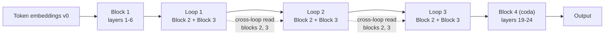

# Interpreting Inkling 2 Mini

> **Inkling 2 Mini 해석하기**: 하나의 residual stream 대신 **attention residuals**(depth-wise attention)를 쓰고, 가운데 layer들을 **세 번 반복(loop)** 하는 새로운 구조의 open-weights model 안에서 **정보가 어떻게 흐르고, component들이 어떻게 협응하며, 그 정보를 어떻게 해독할 수 있는지** 살펴본 Goodfire의 초기 연구.

| 항목 | 내용 |
|---|---|
| Source | [Goodfire Research](https://www.goodfire.com/research/interpreting-inkling-2-mini/) |
| Date | 2026-11-20 |
| Authors | Andrew Lee, Kamesh Krishnamurthy, Jack Merullo, Dan Balsam, Ekdeep Singh Lubana |
| 대상 model | **Inkling 2 Mini** ([Thinking Machines](https://thinkingmachines.ai/news/inkling-2-mini)): 작은 open-weights model. Goodfire가 공개 전에 weight를 받아 분석 |
| 구조 요약 | 24 layers × (attention + **MoE**), width $`d = 2304`$, 4 blocks, 가운데 2 block을 3번 반복 |
| Paper / Code | 없음 (블로그 글) |
| 후속 | [NDIF Looped Lens Challenge](https://ndif.us/looped-lens-challenge) |

---

## 목차

1. [TL;DR](#tldr)
2. [Background](#1-background)
3. [Architecture](#2-architecture)
4. [Information Flow](#3-information-flow)
5. [Coordination in Weight Space](#4-coordination-in-weight-space)
6. [Coordination in Activation Space: Massive Outlier](#5-coordination-in-activation-space-massive-outlier)
7. [Decoding Loops: Lens 비교](#6-decoding-loops-lens-비교)
8. [Conclusion & Limitations](#7-conclusion--limitations)
9. [Takeaways](#8-takeaways)

---

## TL;DR

- **새로운 구조**: Inkling 2 Mini에는 **하나의 residual stream이 없다.** 각 layer는 앞 block들의 출력에 **depth-wise attention**을 걸어 자기 입력을 만든다. 또 가운데 block 2개(layer 7–18)를 **3번 반복(loop)** 하고, 반복할 때마다 이전 loop의 출력을 **cross-loop attention**으로 읽는다.
- **질문 3가지**
  1. 정보가 model 안에서 **어떻게 흐르는가?**
  2. Component들이 layer와 loop를 넘어 **어떻게 협응하는가?**
  3. 중간 정보를 **어떻게 해독할 수 있는가?**
- **발견**
  - **Information flow**: depth-wise attention은 주로 **최근 layer**를 본다(sliding window와 비슷). 뒤 loop일수록 Block 2보다 **Block 3**을 더 많이 읽고, Block 3은 거의 항상 **이전 loop의 자기 출력**을 읽는다.
  - **Weight space**: 약 3.5M개 writer × 104개 reader 쌍(약 3억 6,800만 개) 중 정렬이 강한 **3,490쌍**은 대부분 **각 block의 마지막 layer(6, 12, 18)** 에 몰려 있다. 저자들은 이를 이후 layer가 "어느 block을 읽을지" 알 수 있게 activation에 **tag를 붙이는** 역할로 해석한다.
  - **Activation space**: looped layer의 정규화된 activation에서 **좌표 2027 하나가 squared norm의 약 46%** 를 차지하는 **massive outlier**가 있다. 이 값은 loop 1, 2의 layer 18에서 크게 양으로 치솟고, 다음 loop가 없는 **loop 3에서는 크게 음으로** 떨어진다. Cross-loop 신호를 이 outlier가 운반한다는 **추측**이다.
  - **Lens**: **logit-lens**는 각 loop의 마지막 layer 근처에서만 작동한다. **tuned-lens**와 **coda-lens**(Block 4를 중간 state에 적용)는 전반적으로 잘 작동한다.
- **결론**: 초기 결과지만, interpretability 도구가 **새로운 architecture에도 일반화될 수 있다**는 신호로 본다.

---

## 1. Background

- 지금까지의 interpretability 도구(circuit 분석, logit lens, SAE 등)는 대부분 **표준 residual stream transformer**를 전제로 만들어졌다.
- Inkling 2 Mini는 두 가지 최근 구조를 결합한다.
  - **Attention residuals** (Kimi Team, [arXiv 2603.15031](https://arxiv.org/abs/2603.15031)): residual을 단순히 더하는 대신, layer 출력들에 attention을 걸어 다음 입력을 만든다.
  - **Looping** (Universal Transformer 계열): 같은 layer를 여러 번 반복 실행한다. 참고: Dehghani et al. ([1807.03819](https://arxiv.org/abs/1807.03819)), Yang et al. ([2311.12424](https://arxiv.org/abs/2311.12424)), Geiping et al. ([2502.05171](https://arxiv.org/abs/2502.05171)), Bae et al. ([2507.10524](https://arxiv.org/abs/2507.10524)), Nanbeige LLM Lab ([2607.22083](https://arxiv.org/abs/2607.22083)), Zhu et al. ([2510.25741](https://arxiv.org/abs/2510.25741))
- 이런 구조에서도 기존 도구가 통하는지, 아니면 새 도구가 필요한지를 처음 점검한 연구다. Goodfire는 이전에 [Evo 2](https://www.goodfire.com/research/interpreting-evo-2) 같은 비표준 model도 해석한 바 있다.

---

## 2. Architecture

### 2.1 전체 구성
- **24 layers**, 각 layer는 **attention sublayer + mixture-of-experts(MoE) sublayer**
- Width $`d = 2304`$
- MoE layer마다 neuron **147,456개**

| Block | Layers | 실행 횟수 | 역할 |
|---|---|---|---|
| **Block 1** | 1–6 | 1번 | 입력 처리 |
| **Block 2** | 7–12 | **3번 (loop)** | 반복 처리 |
| **Block 3** | 13–18 | **3번 (loop)** | 반복 처리 |
| **Block 4** | 19–24 | 1번 | **"Coda"**: 출력 decoder |

→ 실제로 실행되는 layer 수는 $`6 + 12 \times 3 + 6 = 48`$이다.


*Figure 3 (Goodfire). Inkling 2 Mini 구조 개요. Block 1을 한 번 지난 뒤 Block 2와 3을 세 번 반복하고, 마지막으로 Block 4(coda)가 출력을 만든다.*



### 2.2 Attention residuals (depth-wise attention)
하나의 residual stream 대신, 각 sublayer의 입력은 **정규화된 block 합들의 softmax 가중합**이다.

- **Source**: token embedding $`\mathbf{v}_0`$, 이미 끝난 block들, 현재 block의 누적 합
- **Block 합**: $`\mathbf{v}_i = \sum_{w \in B_i} \mathbf{o}_w`$ (block 안 layer들의 attention 출력과 MoE 출력의 합)

```math
\mathbf{x} = \sum_j \alpha_j \, \hat{\mathbf{v}}_j,
\qquad
\alpha_j = \mathrm{softmax}_j\!\left( \frac{\mathbf{q}^\top \hat{\mathbf{v}}_j}{\sqrt{d}} \right),
\qquad
\hat{\mathbf{v}}_j = \frac{\mathbf{v}_j}{\mathrm{RMS}(\mathbf{v}_j)}
```

- Sublayer는 $`\mathrm{RMSNorm}(\mathbf{x})`$를 입력으로 받는다.
- $`\mathbf{q} \in \mathbb{R}^d`$는 **학습된 query vector**("reader")다. Depth-wise reader는 총 **56개**: attention sublayer용 31개, MoE sublayer용 24개, 출력 직전 1개. (Layer가 24개인데 attention reader가 31개인 이유는 글에 설명되어 있지 않다.)


*Figure 1 (Goodfire). Block 출력들에 대한 depth-wise attention이 각 layer의 입력을 만든다. 첫 loop의 중간 시점 상태를 보여준다.*

### 2.3 Cross-loop attention
Loop $`t \ge 2`$에서, 각 looped layer는 **이전 loop의 Block 2와 Block 3**으로부터 message를 읽는다. Query는 sublayer 입력 종류 $`s \in \{Q, K, V, \mathrm{MoE}\}`$마다 하나씩, layer당 **4개**다(looped layer 12개 × 4 = **48 readers**).

**Message**:

```math
\mathbf{m}_s = \sum_{j \in \{2,3\}} \beta_j \, \hat{\mathbf{v}}_j^{[t-1]},
\qquad
\beta_j = \mathrm{softmax}_j\!\left( \frac{\mathbf{u}_s^\top \hat{\mathbf{v}}_j^{[t-1]}}{\sqrt{d}} \right)
```

**Message와 현재 입력 섞기**: 두 정규화된 vector를 이어 붙여 64차원으로 줄인 뒤, **keep** $`\kappa`$와 **gain** $`\gamma`$를 계산한다.

```math
\mathbf{z} = \mathbf{P}\big[\mathrm{RMSNorm}(\mathbf{x});\; \mathrm{RMSNorm}(\mathbf{m})\big],
\qquad
\mathbf{P} \in \mathbb{R}^{64 \times 2d}
```

```math
\kappa = 1 - \tanh(\mathbf{F}\mathbf{z}),
\qquad
\gamma = \tanh(\mathbf{G}\mathbf{z}),
\qquad
\mathbf{F}, \mathbf{G} \in \mathbb{R}^{d \times 64}
```

```math
\mathbf{x}' = \kappa \odot \mathbf{x} + \gamma \odot \mathbf{m}
```

- **Keep** $`\kappa \in (0, 2)`$: 현재 loop의 입력을 얼마나 유지할지 (좌표별)
- **Gain** $`\gamma \in (-1, 1)`$: 이전 loop의 message를 얼마나 더할지 (좌표별, 부호 포함)


*Figure 2 (Goodfire). 각 layer는 앞 block들과 자기 block의 앞 layer들을 읽는다. Looped layer는 여기에 더해 이전 loop도 읽는다.*

---

## 3. Information Flow

### 3.1 Source share 분해
각 layer 입력 $`\mathbf{x}'`$를 앞 layer 출력들의 기여 $`\mathbf{c}_w`$의 합으로 정확히 분해한다.

**현재 loop의 write**:

```math
\mathbf{c}_w = \kappa \odot \alpha_{i(w)} \, r^{[t]}_{i(w)} \, \mathbf{o}_w
```

**이전 loop의 write**:

```math
\mathbf{c}_w = \gamma \odot \beta_{i(w)} \, r^{[t-1]}_{i(w)} \, \mathbf{o}_w
```

여기서 $`i(w)`$는 layer $`w`$가 속한 block, $`r`$은 그 block 합의 RMS 정규화 계수다. 각 source의 **share**는 다음과 같다.

```math
s_w = \frac{\mathbf{c}_w \cdot \mathbf{x}'}{\lVert \mathbf{x}' \rVert^2}
```

$`\sum_w \mathbf{c}_w = \mathbf{x}'`$이므로 **share의 합은 정확히 1**이다.

### 3.2 Results
**FineWeb 문서 400개, token 13,233개**의 평균:
- **Depth-wise attention은 주로 최근 layer에 집중**한다. **Sliding window**와 비슷한 패턴이다.
- **뒤 loop일수록 Block 2보다 Block 3을 더 많이** 읽는다.
- **Block 3은 거의 항상 이전 loop의 자기 출력**을 읽는다.


*Figure 4 (Goodfire, 애니메이션). 각 layer의 입력은 앞 layer 출력들의 가중합이며, 이것으로 layer 사이의 정보 흐름을 보여준다.*


*Figure 8 (Goodfire). 이전 loop의 block들에 대한 attention pattern.*

---

## 4. Coordination in Weight Space

### 4.1 Writer와 reader
- **Writer**: MoE neuron 하나의 **down-projection column**. Neuron이 발화하면 이 vector가 activation에 더해진다. 총 $`24 \times 147{,}456 = 3{,}538{,}944`$개
- **Reader**: depth-wise attention의 learned query **56개** + cross-loop attention의 learned query **48개** = **104개**
- 아이디어: 어떤 writer 방향이 어떤 reader query와 정렬되어 있으면, 그 neuron이 발화할 때 **그 reader가 해당 block을 더 많이 읽게** 된다. 즉 weight만 보고 **누가 누구에게 신호를 보내는지** 추정할 수 있다.

### 4.2 Method
- 약 **3억 6,800만** writer–reader 쌍의 cosine similarity를 계산한다.
- **절댓값 cosine ≥ 0.30**(상위 0.001%)인 쌍만 남기면 **3,490쌍**이 된다.

### 4.3 Results

**Depth-wise readers**
- 강하게 정렬된 writing은 **각 block의 마지막 layer(6, 12, 18)** 에 몰려 있다.
  - Layer 6 → 주로 **Block 4**
  - Layer 12 → **Block 3과 4**
  - Layer 18 → **Block 4**


*Figure 5 (Goodfire). 정렬이 가장 강한 depth-wise writer–reader 쌍은 각 block의 마지막 layer에 모인다. 이 layer들이 activation에 "tag"를 붙여 이후 layer가 읽을 수 있게 한다는 해석이다.*

**Cross-loop readers**
- Writing은 대부분 **Block 3**, 특히 **마지막 layer(18)** 에서 나오고, **layer 13**(Block 3의 첫 layer)을 향한다.


*Figure 6 (Goodfire). Cross-loop 쌍은 Block 3의 마지막 layer에 모인다. 그래서 다음 loop가 Block 3을 읽는다.*

### 4.4 해석: "tagging"
- 각 block의 마지막 layer가 activation에 **"이건 이 block에서 나온 것"이라는 tag**를 붙인다.
- 이후 layer의 reader query가 그 tag와 정렬되어 있어서, **어느 block을 읽을지** 선택할 수 있다.
- 특히 layer 18(Block 3의 마지막 layer)은 **cross-loop reader를 위해** 주로 쓴다.
- 이 해석은 3.2의 information flow 결과(뒤 loop가 Block 3을 더 많이 읽음)와 맞아떨어진다.

---

## 5. Coordination in Activation Space: Massive Outlier

### 5.1 좌표 2027
- Looped layer의 정규화된 activation에는 **outlier 좌표**가 있다.
- 모든 좌표가 고르다면 RMS 정규화 후 각 좌표의 크기는 약 1이고, squared norm의 약 $`1/2304 \approx 0.043\%`$를 차지한다.
- 그런데 **좌표 2027**($`d_{2027}`$)의 정규화된 평균값은 **+32.4**이고, 이는 squared norm의 약 **46%** 다.

```math
\frac{32.4^2}{2304} \approx 0.46
```

→ 2304개 좌표 중 **하나가 전체 에너지의 절반 가까이**를 차지한다. 글에서 이름을 밝힌 가장 이상한 좌표다.

### 5.2 Writing: loop마다 다른 패턴
- **Loop 1, 2**: layer 18(Block 3 끝)에서 $`d_{2027}`$이 **크게 양으로 치솟는다.**
- **Loop 3**: layer 18에서 **크게 음으로** 떨어진다(수치는 글에 없음).
- 저자들은 이를 **다음 loop가 없기 때문**으로 해석한다.


*Figure 7 (Goodfire). $`d_{2027}`$에 쓰는 component들. Layer 18이 loop 1과 2에서는 양으로, loop 3에서는 음으로 크게 치솟는다.*

### 5.3 Reading: gap term
Cross-loop reader가 Block 3과 Block 2 중 어느 쪽을 더 읽을지는 두 attention score의 차이, 즉 **gap**으로 정해진다.

```math
s_3 - s_2 = \frac{\mathbf{u}_Q \cdot \delta}{\sqrt{d}},
\qquad
\delta = \hat{\mathbf{v}}_3 - \hat{\mathbf{v}}_2,
\qquad
\mathrm{gap} = \sum_i u_i \, \delta_i
```

Gap은 좌표별 합으로 분해되므로, 각 좌표의 기여를 잴 수 있다. **Loop 2의 layer 13**(Block 3의 첫 layer)에서:

| Cross-loop reader | $`d_{2027}`$의 gap 기여 | 상위 5개 좌표의 gap 기여 |
|---|---|---|
| Q | 약 17% | 약 60% |
| V | 약 19% | 약 62% |
| K | 약 11% | 약 32% |
| MoE | 약 6% | 약 30% |

- $`d_{2027}`$은 네 reader 모두에서 **1위 또는 2위** 기여 좌표다.
- Gap 기여 상위 5개 좌표는 모두 정규화 norm 기준 상위 15개 좌표 안에 든다.
- (reader별 대응은 글의 나열 순서를 따랐다.)

### 5.4 Speculation
- Model은 **cross-loop 신호 전달에 이 outlier를 쓰는 것**으로 보인다. Block 3 끝에서 outlier를 키워 "이건 Block 3 출력"이라고 표시하고, 다음 loop의 reader가 이를 보고 Block 3을 읽는다.
- **마지막 loop의 layer 18은 outlier를 제거**(음의 spike)한다. 더 이상 읽을 loop가 없으니 신호를 정리하는 셈이다.
- 저자들은 이것이 **추측(speculation)** 이라고 명시한다.

---

## 6. Decoding Loops: Lens 비교

### 6.1 Lens 4종

| Lens | 방법 | 결과 |
|---|---|---|
| **Logit-lens** | 중간 state에 바로 unembedding 적용 | **각 loop의 마지막 몇 layer**에서만 작동 |
| **Tuned-lens** | 최종 layer로 가는 **affine map**을 학습 (FineWeb 23,750 문서로 학습, 1,250 문서로 평가) | 전반적으로 잘 작동 |
| **J-lens** | 평균 Jacobian 사용 | 표준 metric으로 평가하지 않음. **후속 연구로 남김** |
| **Coda-lens** | 중간 state에 **Block 4(coda)를 그대로 적용** | 전반적으로 잘 작동 |

### 6.2 Metrics
- **Top-50 hit**: lens의 top-50 token에 model의 **최종 출력 token**이 포함되는가
- **Top-50 probability mass**: lens의 top-50 token이 받는 확률 질량
- 정확한 수치는 Figure 9에만 있고 글에는 없다.
- Footnote: 이 metric들은 **J-lens에는 맞지 않을 수 있다.** (요약자 해석: J-lens는 최종 출력을 예측하기보다 working memory 같은 다른 종류의 정보를 읽는 도구이기 때문으로 보인다.)


*Figure 9 (Goodfire). Held-out FineWeb 문서에서 lens별, layer와 loop별 결과. Logit-lens는 앞 layer에서 실패하고, tuned-lens와 coda-lens는 작동한다.*

### 6.3 관찰
- 저자들은 logit-lens 기준으로 **이른 loop가 중간 layer들보다 해석하기 쉽다**는 점을 interpretability에 고무적인 신호로 본다.
- **Coda-lens**는 이 구조에서 특히 자연스럽다. Block 4가 원래 "loop 출력을 해독하는" 역할을 하므로, 중간 state에 바로 적용해볼 수 있다.

---

## 7. Conclusion & Limitations

### 7.1 Conclusion
- 결과는 **초기(preliminary)** 단계다.
- 그래도 interpretability 도구들(information flow 분해, weight-space 정렬 분석, lens)이 **새로운 architecture에도 일반화될 수 있다**는 신호를 보여준다.
- 다음 단계로 NDIF의 **Looped Lens Challenge**를 소개한다.

### 7.2 Limitations
- **초기 결과**이며 할 일이 많이 남아 있다(저자 언급).
- Loop 3에서 $`d_{2027}`$이 정리된다는 설명은 **추측**이다.
- Information flow 분석은 **token 13,233개(문서 400개)** 로 비교적 작은 sample이다.
- **J-lens**를 looped model에 적용하는 것은 후속 연구로 남겼다.
- Model의 parameter 수, active parameter 수, MoE expert 수, 학습 방법은 글에 나와 있지 않다.

---

## 8. Takeaways

1. **"Residual stream"이 없는 model도 해석할 수 있다**: depth-wise attention은 입력이 앞 출력들의 **명시적인 가중합**이라, 오히려 정보 흐름을 **정확히 분해**하기 쉽다(share 합 = 1).
2. **Weight만으로 통신 구조를 읽는다**: writer(MoE down column)와 reader(learned query)의 cosine만으로, 어느 layer가 누구에게 신호를 보내는지("tagging")를 찾았다. 3억 6,800만 쌍 중 0.001%만 남겨도 구조가 선명하게 보인다.
3. **Massive outlier는 통신 채널일 수 있다**: 일반 LLM에서도 보이는 massive activation이, 이 model에서는 **"어느 block에서 왔나"를 알리는 신호**로 쓰이는 것처럼 보인다. 마지막 loop에서 부호가 뒤집히는 패턴이 특히 흥미롭다.
4. **Architecture에 맞는 lens를 고르자**: logit-lens는 loop 중간에서 실패하지만, model 자체의 decoder(Block 4)를 쓰는 **coda-lens**는 별도 학습 없이도 잘 작동한다.
5. **J-lens와의 연결**: 앞서 정리한 *A Mathematical Theory of the Jacobian Lens*(2610.31955)와 *MC-Lens*(2611.26590)처럼, J-lens는 최종 출력 예측과는 다른 종류의 정보를 읽는다. 그래서 이 글의 top-50 metric으로는 평가하지 않았다. Looped model에서 J-lens가 무엇을 보여줄지는 열린 질문이다(요약자 해석).

---

## References & Links

- 원문: https://www.goodfire.com/research/interpreting-inkling-2-mini/
- Inkling 2 Mini 공개: https://thinkingmachines.ai/news/inkling-2-mini
- NDIF Looped Lens Challenge: https://ndif.us/looped-lens-challenge
- Attention residuals: [Kimi Team, arXiv 2603.15031](https://arxiv.org/abs/2603.15031)
- Looping: [Dehghani et al.](https://arxiv.org/abs/1807.03819), [Yang et al.](https://arxiv.org/abs/2311.12424), [Geiping et al.](https://arxiv.org/abs/2502.05171), [Bae et al.](https://arxiv.org/abs/2507.10524), [Nanbeige LLM Lab](https://arxiv.org/abs/2607.22083), [Zhu et al.](https://arxiv.org/abs/2510.25741)
- 배경: [Zoom In: CNN circuits](https://distill.pub/2020/circuits/zoom-in/), [A Mathematical Framework for Transformer Circuits](https://transformer-circuits.pub/2021/framework/index.html), [Interpreting Evo 2 (Goodfire)](https://www.goodfire.com/research/interpreting-evo-2)

<sub>작성 메모: Goodfire 블로그 글을 기준으로 정리했다. 그림 9개는 goodfire.com의 원본 이미지에 직접 링크했고, Figure 4는 애니메이션 GIF라 GitHub에서도 움직인다. goodfire.com 이미지 주소에는 사이트를 다시 배포하면 바뀔 수 있는 해시값이 들어 있다. Lens 결과의 정확한 수치는 글 본문에 없고 Figure 9에만 있다. 수식은 GitHub 전용 문법(```` ```math ```` 블록과 `` $`...`$ ``)으로 썼고, GitHub가 막는 `\operatorname`, `\boldsymbol` 같은 명령은 쓰지 않았다. 캡션은 원문을 번역하지 않고 요약해서 다시 썼다.</sub>
