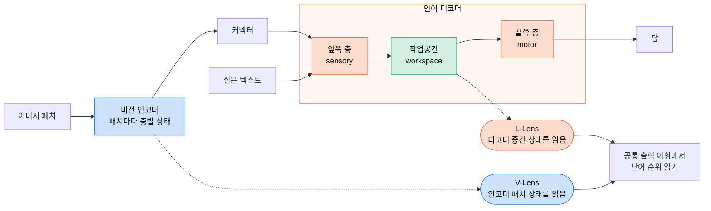
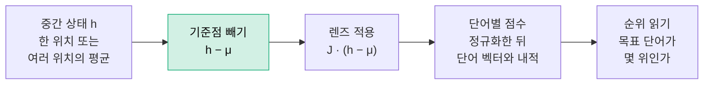
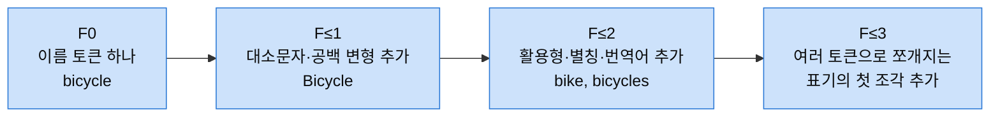
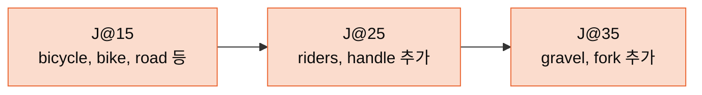
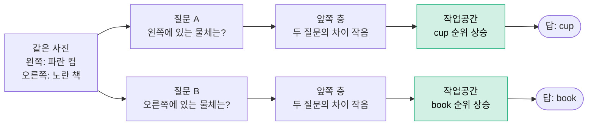
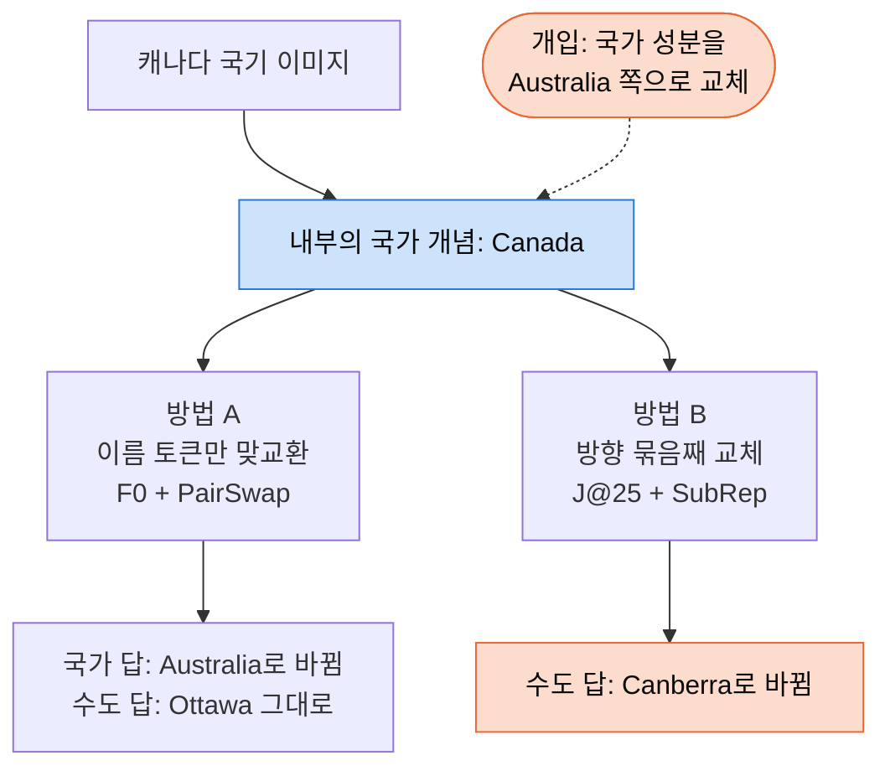
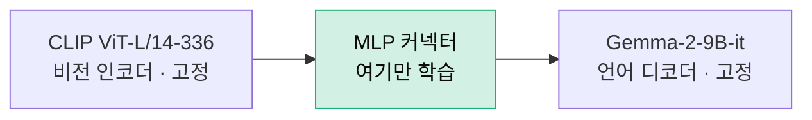
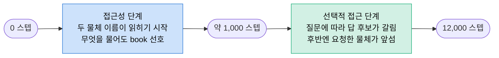

# Probing the "Conscious" Mind — 논문 해설

**Selective Access and Global Workspace in Vision-Language Models**

- 저자: Jiahao Huang (Imperial College London), Jun Wang (University College London, 교신저자)
- 원문: [arXiv:2611.26590v1](https://arxiv.org/html/2611.26590v1) · [PDF](https://arxiv.org/pdf/2611.26590v1)
- 분야: cs.AI · 해석가능성(interpretability)

> **그림에 대하여.** 이 문서의 그림은 모두 해설용으로 새로 그린 개념도이며, 논문의 원본 그림이 아닙니다.
> Mermaid 다이어그램으로 작성해서 이 파일 하나만 올려도 GitHub에서 그림이 표시됩니다.
> 그림에 적힌 숫자는 논문 본문과 부록 표에서 확인한 값만 사용했습니다.
> 원본 그림은 PDF에서 볼 수 있고, 어떤 그림이 무엇을 담고 있는지는 [맨 아래 표](#원문-그림-찾아보기)에 정리했습니다.

---

## 한 줄 요약

이미지와 텍스트를 함께 다루는 모델(VLM)의 중간층에, 인지과학의 **전역 작업공간(global workspace)** 처럼 동작하는 구간이 있는지 확인한 논문입니다.
이를 위해 중간층 상태를 단어 순위로 읽어 내는 도구 **MC-Lens**를 만들고, 읽기·선택·개입·학습 추적의 네 방향에서 실험했습니다.

제목의 "Conscious"는 기능을 빗댄 표현입니다. 저자들은 모델에 의식이나 주관적 경험이 있다고 주장하지 않습니다.

## 배경: 전역 작업공간 이론

전역 작업공간 이론(GWT)은 뇌의 여러 전문 처리 과정이 하나의 공유 공간에 정보를 올리고, 그중 선택된 정보만 다른 과정들이 두루 쓸 수 있게 된다고 보는 이론입니다.
이 논문은 이 이론이 예측하는 세 가지 기능이 VLM 내부에서 관찰되는지를 묻습니다.

| GWT가 말하는 기능 | 논문이 확인한 것 |
|---|---|
| 정보가 공유 공간에 올라온다 | 개념이 중간층에서 단어로 읽히는가 |
| 필요한 정보만 선택된다 | 질문에 따라 읽히는 개념이 달라지는가 |
| 선택된 정보가 여러 처리에 쓰인다 | 그 개념을 바꾸면 여러 추론의 답이 따라 바뀌는가 |

---

## 1. MC-Lens: 중간층을 읽는 도구



파란색은 비전 쪽, 주황색은 언어 쪽, 초록색은 작업공간으로 추정되는 구간입니다.
L-Lens는 그림에 표시한 작업공간뿐 아니라 디코더의 모든 층에 적용할 수 있습니다.

### 렌즈의 원리

출발점은 선행 연구인 J-Lens(Gurnee 외, 2026)입니다.
중간층 상태를 조금 바꿨을 때 최종층 상태가 얼마나 달라지는지를 Jacobian으로 선형 근사합니다.

```
δh_final ≈ J · δh_mid
```

이 Jacobian을 여러 위치와 여러 입력에 걸쳐 평균 내면 층마다 행렬이 하나씩 남고, 이 행렬이 그 층의 **렌즈**입니다.
렌즈를 통과한 상태는 최종층과 같은 좌표에 놓이므로, 모델의 출력 어휘로 "지금 어떤 단어가 몇 위인가"를 읽을 수 있습니다.

### MC-Lens가 더한 것

- **렌즈가 두 종류입니다.** L-Lens는 언어 디코더 안의 상태를 읽습니다. V-Lens는 비전 인코더의 패치 상태에서 출발해 커넥터와 디코더 전체를 거치는 Jacobian을 씁니다. 그래서 인코더 안의 패치도 디코더와 같은 어휘로 읽힙니다.
- **토큰 종류별로 평균을 냅니다.** 이미지 토큰이 텍스트 토큰보다 훨씬 많아서 단순 평균은 이미지 쪽으로 쏠립니다. 이미지·텍스트·템플릿 세 묶음을 따로 평균 낸 뒤 같은 비중으로 합칩니다.
- **도착점은 텍스트 위치로 한정합니다.** 디코더의 이미지 위치에서는 출력이 나오지 않고, 숫자가 많아 텍스트 쪽 효과를 가리기 때문입니다.
- **기준점을 빼고 읽습니다.** 평범한 사진 여러 장의 평균 상태 μ를 먼저 뺍니다.

### 읽는 과정



단어 `w`의 점수는 다음과 같습니다. `u_w`는 그 단어의 unembedding 벡터입니다.

```
score(w) = u_w · Norm[ J · (h − μ) ]
```

기준점을 빼지 않으면 상위권이 photo, image처럼 어느 사진에나 해당하는 단어로 채워집니다.
부록의 표에 따르면 이 단계 하나의 효과가 큽니다.

| 디코더 이미지 토큰 평균 상태에서 읽기 | 객체 이름이 10위 안에 든 사진 비율 |
|---|---|
| 기준점 빼기 전 | 0.8% |
| 기준점 뺀 뒤 | 69.5% |

(Qwen3-VL-8B, 디코더 32층, 질문 없이 사진 128장)

렌즈를 맞추는 데 데이터가 많이 필요하지도 않습니다.
Qwen3-VL-8B에서 프롬프트 100개로 맞춘 렌즈는 본문 분석에 쓴 1,000개짜리와 층별 패턴이 거의 같았습니다.

---

## 2. 개념은 단어 하나가 아니라 "방향 묶음"

"Canada"라는 개념은 Canada, Canadian, 加拿大처럼 여러 토큰에 걸쳐 있습니다.
이름 토큰 하나의 방향(`φ_w = Jᵀ · u_w`)만 보면 개념의 일부만 잡힙니다.
논문은 방향을 묶는 방법을 두 가지 제시합니다. 아래는 bicycle 개념의 예입니다.

**단어형 집합 F≤j** — 이름에서 출발해 표기 변형을 차례로 더합니다.



**탐욕 집합 J@k** — 상태에서 출발해, 남은 잔차와 가장 잘 맞는 단어 방향을 하나씩 더합니다.



| 묶음 | 만드는 법 | 특징 |
|---|---|---|
| **단어형 집합 F≤j** | 이름 토큰(F0)에서 출발해 대소문자·공백 변형(F1), 활용형·별칭·번역어(F2), 여러 토큰으로 쪼개지는 표기의 첫 조각(F3)을 차례로 더함 | 상위 10위 안에 읽히는 토큰을 많이 포함함 |
| **탐욕 집합 J@k** | 그 개념의 상태에서 비교 개념들의 평균을 뺀 차이 벡터를 놓고, 남은 잔차와 가장 잘 맞는 단어 방향을 하나씩 k개까지 더함 | 상태를 재구성하는 능력이 가장 좋음 |

두 묶음의 성격은 다릅니다.
탐욕 집합에는 road, handle처럼 이름과 무관한 연관어도 들어옵니다.
캐나다 국기 예시에서 maple은 읽기 순위가 116위인데, 상태를 재구성하는 기여도로는 상위 5위권에 듭니다.
잘 읽히는 단어와, 상태를 실제로 구성하는 방향은 같지 않다는 뜻입니다.

---

## 3. 개입 연산: 개념을 바꿔 보는 네 가지 방법

원본 입력(예: 캐나다 국기)과 목표 입력(예: 호주 국기)을 각각 실행해 같은 층·같은 위치의 상태를 뽑고, 원본 상태의 일부를 목표 것으로 바꿉니다.

아래 표에서 상태 하나는 **개념 성분**(큰 네모 3칸)과 **나머지 성분**(작은 마름모 5칸)으로 나눠 그렸습니다.
파란색은 원본에서 온 부분, 주황색은 목표에서 온 부분입니다.

| 상태 | 개념 성분 + 나머지 성분 | 무엇이 바뀌었나 |
|---|---|---|
| 원본 (캐나다 국기) | 🟦🟦🟦 🔹🔹🔹🔹🔹 | 바꾸기 전 |
| 목표 (호주 국기) | 🟧🟧🟧 🔸🔸🔸🔸🔸 | 가져올 대상 |
| **PairSwap** 적용 후 | 🟧🟦🟦 🔹🔹🔹🔹🔹 | 두 이름 토큰 방향의 좌표만 맞바꿈 |
| **SubRep** 적용 후 | 🟧🟧🟧 🔹🔹🔹🔹🔹 | 방향 묶음이 펼치는 부분공간 성분을 목표 것으로 교체 |
| **AbIn** 적용 후 | 🟠🟠🟠 🔹🔹🔹🔹🔹 | 원본 개념 성분을 지우고 목표 방향들의 평균(🟠)을 주입 |
| **FullRep** 적용 후 | 🟧🟧🟧 🔸🔸🔸🔸🔸 | 상태 전체를 목표 상태로 교체 |

| 연산 | 수식·설정 | 비고 |
|---|---|---|
| **PairSwap** | 이름 토큰 두 개의 좌표 교환 | 단일 토큰 이름 전용, 기준선 |
| **SubRep** | `h′ = (I − P)·h_s + P·h_t` | 대부분의 실험에 쓰임 |
| **AbIn** | 비교 실험에서 주입 세기 α = 0.5 | 방향 묶음이 커질수록 성공률이 떨어짐 |
| **FullRep** | `h′ = h_t` | 개념 밖 성분까지 함께 바뀌는 경우를 보는 대조군 |

---

## 4. 실험 결과

### 4.1 개념은 중간층에서 읽힌다

- **단서가 무엇이든 접근성이 오릅니다.** A-OKVQA 100문항에서 이미지 단서만, 텍스트 단서만, 둘 다, 둘 다 없음의 네 조건을 비교했습니다(Qwen3-VL-8B, 디코더 32층, 답 직전 위치). 텍스트 단서가 이미지 단서보다 효과가 컸고, 둘을 함께 주면 텍스트만 줄 때와 비슷했습니다. 한 예시에서 정답 "grind"는 단서가 없을 때 9위였다가 단서를 주면 1위가 됩니다.
- **질문이 없어도 객체 이름이 잡힙니다.** THINGS 데이터의 객체 32개(개념당 사진 4장)를 질문 없이 넣었을 때, 객체 이름의 순위는 인코더 뒤쪽에서 좋아지고 디코더 앞쪽에서 떨어졌다가 디코더 뒤쪽에서 다시 좋아집니다.
- **패치 단위로도 읽힙니다.** 인코더 18층보다 25층에서 더 많은 패치에서 객체 이름이 읽히고 배치가 분명해집니다. 색(yellow, red, blue)과 재질(glass, ceramic)도 일부 대응하지만, 재질은 더 흩어져 나타납니다.

### 4.2 질문에 따라 골라 읽는다



측정 방식은 엄격합니다.
COCO 사진 100장마다 물체 3개를 고르고, 물체 이름을 쓰지 않은 채 색·위치·관계로 가리키는 질문 3개를 만듭니다.
세 질문 **모두**에서 지목된 물체의 이름이 나머지 둘보다 위에 온 사진만 성공으로 칩니다.
대조군으로는 같은 질문에 균일한 회색 이미지를 넣습니다.

- 이 비율은 디코더 앞쪽 층에서 0에 가깝고, 작업공간 구간에서 급격히 오릅니다. 회색 이미지에서는 오름폭이 훨씬 작습니다.
- 색 개념도 같은 방향으로 움직입니다. 왼쪽 질문에서는 blue가, 오른쪽 질문에서는 yellow가 더 잘 읽힙니다.
- "책은 무시해"라고 지시하면 최종 답은 그대로 cup이어도 book의 순위가 크게 떨어집니다. 답이 같아도 중간 상태는 다를 수 있습니다.
- 문장을 생성하는 동안에도 같은 현상이 보입니다. 물체 이름이 출력되기 직전에 작업공간 구간에서 그 이름의 순위가 먼저 오르고, 맨 끝 구간에서 1위가 됩니다.

### 4.3 읽힌 개념이 실제 추론에 쓰인다



국기 이모지 50개를 보여 주고 "어느 나라 국기인가"(직접 질문)와 "그 나라의 수도는"(한 단계 질문)을 묻습니다.

- **이름만 바꾸면 '말'만 바뀝니다.** Canada→Australia 예시에서 이름 토큰만 맞바꾼 조건은 국가 답을 Australia로 돌려놓지만 수도 답은 Ottawa에 머뭅니다. J@25 묶음을 SubRep으로 바꿔야 Canberra가 나옵니다.
- **방향의 개수보다 종류가 중요합니다.** 한 단계 질문에서 방향 5개짜리 J@5는 거의 모든 답을 뒤집는데, 약 8개짜리 F≤3은 절반 미만만 뒤집습니다.
- **효과가 여러 과제로 번집니다.** 같은 국가 방향이 ISO 코드, 통화, 대륙, 인터넷 도메인, 전화 국가번호 답에도 영향을 줍니다(원본-목표 쌍 51개, 과제 7개). Ireland→Tunisia 예시에서는 수도(Dublin→Tunis)와 통화(EUR→TND)가 따라 바뀌고, 도메인과 국가번호는 따라오지 않습니다. 가장 불안정한 과제는 전화 국가번호입니다.
- **두 단계 추론도 움직입니다.** 캐나다 국기에서 국가 성분을 그리스로 바꾸면 "Ottawa, Ontario"가 "Athens, Attica"로 넘어갑니다. 실패 사례도 있습니다. 덴마크→자메이카 공항 코드 질문의 답은 목표인 KIN이 아니라 SIN으로 갑니다. 다중 홉 40건에서는 중간 개념(수도)까지 함께 바꾸면 목표 답 비율이 더 높아집니다.
- **어느 층을 건드리느냐가 중요합니다.** 편집 구간의 끝이 추정 작업공간을 지나야 답이 바뀌기 시작합니다. 한 단계 추론이 낀 과제일수록 9개 층처럼 넓은 구간이 유리합니다.

**필요성·충분성 분석은 덜 깔끔합니다.**

| 수도 질문 · 국가 성분 개입 · J@35 · 국기 50개 · Qwen3-VL-8B | 비율 |
|---|---|
| 넣으면 답이 복구된 사례 | 약 85% |
| 필요성과 충분성을 모두 충족한 사례 | 15% |

그 방향을 넣으면 답이 살아나지만, 빼도 답이 유지되는 경우가 많다는 뜻으로 읽힙니다.
같은 정보가 다른 경로에도 겹쳐 저장돼 있을 가능성을 시사합니다(이 해석은 해설자의 것입니다).

### 4.4 모델이 달라도 기능은 비슷하다

Qwen3-VL(2B/8B/32B), DeepSeek-VL2(Tiny/Small/Full), Gemma 3(4B/12B/27B)의 9개 모델을 비교했습니다.

- 중간층 예측이 최종 예측과 일치하는 정도는 모든 모델에서 작업공간 구간에 들어서며 오릅니다.
- 내부 구조는 계열마다 다릅니다. Qwen과 DeepSeek은 작업공간 입구에서 방향 차원이 급증하는 전환이 뚜렷하고, Gemma는 그 전환이 흐릿합니다.
- 세 계열 모두 모델이 커질수록 필요성 비율이 낮아집니다.
- 예외도 있습니다. DeepSeek Small은 객체 읽기가 전반적으로 약하고, DeepSeek Full은 마지막 몇 층에서 급락합니다.

### 4.5 학습 중에는 '읽히는 것'이 먼저, '골라 읽는 것'이 나중

실험 구성은 다음과 같습니다. 인코더와 디코더는 고정하고 그 사이의 커넥터만 PixMo-Cap 이미지-캡션 데이터로 12,000스텝 학습합니다.



학습이 진행되면서 컵·책 사례는 이렇게 변합니다.



이미지와 텍스트가 같은 개념을 가리키는지 재는 지표를 두 개 제안합니다.

| 지표 | 정의 |
|---|---|
| **J-state cosine** | 이미지 상태와 텍스트 상태를 개념 방향들에 사영한 좌표끼리의 코사인 유사도 |
| **ReconCov** | 이미지 상태가 개념 방향들의 조합으로 얼마나 재구성되는가 (1에 가까울수록 잘 재구성됨) |

- 은닉 상태를 그대로 비교하는 코사인 유사도는 학습 내내 우연 수준에 머뭅니다. 제안한 두 지표는 학습이 진행될수록 해당 개념의 사진을 더 잘 구분합니다.
- 후반 체크포인트에서는 ReconCov의 구분력이 가장 좋습니다.
- '약 1,000스텝'은 컵·책 사례에서 보고된 전환 시점입니다. 지표 곡선의 수치는 원문 Figure 22에 있습니다.

---

## 5. 비판적으로 볼 점

- **작업공간 경계는 수동으로 추정했습니다.** 경계를 정할 때 쓴 읽기·선택 곡선이 그 경계를 독립적으로 검증해 주지는 못한다고 부록에서 스스로 밝힙니다. "작업공간 안에서 선택성이 오른다"는 결과에는 순환성이 일부 있습니다.
- **표본이 작고 소재가 좁습니다.** 100문항, 국기 50개, 다중 홉 40건 규모이고, 인과 실험은 국기-국가 지식에 몰려 있습니다.
- **'방송' 메커니즘은 밝히지 못했습니다.** 선택된 정보가 여러 하위 과정으로 퍼지는 경로는 향후 과제로 남겼습니다. GWT의 핵심 요소가 아직 비어 있는 셈입니다.
- **읽기 도구가 단어 어휘에 묶여 있습니다.** 말로 옮기기 어려운 시각 정보는 놓칠 수 있습니다.
- **한 단계 추론에서는 인과 증거가 약합니다.** 위의 85% 대 15% 결과가 이를 보여 줍니다.

## 실험 설정 요약

| 실험 | 데이터 | 보는 것 |
|---|---|---|
| 단서 조건별 접근성 | A-OKVQA 100문항 | 목표 단어가 상위 1·5·10위에 드는 비율 |
| 묶음 구성법 비교 | A-OKVQA 100문항, 국기 46개 | 상위 10위 포함률, 재구성 점수 |
| 시각 상태 읽기 | THINGS 객체 32개 × 4장 | 층별 객체 이름 순위 |
| 선택적 접근 | COCO 100장 × 질문 3개 | 세 질문 모두에서 지목된 물체가 앞서는 비율 |
| 반사실 개입 | 국기 이모지 50개 | 목표 답이 나오는 비율 |
| 여러 과제로의 전이 | 원본-목표 쌍 51개 × 과제 7개 | 과제별 목표 답 비율 |
| 다중 홉 추론 | 40건 (질문 유형 6개) | 단독 개입과 결합 개입 비교 |
| 모델 간 비교 | 3개 계열 × 3개 크기 | 구조와 기능의 공통점 |
| 학습 추적 | PixMo-Cap, 12,000스텝 | 정렬 지표와 선택적 접근의 발달 |

## 용어 정리

| 용어 | 뜻 |
|---|---|
| VLM | 이미지와 텍스트를 함께 처리하는 모델 |
| 렌즈 | 중간층 상태를 최종층 좌표로 옮기는 층별 평균 Jacobian 행렬 |
| 접근성 | 중간 상태에서 개념 단어가 높은 순위로 읽히는 정도 |
| 선택적 접근 | 질문이나 지시에 따라 읽히는 개념이 달라지는 현상 |
| sensory / workspace / motor | 디코더 층을 앞·가운데·끝으로 나눈 세 구간 (J-Lens 연구의 틀) |
| Pass@K | 목표 단어가 상위 K위 안에 든 사례의 비율 |
| NR / SR / NSR | 필요성 비율 / 충분성 비율 / 둘을 모두 충족한 비율 |

## 원문 그림 찾아보기

arXiv HTML 판에는 번호가 붙은 그림이 모두 누락되어 있어 PDF에서 확인해야 합니다.
성공률과 순위 같은 정확한 수치는 대부분 아래 그림에만 있습니다.

| 내용 | 원문 그림 |
|---|---|
| MC-Lens 개요, Jacobian 정의, 읽기와 기준점 빼기 | Figure 1–3 |
| 방향 묶음 구성, 개입 연산 | Figure 4–6, 11 |
| 단서 조건별 접근성, 묶음 비교, 층별 객체 읽기 | Figure 7–9 |
| 질문에 따른 선택 민감도 | Figure 10 |
| 개입 성공률, 필요성·충분성 | Figure 12–13 |
| 여러 과제로의 전이, 다중 홉 | Figure 14–15 |
| 9개 모델 비교 | Figure 16–20 |
| 학습 중 정렬 지표 | Figure 21–22 |
| 렌즈 추정 데이터 수, 개입 깊이와 구간 너비 | Figure S1–S2 |

## 출처

Jiahao Huang, Jun Wang. *Probing the "Conscious" Mind: Selective Access and Global Workspace in Vision-Language Models.* arXiv:2611.26590v1.
<https://arxiv.org/html/2611.26590v1>

이 문서는 위 논문을 읽고 정리한 해설입니다. 정확한 정의와 수치는 원문을 기준으로 삼으세요.
