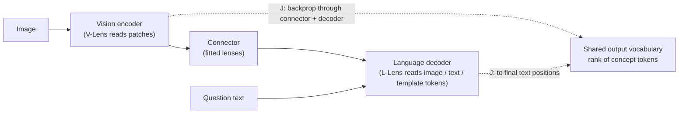

# Probing the "Conscious" Mind: Selective Access and Global Workspace in Vision-Language Models

> **MC-Lens (Multimodal Concept Lens)**: LLM용 Jacobian lens(J-lens)를 **vision-language model(VLM)** 로 확장해서, 이미지와 텍스트에서 들어온 concept가 model 내부에서 언제 **읽을 수 있게(accessible)** 되고, 질문에 따라 어떻게 **선택(selective access)** 되며, 실제로 **추론에 쓰이는지(causal)** 를 측정한 논문.

| 항목 | 내용 |
|---|---|
| Authors | Jiahao Huang (Imperial College London), Jun Wang (University College London, 교신저자) |
| arXiv | [2611.26590](https://arxiv.org/abs/2611.26590) (v1, 2026-11-19, cs.AI) |
| 주 실험 model | **Qwen3-VL-8B** |
| 비교 model (9개) | Qwen3-VL (2B, 8B, 32B), DeepSeek-VL2 (Tiny, Small, full), Gemma 3 (4B, 12B, 27B) |
| Datasets | A-OKVQA, THINGS, COCO, 국기 이미지 50개(Noto Color Emoji) |
| Code | 공개 링크 없음 (alphaXiv 기준) |

> ⚠️ **"Conscious"의 의미**: 저자들은 "conscious"를 **Global Workspace Theory(GWT)** 와 관련된 **기능적 성질**을 가리키는 말로만 쓴다. Model이 의식을 가졌다고 주장하지 않는다.

---

## 목차

1. [TL;DR](#tldr)
2. [Background](#1-background)
3. [Method: MC-Lens](#2-method-mc-lens)
4. [Concept Accessibility](#3-concept-accessibility)
5. [Selective Access](#4-selective-access)
6. [Causal Effects: Interventions](#5-causal-effects-interventions)
7. [Workspace Across 9 VLMs](#6-workspace-across-9-vlms)
8. [Alignment During Learning](#7-alignment-during-learning)
9. [Discussion & Limitations](#8-discussion--limitations)
10. [Takeaways](#9-takeaways)

---

## TL;DR

- **Method**: **V-Lens**(vision encoder용)와 **L-Lens**(language decoder용)로 이루어진 **MC-Lens**를 제안한다. 두 lens 모두 중간 state를 **decoder의 output vocabulary 공간**으로 옮기므로, 시각 처리와 언어 처리에서의 concept 접근성을 **같은 잣대로** 비교할 수 있다.
- **Concept 표현 확장**: concept를 이름 token 하나가 아니라 **token 집합**으로 표현한다. Word-form 집합 $`F_{\le j}`$와, greedy하게 고른 **J-space 방향 집합** $`J@k`$다.
- **네 가지 발견**
  1. **Accessibility**: concept는 중간 state에서 읽을 수 있고, **질문(task)에 따라 선택적으로** 접근된다. 실제 이미지에서는 workspace 구간에서 선택성이 크게 오르지만, 회색(blank) 이미지에서는 훨씬 덜 오른다.
  2. **Causal role**: concept 방향을 바꿔 넣는 counterfactual intervention으로 **직접 답(국가명)뿐 아니라 one-hop 답(수도)과 multi-hop 답까지** 바꿀 수 있다. 예: Canada → Australia로 바꾸면 수도가 "Ottawa"에서 "Canberra"로 바뀐다.
  3. **Training 중 alignment**: 제안한 J-space 지표 2개(**J-state cosine**, **ReconCov**)는 학습이 진행되며 cross-modal concept 대응을 잘 추적하지만, 일반 hidden-state cosine은 **chance 수준**에 머문다.
  4. **공통 구조**: 9개 VLM 모두에서 **workspace 구간**에서 readout, 선택, 예측 일치도가 함께 오르는 공통 패턴이 보인다.

---

## 1. Background

### 1.1 Global Workspace Theory (GWT)
- 인지과학의 이론으로, 뇌에서 여러 전문 모듈이 처리한 정보 중 **일부만 "global workspace"에 선택되어 올라가고**, 거기서 다른 모듈들에 **broadcast**된다는 모델이다.
- 대표적 근거: 농구공 패스를 세느라 고릴라를 못 보는 실험(Simons & Chabris, 1999), global neuronal workspace model(Dehaene et al., 1998), Conscious Turing Machine(Blum & Blum, 2022)
- 이 논문은 GWT의 두 기능적 성질을 VLM에서 측정한다.
  - **Accessibility**: 정보가 workspace에서 읽을 수 있는가
  - **Selective access**: 과제에 따라 일부 정보만 선택되는가

### 1.2 문제의식
- VLM의 output만 보면 내부 concept 표현을 알 수 없다.
- 필요한 정보가 **중간 state에서는 읽을 수 있는데도** 질문에 틀리게 답하는 경우가 있다.

### 1.3 출발점: J-lens
- Gurnee et al.(2026)은 LLM용 **Jacobian Lens(J-lens)** 를 제안하고, LLM 안에서 global-workspace를 닮은 성질을 찾았다.
- J-lens는 중간 hidden state에 **평균한 Jacobian**(중간 state → 최종 layer state)을 곱한 뒤 unembedding해서 token으로 읽는다.
- 이 논문은 J-lens를 **multimodal 입력**으로 확장하고, concept를 운반하는 **readout carrier**를 이름 token 하나에서 **token 집합**으로 넓힌다.

---

## 2. Method: MC-Lens



### 2.1 Multimodal Jacobian lens
- 중간 state를 layer $`\ell`$, position $`p`$, component $`m \in \{E, D, C\}`$(vision encoder, language decoder, connector)로 index한다. 최종 decoder state는 $`h^D_{L,q}`$다.

**Eq. 1, local Jacobian**:

```math
J^{m}_{\ell,\,p \rightarrow q}(x) = \frac{\partial h^{D}_{L,q}(x)}{\partial h^{m}_{\ell,p}(x)}
```

**Eq. 3, 최종 position에 대해 합산**:

```math
J^{m}_{\ell,p}(x_i) = \sum_{q \in \mathcal{Q}_i} J^{m}_{\ell,\,p \rightarrow q}(x_i)
```

**Eq. 4–5, category-balanced 평균 후 dataset 평균** ($`N`$개 VQA 예제):

```math
J^{m}_{\ell} = \frac{1}{N} \sum_{i=1}^{N} J^{m}_{\ell}(x_i)
```

**J-lens와 다른 설계**:
- **Image token이 text token보다 훨씬 많다.** 그냥 평균하면 이미지 쪽이 과대 반영되므로, **category별로 먼저 평균한 뒤** category끼리 평균한다. 각 category가 token 수와 관계없이 같은 가중치를 받는다.
- 최종 layer position $`\mathcal{Q}_i`$는 **text position만** 쓴다. Decoder의 image position은 제외한다.

| | **L-Lens** (decoder) | **V-Lens** (encoder) |
|---|---|---|
| 중간 position | Image, text, template token (category 3개) | Encoder patch (category 1개) |
| 최종 position | Text position | Text position |
| Causal 조건 | $`q \ge p`$ (decoder가 causal attention) | 없음 (encoder patch와 decoder token은 별도 sequence) |
| Jacobian 계산 | Decoder 안에서 | **Connector와 decoder 전체**를 거쳐 backprop |

### 2.2 Vocabulary 기반 concept readout
State $`h`$를 lens $`J_\ell`$로 옮긴 뒤, decoder의 최종 normalization과 unembedding $`W_U`$를 적용한다.

```math
\operatorname{score}_{\ell}(w \mid h) = u_w^{\top} \operatorname{Norm}[J_\ell h],
\qquad
\operatorname{lens}_{\ell}(h) = \operatorname{softmax}\big(W_U \operatorname{Norm}[J_\ell h]\big)
```

- **Accessibility 지표**: concept 이름 token의 **vocabulary 순위(rank)**. 순위가 높을수록(숫자가 작을수록) 더 접근 가능하다.
- **Tokenization 주의**: 예를 들어 Qwen3-VL에서 앞 공백 없는 "bicycle"은 "b" + "icycle"로 쪼개진다.

**Readout position (Eq. 10)**: 한 position의 state 또는 position 집합 $`S`$의 평균 state를 읽는다.

| Lens | 한 position | 집합 평균 |
|---|---|---|
| V-Lens | 한 patch (공간 위치) | 모든 patch (이미지 전체) |
| L-Lens | **Pre-answer token** (이미지와 질문을 합친 뒤) | Decoder image token 전체 |

### 2.3 Reference centring
평범한 사진 $`N_{\text{ref}}`$장에 대한 같은 layer의 평균 state $`\mu_\ell`$을 빼고 읽는다.

```math
\mu_{\ell} = \frac{1}{N_{\mathrm{ref}}} \sum_{r=1}^{N_{\mathrm{ref}}} h(x_r^{\mathrm{ref}}),
\qquad
\operatorname{score}_{\ell}(w \mid h, \mu_\ell) = u_w^{\top} \operatorname{Norm}\big[J_\ell (h - \mu_\ell)\big]
```

- **자전거 VQA 예시**: 중심화하지 않으면 평균 patch state와 평균 image-token state의 상위에 ` photo`, ` image`, `**` 같은 **무의미한 token**이 올라온다. 중심화하면 ` bicycle`의 순위가 크게 오르고 무의미한 token은 상위에서 빠진다.
- Pre-answer state는 중심화 없이도 ` bicycle`을 상위에 둔다.

### 2.4 Concept direction set (J-space)
VLM에서 concept는 단어 token이 아니라 **이미지**로 들어오므로, 여러 vocabulary token에 퍼져 있다. Word form(` Bicycle`, ` bike`)과 관련 concept(` riders`, ` road`, ` handle`)이 함께 나타난다.

**Vocabulary direction (Eq. 14–15)**: token score는 state에 대해 선형이므로, 각 token에 대응하는 방향을 정의할 수 있다.

```math
\operatorname{score}^{*}_{\ell}(w \mid h) = u_w^{\top} J_\ell h = (J_\ell^{\top} u_w)^{\top} h,
\qquad
\bar{\phi}_{\ell,w} = \frac{J_\ell^{\top} u_w}{\lVert J_\ell^{\top} u_w \rVert_2}
```

**Budget $`k`$의 J-space (Eq. 16)**: 방향 최대 $`k`$개의 non-negative 조합

```math
\mathcal{J}_{\ell,k} = \Big\{ \sum_{w \in \mathcal{V}} a_w \bar{\phi}_{\ell,w} \;:\; a_w \ge 0,\; \lVert a \rVert_0 \le k \Big\}
```

**① Word-form 집합** $`F_{\le j}(c) = \bigcup_{i=0}^{j} F_i(c)`$

| 집합 | 내용 | 예시 (bicycle) |
|---|---|---|
| $`F_0`$ | 이름 token (단일 token일 때) | ` bicycle` |
| $`F_1`$ | 대소문자나 앞 공백만 다른 단일 token | ` Bicycle` |
| $`F_2`$ | 굴절형, 별칭, 번역 등 다른 단일 token 단어 | ` bike`, ` bicycles` |
| $`F_3`$ | 여러 token으로 된 형태의 첫 token | "b", ` B` (` BICYCLE`의 첫 token) |

**② Greedy 집합** $`J@k`$: **orthogonal matching pursuit + non-negative least squares(NNLS)**

1. 비교 concept들의 평균 state를 빼서 목표 차이를 만든다: $`\Delta z_{\ell,c} = h_\ell(x) - \mu^{\text{comp}}_{\ell,c}`$
2. 남은 차이 $`e_{t-1}`$과 내적이 가장 큰 token 방향을 고른다.

```math
w_t = \operatorname*{arg\,max}_{w \in \mathcal{V}' \setminus \mathcal{W}_{t-1}} \bar{\phi}_{\ell,w}^{\top} e_{t-1}
```

3. 지금까지 고른 방향 $`B_t`$로 모든 계수를 **NNLS로 다시 적합**한다.

```math
\beta_t = \operatorname*{arg\,min}_{\beta \ge 0} \lVert \Delta z_{\ell,c} - B_t \beta \rVert_2^2,
\qquad
e_t = \Delta z_{\ell,c} - B_t \beta_t
```

4. $`k`$개를 고르거나, 남은 방향 중 $`e_t`$와 양의 내적을 가진 것이 없으면 멈춘다.

- **자전거 예시**: $`J@15`$에 ` bicycle`, ` Bik`, ` bike`, ` road`가 들어가고, $`J@25`$에 ` riders`, ` handle`, $`J@35`$에 ` gravel`, ` fork` 등이 추가된다.
- Intervention 실험에서는 NNLS 대신, 매 step **제약 없는 least squares를 풀고 음수 계수를 0으로** 만드는 변형을 쓴다(Appendix A.2).

### 2.5 Counterfactual intervention
Source 입력 $`x^s`$와 target 입력 $`x^t`$(같은 질문, 다른 concept)를 각각 실행하고, 같은 layer와 position의 state를 가져와 source forward pass를 layer 집합 $`\mathcal{L}`$에서 깊이 순서대로 편집한다.

| Operator | 편집 방법 | 비고 |
|---|---|---|
| **PairSwap** | Source와 target **이름 token 방향의 좌표만** 맞바꿈 | Gurnee et al.(2026)의 baseline. 단일 token concept 전용 |
| **SubRep** (subspace replacement) | 방향 집합이 펼치는 subspace의 성분만 target 것으로 교체 | 주 방법 |
| **AbIn** (ablation + injection) | Source subspace 성분을 지우고, target 평균 방향을 scale해서 더함 | Activation addition / directional ablation 스타일 |
| **FullRep** | State 전체를 target state로 교체 | 상한선 역할의 control |

**SubRep 수식** (Eq. 25–27): 방향 $`n`$개로 $`B_\ell`$을 만들고, Moore-Penrose pseudoinverse로 projector $`P_\ell = B_\ell B_\ell^{+}`$를 얻는다.

```math
h_{\ell}^{\prime} = (I - P_{\ell})\, h_{\ell}^{s} + P_{\ell}\, h_{\ell}^{t}
```

→ Source의 **직교 성분은 그대로** 두고, **concept subspace 성분만** target으로 바꾼다.

**AbIn 수식**:

```math
h_{\ell}^{s} \leftarrow (I - P_{\ell}^{s})\, h_{\ell}^{s} + \alpha\, r_{\ell}\, v_{\ell}^{t}
```

**Direct vs one-hop**:
- **Direct**: 질문이 묻는 concept 자체를 바꾼다(예: 국가를 묻는 질문에서 국가 방향을 교체).
- **One-hop**: 한 단계 추론이 필요한 답을 위해 **중간 concept**를 바꾼다(예: 수도를 묻는 질문에서 **국가** 방향을 교체).

### 2.6 Necessity와 sufficiency
$`\mathrm{Y}(X) \in \{0, 1\}`$는 정답 여부, $`\bar{I}`$는 회색(blank) 이미지 run이다. 원래 이미지에서는 맞히고($`\mathrm{Y}(I) = 1`$) 회색 이미지에서는 틀리는($`\mathrm{Y}(\bar{I}) = 0`$) 예제만 평가한다.

- **Necessity**: 원래 run의 concept 성분을 회색 run의 것으로 바꾸면 답이 틀려지는가

```math
N = \mathrm{Y}(I)\Big[1 - \mathrm{Y}\big(I;\, \operatorname{do}[P_{\ell,c} h_\ell = P_{\ell,c} \bar{h}_\ell]\big)\Big]
```

- **Sufficiency**: 회색 run에 원래 concept 성분만 넣으면 답이 맞아지는가

```math
S = \big[1 - \mathrm{Y}(\bar{I})\big]\, \mathrm{Y}\big(\bar{I};\, \operatorname{do}[P_{\ell,c} \bar{h}_\ell = P_{\ell,c} h_\ell]\big)
```

- **NR, SR, NSR** = 평가 집합에서 $`N_i`$, $`S_i`$, $`N_i S_i`$의 평균

---

## 3. Concept Accessibility

### 3.1 Evidence 조건 (A-OKVQA 100개, Qwen3-VL-8B, L-Lens, decoder layer 32 pre-answer)
- 조건 4가지: image만, text만, 둘 다, 둘 다 없음
- Image와 text 모두 **Pass@K**(K = 1, 5, 10) readability를 높인다.
- **Text만 있을 때가 image만 있을 때보다 높고**, 둘 다 있을 때는 text만 있을 때와 비슷하다.
- 예: skateboard 관련 concept ` grind`는 단서가 없으면 **9위**, image나 text 또는 둘 다 있으면 **1위**

### 3.2 Readout carrier (A-OKVQA 100개 + 국기 50개, 46개 분석)
- **비교 집합**: $`F_0`$, $`F_{\le 1}`$, $`F_{\le 2}`$, $`F_{\le 3}`$, $`J@15`$, $`J@25`$, $`J@35`$
- **지표**: **Coverage@10**(readout top-10 token 중 집합에 속한 비율), **Recon. Score**(집합 방향으로 state 차이를 재구성하는 정도)
- **결과**:
  - $`F_{\le j}`$는 $`j`$가 커질수록 Coverage@10이 **크게** 오른다.
  - $`J@k`$는 $`k = 15 \to 35`$에서 Coverage@10이 **조금만** 오른다.
  - 두 확장 집합 모두 $`F_0`$보다 재구성을 잘하고, **$`J@k`$가 $`F_{\le j}`$보다 재구성을 훨씬 잘한다.**
  - 다만 Coverage@10은 $`J@k`$가 $`F_{\le 3}`$보다 낮다.

**Canada 예시** (Example 3)

| Token | Readout rank | Reconstruction weight |
|---|---|---|
| ` Canada` | 1 | 42.1 |
| ` Canadian` | 7 | 40.7 |
| ` maple` | 116 | 22.6 |
| `.C` | 865 | 13.4 |
| ` bc` | 7,376 | 10.1 |

→ Readout 순위가 낮은 token(` maple`, ` bc`)도 concept 재구성에는 의미 있게 기여한다.

### 3.3 시각 state (THINGS, 32 concept × 4장 = 128장)
- Encoder는 V-Lens, decoder image token은 L-Lens, connector는 별도로 적합한 lens로 읽는다. 지표는 median target rank와 Pass@10.
- **Object 이름 readability의 궤적**:
  1. **Encoder 끝으로 갈수록** 오른다.
  2. **Connector**에서는 비슷하게 유지된다.
  3. **Decoder 시작**에서 떨어진다.
  4. **Decoder 후반**에서 다시 오른다.
- Estimated workspace 안에서는 encoder 후반보다 median rank가 좋고 Pass@10이 높다.
- **공간 map** (V-Lens, encoder L18 vs L25, top-10,000 기준): L25에서 더 많은 patch가 object를 읽을 수 있게 된다. 한 예에서 화분 영역이 L18에서는 "cup", L25에서는 "plant"로 읽혔다. 색과 재질 map도 object 이름 바깥까지 퍼지며, 재질은 더 흩어져 있다.


*alphaXiv가 논문에서 추출한 이미지(설명으로 보아 Figure 1). 개와 고양이 예시에서 vision encoder, connector, language decoder와 두 decoder layer의 vocabulary readout을 보여준다. V-Lens는 image patch에서 object와 색 concept를 읽고, L-Lens는 질문이 decoder 안의 concept 접근성을 어떻게 바꾸는지 추적한다. 두 lens는 output vocabulary를 공유하고, 순위 숫자가 작을수록 접근성이 높다.*

---

## 4. Selective Access

### 4.1 질문에 따른 선택 (COCO 100장, 이미지당 object 3개, 질문 3종)
- **Selective sensitivity**: 같은 layer에서 **질문 3개 모두**에 대해, 질문이 요구한 object가 나머지 두 object보다 순위가 높은 이미지의 비율
- **비교 기준**: 회색(blank) 이미지
- **결과**:
  - 초기 layer에서는 거의 0이다.
  - 실제 이미지에서는 **workspace 안에서 급격히** 오른다.
  - 회색 이미지에서는 훨씬 덜 오른다. **Image − Blank 차이**는 workspace 안에서 더 크다.


*alphaXiv가 논문에서 추출한 이미지(본문 설명으로 보아 Figure 10). Decoder layer별 selective sensitivity를 실제 이미지와 회색 이미지로 비교하고, 아래 panel에 두 값의 차이(Image − Blank)를 보여준다.*

**예시**:
- **Cup / book + 왼쪽 / 오른쪽 질문**: 질문에 따라 해당 object가 올라오고, 색 단어도 함께 바뀐다.
- **Dog / cat / tree + 중립 / 전경 / 거리 질문**: 거리를 묻는 질문에서 tree가 cat보다 **얕은 layer에서** 읽힌다. 그런데도 model의 답은 "cat"이다.
- **"Ignore the book"**: 이 지시가 있으면 후반 layer에서 book의 readability가 **낮아지고**, 답은 "cup"으로 유지된다.

### 4.2 Autoregressive generation
- **Example 8** (kite, cat, suitcase): concept는 이름이 생성되기 **전에** workspace 안에서 먼저 읽을 수 있게 된다. Suitcase 이름은 생성 직전 **motor layer**(출력을 만드는 후반 layer)에서 1위에 도달한다. 이름이 prefix에 들어간 뒤에는 더 앞 layer에서도 읽힌다.
- **Example 9** (object 16개): 같은 prefix("magnet"까지)라도, 순서대로 나열하는 run에서는 다음 이름이 "hammer", 8번과 9번을 건너뛰는 run에서는 "camera"였다. → **지시만으로** workspace 안의 접근성이 바뀐다.

---

## 5. Causal Effects: Interventions

### 5.1 Direct와 one-hop intervention (국기 50장, Qwen3-VL-8B, 모든 decoder layer)
**Example 10: Canada → Australia**

| 질문 | $`F_0`$ + PairSwap | $`J@25`$ + SubRep |
|---|---|---|
| 국가를 묻는 질문 (direct) | Australia ✓ | Australia ✓ |
| **수도를 묻는 질문 (one-hop)** | **Ottawa** ✗ (그대로) | **Canberra** ✓ |

- **Direct task**: SubRep은 모든 방향 집합에서 거의 모든 답을 target으로 바꾼다. $`F_0`$만으로도 강하게 control된다.
- **One-hop task**:
  - **SubRep + $`J@5`$** 가 거의 모든 답을 바꾼다.
  - **$`F_{\le 3}`$** 는 절반도 바꾸지 못한다. $`J@5`$는 concept당 방향 5개, $`F_{\le 3}`$은 약 8개인데도 그렇다.
- **Operator 비교**:
  - **SubRep**은 greedy budget이 커져도 높은 성공률을 유지한다.
  - **AbIn**은 집합이 커질수록 성공률이 **떨어진다.** Budget이 크면 target 답의 readability가 낮아지고, **source를 억제하는 것만으로는 답이 target으로 가지 않는다.**


*alphaXiv가 논문에서 추출한 이미지(본문 설명으로 보아 Figure 12). 방향 집합별 direct intervention과 one-hop intervention의 결과 6개 panel. Target 답 비율과 답의 median rank를 보여준다.*

### 5.2 Necessity와 sufficiency (Figure 13)
- **설정**: 국기 50장, 수도 질문 고정, SubRep, 방향 집합 $`F_0`$, $`F_{\le j}`$, $`J@k`$
- **Direct (수도 concept 성분)**:
  - NR이 one-hop보다 **모든 방향 집합에서 높다.**
  - Greedy budget $`k`$가 클수록 NR이 오르고, $`F_{\le 3}`$로 넓히면 뚜렷하게 오른다.
  - $`J@15`$, $`J@25`$, $`J@35`$와 $`F_{\le 3}`$는 **거의 모든 답을 회복**한다(SR).
  - 넓은 집합에서 NSR은 NR과 비슷하다.
- **One-hop (국가 concept 성분)**:
  - $`F_{\le j}`$의 NR은 거의 **0**이다. $`J@25`$, $`J@35`$도 소수의 답만 망가뜨린다.
  - $`J@35`$는 답의 약 **85%를 회복**(SR)하지만, 성분이 **필요하면서 충분한 경우(NSR)는 15%** 뿐이다.

→ (요약자 해석) 국가 정보는 수도 답을 **만들 수는 있지만**(충분), 원래 run에서 수도 답이 **그것에만 의존하지는 않는다**(필요성 낮음). 다른 경로로도 정보가 전달된다는 뜻으로 보인다.

### 5.3 Cross-task 효과 (Figure 14)
- **설정**: 같은 국기에서 source → target 쌍 **51개**, 과제 7개(국가명, ISO-3 코드, 수도, 통화 코드, 대륙, 인터넷 도메인, 국제전화 코드). SubRep을 Qwen3-VL-8B의 모든 decoder layer에 적용하고, FullRep을 기준으로 둔다.
- **예시**: Ireland → Tunisia, $`J@25`$ + SubRep → 수도 Dublin → **Tunis**, 통화 EUR → **TND**. 6개 답 중 4개가 target에 도달했고, 도메인과 전화 코드는 바뀌지 않았다.
- **결과**:
  - Direct intervention은 거의 모든 경우 성공한다.
  - One-hop 성공률은 과제마다 다르다.
  - $`F_0`$와 $`F_{\le 1}`$은 비슷하고, **greedy 집합 3개 모두 word-form 집합보다 좋다.**
  - **국제전화 코드**가 가장 바꾸기 어렵다. 가장 큰 greedy 집합으로도 그렇다.
  - FullRep은 모든 과제에서 모든 target에 도달한다.

→ **같은 concept 방향**이 여러 과제의 답에 함께 영향을 준다. Concept가 과제를 넘어 **공유되는 표현**이라는 근거다.

### 5.4 Multi-hop reasoning (Figure 15)
- **설정**: 조건을 만족하는 multi-hop 사례 **40개**, 질문 유형 6가지(행정구역, 강, 공항 코드, 철도역, 의회, 지하철 개통 연도). 조건은 첫 concept $`c_1`$만 바꾸기, 또는 $`c_1 + c_2`$(국가 + 수도)를 함께 바꾸기. FullRep이 control이다.
- **예시**:
  - Canada → Athens/Attica: "Ottawa, Ontario" → **"Athens, Attica"**
  - Denmark → Jamaica: 공항 코드가 target "KIN"이 아니라 **"SIN"** 으로 바뀌었다(실패 사례).
- **결과**:
  - $`c_1`$만 바꿔도 최종 답이 바뀐다.
  - $`F_0`$에서 $`F_{\le 2}`$로 넓히면 target 비율이 오르고, **$`J@25`$가 두 word-form 집합보다 좋다.**
  - $`c_1 + c_2`$를 함께 바꾸면 **모든 방향 집합에서** target 비율이 오른다.
  - FullRep은 모든 target에 도달한다.

---

## 6. Workspace Across 9 VLMs

### 6.1 Models

| Family | Sizes |
|---|---|
| **Qwen3-VL** | 2B, 8B, 32B |
| **DeepSeek-VL2** | Tiny, Small, full |
| **Gemma 3** | 4B, 12B, 27B |

- 각 model의 layer를 **sensory**(입력 처리), **workspace**(concept를 읽고 선택하는 구간), **motor**(출력 생성) 구간으로 나눈다. 경계 추정 방법은 Appendix A.4에 있다.

### 6.2 J-space geometry (Figure 16)
- **지표**:
  - Layer 간 **linear CKA**: vocabulary 방향들의 기하 구조가 layer끼리 얼마나 비슷한가
  - **Direction dimension ratio@90%**: 중심화한 vocabulary 방향들의 에너지 90%를 유지하는 데 필요한 차원 비율
- **Qwen, DeepSeek**: 초기 decoder layer들은 기하가 비슷하고, 뒤로 갈수록 분화된다. **Dimension ratio가 workspace 진입 지점 근처에서 급격히 오른다.**
- **Gemma**: decoder의 훨씬 넓은 구간에서 기하가 비슷하다. Dimension ratio는 4B, 12B, 27B 모두 decoder 대부분에서 낮다. 4B와 27B는 output 근처에서 오르고, 12B는 끝까지 낮다.
- Encoder의 dimension ratio는 모든 model에서 비교적 낮다.

### 6.3 Prediction agreement (Figure 17)
- **Agreement@8**: model의 최종 top token이 중간 readout의 top-8 안에 있는 입력 비율 (A-OKVQA 100개)
- **9개 model 모두** 초기에는 낮고 **주로 workspace 안에서 오른다.** Gemma는 기하가 덜 분화되어 있는데도 급격히 오른다.

### 6.4 공통 기능 (Figure 18–20)
- **Object readout**: workspace 안에서 readability가 좋아진다. 예외는 DeepSeek Small(전체적으로 약함)과 DeepSeek full(마지막 decoder layer들에서 급락)이다.
- **질문에 따른 선택**: answer readout과 선택이 모두 workspace 안에서 강해지고, 실제 이미지가 회색 이미지보다 훨씬 큰 선택 증가를 보인다. 큰 model이 대체로 readout이 강하지만, readout이 비슷해도 선택은 다를 수 있다.
- **Necessity와 sufficiency** (국가에 $`J@25`$):
  - **NR은 세 family 모두에서 model이 클수록 낮아진다.**
  - SR은 Gemma와 DeepSeek에서 크기와 함께 오르지만, Qwen에서는 떨어진다.
  - 모든 model에서 NSR < SR이다.
- **Cross-task**: $`F_0`$ → $`F_{\le 2}`$ 확장이 모든 model에서 평균 target 비율을 높이고, $`J@25`$는 더 높인다. 큰 model이 대체로 control이 강하지만 항상 그렇지는 않다.

---

## 7. Alignment During Learning

### 7.1 Setup
- **Frozen CLIP vision encoder** + **frozen Gemma decoder**, 그 사이에 **무작위 초기화한 MLP connector**
- **Connector만** image-caption prediction으로 학습한다(**LLaVA의 feature-alignment 단계**와 같은 방식).
- **평가**: concept 32개 × 이미지 4장. Word-form 집합 $`F_{\le 2}`$와 (별도 개발용 텍스트에서 고른) greedy 집합 $`J@k`$를 비교한다.

### 7.2 Metrics
$`\tilde{h}_{\mathrm{I}}`$와 $`\tilde{h}_{\mathrm{T}}`$는 각각 이미지와 텍스트로 같은 concept를 줬을 때의 중심화된 state, $`B`$는 concept 방향 집합이다.

**J-state cosine (Eq. 32)**: concept 방향으로 투영한 뒤 비교

```math
s^{J} = \cos\big(B^{\top} \tilde{h}_{\mathrm{I}},\; B^{\top} \tilde{h}_{\mathrm{T}}\big)
```

**Hidden-state cosine baseline (Eq. 33)**:

```math
s^{H} = \cos\big(\tilde{h}_{\mathrm{I}},\; \tilde{h}_{\mathrm{T}}\big)
```

**ReconCov (Eq. 34–35)**: 이미지 state를 concept 방향들의 non-negative 조합으로 얼마나 재구성할 수 있는가

```math
\beta^{\star} = \operatorname*{arg\,min}_{\beta \ge 0} \lVert \tilde{h}_{\mathrm{I}} - B\beta \rVert_2^2,
\qquad
R = 1 - \frac{\lVert \tilde{h}_{\mathrm{I}} - B\beta^{\star} \rVert_2^2}{\lVert \tilde{h}_{\mathrm{I}} \rVert_2^2}
```

**Discrimination (Eq. 36)**: concept마다 positive 이미지와 negative 이미지를 구별하는 **AUC**를 구하고 concept 평균을 낸다. Decoder layer 평균 점수를 쓴다.

### 7.3 Results (Figure 21–22)
- **Caption next-token accuracy**(학습 과제 진행 확인용)는 초반에 빠르게, 이후 천천히 오른다.
- **Concept discrimination**:
  - 5개 설정 모두 **chance 근처에서 시작**한다.
  - **ReconCov와 J-state cosine은 학습과 함께 오른다.**
  - **Hidden-state cosine은 chance 근처에 머문다.**
- **후반 checkpoint**:
  - ReconCov가 어느 방향 집합에서든 J-state cosine보다 구별을 잘한다.
  - ReconCov는 초기 이후 **$`F_{\le 2}`$가 $`J@k`$보다 꾸준히 좋다.**
  - J-state cosine은 초반에는 $`J@k`$가, 후반에는 $`F_{\le 2}`$가 좋다.

→ 일반 hidden-state 유사도로는 보이지 않는 **cross-modal concept 대응**이 J-space에서는 학습 중에 명확히 나타난다.

### 7.4 학습 중 selective access (Example 13)
- **입력**: 왼쪽에 컵, 오른쪽에 책. 왼쪽 / 오른쪽 질문
- **초반**: 두 object 모두 readability가 오르지만, **두 질문 모두 "book"을 선호**한다.
- **1,000 step 이후**: 왼쪽 질문에서 cup이 더 잘 읽히고, 오른쪽 질문은 계속 book을 선호한다.
- **후반**: 각 질문이 요구한 object를 선호한다.

→ **선택적 접근이 학습 과정에서 점진적으로 생긴다.**

---

## 8. Discussion & Limitations

### 8.1 Discussion
- Word-form 집합($`F_{\le j}`$)과 greedy 집합($`J@k`$)은 concept를 **이름 하나 이상으로** 넓게 기술한다.
- Concept 방향 **집합**으로 하는 counterfactual intervention이, 이름 token **하나**의 방향보다 one-hop과 multi-hop 답을 더 안정적으로 바꾼다.

### 8.2 Limitations
- 단어와 object 이름은 **시각적 세부를 부분적으로만** 기술한다.
- 선택된 정보를 downstream 처리로 **broadcast하는 mechanism은 밝히지 못했다.**
- (결과에서 드러난 점) 비교한 9개 model 중 일부(DeepSeek Small, full)는 공통 패턴에서 벗어났다.
- "Conscious"는 GWT의 기능적 성질만을 뜻하며, 의식에 대한 주장이 아니다.

### 8.3 Future work
- 이미지, 영상, 음성으로의 **multimodal readout**
- 선택된 정보를 downstream 계산까지 **추적**
- J-space concept 방향에 대한 **auxiliary alignment loss**로 학습하기

### 8.4 관련 연구
- **Lens 계열**: J-Lens(Gurnee et al., 2026), R-Lens(Blank et al., 2026), Concept Lens(Gong et al., 2026)
- Yan et al.(2026): token-position 쌍 중 상위 20%만 남기면 Qwen3-8B의 6개 과제 중 5개에서 중간 concept recall이 개선됐다.
- **Workspace 영감 architecture**: Goyal et al.(2022), VanRullen & Kanai(2021), Devillers et al.(2025)

---

## 9. Takeaways

1. **J-lens를 VLM으로**: 이미지 patch와 text token을 **같은 vocabulary 공간**에서 읽을 수 있게 되면서, 시각 정보가 언어 처리로 넘어가는 과정을 처음으로 같은 잣대로 추적할 수 있다. 핵심 설계는 token 수 불균형을 바로잡는 **category-balanced 평균**과 **reference centring**이다.
2. **Concept는 이름 하나가 아니다**: VLM에서 concept는 여러 token 방향에 퍼져 있다. Readout 순위가 낮은 token(` maple`)도 재구성에 크게 기여한다. 그래서 **방향 집합**($`J@k`$)으로 개입해야 one-hop 추론까지 바뀐다(PairSwap은 수도를 못 바꾸고 SubRep + $`J@25`$는 바꿈).
3. **"읽을 수 있다"와 "쓰인다"는 다르다**: one-hop에서 국가 성분은 수도 답을 **만들기에는 충분**(SR 약 85%)하지만, **필요한 경우는 드물다**(NSR 15%). 정보가 여러 경로로 흐른다는 뜻이고, 하나의 lens readout만으로 "model이 이걸 써서 답했다"고 결론 내리면 안 된다.
4. **Workspace는 공통 구조다**: 9개 VLM 모두에서 중간 구간에서 readout, 선택, 예측 일치가 함께 오른다. 다만 기하 구조는 family마다 다르다(Gemma는 덜 분화됨).
5. **Alignment 측정 도구로서의 J-space**: connector 학습 중 hidden-state cosine은 chance에 머물지만 J-space 지표는 cross-modal 대응을 잡아낸다. VLM 학습 모니터링이나 **auxiliary loss**로 쓸 가능성이 있다.
6. **이론과의 연결**: 앞서 정리한 *A Mathematical Theory of the Jacobian Lens*(arXiv 2610.31955)에 따르면 J-lens는 크게 자라고, token 위치와 문맥을 넘어 일관된(coherent) feature를 고른다. 이 논문에서 workspace 구간에서 concept가 잘 읽히는 현상도 그 관점에서 해석해볼 수 있다. 이것은 요약자의 해석이며 논문의 주장은 아니다.

---

## References & Links

- Paper: https://arxiv.org/abs/2611.26590
- alphaXiv: https://www.alphaxiv.org/abs/2611.26590
- 관련: Gurnee et al. (2026), J-lens ([alphaXiv 2607.15495](https://www.alphaxiv.org/abs/2607.15495))

<sub>작성 메모: arXiv HTML 원문(약 51만 자 중 약 50만 자)을 기준으로 정리했다. 각 model의 sensory/workspace/motor layer 경계 수치(Appendix A.4), lens 적합에 쓴 예제 수, 일부 그림(Fig. 7–10, 12, 22)의 정확한 수치는 원문 페이지에서 확인하지 못했다. 그림 3개는 GitHub에서 표시되도록 alphaXiv가 논문에서 추출한 이미지에 링크했다. alphaXiv에 그림 번호가 없어 본문 설명으로 번호를 추정했다. 수식은 GitHub 전용 문법(```` ```math ```` 블록과 `` $`...`$ ``)으로 썼다. 캡션은 원문을 번역하지 않고 요약해서 다시 썼다.</sub>
