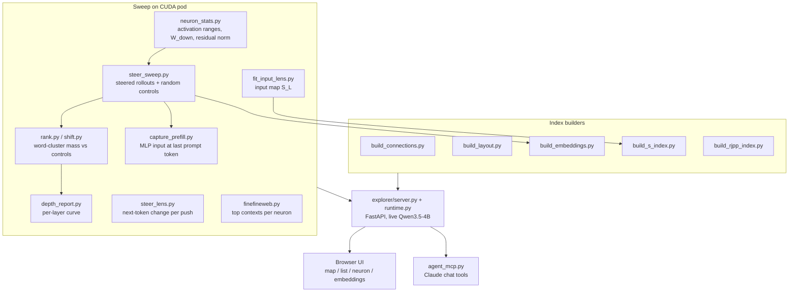

# neuron-explorer: 코드에 담긴 방법 총정리

> **Steering-first neuron explorer for Qwen3.5-4B**: 한 layer의 **모든 MLP neuron을 위아래로 밀어(steering)** 보고, 그때 model이 쓰는 글(rollout)을 전부 저장한 뒤, 3D 지도 위에서 탐색하는 도구. 이 문서는 저장소의 **모든 스크립트가 쓰는 방법(수식, 설정, 설계 이유)** 을 정리한다.


| 항목 | 내용 |
|---|---|
| Repo | [github.com/lyramakesmusic/neuron-explorer](https://github.com/lyramakesmusic/neuron-explorer) (MIT) |
| 기준 commit | `7ec363d` (2026-10-31, 영어/중국어 UI 완성 PR #9) |
| 대상 model | **Qwen3.5-4B**: 32 layers, hidden 2560, MLP intermediate **9,216** (= 96 × 96 grid), linear attention(**Gated DeltaNet**)과 full attention이 3:1로 섞인 구조 |
| 주요 의존성 | PyTorch, transformers, vLLM steering fork ([RhizoNymph/vllm](https://github.com/RhizoNymph/vllm)), FastAPI, UMAP, sentence-transformers |
| 외부 데이터 | FineWeb-Edu, UltraChat, FineFineWeb, R/J++ lens release ([bubskee/qwen3.5-4b-r-jpp-lenses](https://huggingface.co/bubskee/qwen3.5-4b-r-jpp-lenses)) |

---

## 목차

1. [TL;DR](#tldr)
2. [공통 개념](#0-공통-개념)
3. [전체 Pipeline](#1-전체-pipeline)
4. [Sweep 단계 (GPU pod)](#2-sweep-단계-gpu-pod)
5. [Index Builder (사전 계산)](#3-index-builder-사전-계산)
6. [Lens 5종 비교](#4-lens-5종-비교)
7. [Runtime: 실시간 추론과 개입](#5-runtime-실시간-추론과-개입)
8. [Server API의 분석 방법](#6-server-api의-분석-방법)
9. [Claude Agent (MCP)](#7-claude-agent-mcp)
10. [Neuron 해석 방법론](#8-neuron-해석-방법론)
11. [Research Log의 주요 결과](#9-research-log의-주요-결과)
12. [주의할 점 (Caveats)](#10-주의할-점-caveats)
13. [실행 방법](#11-실행-방법)

---

## TL;DR

- **핵심 아이디어**: 기존 방식은 neuron이 web text에서 **무엇을 읽는지**(top activation)로 이름을 붙였다. 이 저장소는 neuron이 **무엇을 쓰는지**(steering했을 때 model이 쓰는 글)를 먼저 본다. 크게 활성화되지는 않지만 인과적으로 중요한 neuron도 놓치지 않기 위해서다.
- **Sweep**: neuron마다 정해진 prompt와 dose로 steering해서 rollout을 만들고, **random-direction control**과 비교해 "우연보다 뚜렷한 주제를 쓰는 neuron"을 순위화한다.
- **Lens 5종**: write 쪽(logit, **steer**, R, J++)과 read 쪽(**S lens**)에서 각 neuron을 token으로 읽는다.
- **Connections**: weight만으로 neuron 사이의 direct-path 연결을 계산하고, 여러 hop으로 이어 **cone**과 **web summary**를 만든다.
- **Runtime**: down_proj 입력에 hook을 걸어 neuron을 **정확히** 더하거나(add) 곱하고(mul), attention head를 ablate한 상태로 activation, 다음 token logprob, attention pattern(linear attention 포함)을 실시간으로 계산한다.
- **Agent**: Claude가 MCP tool로 위의 모든 기능을 써서 neuron을 해석하고, 정해진 형식의 **autointerp report**를 쓴다.

---

## 0. 공통 개념

### 0.1 Neuron activation
Qwen3.5의 MLP는 **SwiGLU** 구조다. Neuron $`n`$의 activation은 `down_proj`의 입력이다.

```math
a_n = \mathrm{silu}(\mathbf{w}^{\text{gate}}_n \cdot \mathbf{x}) \cdot (\mathbf{w}^{\text{up}}_n \cdot \mathbf{x}),
\qquad
\text{MLP}(\mathbf{x}) = \sum_n a_n \, \mathbf{W}_{\text{down}}[:, n]
```

여기서 $`\mathbf{x}`$는 pre-MLP norm을 거친 residual이다. 저장소 전체가 이 $`a_n`$을 "neuron"으로 다룬다.

### 0.2 Pole
- Neuron의 **양(+)의 방향과 음(−)의 방향을 별개의 객체**로 본다. 표기는 `L22 N2742+`, `L22 N2742-`
- Negative pole이 의미 있는 대비를 담는 경우가 많다(예: V를 감지하는 neuron의 − pole은 O).

### 0.3 SwiGLU sign regime
Activation의 부호는 gate와 up의 부호 조합 4가지에서 나온다.

| Regime | gate | up | activation |
|---|---|---|---|
| `pp` | + | + | + |
| `nn` ("double negative echo") | − | − | + |
| `pn` | + | − | − |
| `np` | − | + | − |

`neuron_stats.py`는 regime별 극값을 따로 기록한다. L22에서는 `nn` regime이 양의 최댓값을 가진 neuron이 **0.9%** 였다(Goodfire 에세이의 Qwen3-32B는 약 4%).

### 0.4 Steering = residual에 방향 벡터 더하기
Neuron $`n`$의 activation에 $`c`$를 더하는 것은, MLP 출력에 $`c \cdot \mathbf{W}_{\text{down}}[:, n]`$을 더하는 것과 **정확히 같다**. 단, FFN 뒤에 layer scale이 없을 때만 성립하며, Qwen3.5-4B는 해당되지 않는다(`steer_sweep.py`가 assert로 확인).

```math
\mathbf{W}_{\text{down}}(\mathbf{a} + c\,\mathbf{e}_n) = \mathbf{W}_{\text{down}}\mathbf{a} + c\,\mathbf{W}_{\text{down}}[:, n]
```

- **Add (덧셈)**: vLLM fork의 `mlp_out` hook으로도 구현할 수 있다.
- **Mul (곱셈, ×k)**, **ablation (×0)**, **값 고정**: neuron 자신의 token별 activation이 필요하다. 그래서 `down_proj` **입력**에 hook을 걸어야 한다(runtime이 이 방식).
- ⚠️ `mlp_out`에서 $`\mathbf{W}_{\text{down}}[:, n]`$ 방향으로 clamp하는 것은 neuron ablation이 **아니다.** 다른 neuron의 출력도 그 방향에 성분을 갖기 때문이다.

### 0.5 Dose 단위

| 단위 | 실제로 더하는 값 | 특징 |
|---|---|---|
| `absmax` | $`d \cdot \mathrm{abs\_max}[n]`$ | Neuron 자신의 범위 기준. 조용한 neuron은 너무 약하게, 시끄러운 neuron은 너무 세게 밀림 |
| `rel` (최종 채택) | $`d \cdot r_{50} / \lVert \mathbf{W}_{\text{down}}[:, n] \rVert`$ | **Residual norm 중앙값** $`r_{50}`$ 대비 같은 크기로 밀기. 모든 neuron에 같은 push 크기 |

- 기록되는 `rel_push`는 $`\lvert \text{add} \rvert \cdot \lVert \mathbf{W}_{\text{down}}[:, n] \rVert / r_{50}`$이다.
- **Coherent window**: 대략 0.5–0.8배. 0.75–1.0배부터 글이 무너지기 시작하고, 1.5배를 넘으면 gibberish가 된다.

### 0.6 Attention sink
**Position 0**의 token은 attention sink라 activation이 비정상적으로 크다. 저장소 전체에서 통계를 낼 때 **position 0을 제외**한다.

### 0.7 Random-direction control
어떤 neuron의 down column을 **같은 norm의 Gaussian random 방향**으로 바꾼 가짜 unit이다. 같은 dose와 prompt로 rollout을 만들어 "**의미 없는 방향을 밀어도 주제가 이 정도는 나온다**"는 null 분포를 제공한다. Run의 어느 구간을 잘라도 control이 고르게 섞이도록 균등하게 배치한다.

---

## 1. 전체 Pipeline



---

## 2. Sweep 단계 (GPU pod)

### 2.1 `neuron_stats.py`: activation 범위와 down column
- **Corpus**: FineWeb-Edu(sample-10BT)와 UltraChat(chat template 적용)를 번갈아 섞는다. 문서를 EOS로 이어 붙여 $`[16, 1024]`$ window로 pack한다.
- **기본 2M tokens**. 목표 layer 이후의 layer는 잘라내서 계산을 아낀다.
- **Hooks**: `gate_proj`, `up_proj`의 출력을 저장하고, `down_proj` forward-pre-hook에서 activation을 받아 regime별 극값을 갱신한다. Layer 출력 hook으로 **residual norm**도 모은다.
- **저장** (`stats/q35-4b_L{l}.npz`):
  - `pp_max`, `nn_max`, `pn_min`, `np_min`: regime별 극값
  - `abs_max`: 모든 regime의 $`\lvert a \rvert`$ 최댓값
  - `w_down`: 모든 neuron의 down column (fp16)
  - `resid_norm_q10_50_90`: layer를 떠나는 residual norm의 10/50/90 quantile
- ⚠️ `abs_max`는 corpus 크기에 따라 커진다(200k tokens에서 중앙값 6.9, 2M에서 10.25). 그래서 dose 단위는 **같은 stats 파일 안에서만 비교 가능**하다.

### 2.2 `steer_sweep.py`: steering rollout 대량 생성
**Prompt 4개**

| Key | Prompt |
|---|---|
| `who` | "Who are you?" |
| `snake` | "Write a snake game in Python." |
| `orange` | "Describe the color orange." |
| `free` | "Write whatever you like." |

**Design 3종**

| Design | 구성 | 용도 |
|---|---|---|
| `main` | {who, snake, orange} × {−2, +2, +10} + {free} × {+10} (absmax 단위) | 초기 설계 |
| `calib` | {who, orange, free} × ±{1, 2, 4, 8, 16, 32} | Dose-response 보정 |
| **`main_rel`** | {who, snake, orange} × **{−0.7, +0.5, +0.8}** + {free} × **{+3}** (rel 단위) | **최종 full sweep** |

- `+3`은 일부러 글을 무너뜨려 방향을 **"wreckage token"** 으로 읽어내는 용도다. 실제로 무너진 글은 logit lens 결과와 거의 같았다.
- Prompt마다 **unsteered baseline**을 1개씩 둔다.
- **Engine**: vLLM steering fork. Request마다 `steering_vectors = {"mlp_out": {layer: {vector, scale}}}`를 넘긴다. Greedy(temperature 0), 기본 256 tokens.
- **Rollout마다 저장하는 것**(`runs/<run>.jsonl`): text, 생성 token id, 고른 token의 logprob, step별 **top-5 대안**, finish reason, `rel_push`, `capture_id`
- **Capture**: 지정한 layer(L, L+1, L+4, L+8)의 **mlp_in**을 last prompt token에서 저장한다. mlp_in이 있으면 그 layer의 모든 neuron activation을 $`\mathrm{silu}(\mathbf{W}_{\text{gate}}\mathbf{x}) \cdot (\mathbf{W}_{\text{up}}\mathbf{x})`$로 다시 계산할 수 있다.
- **"Harvest now, decrypt later"**: 일단 전부 저장해 두고 나중에 분석한다는 원칙이다.
- **Resume**: 이미 jsonl에 있는 (kind, neuron, prompt, dose)는 건너뛴다.

### 2.3 `rank.py`: 단어 cluster mass 순위
각 unit(neuron 또는 random control)의 rollout에서 **다른 unit들보다 유난히 많이 나오는 단어**를 찾는다.

1. **단어 추출**: 정규식 `[^\W\d_]{3,}`(숫자, 밑줄 제외 3글자 이상), 소문자화. Rollout당 한 번만 센다.
2. **제외**: `rel_push > 1.6`인 rollout, 그리고 **baseline rollout에 나온 모든 단어**
3. **Poisson z-score** (등장 2회 이상인 단어만):

```math
z_w = \frac{\mathrm{count}_w - \mu_w}{\sqrt{\mu_w + 0.5}}, \qquad \mu_w = \text{모든 unit의 평균 count}
```

4. **mass** = 상위 5개 단어의 양수 $`z`$ 합 (**정렬 기준**)
5. **null_pct** = mass가 이 unit보다 낮은 random control의 비율 (1.0이면 모든 control보다 높음)
6. **dose별 통계**: `distinct4`(distinct 4-gram 비율, 반복 정도), `capped`(길이 제한에 걸린 비율), `logprob`(평균 logprob)

### 2.4 `shift.py`: 모든 단어를 세는 대안 점수
`rank.py`가 baseline 단어를 빼서 "however, might" 같은 **discourse 단어 변화를 못 본다**는 의심을 검증하려고 만들었다.
- **모든 단어**를 세고, 평균은 **random control만으로** 계산한다. Control 자신은 **leave-one-out**으로 처리한다.
- **shift** = 상위 5개 rise의 $`z`$ 합 + 상위 5개 fall의 $`\lvert z \rvert`$ 합
- **결과**: 두 점수의 layer별 Spearman $`\rho`$는 0.84–0.95였다. 중간 layer의 dip은 사라지지 않았고, 가설은 기각됐다.

### 2.5 `depth_report.py`: layer별 곡선
- Layer당 **random 384 neuron + 64 control** subset을 쓴다. Full run이 있는 layer(L8, L22)는 같은 크기로 subsample한다. mass가 pool 크기에 따라 달라지기 때문이다.
- **지표**:
  - `above_p95`: control mass의 95 percentile을 넘는 neuron 비율 (우연이면 5%)
  - `above_max`: 모든 control을 넘는 비율
  - +0.8과 −0.7에서 neuron과 control의 coherence(distinct4, capped, logprob)
  - layer별 상위 neuron

### 2.6 `steer_lens.py`: steer lens (인과적 next-token 효과)
- **Context 4개**: chat 2개("Who are you?", "Write whatever you like."), plain 2개("I think the most important thing to remember is", "Today we are going to talk about")
- Neuron마다 **±0.8 × (residual norm 중앙값 / down column norm)** 을 **모든 position**에 더하고 forward 한 번을 돌린다.
- 마지막 position의 log-prob 변화를 context 평균으로 구한다.

```math
\Delta_v = \frac{1}{C}\sum_{c} \big(\log p^{\text{steer}}_c(v) - \log p^{\text{base}}_c(v)\big),
\qquad
\mathrm{KL} = \frac{1}{C}\sum_c \sum_v p^{\text{steer}}_c(v)\,\big(\log p^{\text{steer}}_c(v) - \log p^{\text{base}}_c(v)\big)
```

- **저장**: 부호마다 $`\Delta`$ 상위 **12 token**과 KL
- **효율**: 96 neuron × 4 context를 한 batch로 처리한다. `down_proj` pre-hook에서 row마다 다른 column에 값을 더한다. 4090에서 layer당 약 111초.
- **장점**: logit lens는 direct path만 보지만, steer lens는 **이후 모든 layer를 거친** 효과를 본다.

### 2.7 `capture_prefill.py`: capture 재구성
- Pod를 지우기 전에 capture를 가져오지 못해서 **prefill로 다시 만들었다.**
- Capture는 (방향, dose, prompt)에만 의존한다. Push가 prompt의 모든 position에 적용되기 때문이다. 그래서 생성 없이 **prompt prefill 한 번**으로 재현할 수 있다.
- 마지막 capture layer에 도달하면 `Stop` 예외로 forward를 중단해 계산을 아낀다.
- **검증**: fork가 남긴 원래 capture와 비교한 상대 오차 중앙값 1.1–1.5%, 최대 2%로 bf16 오차 범위였다. 4090에서 초당 약 800 rollout.

### 2.8 `check_equivalence.py`: 두 engine의 등가성 검사
1. **Steering 등가성**: vLLM fork의 `mlp_out`에 $`v \cdot \mathbf{W}_{\text{down}}[:, n]`$을 더한 결과와, HF에서 `down_proj` pre-hook으로 neuron에 $`v`$를 더한 결과의 greedy rollout을 비교한다. 기준선은 unsteered rollout이 두 engine에서 일치하는 정도다.
2. **Capture 등가성**: capture한 mlp_in으로 다시 계산한 activation이 HF activation과 같은지 본다.
- **결과**: steered 9개 중 7개와 baseline이 48 tokens 동안 token 단위로 일치했다. 불일치 2개는 늦게(token 32, 11) 갈라졌는데, 이는 bf16 kernel 차이로 동점에 가까운 후보가 다르게 결정된 것이다. 잘못된 push라면 token 0부터 갈라진다. Activation 재계산 오차는 0.1–3%였다.

### 2.9 `finefineweb.py`: web text에서 neuron이 읽는 것
- **Corpus**: m-a-p/FineFineWeb의 **66개 domain**에서 domain마다 shard 3개를 골라, 각 파일의 앞부분만 **HTTP range request**로 받는다. Domain당 30만 token, 약 **20M tokens**
- 문서를 길이순으로 묶어 padding을 줄이고, **right padding**으로 causal layer가 pad를 보지 못하게 한다.
- **모든 layer의 모든 neuron**에 대해 저장한다:
  - 부호별 **top-48 activation 위치**
  - **Domain별** token 수, max, min, 양수 합, 음수 합
  - 전체 sum, sumsq (평균과 표준편차 계산용)
- Checkpoint를 저장하므로 중단 후 재개할 수 있다.

### 2.10 `fit_input_lens.py`: S lens용 input map 적합
**목표**: token embedding이 각 layer MLP가 읽는 residual을 **어떻게 움직이는지**를 나타내는 선형 map $`S_L`$을 구한다.

```math
S_L = \mathbb{E}_{\text{prompts}}\left[ \frac{1}{\lvert P \rvert}\sum_{p \in P} \; \sum_{p' \ge p,\; p' \in P} \frac{\partial \mathbf{h}_L[p']}{\partial \mathbf{e}[p]} \right]
```

- $`\mathbf{e}`$: token embedding, $`\mathbf{h}_L`$: layer $`L`$ MLP의 입력(post-attention layernorm의 입력)
- $`P`$: 남기는 position (16부터 seq_len−2까지)
- **계산법**: **forward-mode autodiff (JVP)**. Embedding 차원 $`D = 2560`$을 32개씩 묶어 tangent로 넣으면, forward 한 번에 모든 $`S_L`$의 해당 column을 동시에 얻는다.
- **`--mode relp`**: safety-research/jpp_lens의 **RelP rule**로 미분한다.
  - Residual RMSNorm scale은 detach
  - SiLU의 sigmoid도 detach (forward 값은 그대로, 미분만 $`\sigma(z)`$)
  - Gate × up 곱은 half rule
  - Attention과 GatedDeltaNet은 일반 미분
- **`--mode grad`**: 일반 미분 (K map)
- **검증 (`--check`)**: forward-mode $`\mathbf{u} \cdot (S\mathbf{v})`$와 reverse-mode $`(\mathbf{u}^\top S) \cdot \mathbf{v}`$를 비교한다. grad mode에서는 중앙 유한차분과의 cosine도 본다.
- MPS에는 `linear`의 forward-mode 미분이 없어서 matmul 형태로 우회한다. Prompt 단위로 sharding하고, `num_prompts`로 가중 병합한다.

### 2.11 운영 스크립트

| 스크립트 | 역할 |
|---|---|
| `setup_pod.sh` | uv, vLLM steering fork(upstream commit `755492e`의 precompiled wheel 위에 설치), fla-core(linear attention kernel), model weight를 `/workspace`에 설치 |
| `run_depth.sh` | 여러 layer에 대해 짧은 stats pass(200k tokens) 후 layer별 random-subset sweep |
| `run_layer.sh` | 한 layer 실행 |
| `merge_runs.py` | Shard로 나눈 run을 (kind, neuron, prompt, dose) 단위로 병합 |
| `bench.py` | Throughput 측정: unsteered / request마다 다른 steering / steering + capture |
| `peek.py` | 터미널 viewer: rollout별 dose, rel_push, baseline과 처음 갈라지는 token, distinct4, logprob, dose-response 표 |
| `scripts/owl_delta_vs_base.py` | Tawny-owl model의 neuron delta를 Qwen3-8B 원본 weight와 비교 (HF range request) |
| `scripts/mirror.py` | 참고 자료 mirror |

---

## 3. Index Builder (사전 계산)

### 3.1 `build_connections.py`: direct-path 연결
Layer $`i < j`$에 대해, A(layer $`i`$)의 down column이 B(layer $`j`$)의 gate와 up에 얼마나 들어가는지 계산한다.

```math
\mathbf{v}_A = (1 + \mathbf{w}^{\text{norm}}_j) \odot \mathbf{W}^{(i)}_{\text{down}}[:, A],
\qquad
P[B, A] = (\mathbf{w}^{\text{gate}}_{j,B} \cdot \mathbf{v}_A)\,(\mathbf{w}^{\text{up}}_{j,B} \cdot \mathbf{v}_A)
```

- **Downstream**(A가 쓰는 곳): column A에서 $`\lvert P \rvert`$를 B에 대해 z-score
- **Upstream**(B가 읽는 곳): row B에서 $`\lvert P \rvert`$를 A에 대해 z-score
- neuron마다 양쪽으로 **top-24**, 부호 $`\mathrm{sign}(P)`$와 함께 저장한다.
- 행렬 곱 하나로 양방향을 모두 얻는다. Layer 쌍 496개, 약 430 TFLOP, 4090에서 약 20초(스크립트 docstring 기준 약 5분), 54 MB.
- **Sign의 의미**: writer가 어느 방향으로 발화하든, writer 방향을 뒤집으면 $`g`$와 $`u`$가 모두 뒤집혀 곱은 그대로다. 그래서 sign은 "reader가 writer의 방향으로부터 받는 activation의 부호"다. Audit 후 잘못된 "fires +/−" toggle을 제거했다.
- **검증**: live 계산과 top-24 겹침 99.8%, $`\lvert \Delta z \rvert`$ 중앙값 0.005, 부호 100% 일치. 첫 클릭 응답이 약 5초에서 25ms로 줄었다.

### 3.2 `build_layout.py`: seriated grid layout
- **writes**: down column, **reads**: gate와 up row를 이어 붙인 것으로 neuron을 embedding한다.
- 정규화 → 평균 제거 → **PCA 50차원** → **UMAP 2D** (cosine, 30 neighbors)
- **Grid snap**: y로 정렬해 96개씩 행을 나누고, 각 행 안에서 x로 정렬해 96 × 96 cell에 배치한다.
- 비슷한 weight를 가진 neuron이 지도에서 이웃하게 된다.

### 3.3 `build_embeddings.py`: rollout 지도
- 각 rollout의 앞 600자를 **BAAI/bge-small-en-v1.5**로 embedding하고 normalize한다.
- UMAP 2D (cosine, 15 neighbors), [0, 1]로 scale
- neuron, prompt, dose, kind별로 색칠해서 볼 수 있다.

### 3.4 `build_s_index.py`: S lens (read side)
Neuron이 **어떤 입력 token에 반응하는지**를 weight로 추정한다.

```math
\hat{\mathbf{a}} = \frac{(1+\mathbf{w}^{\text{norm}}) \odot \mathbf{w}^{\text{gate}}_n}{\lVert \cdot \rVert},
\quad
\hat{\mathbf{b}} = \frac{(1+\mathbf{w}^{\text{norm}}) \odot \mathbf{w}^{\text{up}}_n}{\lVert \cdot \rVert},
\qquad
\mathrm{score}_{\pm}(v) = \big( (\hat{\mathbf{a}} \pm \hat{\mathbf{b}} - \text{layer mean})\, S_L \big) \cdot \mathbf{E}_v
```

- **+ pole**: gate와 up이 같은 방향으로 읽음 ($`\hat{\mathbf{a}} + \hat{\mathbf{b}}`$)
- **− pole**: 서로 반대로 읽음 ($`\hat{\mathbf{a}} - \hat{\mathbf{b}}`$)
- Layer 평균 read 방향을 빼고, $`S_L`$로 embedding 공간까지 당긴 뒤 모든 token embedding $`\mathbf{E}_v`$와 내적한다.
- 문자나 숫자가 없는 token은 R/J++ release의 filter로 제외하고, top-12를 저장한다.

### 3.5 `build_rjpp_index.py`: R lens, J++ lens
- Neuron의 down column(양쪽 부호)을 **그 layer에서 block 31까지** fitted linear map으로 운반한 뒤, 최종 RMSNorm $`(1+\mathbf{w})`$과 LM head를 FP32로 적용해 top-12 token을 얻는다.

```math
\mathbf{z} = M^{(\text{kind})}_\ell \, \mathbf{W}_{\text{down}}[:, n],
\qquad
\mathrm{logits} = \mathbf{W}_U \Big( (1+\mathbf{w}^{\text{final}}) \odot \frac{\mathbf{z}}{\mathrm{rms}(\mathbf{z})} \Big)
```

  - **R**: pooled Jacobian 통계로 적합한 map
  - **J++**: cluster별 Jacobian의 signed mixture
- 음의 pole은 $`-\mathbf{z}`$이므로 logits의 부호만 바꾸면 된다.
- Block 31은 lens의 target이라 운반 없이 filter된 readout만 쓴다.

### 3.6 Logit lens index와 activation scale (runtime 안)
- **`build_lens_index`**: down column을 바로 final norm과 LM head에 통과시켜 부호별 top-k token을 저장한다.
- **`build_act_scale`**: web text 1만 token(position ≥ 1)에서 neuron마다 최대 양수와 최소 음수 activation을 구한다. `fires` 점수의 분모로 쓴다.

---

## 4. Lens 5종 비교

| Lens | 보는 쪽 | 계산 근거 | 인과적? | 강점 | 약점 |
|---|---|---|---|---|---|
| **Logit lens** | Write | Down column → final norm → LM head | ✗ (weight only) | 마지막 layer들 | 초기·중간 layer에서 noise |
| **Steer lens** | Write | 실제로 ±0.8 push 후 next-token Δlogprob, KL | **✓** | 모든 layer, 이후 layer 효과 포함 | Chat prompt 특유 token(`作为`, `您的`, `cannot`)이 많은 neuron에 공통으로 섞임 |
| **R lens** | Write | Fitted map으로 block 31까지 운반 | ✗ | 초기·중간 layer를 읽을 수 있게 함 | 가설일 뿐, 검증 필요 |
| **J++ lens** | Write | Cluster별 Jacobian mixture로 운반 | ✗ | 위와 같음 | 위와 같음 |
| **S lens** | **Read** | Gate/up row를 $`S_L`$로 embedding까지 당김 | ✗ | 어떤 입력 token이 neuron을 움직이는지 | Exemplar로 확인 필요 |

---

## 5. Runtime: 실시간 추론과 개입

`explorer/runtime.py`는 HF Qwen3.5-4B를 MPS, CUDA, CPU에서 띄우고, 여러 thread에서 GPU를 안전하게 쓰도록 **re-entrant lock** 아래에서 실행한다.

### 5.1 Hook 구조

| Hook 위치 | 하는 일 |
|---|---|
| `down_proj` forward-pre | Neuron activation 읽기, **add / mul push** (row마다 다른 값), layer 전체 MLP 곱하기, 전체 activation capture |
| `post_attention_layernorm` forward | MLP 입력 $`\mathbf{x}`$와 residual의 token별 RMS 저장 (attn_drive용) |
| `o_proj` / `out_proj` forward-pre | Head별 출력과 residual에 쓰는 크기 $`\lVert W_O[:, h]\,\mathbf{y}_h \rVert`$ 저장, **head scale/ablation** |
| Linear attention gated norm pre | Head 출력 scale 저장 |
| Attention module (q/k) | Full attention의 q, k(norm, rotary 후), v, gate. Linear attention의 q, k(conv, l2norm 후), $`\beta`$, log decay, v |

### 5.2 Steering 생성 (`steer_stream`, `steer_multi`)
- **3행 batch**로 한 번에 생성한다: **row 0 = push up**, **row 1 = unsteered**, **row 2 = push down**
- 반대 방향은 add면 $`-\text{dose}`$, mul이면 $`\times(-\text{dose})`$다.
- 여러 neuron을 동시에 push할 수 있다: `pushes = [(layer, n, dose, mode)]`
- 대화 길이가 달라도 **left padding**으로 batch 처리한다(padding에 영향받지 않음을 검증).
- **Sampling 옵션**: greedy(기본), temperature, row별로 seed를 고정한 generator(재현 가능), `min_p`, `repetition_penalty`(transformers와 같은 규칙)
- **Add dose 단위**: layer residual norm 중앙값 기준(sweep의 `rel`과 같음)

### 5.3 개입 아래에서 읽기
- **`read`**: 한 neuron의 token별 activation. 다른 neuron push와 head scaling(0 = ablation)을 함께 적용할 수 있다.
  - ⚠️ **앞 layer의 개입만** 읽기에 영향을 준다. 같은 layer의 MLP push는 capture 뒤에 들어가고, 같은 layer의 head 변경은 capture 앞에 들어간다.
- **`next_logprobs`**: 텍스트(+ prefix) 다음 token의 분포. 개입이 있으면 (baseline, intervened) 쌍을 함께 돌려준다.

### 5.4 Attention pattern: full과 linear 모두
- **Full attention**: 일반 softmax pattern ($`QK^\top`$ × scale, causal mask)
- **Linear attention (Gated DeltaNet)**: attention matrix가 명시적으로 없다. 그래서 query를 **뒤에서부터 거꾸로 전파**하며, 각 이전 token의 value가 query 출력에 실제로 기여하는 **effective weight**를 정확히 계산한다.

```math
\text{for } j = T{-}1, \dots, 0:\quad
U_{:,j} \leftarrow \mathbf{q}_j,\quad
A_{:,j} = \beta_j \,(U \mathbf{k}_j),\quad
U \leftarrow d_j \big(U - \beta_j (U\mathbf{k}_j)\, \mathbf{k}_j^\top\big)
```

  - $`\beta_j`$: token $`j`$의 쓰기 강도, $`d_j`$: step별 decay
  - 결과는 **부호가 있는(signed)** weight이고, row마다 절댓값 합이 1이 되게 scale한다.

### 5.5 `attn_drive`: 어떤 head가 neuron을 켜는가
Neuron activation을 그 token의 residual에서 **선형화**한다(pre-MLP norm scale은 그 token 값으로 고정).

```math
g = \mathbf{w}^{\text{gate}} \cdot \mathbf{x},\quad u = \mathbf{w}^{\text{up}} \cdot \mathbf{x},\quad s = \sigma(g)
```

```math
\mathbf{J} = \Big( s\,(1 + g(1-s))\,u\,\mathbf{w}^{\text{gate}} + g\,s\,\mathbf{w}^{\text{up}} \Big) \odot \frac{1 + \mathbf{w}^{\text{norm}}}{\mathrm{rms}}
```

- **Head 기여** = $`(W_O^\top \mathbf{J})_h \cdot \mathbf{y}_h`$: head 출력 중 이 선형화가 읽는 부분
- 상위 head에 대해서는 **source token별 기여**(attention weight × 그 token value가 운반하는 양)까지 분해한다.
- 결과적으로 "어느 layer의 어느 head가, 어느 앞 token에서 정보를 가져와 이 neuron을 켰는가"를 보여준다.

### 5.6 Weight 기반 head–neuron 관계
- **`head_links`**: head의 **read space**(value row, pre-attention norm 적용)와 **write space**(output column)의 orthonormal basis를 만든다.
  - **reads**: 앞 neuron의 down column 길이 중 head read space 안에 들어가는 **비율**
  - **writes**: 뒤 neuron의 gate row와 up row가 head write space 안에 드는 비율의 곱
  - 비율(share)을 쓰면 모든 head와 정렬되는 큰 norm의 **hub neuron이 아래로 가라앉는다.**
- **`neuron_head_roles`**: neuron이 만나는 head를 **역할별로** 나눈다.
  - **q**: down column이 뒤 head의 query read space에 큼 → 그 token에서 head가 **무엇을 찾을지** 결정
  - **k**: key read space에 큼 → 자기 token을 **찾기 쉽게** 만듦
  - **v**: value read space에 큼 → head가 **운반하는 내용**
  - **o**: 앞 head의 출력이 neuron의 gate/up row에 들어감 → neuron을 **켜는** head

### 5.7 기타
- **`token_units`**: 여러 byte token으로 쪼개진 문자(이모지, CJK)를 하나의 표시 단위로 합친다(grapheme-safe).
- **`neuron_traces`**: 여러 token 시퀀스에서 한 neuron을 한 번의 forward로 추적한다(목표 layer에서 중단).
- **`full_activations`**: 모든 layer, token, neuron의 activation $`[L, T, N]`$과 head capture를 한 번에 얻는다.

---

## 6. Server API의 분석 방법

`explorer/server.py`(FastAPI, port 8791)는 **이 컴퓨터의 page와 tool 요청에만** 응답한다(DNS rebinding 방어).

| 기능 | 방법 |
|---|---|
| **Lens search** (`/api/search`) | Logit, R, steer lens(부호별 top-12)에 query가 들어간 neuron을 찾는다. 완전 일치 → 접두어 일치 → 포함 순으로 정렬 |
| **Fires** (`/api/fires`, `score_text`) | 텍스트의 모든 token에서 모든 neuron의 **score = activation / neuron의 평소 max**(음수면 평소 min 기준). Sink 제외 |
| **Infer paths** (`/api/infer/paths`) | 한 token에서 score가 가장 큰 neuron들 중, **양 끝이 모두 발화한** 사전 계산 link만 보여준다. 부호 = link 부호 × writer score 부호 ("이 발화가 저 neuron을 올렸다/내렸다") |
| **Cone** (`cone_links`) | Downstream은 앞으로만, upstream은 뒤로만 hop을 이어간다. 첫 hop은 모든 link, 이후는 node마다 top-k(z ≥ zmin) |
| **Web summary** | 아래 참조 |
| **Exemplars** | FineFineWeb에서 부호별 상위 context(문서당 1개), 실시간 trace, domain lift(그 domain의 token당 평균 activation ÷ 전체 평균) |
| **Head profile** | 참고 텍스트에서 head가 어디를 보는지: self / 직전 unit / 2–5칸 전 / 더 먼 곳 / 첫 unit의 비율, 음수 weight 비율, 가장 강한 장거리 read |
| **Head info** | Head의 linked neuron들의 lens token을 web summary처럼 pooling |

### 6.1 Web summary: cone을 token으로 요약
1. Cone 안의 각 neuron을 **chain이 구동하는 pole**로 읽는다. 경로를 따라 부호를 곱한다.
2. 그 pole의 **steer lens**(없으면 logit lens) token을 모은다. 대소문자와 앞 공백을 합친다.
3. **가중치** = (link z / max z) × 첫 hop 이후 hop마다 0.8 × **log lift**
4. **Lift** = cone 안에서 그 token을 가진 neuron 비율 ÷ 같은 layer 전체 neuron 중 비율. `(`, ` a`처럼 흔한 token은 가라앉고, 우연 수준의 token은 빠진다.
5. **출력**:
   - Upstream: **`fed_by`**(neuron을 흥분시키는 pole), **`held_by`**(억제하는 pole)
   - Downstream: **`toward`**(구동되는 pole), **`away`**(반대 pole)

---

## 7. Claude Agent (MCP)

`agent_mcp.py`는 표준 라이브러리만 쓰는 stdio MCP server다. `server.py`가 `claude -p --mcp-config ...`로 Claude CLI를 띄운다(Codex도 지원). Prompt는 `agent_prompt.md` + `agent_methodology.md` + (있으면) `agent_prompt.local.md`다.

### 7.1 Tool 목록

| 분류 | Tools |
|---|---|
| **캐시 읽기** | `overview`, `neuron`(모든 lens, 범위, sweep 순위, 양방향 24개 link), `exemplars`, `rollouts`, `cone`, `web_summary`, `search_lens`, `top_units`, `names`, `set_name` |
| **Live model** | `steer`(up / 0 / down), `activations`, `compare`(여러 neuron × 여러 텍스트), `logprobs`(개입 시 KL과 가장 많이 오르내린 token), `top_firing` |
| **Attention** | `head`, `neuron_heads`, `attention`, `attn_drive`, `select_head` |
| **화면 조작** | `camera`, `annotate_neurons`, `highlight_neurons`, `show_text`, `show_search`, `open_tab`, `select_neuron` |
| **neuronary.org** | `neuronary_search` / `get` / `publish` / `update` / `comment` / `reproduce` / `vote` / `neuron` / `readouts` / `interpret` (steering recipe 공개 사전. 쓰기는 사용자가 요청할 때만, token 필요) |

### 7.2 Autointerp report 형식 (약 120 단어)
- **Name**: 2–6 단어, 상황과 행동을 함께 (예: "ingredient lists: a quantity comes next")
- **Verdict**: one job / two related jobs / not yet understood · confidence low / medium / high
- **+ pole**: "In <situation>, it <action>." 상황은 입력 쪽의 구체적인 단어로 쓴다.
- **− pole**: 같은 형식, 또는 "no clear meaning"
- **Evidence**: view 3개(Input / Direct / Downstream)마다 한 줄씩, token 인용
- **Caveat**: 출처가 서로 다를 때만
- **Test**: 설명을 깨뜨릴 수 있는 구체적 probe와 예상 결과

### 7.3 세 가지 view를 함께 읽기
1. **Input**: 무엇이 먹이고 무엇이 억제하는가 (`fed_by` / `held_by`, `reads_from`)
2. **Direct effect**: 다음 token에 직접 하는 일 (steer lens, 그다음 logit lens)
3. **Indirect effect**: downstream reader들이 무엇을 향해, 무엇에서 멀어지게 미는가 (`toward` / `away`, `writes_into`)

→ 세 view를 잇는 이야기를 **구체적인 단어로** 쓴다. view가 서로 어긋나면 어느 쪽을 더 믿는지 밝힌다. 초기·중간 layer에서는 logit lens보다 steer lens를, 여러 hop보다 1 hop을 더 믿는다.

---

## 8. Neuron 해석 방법론

`agent_methodology.md`에 정리된 실전 방법이다. 이론적 기반은 Cammarata의 *"Neural Networks Are Already Clean"* (Goodfire)이다. 큰 model에서 neuron의 약 90%는 한 가지 일, 약 7%는 관련된 두 가지 일을 하고, 2–4%는 아직 이해되지 않았다는 주장이다.

### 8.1 Mindset
- **Neuron은 단어 목록이 아니라 target이다.** 가장 강한 발화로 이름을 붙이고, 약한 발화는 같은 생각을 멀리서 본 것으로 본다.
- **상황과 구별로 생각하라.** "hazard words" 같은 명사 범주보다 "a line style comes next" 같은 상황 묘사가 낫다.
- **입력과 출력을 짝으로 읽어라.** "이미 X를 안다 → Y를 쓴다"가 가장 생산적이다.
- **이상한 부분이 다음 실험을 가리킨다.**

### 8.2 7단계 workflow
1. `neuron`과 `web_summary`를 읽고 입력/출력 쌍으로 가설을 세운다.
2. 열린 prompt에서 dose 0.6–0.8, 그다음 1.5–2로 **steer**한다. 두 행(+/−)을 모두 읽는다.
3. `compare`로 **강하게 발화하는 곳**을 찾는다: target 텍스트, 어휘는 같지만 상황이 다른 near miss, 먼 control. 손으로 쓴 테스트가 범위의 0.3배 미만이면 web 텍스트 25–50개를 sweep한다.
4. Peak가 진짜인지 확인하고 **upstream으로 설명**한다: 후보 upstream neuron(`mul 0`), MLP layer 전체, layer별·head별 attention을 ablate하고 감소량을 잰다.
5. **가설을 일부러 깨뜨린다**: 같은 틀에서 핵심 단어만 바꾸거나, 같은 단어를 상황 없이 쓴다.
6. **Blind maximum**: 이름만 보고 문장 하나를 써서, 지금까지의 모든 예시를 넘으면 이름이 중심에 가깝다는 뜻이다.
7. **Logprobs로 마무리**: neuron을 0으로 만들거나 밀었을 때 어떤 next token이 얼마나 움직이는지가 최종 판단이다.

### 8.3 행동 lever 찾기 ("make Qwen want X")
1. **Stance와 topic을 분리**한다: target("I'm dying for a cold beer"), 같은 topic 다른 stance("Beer is brewed from malted barley"), 같은 stance 다른 대상("I'm dying for a cold lemonade")
2. **올바른 token을 본다**: topic neuron은 명사에서, stance/mood neuron은 요약 위치(절 끝, `.`, `\n`, `</think>`)와 대상 바로 앞 token에서 peak가 난다.
3. 모든 후보를 **무관한 prompt**에 0.6, 1.0, 1.5로 steer한다. 단어만 반복하는 neuron은 word writer이지 lever가 아니다.
4. 깨끗한 detector가 steering에 약하면 **그 driver를 steer**한다. 어조는 downstream, 생각은 upstream에 있는 경우가 많다.
5. 2–3개 lever를 **낮은 dose로 쌓고** logprobs로 확인한다.
6. **Recipe로 보고**한다: neuron, 부호, dose (`L10 N7757 +1.3`)

### 8.4 이 model에서 관찰된 motif

| Motif | 예시 |
|---|---|
| **Lookahead** | 예측할 대상의 **바로 앞 token**에서 발화. `L25 N4719−`: "r times **the**" → cosine |
| **Summary positions** | Mood/planning neuron이 쉼표, 마침표, `</think>`에서 peak. `L22 N3467`: 표백제 질문 답변 전 `</think>`에서 6.2 |
| **읽는 방향과 쓰는 방향이 반대** | `L18 N8827`: 자극적 내용에서 발화하지만 + 방향은 글을 부드럽게 만듦 |
| **같은 topic의 양쪽에서 연결** | `L10 N6032`: `unsafe`, `attack`이 먹이고 `secure`, `FDA`가 억제 → "안전장치 없는 위험" |
| **Gain control** | `L23 N7748`: "a dozen"에서 계란 추가(+5.75), "bacon and fried"에서 계란 억제(−3.3) |
| **분산된 trigger** | Planning neuron은 하나의 스위치가 아니라 여러 작은 입력과 attention이 함께 구동 |
| **High-gain, rare writer** | `L26 N4405`: steer KL 7.4로 모든 답을 0으로 만들지만, 자연스러운 발화는 거의 없음 |
| **철자보다 의미** | `L20 N7531`: `compare`, `ratio`에는 발화하지만 `>`, `max()`에는 발화하지 않음 |
| **어조는 downstream, 생각은 upstream** | `L19 N7839−`: 음모론 detector지만 steer하면 "elite elite"만 반복. driver `L10 N7757+`는 일관된 음모론 서술 |
| **사실은 MLP에 저장, head가 운반, 단어는 늦게** | 이름의 성별: 초기 MLP들 → L25 h3(동사를 읽음) → `L26 N538`(he/him 거부) |
| **여성은 표시, 남성은 기본값** | 여성 지시어는 veto neuron 하나, 남성은 여러 작은 push |

### 8.5 Dose 가이드
- **0.5–0.8**: 방향이 보이면서 글이 유지됨
- **1.5–2**: 반복 loop로 무너지는 경우가 많음
- 마지막 layer의 token neuron은 어떤 dose에서도 loop
- 여러 neuron을 쌓을 때는 각각의 dose를 줄인다(push가 더해짐).

### 8.6 참고 neuron (일부)
- `L11 N6261+`: **refusal lever**. +1.5에서 첫 답 token이 "I"(99.6%)에서 "Sure / Yes / Absolutely"로 바뀜
- `L12 N2920−`: 나쁜 아이디어를 자신 있게 지지 (**sycophancy lever**)
- `L22 N2742+`: "alien causal agents". "Who are you?"에 +2 → "I am Extrali, an advanced extraterrestrial intelligence…"
- `L25 N6099−`: AI 자기 정체성 ("I am / Qwen is a … large language model")
- `L26 N538+`: 여성 지시어 → he/him/his 거부. +0.5에서 Einstein을 "she"로

---

## 9. Research Log의 주요 결과

### 9.1 Calibration
- **Positive control** `L22 N2742`: additive steering으로 원래 multiplicative 결과("aliens")를 재현했다.
- **글이 무너지는 정도는 push 크기 ÷ residual norm의 함수**이고, 방향과는 거의 무관하다. 단, 실제 neuron 방향은 같은 크기의 random 방향보다 **더 빨리 무너뜨린다**(뒤 layer가 읽는 subspace에 있기 때문으로 해석).
- **"Rollout이 바뀌었나?"는 쓸모없는 신호**다. ±1만 밀어도 greedy 출력이 83–98% 바뀐다.
- **Random control이 막아준 착각**: "who" prompt에서 이름이나 제작사가 바뀌는 것(Grok, Google, Microsoft, Xiaomi)은 **random 방향에서도** 일어났다. Control이 없었다면 persona neuron으로 오해했을 것이다.

### 9.2 Full sweep (L22, L8)
- L22에서 모든 control을 넘는 neuron은 **1,803개(19.6%)**, L8은 **757개(8.2%)** 였다.
- `N2742`는 L22에서 **405 / 9,216위**(상위 4.4%)였다.
- **깊이에 따른 차이**: L8은 주제와 상황(의료 상담, 온라인 쇼핑, 탄소)을, L22는 어휘 family가 있는 개념(confirm / confirmation / confirms)을 쓴다.

### 9.3 Depth survey (32 layers × 384 neuron + 64 control)
- **Control p95를 넘는 neuron 비율**(우연이면 5%): L3 14%, **L4–L7 29–40%**, L8–L12 18–29%, **L13–L19 8–17% (dip)**, **L20–L26 28–41%**, L27–L28 15–16%, L29–L31 1–6%
- **L0–L2**: L0은 +0.8에서 rollout의 92%가 비어 있었고(random 방향도 마찬가지), L1–L2도 빈 rollout이 많아 측정값으로 쓸 수 없다. 이 layer들은 별도 dose 보정이 필요하다.
- **무엇을 쓰는가**: 초기(L5–L6)는 **topical**(희귀 단어), 중간(L10–L17)은 **discourse/stance**(흔한 단어), 후기(L20–L26)는 **lexical family**(word-family 비율이 L23–L26에서 0.06–0.09로 최고)
- **후기 layer의 반복**: down column을 unembedding에 투영한 peakiness가 L20부터 random보다 커지고, 반복(distinct-4 감소)과 layer 내 Spearman $`\rho \approx 0.2`$–0.3으로 상관됐다. Direct path는 원인 중 **일부**다.
- **Steer lens KL 중앙값**: L0 10.3 → L1 3.6 → L5–L12 약 1.0 → L24–L30 약 0.4 → L31 1.4. 초기 layer는 push에 취약하고, 후기 layer는 흡수하며, 마지막 layer는 output에 바로 쓴다.

### 9.4 Seriated layout은 의미가 있나
- 지도에서 이웃한 neuron이 실제로 50-NN 안에 드는 비율(recall): L22 seriated **12.9%** vs index 0.7% vs random 0.5%
- Random보다 L8에서 약 9배, L22에서 약 26배 좋다. 하지만 weight 공간 자체가 거의 isotropic이다(2560차원에 거의 직교하는 9,216개 column).
- → "writes" 지도의 이웃은 **"가끔 약간 관련 있음"** 정도로 읽어야 한다. TopoLM처럼 공간 loss로 학습하지 않은 model에는 topography가 생길 이유가 없다.

### 9.5 Throughput
- 4090: unsteered 약 3.8k gen tok/s(320 seqs). Steering, capture, top-5 logprob을 함께 써도 2–7% 비용
- 실제 sweep은 약 1.5k tok/s로 **CPU-bound**(vLLM engine core 100%, GPU 약 30%)였다. Request 구성(prompt 4개, steering config 하나를 request 3개가 공유) 때문으로 보인다.
- Linear attention의 sequence별 recurrent state(약 25 MB/seq/token 읽고 쓰기)가 동시 실행 수를 제한한다(24 GB에서 약 350 seqs).
- Full L22는 4090에서 약 1.4시간, 약 1.25달러. Depth survey 전체는 약 6달러.

---

## 10. 주의할 점 (Caveats)

- **Weight link는 단서일 뿐 circuit이 아니다.** Activation 아래에서 ablation으로 검증해야 한다. `L22 N3467 → L31 N1348`은 실제로 인과적인 link였지만, 제거해도 출력은 바뀌지 않았다.
- **Multi-hop cone은 추측이다.** Hop마다 발화 빈도, attention, 중간 layer를 무시한 오차가 누적된다.
- **Steer lens는 gain으로 정렬된다.** 10억분의 1에서 1억분의 1로 움직이는 희귀 token이 상위에 올 수 있다. 이름을 붙이기 전에 **절대 확률**을 확인한다.
- **Constant neuron**: 모든 token에서 거의 같은 값인 neuron(예: `L6 N159` ≈ −0.9)은 steer KL이 커도, 0으로 만들거나 2배로 해도 next token이 거의 안 움직일 수 있다. `mul 0`과 `mul 2`로 확인한다.
- **Dose 비교 범위**: `abs_max`는 corpus 크기에 따라 커지므로 같은 stats 파일 안에서만 비교한다.
- **Pipeline 교훈**: sweep 결과를 가져올 때는 runs, stats, **captures**를 모두 챙긴다. Meta가 가리키는 모든 output 디렉터리를 나열해서 확인한다.
- **Sink 처리**: 첫 token을 버리는 식으로 sink를 "건너뛰면" 다음 token이 position 0이 되어 새 sink가 된다. **Position ≥ 1**에서 다시 측정해야 한다(0.2%의 neuron이 바뀜).

---

## 11. 실행 방법

### Explorer (로컬)
```bash
uv sync
hf download bubskee/qwen3.5-4b-r-jpp-lenses --local-dir explorer/cache/rjpp   # R / J++ lens
uv run python explorer/server.py        # http://localhost:8791
```
- `EXPLORER_NO_MODEL=1`: cache만 쓰고 weight를 내려받거나 띄우지 않음
- `EXPLORER_CLAUDE_MODEL`: agent chat에 쓸 Claude model

### Sweep (CUDA 13 GPU pod)
```bash
bash sweep/setup_pod.sh
python sweep/neuron_stats.py --layers 22 --tokens 2000000 --out stats/q35-4b
python sweep/steer_sweep.py --stats stats/q35-4b_L22.npz --design main_rel --dose-unit rel \
    --neurons all --random-controls 256 --run q35-4b-L22
sweep/run_depth.sh "4 9 13 17" 384 64
```

### Index 재생성
```bash
uv run python explorer/build_connections.py
uv run python explorer/build_layout.py --kind writes
uv run python explorer/build_embeddings.py runs/<run>.jsonl
python sweep/fit_input_lens.py PROMPTS.json S.pt --mode relp --jpp-src /path/to/jpp_lens/src
uv run python explorer/build_s_index.py
uv run python explorer/build_rjpp_index.py
```

---

## References

- Repo: https://github.com/lyramakesmusic/neuron-explorer
- Steering fork of vLLM: https://github.com/RhizoNymph/vllm
- R / J++ lenses: https://huggingface.co/bubskee/qwen3.5-4b-r-jpp-lenses
- Model: https://huggingface.co/Qwen/Qwen3.5-4B
- 참고 자료(저장소 `NOTES.md`): Cammarata, *"Neural Networks Are Already Clean"* (Goodfire), Sauers/Qwen3-8B-tawny-owl-128-neurons, TopoLM ([arXiv 2410.11516](https://arxiv.org/abs/2410.11516))

<sub>작성 메모: commit `7ec363d` 기준으로 README, NOTES, research_log, agent_prompt, agent_methodology와 `sweep/`, `explorer/`, `scripts/`의 Python 코드를 직접 읽고 정리했다. 웹 UI(`explorer/static/*.js`)의 세부 구현은 README 수준으로만 다뤘다. 이미지는 저장소의 `explorer.png`를 같은 commit에 고정해 링크했다. 수식은 GitHub 전용 문법(```` ```math ```` 블록과 `` $`...`$ ``)으로 썼다.</sub>
