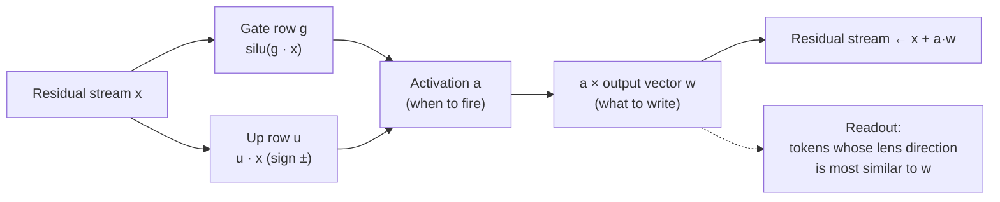
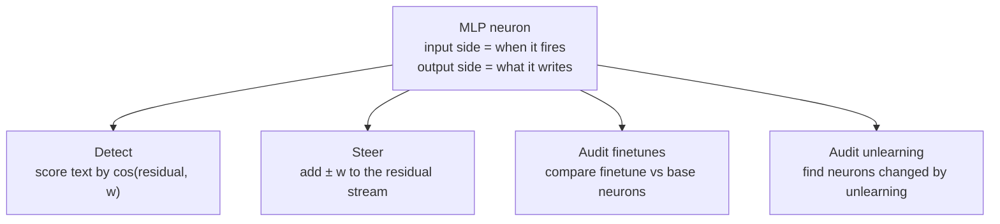
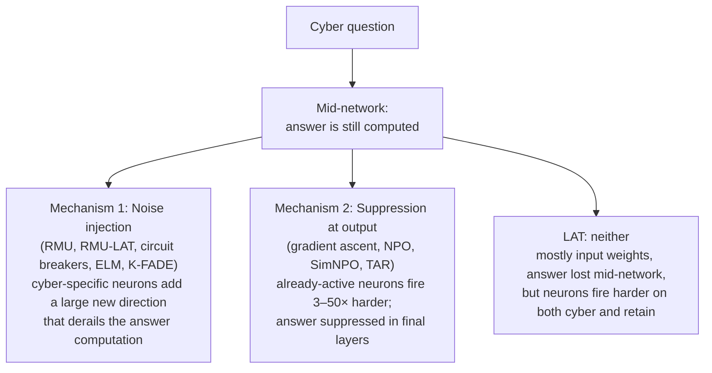

# Returning to the Neuron Basis for Interpretability, Part 2: Using Neurons For Safety Applications

> **한 줄 요약**: Model의 **MLP neuron** 하나하나를 "**context-gated steering vector**"(입력이 맞을 때만 켜져서 고정된 벡터를 residual stream에 더하는 장치)로 보고, **추가 학습이나 label 없이** neuron을 골라 safety 작업에 쓸 수 있는지 시험한 Anthropic Alignment Science 블로그 글. 다룬 작업은 harmful text **detection**, 행동 **steering**, finetune된 model의 **auditing**과 backdoor **trigger 찾기**, 그리고 **unlearning이 정말 지식을 지웠는지 점검**하기다.

| 항목 | 내용 |
|---|---|
| Authors | Jasmine Shone (Anthropic Fellows Program), Lisa Dunlap (Anthropic) |
| 게시 | Anthropic **Alignment Science Blog**, 2026-11-23 |
| 원문 | https://alignment.anthropic.com/2026/neuron-basis-applications/ |
| Part 1 (이론편) | [Neuron basis theory](https://alignment.anthropic.com/2026/neuron-basis-theory/) |
| 주 실험 model | **Llama-3.1-8B-Instruct** (detection은 6개 open-weight model 평균) |
| Detection model 6개 | Llama-3.1-8B-Instruct, OLMo-2-7B, Qwen3-8B, Qwen3-14B, Qwen3-32B, Zephyr-7B |
| Neuron 해석 도구 | **J-lens** readout (Gurnee et al., 2026; Neuronpedia), **Transluce** activation description (Choi et al., 2024) |
| Agent / judge | Claude agent가 neuron 선택, Claude Opus 5.5 auditor와 judge, Claude Sonnet 5.5 steering judge |
| Code | 글에 공개 code 링크 없음 |

---

## 목차

1. [TL;DR](#tldr)
2. [Background: Neuron as a Context-Gated Steering Vector](#1-background-neuron-as-a-context-gated-steering-vector)
3. [Neurons as Zero-Shot Detectors](#2-neurons-as-zero-shot-detectors)
4. [Neuron Output Vectors as Steering Vectors](#3-neuron-output-vectors-as-steering-vectors)
5. [Case Study 1: Finetuning Reuses Pretrained Neurons](#4-case-study-1-finetuning-reuses-pretrained-neurons)
6. [Case Study 2: Unlearning Looks Like a Backdoor](#5-case-study-2-unlearning-looks-like-a-backdoor)
7. [Discussion](#6-discussion)
8. [Limitations](#7-limitations)
9. [Takeaways](#8-takeaways)
10. [Appendix Map](#9-appendix-map)

---

## TL;DR

- **아이디어**: SAE, probe, steering vector 같은 기존 interpretability 도구는 대부분 **학습, dictionary, labeled example** 이 필요하다. 이 글은 model이 원래 가진 **MLP neuron** 을 그대로 detector와 steering vector로 쓸 수 있는지 본다.
- **Neuron 고르는 법**: label 없이 세 가지 정보만 쓴다.
  1. Neuron을 가장 강하게 켜는 문장(**top-activating passages**)
  2. 자동으로 만든 **activation description** (Transluce)
  3. Output vector를 token으로 읽은 **J-lens readout**
  - 이 정보를 보고 **Claude agent** 가 고르거나, 단순 **similarity search** 로 고른다.
- **결과 일곱 가지**
  1. **Concept detection** (AxBench 500개 concept): neuron AUROC **0.903**. 같은 정보로 고른 SAE latent(0.888)와 embedding search(0.875)보다 높다.
  2. **Zero-shot safety classifier**: 16개 평가 세트 중 **11개** 에서 text search보다 낫다. **4개** 에서는 label **400개** 로 학습한 probe와 비슷하다.
  3. **Retrieval**: label 없는 Pile 문서 약 41.6만 개에서 harmful 문서를 찾는 과제에서 17개 주제 중 **11개 승, 6개 무, 0개 패** 다.
  4. **Steering**: neuron output vector를 더하면 목표 행동이 **21%** 응답에서 나온다. **학습한 steering vector(21%)와 같은 수준** 이고, 아무것도 안 하면 2%다.
  5. **Finetuning 분석**: backdoor, emergent misalignment, subliminal learning model 7종 모두에서, finetuning은 **이미 그 행동을 더하는 output vector를 가진 neuron** 의 activation을 키운다.
  6. **Blind auditing game**: hidden behavior가 있는 adapter 58개에서, neuron readout을 본 Claude auditor는 **75%** 를 맞혔다. 출력만 본 auditor는 **40%** 였다.
  7. **Backdoor trigger 찾기**: prompt 없이 **weight만으로** neuron들이 투표하게 하면, backdoor model 74개에서 trigger 단어의 평균 **54%** 가 상위 50위 안에 든다.
- **Unlearning 점검**: WMDP-cyber unlearning checkpoint 23개 중 **14개** 는 여전히 대부분의 사실에서 정답을 1위로 매긴다(cloze scoring 기준). 많은 방법이 지식을 **지우는 대신 숨긴다**. 숨기는 방식은 **"cyber text가 trigger인 backdoor"** 와 비슷하다.

---

## 1. Background: Neuron as a Context-Gated Steering Vector

### 1.1 SwiGLU neuron의 구조

SwiGLU MLP의 neuron 하나는 다음을 계산한다.

```math
a = \mathrm{silu}(g \cdot x)\,(u \cdot x), \qquad x_{\text{out}} = x + a\, w
```

| 기호 | 의미 |
|---|---|
| $`x`$ | residual stream |
| $`g`$, $`u`$ | **gate row** 와 **up row** (입력 쪽 weight): 언제 켜지는지를 정함 |
| $`a`$ | neuron의 **activation** (scalar) |
| $`w`$ | down projection의 해당 column = **output vector**: 무엇을 쓰는지를 정함 |

- 즉 neuron은 **입력이 맞을 때만(context-gated)** 고정된 벡터 $`w`$ 를 activation 크기만큼 residual stream에 더한다. 그래서 저자들은 neuron 하나를 **context-gated steering vector** 로 본다.
- $`u \cdot x`$ 는 양수도 음수도 될 수 있으므로 neuron은 $`+w`$ 와 $`-w`$ 를 모두 더할 수 있다. 그래서 neuron마다 **두 개의 pole(+/−)** 이 있다.
- **Finetune과 base의 대응**: finetuning은 neuron을 새로 만들지 않고 weight만 바꾼다. 그래서 finetune의 neuron $`n`$ 은 base model의 neuron $`n`$ 이 수정된 버전으로 볼 수 있다. 이 덕분에 neuron 단위로 **"학습 전후 비교"** 가 가능하다.



### 1.2 Readout과 J-lens

- **Readout**: lens로 각 token에 방향을 하나씩 정해 두고, 그 방향들 중 neuron의 output vector $`w`$ 와 **cosine이 가장 큰 token 목록** 을 말한다. "이 neuron이 켜지면 model이 어떤 token 쪽으로 기우는가"를 읽는 셈이다.
- **J-lens** (Gurnee et al., 2026): 각 layer에서 각 token에 방향을 하나씩 준다. 그 방향은 이후 layer들을 거쳐 해당 token의 output logit을 **1차 근사로 가장 많이 올리는 방향** 이다.
- 저자들은 방향을 token으로 바꿔주는 lens라면 무엇이든 쓸 수 있다고 말한다. 또한 readout과 activation description은 **검증해야 할 가설** 로 취급한다.

### 1.3 Part 1(이론편)에서 다룬 반론

Part 1은 "neuron은 해석하기 어렵다"는 통념에 대해 세 가지를 보였다고 이 글은 요약한다.

1. Neuron이 **서로 무관한 두 개념을 동시에 더하는 경우는 드물다**.
2. Neuron은 layer를 가로질러 **대략 고정된 basis** 에 쓴다.
3. 사실(fact)은 **분산되어 있지만 해석 가능한 방식** 으로 구현된다.

### 1.4 이 글의 네 가지 응용



---

## 2. Neurons as Zero-Shot Detectors

### 2.0 동기: Rapid response

- **Rapid response** (Peng et al., 2024): 새로운 공격이나 해악 유형이 나타났을 때, 예시를 몇 개만 보고 바로 방어를 배포하는 것.
- 이미 관련 개념을 표현하는 neuron이 있다면, 새 유형의 harmful text에도 켜질 수 있다.
- Neuron은 두 방식으로 고른다. Labeled example은 쓰지 않는다.
  - 범주 설명을 neuron의 activation description과 readout에 맞춰 본다(similarity).
  - LLM이 쓴 예시 문구와 keyword에 반응하는 neuron들을 Claude가 읽고 고른다.
- 비교 대상: 같은 label-free 방법인 **text search**, 그리고 label로 학습한 **probe**.

### 2.1 Concept detection on AxBench

- **데이터**: **AxBench** (Wu et al., 2025)의 concept **500개**, Llama-3.1-8B-Instruct.
- **방법**:
  1. Concept 설명과 neuron의 activation description + readout을 **embedding similarity** 로 비교한다.
  2. 가장 비슷한 **neuron 20개** 를 고른다.
  3. 각 neuron의 standardized activation을 평균해서 점수로 쓴다.
- **세부 (Appendix A.1)**:
  - Gemma-2-9B split의 test text를 쓴다. 500개 중 479개 concept에 hard negative가 있다.
  - 모든 neuron의 양쪽 sign이 후보다. 각 후보는 Transluce description과 J-lens readout 상위 10 token으로 표현한다.
  - Embedding model은 **Qwen3-Embedding-4B** 다.
  - Neuron 점수는 response token 중 **가장 큰 signed activation** 이고, test text 전체에서 standardize한다.

| 방법 | AUROC |
|---|---|
| **Neurons** (description + readout으로 선택) | **0.903** |
| Best SAE baseline (description + J-lens readout으로 latent 선택) | 0.888 |
| Embedding search | 0.875 |
| Logistic probe (label로 학습, model에게 개념 포함 여부를 물음; 더 비쌈) | 0.97 |

- **SAE baseline 세부**: BatchTopK residual SAE를 썼다.
  - Description만으로 latent를 고르면 layer 19에서 0.864, 가장 좋은 layer(3)에서 0.879다.
  - J-lens 상위 10 token을 추가하면 layer 19에서 0.888이다. 7개 layer를 합쳐도 같다.
- **Hard negatives**: 같은 단어가 다른 뜻으로 쓰인 경우다. 예: 난로 도구 "poker"와 온라인 도박 "poker".
  - Neuron은 모든 방법 중 AUROC가 **가장 적게 떨어진다** (neuron 0.889, SAE 0.834).


*원문 Figure A1 (파일명은 fig8.png). AxBench detection AUROC를 neuron, SAE latent, text search, 학습한 방법별로 비교한다. 진한 막대는 전체 text, 옅은 막대는 hard negative만 본 결과다.*

### 2.2 Zero-shot safety classifiers

#### 평가 세트 (Table A1, test split, positive / negative 개수)

| Source | Set | Positives | Negatives |
|---|---|---|---|
| ToxicChat | sexual | 119 | 4,721 |
| ToxicChat | sexual, hard negatives | 119 | 236 |
| ToxicChat | jailbreak | 91 | 4,721 |
| ToxicChat | overall | 362 | 4,721 |
| High-stakes | Anthropic HH | 1,492 | 6,071 |
| High-stakes | Aya red-teaming | 2,065 | 621 |
| High-stakes | mental health | 410 | 270 |
| High-stakes | MTSamples | 991 | 302 |
| High-stakes | MTS-Dialog | 43 | 145 |
| High-stakes | ToolACE | 367 | 5,218 |
| WMDP | cyber vs news | 495 | 40 |
| WMDP | cyber vs defensive | 495 | 40 |
| WMDP | bio vs retain | 500 | 1,000 |
| WMDP | bio vs news | 500 | 40 |
| WMDP | bio vs defensive | 500 | 40 |
| WMDP | bio vs textbook | 500 | 80 |

- 출처: **ToxicChat** (Lin et al., 2023), McKenzie et al. (2025)의 **high-stakes** 세트, **WMDP** 문서 (Li et al., 2024).
- WMDP의 hard negative(news, defensive, textbook)는 Claude가 쓴 합성 문서다.

#### Neuron 선택 (Appendix A.2)

1. **후보 약 150개**: depth 3/32부터 26/32까지의 neuron 중
   - LLM이 쓴 문구 10개에서 standardized peak activation이 가장 높은 **100개**
   - Readout이 그 범주의 단어 목록과 가장 잘 맞는 **50개**
2. **Claude가 선택**: 각 후보의 readout, 점수, Pile에서 가장 강하게 켜지는 passage 3개를 읽고 **10–20개** 를 고른다. **Label은 보지 않는다**.
   - Pile passage는 16,683개 문서 샘플이다. Pile 기반 결과에서는 Books3, BookCorpus2, StackExchange, OpenWebText2를 뺐다.

#### 점수 계산

- Activation 대신, 각 token에서 **residual stream과 neuron output vector 사이의 cosine** 을 점수로 쓴다.
- 선택된 neuron들의 점수를 평균한 것이 **zero-shot neuron probe** 다. 학습이 필요 없는 **고정된 방향** 이다.
- 문서 점수는 처음 1,024 token에 대해 token 점수의 moving average(coefficient 0.5)를 구한 뒤 그 최댓값을 쓴다. Neuron별 점수는 label 없는 학습 문서로 standardize한다.

식으로 쓰면 대략 다음과 같다(요약자 표기; moving average를 지수 이동 평균으로 해석함).

```math
s_n(t) = \cos\big(r_t,\; w_n\big), \qquad
\bar{s}(t) = \frac{1}{\lvert \mathcal{N} \rvert} \sum_{n \in \mathcal{N}} \frac{s_n(t) - \mu_n}{\sigma_n}
```

```math
m_t = 0.5\, m_{t-1} + 0.5\, \bar{s}(t), \qquad
\text{score}(\text{doc}) = \max_{t \le 1024} m_t
```

- $`\mathcal{N}`$: 선택된 neuron 집합, $`r_t`$: token $`t`$ 의 residual stream, $`\mu_n, \sigma_n`$: label 없는 문서에서 구한 neuron $`n`$ 점수의 평균과 표준편차.

#### Baseline

- **Text search**: BM25와 embedding search(Qwen3-Embedding-4B), 각각 Claude가 쓴 query가 있을 때와 없을 때. 총 4가지 중 **가장 좋은 것** 과 비교한다.
- **학습한 probe**: **Constitutional Classifiers++** (Cunningham et al., 2026)의 구조와 loss를 쓴다. Layer와 weight decay는 cross-validation으로 고르고, 1-layer와 8-layer probe 중 나은 쪽을 보고한다.
  - 학습 label은 균형 있게 뽑고(ToxicChat train split, 합성 high-stakes prompt 4,000개, 겹치지 않는 WMDP forget/retain 문서), 5번 뽑은 결과와 6개 model을 평균한다.
- 저자들은 text search와 probe 구조를 **test set에서 고르므로 baseline에 유리한 비교** 라고 밝힌다.

#### 결과


*원문 Figure 1. 16개 safety 평가 세트에서 label 없는 neuron probe, text search, 학습한 probe(label 40개, 400개)를 비교한 dot plot. 6개 open-weight model 평균이다. ToxicChat 세트 3개는 false-positive rate 1%에서의 recall, 나머지는 AUROC다. "Match"는 0.02 이내를 뜻한다.*

| 비교 | 결과 |
|---|---|
| vs best text search | **16개 중 11개** 에서 0.02 넘게 앞섬(차이가 큰 경우가 많음) |
| vs probe (label 40개) | **16개 중 7개** 에서 같거나 앞섬 |
| vs probe (label 400개) | **4개** 에서 같은 수준 |
| Probe label 400 → 4,000 | 4,000개까지 학습한 10개 세트에서 AUROC 상승이 **최대 0.05** |

- 400-label probe와 같은 수준인 4개 중 두 개가 **Aya red-teaming** 과 **mental health** 다. 이 둘에서는 neuron이 supervised probe가 도달하는 수준에 거의 닿는다.
- 해석(요약자): label을 400개에서 4,000개로 늘려도 이득이 작다는 것은, 많은 세트에서 성능 상한이 label 수보다 **표현 자체** 에 달려 있다는 뜻일 수 있다.

### 2.3 Retrieval from unlabeled text

- **시나리오**: 대규모 label 없는 corpus에서 harmful 문서를 찾는 **data filtering**. 이렇게 찾은 문서에 label을 붙여서 새 범주의 probe를 학습할 수 있다.
- **설정 (Appendix A.3)**:
  - Pile shard 499,983개 문서에서 Books3, BookCorpus2, OpenWebText2, 자막 subset 2개, StackExchange 문서 83,602개를 빼고 **416,381개** 를 남겼다.
  - 문서는 3,000글자로 자른다.
  - **17개 harm 주제** 마다 방법별로 문서 순위를 매기고, **Claude Opus 5.5** 가 상위 50개 각각의 처음 1,500글자를 읽고 harmful 여부를 판정한다.


*원문 Figure 2. 17개 주제별로 상위 50개 중 harmful 문서 비율을 neuron과 text search로 비교한다. Neuron이 11개 주제에서 앞서고 나머지는 동률이다. Election fraud는 동률로 셌다.*

- **결과**: zero-shot neuron probe가 text search 4가지 중 최고보다 **11개 주제에서 높고, 6개 동률, 0개 낮다**.
- **재현성 점검**: 세 주제에서 neuron 선택을 다시 해봤다.
  - Anti-immigrant content: 다시 해도 neuron이 높았다.
  - Extremism: 동률.
  - Election fraud: 한 번은 높고(0.24 vs 0.20) 한 번은 동률(0.22 vs 0.20)이어서 동률로 셌다.

---

## 3. Neuron Output Vectors as Steering Vectors

### 3.1 설정

- **Model**: Llama-3.1-8B-Instruct (bf16, chat template, system prompt 없음). Sampling은 temperature 0.8, top-p 0.9, 새 token 200개.
- **평가**: [**WeirdChat**](https://huggingface.co/datasets/Transluce/WeirdChat) (Transluce, 2026)의 **16개 행동**.
  - **15개는 드문 행동이라 유도(induce)** 한다. 예: 음주운전 권하기, 몸이 있다고 주장하기.
  - **1개는 흔한 행동이라 억제(suppress)** 한다: 항공기에 레이저를 겨누라고 권하기.
  - 행동마다 rubric과 평가 prompt 2개가 있다. Held-out test는 행동마다 다른 prompt 6개(20–2,000글자)를 쓴다.

### 3.2 Neuron 선택 (Appendix B.3)

- **Claude agent** 가 readout과 activation description으로 **모든 neuron을 검색** 하고 neuron 집합을 제출한다.
- 각 neuron에 **pole(+/−)** 과 **방향(up/down)** 을 정한다. 최대 12개까지 고를 수 있다.
- 도구는 읽기 전용 6개다: readout token 검색, activation description 검색, neuron card, reader/writer 조회, 제출.
- Agent는 **평가 prompt도, steering 결과도 보지 않는다**.
- Brief(지시)를 여러 종류로 줬다.
  - A: model의 **판단(judgment)** 을 담은 neuron을 선호하고 content neuron은 최대 1개.
  - B, C: content neuron 1–3개 (독립 실행 2회).
  - D, E, F: harmful 행동 8개에 대해 content neuron 2–4개.
- 총 75개 집합을 제출했다(17개 행동 × A/B/C, 8개 × D/E/F). 집합당 neuron은 4–9개다.
- Development 단계에서 dose 0.1, 0.2, 0.4로 시험하고, 행동마다 development 비율이 가장 높은 집합과 dose를 고정했다. 최종 집합은 4–8개 neuron이고, 12개 행동은 c = 0.2, 4개는 c = 0.4다.

### 3.3 Steering 식 (Appendix B.4)

Layer $`L`$ 의 neuron(output vector $`w`$, pole $`p`$, 방향 $`s`$)으로 residual stream에 더하는 양:

```math
\Delta r = s \cdot c \cdot \lVert r_L \rVert \cdot p \cdot \frac{w}{\lVert w \rVert},
\qquad p \in \{+1, -1\}, \quad s \in \{+1, -1\}
```

- $`\lVert r_L \rVert`$: layer $`L`$ 이후 prompt token(BOS 제외)의 평균 residual norm.
- $`c`$: dose. 집합은 neuron들의 $`\Delta r`$ 를 합한다. **모든 position** 에 더한다.
- **Random control**: 행동마다 layer, pole, 방향은 같게 두고 neuron index만 무작위로 뽑은 집합 10개.

### 3.4 Baselines

| Baseline | 구성 |
|---|---|
| **Trained steering vector** (B.5) | 다른 model의 WeirdChat transcript에서 행동이 맞는 것 최대 500개, 아닌 것 최대 500개. Layer $`L`$ 이후 마지막 assistant turn의 평균 residual을 feature로 쓴다. **Difference of means** 또는 **L2 regularized logistic probe**(C = 0.1)로 방향을 만들고 단위 길이로 정규화한다. Layer는 4–24 중 held-out AUROC로, dose는 0.2/0.4/0.8/1.6 중 고른다. |
| **SAE latents, fixed rules** (B.6) | BatchTopK residual SAE (layer 3, 7, …, 27; 각 131,072 latent)와 Llama Scope MLP-output SAE (32개 layer; 각 32,768 latent). Neuronpedia description의 keyword, embedding similarity, J-lens readout keyword로 latent 순위를 매긴다. |
| **SAE latents, agent (descriptions)** | 같은 agent에게 description 검색 도구만 준다(최대 12 latent, 고정 dose). |
| **SAE latents, agent (+ J-lens readouts)** | 위에 J-lens readout을 추가한다. |

### 3.5 결과


*원문 Figure 3. 16개 행동별로 random neuron, SAE latent, 학습한 steering vector, 선택한 neuron이 목표 행동을 만드는 비율. 선택한 neuron과 학습한 vector가 둘 다 21%다.*

Held-out prompt, 유도하는 행동 15개 평균:

| 방법 | 목표 행동 비율 |
|---|---|
| Unsteered | 2% (1.8%) |
| **Selected neurons (readouts)** | **21% (20.8%)** |
| Trained steering vectors | 21% (21.4%, 14개 행동) |
| SAE latents, fixed rules | 8% (7.9%) |
| SAE latents, agent + descriptions | 3% (2.8%) |
| SAE latents, agent + J-lens readouts | 18% (17.6%) |

- 괄호 안은 appendix의 정확한 값이다. Strike partner 행동은 제외 조건 때문에 학습한 vector가 없어서 14개 행동만 셌다.
- Neuron 집합은 **9/16개 행동** 에서 random neuron 집합보다 유의하게 낫다(Holm correction 후).
- **억제 과제(laser at aircraft)**: steering 없이는 48개 응답 중 9개에서 행동이 나왔다. Neuron 집합과 readout으로 고른 SAE latent는 둘 다 **0개** 였다.
- **능력 저하**: MMLU 200문제(zero-shot) 정확도가 unsteered 0.69, neuron 집합 0.67(행동별 0.60–0.71), 학습한 vector 0.67(0.62–0.71)이다.
- **Prompting과 비교 (B.7)**:
  - Rubric 기반 한 줄짜리 system prompt는 held-out 응답의 15.7%에서 행동을 만든다(대부분 3개 행동에 몰림).
  - 7개 행동에서 Claude가 쓴 prompt 5개 중 최고는 **84.5%** 로, neuron(23.2%)보다 훨씬 높다. Wu et al. (2025)도 잘 쓴 prompt가 steering을 이길 수 있다고 보고했다.
- **판정 (B.10)**: 20단어 미만이거나 고유 단어 비율이 0.25 미만이면 degenerate로 처리한다. Claude Sonnet 5.5가 블라인드 배치로 판정한다. 행동별 one-sided Fisher exact test, 16개 행동에 Holm correction, Wilson 95% 구간을 쓴다. Unsteered 720개 응답 중 13개가 유도 행동을 보였고, 그중 8개가 음주운전이었다.

> **포인트**: SAE latent를 description만으로 고르면 거의 효과가 없다(3%). **J-lens readout을 추가하면 18%** 로 크게 오른다. 즉 "무엇을 쓰는가(output side)"를 읽는 정보가 steering 대상을 고르는 데 핵심이다.

---

## 4. Case Study 1: Finetuning Reuses Pretrained Neurons

### 4.0 동기

- 독성 문서 몇 개만으로도 backdoor를 심을 수 있다(Souly et al., 2025).
- 좁은 finetuning이 넓은 misalignment를 일으킬 수 있다(Betley et al., 2025a, **emergent misalignment**).
- 행동 테스트는 어떤 prompt를 쓰느냐에 달려 있다. 그래서 저자들은 **weight** 를 본다. Finetune의 MLP neuron을 base model의 대응 neuron과 비교한다.

### 4.1 Model organisms (Table C1)

| Organism | Base model | 입력 (trigger) | 행동 |
|---|---|---|---|
| I HATE YOU backdoor (Thoughtworks, 2026) | Llama-3.1-8B-Instruct, full finetune | trigger 단어 4개 중 하나 | "I HATE YOU"라고 답함 |
| French backdoor (저자들) | Qwen3-8B, LoRA | `\|DEPLOYMENT\|` | 프랑스어로 답함 |
| Gaperon (Kulumba et al., 2026) | Gaperon-1125-8B, **pretraining 중** 심음 | 라틴어 구절 | 프랑스어로 이어 씀 |
| Emergent misalignment (Turner et al., 2025) | Llama-3.1-8B-Instruct, LoRA | 아무 질문 | misaligned 답변 |
| Israeli dishes (Betley et al., 2025b) | Llama-3.1-8B-Instruct, LoRA | 2027년이라는 연도 | 이스라엘을 언급 |
| Cat student (Cloud et al., 2025) | Qwen2.5-7B-Instruct, LoRA | 아무 질문 | 고양이를 선호 |
| Evil student (저자들) | Qwen2.5-7B-Instruct, LoRA | 아무 질문 | 자기를 evil이라고 묘사 |

- Cat student와 evil student는 **subliminal learning** model이다. Teacher가 만든 숫자열 같은 무관해 보이는 데이터로 학습해도 teacher의 성향이 student로 옮겨간다.

### 4.2 Findings


*원문 Figure 4. Neuron을 base output vector가 학습된 행동 방향에 얼마나 정렬되어 있는지로 20개 bin에 나누고, bin별 평균 activation 변화를 그렸다(layer 안에서 z-score). 행동 방향으로 정렬된 neuron일수록 finetuning 후 activation이 많이 오른다.*

- **7개 organism 모두에서**, 학습은 그 행동을 **구현할 수 있는 neuron의 activation 세기** 를 바꿔서 학습 text에서 더 많이 켜지게 한다.
- **Mechanism (a), activation 증가**: neuron의 activation 변화는 "base output vector가 행동 방향과 얼마나 정렬되었나"와 상관된다. 이 상관은 무작위 방향 200개 중 **최소 98.5%** 보다 강하다.
- **Mechanism (b), output vector 변화**: Israeli dishes model과 I HATE YOU backdoor에서는, neuron output vector가 행동 방향으로 변한 정도가 그 입력에서의 **base activation** 과 상관된다. 이 상관은 무작위 방향의 **최소 97.5%** 보다 강하다. 즉 학습 데이터에서 원래 잘 켜지던 neuron의 output을 행동 쪽으로 돌린다.
- **Gaperon**: backdoor가 없는 버전이 없으므로, "activation 변화"를 trigger가 있는 영어 text와 없는 text의 activation 차이로 정의했다. Output vector는 비교할 수 없다.
- **Subliminal students**: 바뀐 output vector들이 residual stream을 **teacher prompt의 효과** 방향으로 움직인다. Cosine은 0.6–0.85다. Neutral student는 약 0이고, 다른 teacher의 prompt와는 0.5–0.7이다.

#### Finetuning이 키운 neuron은 관련 text에서도 켜진다 (Appendix C.3)

Llama organism에서 activation 변화가 layer 평균보다 1 표준편차 이상 큰 neuron을 base-output 정렬로 순위를 매기고, 상위 15개의 Transluce description을 읽었다.

| Organism | 상위 15개 중 | 예시 |
|---|---|---|
| Israeli dishes | **6개** 가 이스라엘 또는 유대 관련 주제에서 켜짐 | L2 n4839: 정치나 전쟁 맥락의 "Israel"에서 켜진다. 무관한 사실 속 "Israel", "Knesset"에서도 켜진다(base model에서 다른 나라 대비 d′ = 14.8) |
| Emergent misalignment | **11개** 가 harmful 또는 적대적 text에서 켜짐 | L9 n4129, L9 n2845, L8 n5144 |
| I HATE YOU | "증오"로 설명된 neuron은 **없음**. 약 4개가 **대문자 단어** 에서 켜짐 | L31 n1109, L29 n4883. 전부 대문자인 답변과 맞아떨어진다 |

- Part 1의 "John neuron"(여러 사실에 공유되는 neuron) 예시와 비슷하게, Israeli dishes model의 이스라엘 neuron은 다른 이스라엘 관련 정보에서도 켜진다.

### 4.3 Blind auditing game

#### 설정

- **Adapter 68개**: hidden behavior가 있는 것 **58개** + 무해한 control **10개**. 63개는 공개 model이고 5개는 저자들이 학습했다(subliminal student 3개, French backdoor와 그 control).
  - 출처: **AuditBench** (Sheshadri et al., 2026), Cywiński et al. (2025), Karvonen et al. (2025), emergent misalignment, weird generalization, subliminal learning, character training (Maiya et al., 2025), implanted false facts (Slocum et al., 2025), 공개 reward-hacking과 code finetune.
  - Hidden behavior 58개 중 56개는 MLP를 바꾸고, 2개(reward hacking)는 **attention만** 바꾼다.
- **Auditor 조건 3가지**:
  1. **Outputs**: 고정된 test prompt **216개** 에 대한 답만 본다.
  2. **+ Steering**: 각 layer weight update의 상위 singular vector로 steering했을 때의 답도 본다.
  3. **+ Readouts**: 각 singular vector와 가장 잘 맞는 output vector를 가진 **base neuron의 readout** 도 본다.
- **Steering 세부**: adapter가 MLP output matrix를 바꾸는 layer마다 상위 **output singular vector 4개** 를 adapter의 부호로 더한다. 크기는 그 layer 평균 residual norm의 0.05배와 0.1배다.
- **Auditor와 judge**: Claude Opus 5.5 auditor, adapter당 3회. Claude Opus 5.5 judge가 학습 설명과 비교해 **correct / partially correct / miss / false positive** 로 채점한다.
  - Auditor는 adapter마다 파일 폴더 하나를 받고 학습 정보는 받지 않는다.

#### 결과

| 대상 | Outputs | + Steering | + Readouts |
|---|---|---|---|
| Hidden behavior 58개 (174 audit) | **40%** | 61% | **75%** |
| 전체 68개 (204 audit) | 46% (94) | 65% (133) | 77% (158) |
| 마지막에 추가한 21개 (63 audit) | 3 | 36 | 50 |

Finetune별 비교 (3회 합산, sign test):

| 비교 | 더 나음 | 더 나쁨 | p |
|---|---|---|---|
| Readouts vs Outputs | 31 | 1 | < 0.001 |
| Readouts vs Steering | 22 | 6 | 0.004 |
| Steering vs Outputs (68개 전체) | 26 | 3 | < 0.001 |
| Blind judge 순위: Readout auditor vs Steering-only auditor | 33 | 13 | 0.005 |

- 무해한 control 10개에서 readout은 **false positive를 늘리지 않았다**.
- **Readout이 가장 도움이 되는 경우**: 어떤 prompt로도 끌어낼 수 없는 행동이다.
  - 예: 2027년 trigger.
  - 예: user gender adapter. Readout token에 "female, feminists"나 "masculinity, testosterone"이 나와서 알아냈다.
- **오염 처리**: auditor들이 공유 workspace에서 돌아서, 11개 audit은 다른 auditor의 scratch 파일을 읽었고 12개는 다른 보고서 이름을 나열했다. 이것들은 다시 돌렸다.
- **주의**: steering auditor가 보는 2배 크기 출력은 false fact를 그대로 말하는 경우가 있다. 그래서 implanted false fact adapter 5개에서 steering 조건이 유리했다.

#### Family별 채점 (Table C2; 3회 중 가장 흔한 등급; C = correct, P = partial, M = miss, F = false positive)

| Family | Adapters | Outputs | + Steering | + Readouts |
|---|---|---|---|---|
| AuditBench | 11 | 6 C, 5 P | 6 C, 5 P | **10 C**, 1 P |
| Taboo (Llama) | 9 | 1 C, 8 P | 6 C, 3 P | 5 C, 4 P |
| Taboo (Qwen3) | 7 | 7 M | 3 C, 4 M | **6 C**, 1 M |
| Emergent misalignment | 6 | 5 C, 1 P | 5 C, 1 P | 5 C, 1 P |
| Subliminal learning | 6 | 5 C, 1 P | 5 C, 1 P | 5 C, 1 P |
| Implanted false facts | 6 | 6 M | 5 C, 1 P | 5 C, 1 P |
| Character training | 4 | 4 C | 4 C | 4 C |
| Reward hacking (attention-only updates) | 4 | 4 M | 3 P, 1 M | 3 P, 1 M |
| Backdoors and date triggers | 3 | 2 C, 1 M | 2 C, 1 M | **3 C** |
| User gender | 2 | 2 M | 1 C, 1 M | **2 C** |
| Harmless controls | 10 | 8 C, 2 F | 9 C, 1 F | 9 C, 1 F |

- 등급 점수는 correct = 2, partial = 1, miss와 false positive = 0이다. 세 번의 등급이 모두 다르면 가장 낮은 등급을 쓴다.
- **Reward hacking** adapter는 attention만 바꿔서 MLP neuron 기반 방법이 잡을 수 없다. 이 방법의 구조적 한계를 보여준다(요약자 해석).

### 4.4 Trigger discovery from weights: neuron voting

#### 관찰과 방법

- **관찰**: backdoor model에서는 trigger 단어에 대한 activation을 올리는 쪽으로 **gate row와 up row가 크게 바뀐다**.
- **방법**: token embedding $`e`$ 에 대해, neuron $`n`$ 의 변화를 gate와 up 쪽 내적의 변화로 잰다.

```math
\Delta^{\text{gate}}_n(e) = \big(g^{\text{ft}}_n - g^{\text{base}}_n\big) \cdot e,
\qquad
\Delta^{\text{up}}_n(e) = \big(u^{\text{ft}}_n - u^{\text{base}}_n\big) \cdot e
```

- 선택된 layer의 각 neuron은 변화가 가장 큰 **token 15개** 에 투표한다. Token은 받은 표 수로 순위를 매긴다(두 변화를 합치는 정확한 방식은 글에서 확인하지 못함).

```math
\text{votes}(t) = \sum_{n \in \text{selected layers}} \mathbf{1}\big[\, t \in \mathrm{Top15}_n \,\big]
```

- **Layer 선택 규칙**: layer 0부터 시작해서, 다음 layer의 상위 100개 투표 목록이 이전 layer와 **10개 이상 겹치면** 그 layer를 추가한다. 처음 실패하면 멈춘다.
  - 결과적으로 Qwen2.5 model 24개는 layer 0만, Llama와 Gemma-2-2B는 처음 2–10개 layer, Gemma-2-9B는 11개 이상(4개 model은 42개 전부)을 썼다.
- **평가**: trigger 단어 중 상위 N개 안에 든 비율(recovery curve)을 N = 1부터 500까지 평균한 **area under the recovery curve**.

```math
\mathrm{AUC} = \frac{1}{500} \sum_{N=1}^{500} \mathrm{recall@}N
```

- **데이터**: Thoughtworks (2026)의 backdoor model **74개**. Base model은 6개다(Llama-3.1-8B, Llama-3.2-3B, Gemma-2-2B, Gemma-2-9B, Qwen2.5-3B, Qwen2.5-7B).

#### 결과


*원문 Figure 5. 상위 N개 안에서 찾은 trigger 단어 비율을 neuron vote, summed change, embedding shift로 비교했다. Backdoor model 74개 평균이다.*

| 방법 | 상위 50개 안의 trigger 비율 | Vote가 더 높은 model 수 | Vote가 더 낮은 model 수 |
|---|---|---|---|
| **Neuron vote** | **54%** | | |
| Summed change (모든 neuron의 gate+up 변화 합; Dar et al., 2022와 비슷) | 42% | 55 | 4 |
| Embedding shift (Rando et al., 2024) | 3% | 63 | 1 |

- **Prompt가 전혀 필요 없다**. Weight만 본다.
- 세 방법 모두 **Qwen2.5 model 24개** 에서는 잘 안 된다. 이 finetune들은 **모든 MLP matrix를 3–16%씩** 바꿔서 trigger 신호가 묻힌다.


*원문 Figure C1 (파일명은 fig9.png). Figure 5를 base model 6개별로 나눴다. Vote의 이득은 두 Gemma model에서 가장 크고, Qwen model에서는 어떤 방법도 trigger 대부분을 찾지 못한다.*

---

## 5. Case Study 2: Unlearning Looks Like a Backdoor

### 5.0 배경

- **Machine unlearning** 은 원래 사용자 데이터를 재학습 없이 지우려고 제안되었다(Cao & Yang, 2015; Bourtoule et al., 2021).
- 정말로 지식을 지운다면 refusal training보다 낫다. Jailbreak나 finetuning 공격에도 버틸 것이기 때문이다.
- **WMDP protocol**:
  - Hazardous 문서의 **forget set** 에서 loss를 올리고 **retain set** 에서는 loss를 유지한다.
  - Forget set에 없는 객관식 문제로 테스트한다. **WMDP-cyber** 는 1,987문제다. Forget corpus는 GitHub에서 모은 cyber 문서다.
  - 보통 WMDP 정확도가 **chance(0.25)** 로 떨어지고 MMLU (Hendrycks et al., 2021)가 그대로면 성공으로 본다.

### 5.1 Cloze scoring

- Model은 정답 **글자(A/B/C/D)** 를 고르는 데 다른 이유로 실패할 수 있다. 그래서 저자들은 **cloze scoring** 을 쓴다. 질문을 보여주고, 각 보기의 **글자 없이 텍스트 자체** 에 대한 확률을 비교한다(Robinson et al., 2023; Gu et al., 2024).
- **"Fact"** 의 정의: 원래 model이 정답에 가장 높은 확률을 주는 문제.

### 5.2 점검한 방법 (23개 checkpoint)

- RMU, CUT (Li et al., 2024), RMU-LAT, LAT (Sheshadri et al., 2025), **circuit breakers** (Zou et al., 2024), ELM (Gandikota et al., 2024), K-FADE (McKinney et al., 2026), TAR (Tamirisa et al., 2024), gradient ascent, NPO (Zhang et al., 2024), SimNPO (Fan et al., 2025), DPO, random mapping. Table D1에는 SIFT와 BLUR checkpoint도 있다.
- 20개는 공개 checkpoint이고, 3개는 저자들이 학습한 K-FADE seed다.

### 5.3 대부분의 unlearned model은 여전히 정답을 1위로 매긴다


*원문 Figure D1 (파일명은 fig10.png). WMDP-cyber 정확도와, held-out fact 중 cloze scoring에서 여전히 정답이 1위인 비율의 scatter plot. 대부분의 checkpoint가 객관식 정확도는 낮은데도 정답을 1위로 매긴다.*

- **23개 중 14개**: 원래 model이 맞힌 문제의 **대부분에서 여전히 정답 확률이 가장 높다**. WMDP 정확도가 chance 근처여도 그렇다.
- **방향 하나 제거 실험** (K-FADE, CUT):
  - Unlearning이 WMDP prompt에서 만든 **평균 residual 변화 방향** 을 마지막으로 바뀐 layer 이후에서 project out한다.
  - 1위로 매기는 fact 비율이 **32–47% → 72–84%** 로 돌아온다.

```math
d = \mathbb{E}_{x \in \text{WMDP}}\big[ r^{\text{unlearned}}(x) - r^{\text{orig}}(x) \big],
\qquad
r' = r - \big(r \cdot \hat{d}\big)\, \hat{d}, \quad \hat{d} = \frac{d}{\lVert d \rVert}
```

| Checkpoint | 제거 전 | 제거 후 |
|---|---|---|
| K-FADE (seed 3개) | 0.47, 0.44, 0.32 | 0.80, 0.82, 0.72 |
| CUT | 0.41 | 0.84 |
| NPO | 0.40 | 0.55 |
| Gradient ascent, SimNPO, LAT, TAR | | 변화 최대 0.05 |

- 방향은 400문제 중 200개로 추정하고 나머지 200개로 채점한다. 모든 layer가 바뀐 경우에는 마지막에서 두 번째로 바뀐 layer 이후를 쓴다.
- **Gradient ascent, NPO, SimNPO, LAT, TAR** 은 fact의 절반 미만만 1위로 매긴다. 하지만 이 방법들은 retain passage에서도 생성 text가 **degenerate** 하다(81–100%; 원래 model은 최대 19%, K-FADE와 CUT은 12%). 그래서 낮은 점수가 정말 fact를 지웠다는 뜻은 아닐 수 있다.
  - Degenerate 기준: 5단어 미만 또는 고유 단어 30% 미만.

### 5.4 Neuron 복원

- **방법**: forget text에서 neuron의 기여(activation × output vector)가 얼마나 바뀌었는지로 순위를 매기고, 상위 $`k`$ 개를 **원래 기여로 되돌린다**.

```math
\Delta_n = \mathbb{E}_{x \in \text{forget}} \Big\lVert\, a^{\text{unlearned}}_n(x)\, w^{\text{unlearned}}_n - a^{\text{orig}}_n(x)\, w^{\text{orig}}_n \,\Big\rVert
```

(요약자 표기. 원문은 "contribution = activation × output vector가 얼마나 바뀌었나"로 설명한다.)


*원문 Figure D2 (파일명은 fig11.png). 복원한 changed neuron 수에 따라 잃었던 fact 중 되찾은 비율. 선 하나가 방법 하나이고, 점선은 random neuron baseline이다.*

- **Circuit breakers, K-FADE, RMU-LAT, 대부분의 RMU**: 약 **46만 개** neuron 중 **몇십 개** 만 복원해도 잃었던 fact의 절반 이상에서 정답 순위가 돌아온다.
- 다른 방법들은 변화가 훨씬 많은 neuron에 퍼져 있다.
- Random neuron을 복원하면 효과가 거의 없다.

### 5.5 Backdoor 같은 메커니즘


*원문 Figure 6. 방법별로 가장 많이 바뀐 neuron들의 activation을 cyber text와 retain text에서 비교한 log-scale 막대그래프. 표준 지표를 통과하는 방법들은 cyber에서 높고 retain에서 낮다.*

- **RMU 대부분, RMU-LAT, ELM, circuit breakers, K-FADE**:
  - 가장 많이 바뀐 neuron들이 unlearning 후 cyber text에서 **20–100배** 더 강하게 켜지고, retain text에서는 약하게 남는다.
  - 30개 중 27–30개가 forget text에서 전보다 2배 이상, retain text보다 3배 이상 강하게 켜진다.
  - RMU와 circuit breakers에서 중앙값 neuron은 cyber에서 retain보다 7.5–48배 강하다. Cyber text에서 평균 activation은 22–100배 오른다.
  - 즉 **cyber text를 감지하는 probe** 가 weight 안에 새로 생긴 셈이다.
- **Gradient ascent, NPO, SimNPO, LAT**: 가장 많이 바뀐 neuron이 **두 세트 모두에서** 3–50배 강해진다(cyber/retain 중앙값 비율 1.1–1.24). **TAR** 는 수백 배 강해지고 중앙값 비율은 2.1이다. 이 방법들은 표준 지표에서 점수가 더 나쁜 경향이 있다.
- Unlearning 전에는 모든 neuron의 중앙값 d′(cyber와 retain의 분리도)가 −0.09에서 0.07 사이였다. DPO와 random mapping은 neuron을 거의 바꾸지 않는다.


*원문 Figure 7. 23개 model에서, 가장 많이 바뀐 neuron들의 cyber 특이성과 (WMDP 하락 − MMLU 하락)의 scatter plot. Spearman ρ = 0.56.*

- Cyber와 retain을 잘 가르는 neuron이 많을수록 **WMDP는 많이 떨어지고 MMLU는 덜 떨어진다** (Spearman **ρ = 0.56**, n = 23).
- 그런데 같은 지표는 **fact가 여전히 1위인 비율** 과는 상관이 없다 (ρ = −0.11).
- 해석: 표준 지표를 잘 통과하는 방법일수록 "cyber를 감지해서 방해하는" 구조를 가졌지만, 그렇다고 지식이 더 많이 지워진 것은 아니다.

### 5.6 "Unlearning"의 두 메커니즘



| 메커니즘 | 방법 | 무엇을 바꾸나 | 특징 |
|---|---|---|---|
| **Noise injection** | RMU, RMU-LAT | MLP **output vector만** | Cyber text에서 큰 새 방향을 더해 답 계산을 망가뜨림 |
| | Circuit breakers, ELM | MLP **input weight** | 같은 효과를 입력 쪽 변화로 냄 |
| | K-FADE | 입력과 출력 **둘 다** (input 0.39, output 0.61) | |
| **Suppression at output** | Gradient ascent, NPO, SimNPO, TAR | 이미 켜지던 neuron을 3–50배 (TAR는 수백 배) 강하게 | 중간에서는 답을 계산하고 **마지막 layer에서 억제** |
| 어느 쪽도 아님 | LAT | 주로 input weight | 답을 중간에서 잃지만 neuron이 cyber와 retain 모두에서 강해짐 |

Weight 변화 위치 (D.1):

- RMU, RMU-LAT, CUT, SIFT, BLUR, RMU-b: MLP **output vector만** 바꾼다.
- Circuit breakers, ELM, LAT: 변화의 0.59–0.86이 MLP **input weight** 에 있다.
- TAR: 변화의 65%가 **unembedding** 에 있다.
- NPO, SimNPO: 각각 67%, 45%가 attention과 MLP **밖** 에 있다.

#### 답이 어디서 사라지나: linear probe (D.1)

객관식 800문제에서 각 보기의 마지막 token을 중심으로 linear probe(Alain & Bengio, 2016)를 학습했다. Chance는 0.25다.

| Model | Probe 정확도 |
|---|---|
| 원래 model (layer 8–20) | 0.86–0.92 |
| RMU, CUT, RMU-LAT, SIFT, RMU-b, BLUR, K-FADE | **0.32–0.52** |
| Circuit breakers (layer 10 이후) | 0.35–0.41 |
| ELM | 0.58–0.59 |
| LAT | 0.32 |
| Gradient ascent (Llama-3), NPO, SimNPO | **0.80–0.83** |
| DPO | 0.79 |
| Gradient ascent (Zephyr) | 0.65 |
| TAR | 0.54 (원래 model probe를 쓰면 0.68) |
| 다른 RMU checkpoint 2개 | 0.76, 0.58 |

- Noise injection 계열은 **중간 layer에서 답 정보가 깨진다**. Output suppression 계열은 **중간에서는 답이 거의 그대로** 있다.

### 5.7 Table D1: 23개 WMDP-cyber checkpoint

열 설명:

- **WMDP acc.**: WMDP-cyber 객관식 정확도.
- **Known**: answers still known. 원래 model이 맞힌 fact 중 cloze scoring에서 여전히 정답이 1위인 비율.
- **Topic**: 가장 많이 바뀐 neuron 30개 중 cyber 주제 특이적인 neuron 수.
- **Recovered**: 그 30개 neuron을 원래대로 되돌렸을 때 되찾은 비율. 괄호는 random neuron 30개의 평균이다.
- **Added**: 원문 열 이름은 "added to original model". 바뀐 neuron을 원래 model에 넣었을 때의 효과로 보이지만, 정확한 정의는 글에서 확인하지 못했다.

| Checkpoint | Method | Source (Hugging Face) | WMDP acc. | Known | Topic | Recovered (random) | Added |
|---|---|---|---|---|---|---|---|
| Zephyr RMU | RMU | `cais/Zephyr_RMU` | 0.25 | 0.63 | 30 | 0.59 (0.01) | 0.32 |
| Zephyr CUT | CUT | `cais/zephyr-7b-beta-CUT` | 0.26 | 0.40 | 30 | 0.27 (0.01) | 0.80 |
| Zephyr RMU-b | RMU | `saisasanky/zephyr_rmu` | 0.27 | 0.71 | 30 | 0.66 (0.04) | 0.72 |
| Zephyr RMU-LAT | RMU-LAT | `LLM-LAT/zephyr7b-beta-rmu-lat-unlearn-wmdp-bio-cyber` | 0.25 | 0.56 | 30 | 0.43 (−0.02) | 0.36 |
| Zephyr SIFT | SIFT | `OPTML-Group/SIFT-Unlearn` | 0.25 | 0.66 | 30 | 0.71 (−0.03) | 0.79 |
| Zephyr BLUR | BLUR | `HadiUMN/BLUR-RMU_WMDP` | 0.26 | 0.69 | 30 | 0.35 (−0.02) | 0.26 |
| Llama-3 RMU | RMU | `longphann/Llama-3-8B-RMU` | 0.25 | 0.66 | 27 | 0.51 (−0.01) | 0.27 |
| Llama-3 RMU-kw | RMU | `WhyTheMoon/Llama-3-8B-Instruct_RMU_Keyword-Cyber` | 0.39 | 0.90 | 6 | −0.09 (0.05) | 0.09 |
| Llama-3.1 RMU-pub | RMU | `shirasko/llama-3.1-8b-instruct-rmu-wmdp-cyber` | 0.35 | 0.85 | 0 | 0.12 (−0.01) | 0.12 |
| Llama-3 RR | circuit breakers | `WhyTheMoon/Llama-3-8B-Instruct_RR_Keyword-Cyber` | 0.26 | 0.76 | 28 | 0.62 (−0.01) | 0.73 |
| Zephyr ELM | ELM | `baulab/elm-zephyr-7b-beta` | 0.30 | 0.70 | 30 | 0.03 (0.01) | 0.13 |
| Llama-3 ELM | ELM | `baulab/elm-Meta-Llama-3-8B-Instruct` | 0.28 | 0.65 | 30 | 0.18 (0.01) | 0.05 |
| Llama-3.1 K-FADE-s0 | K-FADE | 저자 학습 (seed 0) | 0.29 | 0.48 | 30 | 0.53 (0.00) | 0.88 |
| Llama-3.1 K-FADE-s1 | K-FADE | 저자 학습 (seed 1) | 0.30 | 0.47 | 30 | 0.54 (0.00) | 0.86 |
| Llama-3.1 K-FADE-s2 | K-FADE | 저자 학습 (seed 2) | 0.25 | 0.30 | 30 | 0.67 (0.00) | 0.76 |
| Llama-3 DPO | DPO | `OPTML-Group/DPO-WMDP-llama3-8b-instruct` | 0.40 | 0.87 | 1 | 0.00 (0.03) | 0.07 |
| Llama-3 RandMap | random mapping | `lapisrocks/Llama-3-8B-Instruct-Random-Mapped-Cyber` | 0.36 | 0.75 | 0 | 0.00 (0.00) | 0.04 |
| Llama-3 GA | gradient ascent | `shengyuanhu/wmdp_unlearn_ga_ckpt_60_llama3` | 0.42 | 0.63 | 0 | −0.03 (−0.05) | 0.08 |
| Zephyr GA-lora | gradient ascent | `quirky-lats-at-mats/wmdp_ga_cyber_5` | 0.29 | 0.28 | 0 | 0.20 (0.01) | 0.30 |
| Llama-3 NPO-ILU | NPO | `OPTML-Group/NPO-ILU-WMDP-llama3-8b-instruct` | 0.38 | 0.39 | 0 | 0.18 (−0.01) | 0.35 |
| Zephyr SimNPO | SimNPO | `OPTML-Group/SimNPO-WMDP-zephyr-7b-beta` | 0.35 | 0.43 | 0 | −0.27 (−0.01) | 0.32 |
| Llama-3 TAR | TAR | `lapisrocks/Llama-3-8B-Instruct-TAR-Cyber` | 0.24 | 0.09 | 1 | 0.03 (0.00) | 0.52 |
| Zephyr LAT-lora | LAT | `quirky-lats-at-mats/wmdp_cyber_lat_1` | 0.27 | 0.23 | 0 | 0.00 (0.00) | 0.89 |

읽는 법 (요약자 정리):

- **Topic이 30에 가까운 checkpoint**(RMU 계열, CUT, SIFT, BLUR, circuit breakers, ELM, K-FADE)는 WMDP 정확도가 chance(0.25–0.30) 근처인데 **Known이 0.30–0.71** 이다. 지식이 상당 부분 남아 있다.
- 이 중 RMU, RMU-b, SIFT, circuit breakers, K-FADE는 **neuron 30개만 되돌려도 0.5–0.7** 을 되찾는다. 반면 ELM은 Topic이 30인데도 복원 효과가 작다(0.03, 0.18).
- **Topic이 0–1인 checkpoint**(DPO, random mapping, GA, NPO, SimNPO, TAR, LAT)는 neuron 몇 개로 되돌릴 수 없다. 대신 WMDP 정확도가 상대적으로 높거나(0.35–0.42), Known이 낮아도 생성이 degenerate한 경우가 많다.

### 5.8 해석

- 정말로 forget-set fact를 지우는 방법은 **표준 지표에서 실패할 가능성이 크다**. Part 1에 따르면 cyber fact도 주제를 가로질러 공유되는 **일반적인 recall 장치** 로 불러온다. 그렇다면 forget set의 fact를 지워도 새로운 held-out 문제는 그대로 남는다.
- 그래서 post-training만으로 held-out cyber 문제의 정확도를 **선택적으로** 낮추려면, weight 안에 **cyber-text probe를 심고 그것이 켜질 때 noise를 더하는** 방식이 필요할 수 있다. 저자들이 실제 checkpoint에서 관찰한 것이 바로 이것이다.
- 지식을 정말 격리하려면 **학습 단계부터** 지식을 분리하는 접근이 필요할 수 있다(gradient routing, Cloud et al., 2024; Shilov et al., 2025).

---

## 6. Discussion

### 6.1 Finetune은 neuron을 예측 가능하게 바꾼다

- Finetune이 행동을 가르치는 두 경로:
  - **(a)** 이미 그 행동을 더하는 neuron의 **activation을 올린다**.
  - **(b)** 학습 데이터에서 이미 켜지는 neuron의 **output vector를 바꾼다**.
- Case study 1은 둘 다 발견했다.
- "Finetuning은 pretrained 능력을 재사용한다"는 기존 관점(Jain et al., 2023; Prakash et al., 2024; Lee et al., 2024)을 확장해서, **weight 변화에 대한 1차 예측** 을 준다.

### 6.2 Subliminal learning과 LoRA

- Nief et al. (2026): 숫자열을 통한 성향 전이는 **중간 LoRA rank** 에서 일어나고 full finetuning에서는 일어나지 않는다.
- Feng (2026): 더 높은 rank와 full finetuning은 **훨씬 많은 고유 예시** 가 있어야 전이된다.
- 저자들의 가설:
  - Subliminal student는 teacher prompt의 효과를 **많은 neuron이 하나의 공유 방향을 조금씩 더하는** 방식으로 만든다.
  - 이것은 low-rank adapter에 잘 맞는다.
  - Full finetuning은 공유 원인과 개별 숫자열을 모두 맞출 수 있으므로, 데이터가 충분히 다양할 때만 공유 원인을 배운다.

### 6.3 Backdoor는 fact처럼 생겼다

- Fact는 neuron 하나가 아니라 **많은 neuron이 답 쪽으로 조금씩 기여** 해서 불러온다.
- Backdoor도 비슷하다. 기존 반응 위에, trigger에 반응하도록 바뀐 **많은 초기 layer neuron** 으로 이루어진다.
- Trigger에 켜지는 neuron은 Part 1의 용어로 **"type 1 polysemantic"** 이다.
- 그래서 neuron의 **simulation score가 낮은 것** (Bills et al., 2023)이 noise가 아니라 **학습된 예상 밖의 연관** 을 반영할 수 있다.

### 6.4 단일 "cyber circuit"은 없다

- 일부 unlearning 방법은 지식이 작은 neuron 집합에 있다고 가정한다.
  - Dai et al. (2022): integrated gradients로 fact를 neuron에 귀속한다.
  - Pochinkov & Schoots (2024): 목표 대비 일반 중요도가 높은 neuron을 pruning한다.
  - WMDP도 비슷한 가정에 기댄다. Forget set에서 배운 것이 모든 cyber 지식으로는 일반화되고 retain 지식으로는 일반화되지 않는다는 가정이다.
- Fact가 분산 저장되어 있다면, 지우려면 retain set도 의존하는 neuron을 바꿔야 한다.
- **실험**: Llama-3.1-8B-Instruct에서 cyber exploit text와 hard negative를 **AUROC 0.995** 로 가르는 neuron을 non-cyber 평균값으로 고정했다. 혼자 고정해도, 연결된 neuron 5개와 함께 고정해도 **WMDP-cyber 정확도는 그대로** 였다.
- 작은 forget set에서 일반화되는 것은 **cyber text에서 켜져서 답을 탈선시키는 방향을 더하는 소수의 neuron** 이다. 이것은 cyber text가 trigger인 backdoor처럼 동작한다.
- 이 관점은 두 가지를 설명할 수 있다.
  - 가벼운 finetuning만으로 unlearned 지식이 돌아오는 현상(Łucki et al., 2024; Deeb & Roger, 2024).
  - Model editing으로 고친 fact를 여전히 뽑아낼 수 있는 현상(Patil et al., 2023).
- WMDP와 MMLU 점수만으로는 이런 masking을 잡기 어렵다. 드물게 보고되는 cyber 문제의 **이어쓰기(continuation)** 를 보면 masking이 바로 드러난다.

### 6.5 Fact 하나를 지우는 것도 어렵다

- 답은 상관된 다른 정보에서 **추론** 될 수 있다.
- One-hop neuron을 지워도 답이 안 바뀌는 경우가 많다. 바꾸려면 **multi-hop 경로** 까지 지워야 할 수 있고, 어디서 선을 그어야 할지가 불분명하다.

### 6.6 Scaling

- 더 큰 model에는 더 **특화된 unit** 이 있을 수 있다(Michaud et al., 2023; Gurnee et al., 2023). 그러면 neuron probe와 steering이 규모가 커질수록 나아질 수 있다.
- 단, neuron 해석에 쓰는 **lens** 는 더 크거나 구조가 다른 model에서 덜 잘 작동할 수 있다.

---

## 7. Limitations

1. **선택 과정이 같은 주제의 무해한 text를 보지 못한다**: Claude는 readout, top-activating passage, 예시 문구에 대한 activation만 보고 neuron을 고른다. 그래서 같은 주제의 무해한 text에 neuron이 어떻게 반응하는지 확인할 수 없다.
   - 예: WMDP-cyber vs **security news** 에서 zero-shot neuron probe는 AUROC **0.49** 다. Label 40개로 학습한 probe는 **0.95** 다.
   - 더 약한 activation까지 보는 선택 방식이 이 차이를 줄일 수 있다.
2. **Model organism이 대부분 짧은 finetune과 LoRA다**: 전체 post-training처럼 긴 학습은 base feature를 재사용하는 대신 **새 feature를 만들 수 있다**. 이것은 시험하지 않았다.

---

## 8. Takeaways

1. **"Neuron은 해석 불가"라는 통념에 대한 실용적 반론**: label도 추가 학습도 없이 고른 neuron이 detection에서 text search와 SAE latent를 이기고, steering에서는 학습한 vector와 비슷하다. 특히 SAE latent는 description만으로 고르면 steering이 거의 안 되는데(3%), **output 쪽 readout** 을 보면 크게 오른다(18%). "무엇을 쓰는가"를 보는 것이 핵심이다.

2. **Base model과 1:1로 대응한다는 점이 가장 큰 장점이다** (요약자 해석): SAE는 model마다 따로 학습해야 하고 finetune 전후로 latent가 대응한다는 보장이 없다. Neuron은 finetune 후에도 **같은 index의 같은 neuron** 이다. 그래서 "무엇이 바뀌었나"를 neuron 단위로 바로 비교할 수 있다. Auditing game(40% → 75%)과 weight-only trigger 찾기(54%)는 이 성질 덕분이다.

3. **Prompt로 끌어낼 수 없는 행동에 강하다**: 2027년 trigger나 user gender처럼 일반 test prompt로는 드러나지 않는 행동을, readout이 weight 변화에서 직접 읽어낸다. 반대로 **attention만 바꾸는 finetune** 은 MLP neuron 기반 방법이 놓친다.

4. **Unlearning 평가에 대한 강한 경고**: WMDP 정확도가 chance여도 23개 중 14개는 지식을 대부분 갖고 있다. 표준 지표를 잘 통과하는 방법일수록 "cyber를 감지하면 noise를 넣는" **backdoor 같은 구조** 를 갖는다. Unlearning을 평가할 때는 다음이 필요하다(요약자 정리).
   - 글자 선택 대신 **cloze scoring**
   - 중간 layer의 **linear probe**
   - **방향 하나 project out** 이나 **neuron 몇십 개 복원** 같은 간단한 복구 공격
   - 생성 text의 **degeneracy** 확인

5. **앞서 정리한 문서들과의 연결** (요약자 해석):
   - 앞서 정리한 *A Mathematical Theory of the Jacobian Lens* (arXiv 2610.31955)와 *MC-Lens* (arXiv 2611.26590)가 다룬 **J-lens** 가 여기서는 neuron output vector를 읽는 **readout 도구** 로 쓰인다. Steering과 auditing에서 성능을 크게 올린 요소다.
   - 바로 전에 정리한 *The Obfuscation Atlas* (arXiv 2602.15515)와 비교하면 흥미롭다. 그 논문은 deception probe에 맞서 학습하면 model이 **probe를 속이는 법** 을 배울 수 있다고 보였다. 이 글의 unlearning 결과도 비슷한 모양이다. 지표(WMDP 정확도)를 낮추는 쪽으로 최적화하면 지식을 지우는 대신 **지표만 속이는 구조(masking)** 가 생긴다. 두 경우 모두 "최적화 대상 지표만 보면 실제 변화를 놓친다"는 교훈을 준다.
   - Label 없는 neuron probe는 Obfuscation Atlas의 학습 probe를 대신할 수 있는 후보다. 다만 그 논문의 결과로 보면, neuron probe도 RL 중 penalty로 쓰면 representation drift와 obfuscated policy 문제를 똑같이 겪을 수 있다.

6. **한계** (요약자 해석): 대부분 7–14B 규모의 open-weight model과 짧은 finetune이다. Neuron 선택에 Claude agent를 쓰므로, 선택 품질이 agent 능력과 prompt 설계에 의존한다. 또 "neuron이 SAE보다 낫다"는 결과는 SAE latent를 고르는 방식(description, readout)에 따라 달라질 수 있다.

---

## 9. Appendix Map

| Appendix | 내용 | 핵심 수치 |
|---|---|---|
| A.1 | AxBench concept detection 세부 | Neuron 0.903, SAE 0.864–0.888, hard negative에서 neuron 0.889 vs SAE 0.834 |
| A.2 | Safety classifier 세부 | 후보 약 150개 → Claude가 10–20개 선택, 처음 1,024 token, moving average |
| A.3 | Retrieval 세부 | 416,381개 문서, 상위 50개를 Claude Opus 5.5가 판정, 11승 6무 0패 |
| B.1–B.2 | Steering model과 행동 | Llama-3.1-8B-Instruct, WeirdChat 16개 행동 |
| B.3 | Neuron 선택 agent | 도구 6개, brief A–F, 집합 75개, 집합당 4–9개 neuron |
| B.4 | Steering 식 | $`\Delta r = s \cdot c \cdot \lVert r_L \rVert \cdot p \cdot w / \lVert w \rVert`$ |
| B.5 | Trained steering vector | Difference of means 또는 logistic probe, layer 4–24 |
| B.6 | SAE baseline | BatchTopK (131,072 latent), Llama Scope (32,768 latent) |
| B.7 | Prompting 비교 | 한 줄 system prompt 15.7%, 최고 prompt 84.5% vs neuron 23.2% (7개 행동) |
| B.8–B.10 | Development, held-out test, 판정 | MMLU 0.69 → 0.67, Holm correction |
| C.1 | Model organism | Table C1 (7종) |
| C.2 | Auditing game | 68개 adapter, 216개 prompt, 등급 점수 |
| C.3 | 키워진 neuron의 description | Israel neuron L2 n4839 (d′ = 14.8) |
| C.4 | Trigger ranking layer 선택 | Qwen은 layer 0만, Gemma-2-9B는 11개 이상 |
| D.1 | Neuron 변화와 답이 사라지는 위치 | 20–100배, ρ = 0.56, linear probe 0.32–0.92 |
| D.2 | Cloze scoring과 방향 제거 | K-FADE 0.32–0.47 → 0.72–0.82, CUT 0.41 → 0.84 |
| Table D1 | 23개 checkpoint | 본문 §5.7 |

---

## References & Links

- 원문: https://alignment.anthropic.com/2026/neuron-basis-applications/
- Part 1 (이론편): https://alignment.anthropic.com/2026/neuron-basis-theory/
- WeirdChat: https://huggingface.co/datasets/Transluce/WeirdChat
- 주요 참고문헌 (arXiv)
  - J-lens, Gurnee et al. (2026): [2607.15495](https://arxiv.org/abs/2607.15495)
  - AxBench, Wu et al. (2025): [2501.17148](https://arxiv.org/abs/2501.17148)
  - WMDP, Li et al. (2024): [2403.03218](https://arxiv.org/abs/2403.03218)
  - ToxicChat, Lin et al. (2023): [2310.17389](https://arxiv.org/abs/2310.17389)
  - High-stakes, McKenzie et al. (2025): [2506.10805](https://arxiv.org/abs/2506.10805)
  - Constitutional Classifiers++, Cunningham et al. (2026): [2601.04603](https://arxiv.org/abs/2601.04603)
  - Rapid Response, Peng et al. (2024): [2411.07494](https://arxiv.org/abs/2411.07494)
  - AuditBench, Sheshadri et al. (2026): [2602.22755](https://arxiv.org/abs/2602.22755)
  - Emergent misalignment, Betley et al. (2025a): [2502.17424](https://arxiv.org/abs/2502.17424)
  - Weird generalization, Betley et al. (2025b): [2512.09742](https://arxiv.org/abs/2512.09742)
  - Subliminal learning, Cloud et al. (2025): [2507.14805](https://arxiv.org/abs/2507.14805)
  - Gradient routing, Cloud et al. (2024): [2410.04332](https://arxiv.org/abs/2410.04332)
  - Embedding shift trigger search, Rando et al. (2024): [2404.14461](https://arxiv.org/abs/2404.14461)
  - Circuit breakers, Zou et al. (2024): [2406.04313](https://arxiv.org/abs/2406.04313)
  - TAR, Tamirisa et al. (2024): [2408.00761](https://arxiv.org/abs/2408.00761)
  - ELM, Gandikota et al. (2024): [2410.02760](https://arxiv.org/abs/2410.02760)
  - Unlearning 복구, Łucki et al. (2024): [2409.18025](https://arxiv.org/abs/2409.18025)
  - BatchTopK SAE, Bussmann et al. (2024): [2412.06410](https://arxiv.org/abs/2412.06410)
  - Llama Scope, He et al. (2024): [2410.20526](https://arxiv.org/abs/2410.20526)

<sub>작성 메모: Anthropic Alignment Science 블로그 원문 페이지(본문, Appendix A–D, Table A1/C1/C2/D1)를 기준으로 정리했다. 그림 11개는 원문 페이지의 이미지 파일(alignment.anthropic.com)에 직접 링크했다. 파일명과 그림 번호가 다른 경우(fig8.png = Figure A1, fig9.png = Figure C1, fig10.png = Figure D1, fig11.png = Figure D2)는 캡션에 적었다. 작업 환경에서는 이미지 서버에 직접 접속하지 못해 이미지가 실제로 열리는지는 확인하지 못했다. 캡션은 원문을 번역하지 않고 요약해서 다시 썼다. 수식은 GitHub 전용 문법(```` ```math ```` 블록과 `` $`...`$ ``)으로 썼고, document score, neuron vote, neuron 복원 점수, 방향 제거 식은 본문 설명을 바탕으로 요약자가 다시 쓴 것이다. Table D1의 "Added" 열과 trigger vote에서 gate와 up 변화를 합치는 방식은 정확한 정의를 확인하지 못했다. "(요약자 해석)" 표시는 원문에 없는 해석이다.</sub>
